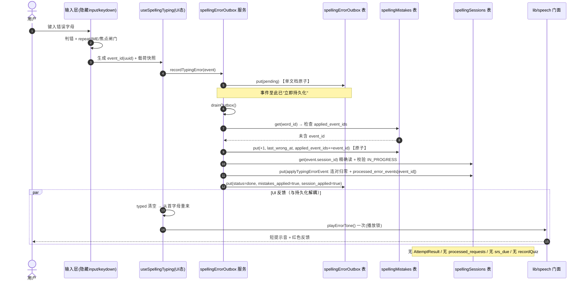
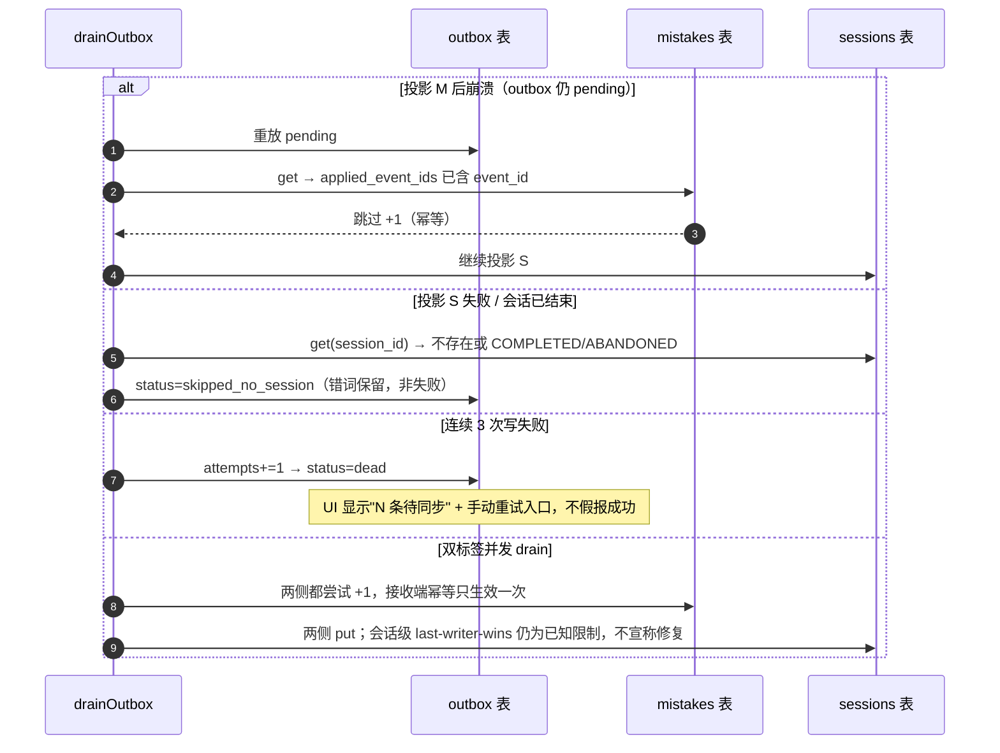

# 单词默写 V2 · Phase 1 详细技术设计报告

> **文档状态：设计提案，未实施、未验证。** 本轮零源码改动、零迁移、零 git 写操作。
> 文中「拟 / 建议 / 待验证假设」均为设计推断，**不是已验证事实**；凡引用现有实现的地方都带 `文件:行号`，可回溯核对。
> 承接：`产品方案/打字/打字输入需求.txt`、`产品方案/打字/Phase0-只读审计报告.md`、上层 `产品前提卡-给协作方.md`（2026-10-31 版，本轮已重读）。
> 时间：2026-11-04 ｜ 范围：用户指定的 A–F 六项；Phase 2（快捷键/移动端）、Phase 4（统计与视觉完善）只留接口边界，不展开设计。

---

## 0. 决策落地、约束与基线

### 0.1 已确认的产品决策 → 技术含义

| 决策 | 技术含义（本设计要解决的） |
| --- | --- |
| ① 逐字母检测；任意错误字母立即入独立错词本、合并去重、错误次数 +1、更新最近错误时间 | 需要一个**独立于答题提交**的错误事件通道与独立数据实体 |
| ① 错误提示音 | 需新增提示音能力，且必须走 services 层（平台 API 红线） |
| ① 输入进度清零、重新从首字母 | UI 层 typed 前缀重置 |
| ① 连续正确次数归零 | 状态机 `SpellingWordState.consecutive_correct` 必须真实归零，但**不能**通过提交一个错误整词实现 |
| ① 不将单个错误字母作为一次完整答题提交 | 不得产生 `AttemptResult`、不得进 `total_attempts` 分母、不得触发 `srs_due` |
| ② 连续正确次数 1/3/5/8 四档、默认 3、持久化、不追溯当前单词、达标才完成切词 | 设置项 + 会话目标值快照 + 生效规则 |
| ③ 错词本独立实体，不复用 SRS 错题记录，独立提交数据模型/迁移/幂等/失败补偿 | 第 2 章完整设计 |

### 0.2 本轮安全约束（已逐条遵守）

不修改源码 ✅｜不执行 Dexie 迁移 ✅｜不修改 Git 暂存区或工作区已有文件 ✅｜不覆盖并行任务未提交改动 ✅｜不擅自修改 `App.tsx` ✅｜不改变现有 SRS 统计语义 ✅｜推断不写成已验证事实 ✅。

**只读基线（2026-11-04 18:30 前后实测）**：HEAD `760e999`；暂存区 6 个 `A`（B12 系列）与 1 个 `D`（`产品前提卡-给协作方.md` 工作区副本）未变；工作区 51 个已跟踪文件被并行任务改、未跟踪 122 项。`src/services/storage/web.ts` 的 v11 与 `src/App.tsx` 仍是**他人未提交改动**。`产品方案/打字/` 下本轮之前只有需求 txt 与 Phase 0 报告。

**前提卡判定**：本轮为纯设计、零源码改动，不触及前提卡的页面清单、数据来源、红线、技术栈、实测事实 → **不改前提卡**。另发现：工作区内 `产品前提卡-给协作方.md` 副本被暂存删除，正本在上层 `shutree/` 且不在 git 内；实施阶段若需同步前提卡，应改上层正本并先重读最新锚点（该情况在 Phase 0 已报告，本轮未擅自处理）。

### 0.3 现有实现的硬事实（设计必须对齐）

- `src/domain/spelling.ts`：`DEFAULT_TARGET_CORRECT = 3`（L37）；`applyAttempt` L505-547 按**整字符串全等**判分（L525），错误分支 L534-541 才归零；`processed_requests` 幂等回放 L510-511；`srs_due` 判定 `outcome==='correct' && COMPLETED && !srs_reported`（L489）；`cloneSession` L424-430 用 `...s` 展开并浅拷贝 `processed_requests`；`advance()` L436-445 取第一个非终态词；`createSessionDraft` L335-360 已支持 `target_correct` 入参并写入 session（L348）与每个 queue 词（L339 via `makeWordState` L311-321），**但无 clamp / 枚举校验**；`SelectWordsInput` L187-195 只有 `entries / review_logs / mode / count / now / rng`。
- `src/domain/spellingSession.ts`：`mutate()` L166-183 = 读 `getResumableSession()` → 纯函数 → 一次 `SESSIONS.put()`，**无 CAS / 写后复核**；`getResumableSession()` L141-148 返回 IN_PROGRESS 或 PAUSED 中最新一份；`getActiveSessions()` L130-135；`createSession` L197-247 遇活跃会话抛 `SESSION_CONFLICT` L205-211；`fulfillSrsHandoff` L433-477 仅对 `pendingSrsWords()` 调 `recordQuiz`（L445）；`repairSrsHandoff` L350-365 扫全部会话。
- 存储：`TableService` 方法集 `get/put/add/delete/toArray/bulkGet/bulkPut/count/whereIndex/whereStartsWith/clear`（`src/services/storage/types.ts` L21-43），**无事务 API**；`put` 是整份文档覆盖（web.ts L219-221）；`whereIndex` 有 `INDEXED_FIELDS` 白名单校验（web.ts L248-257）；**owner 不自动过滤**，由调用方写入。Dexie 当前 **v11**（web.ts L198-200）。
- UI/设置：`useAppStore` 的 `SettingsState` L11-44，zustand persist 键 `shushu-settings` L277，`merge` L286-304 深合并补默认值（新增字段天然兼容旧存档）；`Settings.tsx` L104-123 用 `Segment` 做多档设置；`Review.tsx` L124/L128 把 `DEFAULT_TARGET_CORRECT` 写死在 Badge 与文案；`src/main.tsx` L25 **启用 `React.StrictMode`**（effect 双调用，幂等设计必须考虑）。
- 路由：`src/App.tsx` L153 已注册通配 `/collection/:id`；`CollectionDetail.tsx` L8-13 用 `TITLES` 映射 id，L25 按 id 分派数据源；`Collections.tsx` L21-25 是集合列表数组。
- 发音：`src/lib/speech.ts` `speakFocused` L98-112 经 `audioBus.claim/release` 仲裁；`SpeechService` 接口在 `src/services/speech/types.ts` L39-61，实现有 `web.ts` 与 `noop.ts`。全仓**未找到** outbox / 死信 / `event_id` 基础设施（Grep 无匹配）。

---

## 1. 交付①：Phase 1 详细技术设计（A–F）

### 1.0 分层与模块边界（设计提案）

```
页面层  Spelling.tsx / Settings.tsx / Review.tsx / CollectionDetail.tsx(分派) / 新 MistakesPanel
   │  只调 domain / lib / services 门面，禁止直接碰 Dexie / speechSynthesis / AudioContext
门面层  lib/speech.ts(新增 playErrorTone 门面) · hooks/useSpellingTyping(拟新增, UI 状态)
领域层  domain/spelling.ts(拟新增纯函数 applyTypingErrorEvent / applyTargetFromNextWord)
        domain/spellingMistakes.ts(拟新增：错词+事件投影纯函数)
服务层  domain/spellingSession.ts(拟新增 recordTypingError / createMistakeSession)
        domain/spellingErrorOutbox.ts(拟新增：outbox 编排与 drain)
存储层  services/storage/web.ts(v12) · memory.ts · domain/types.ts
```

设计原则：**正确性由接收端幂等保证，outbox 只保证事件不丢失**；状态字段只用于加速与可观测，不作为唯一正确性依据。领域层纯函数保持「不修改入参」；所有写入仍是「读 → 纯函数 → 一次 `put()`」，与 v10/v11 惯例一致。

### A. 逐字母错误：立即持久化 + 连对归零 + 不污染 SRS

#### A.1 事件定义与边界（拟）

一次**错误字母事件**触发条件（全部满足才计入）：
1. 当前会话 `IN_PROGRESS`，当前词非终态；
2. 输入焦点在练习区，且不在 IME 组合期（`compositionstart`→`compositionend` 之间）；
3. 收到的是单个可打印字母键，且与 `word.word[typed.length]` 不相等（大小写策略待裁定 Q7）；
4. `event.repeat === false`（长按产生的重复 keydown 不算新事件）；
5. 非功能键 / 非 Backspace / 非空格（空格留给快捷键，且 `VALID_ANSWER_RE` L47 本就不含空格）。

**不计入**：Backspace 回退、正确字母、IME 组词、快捷键、暂停/结果页、页面非练习态的输入。
**粒度**：按已确认决策，每个错误字母 = 一次事件 = 错词 `wrong_count + 1`；连续按错 N 个字母则 +N（Q6 请确认）。

#### A.2 事件 ID 与去重（拟）

- UI 在**事件边界**（keydown 监听器内、判错成立的第一时间）生成 `event_id = uuid()`，连同 `session_id`、`word_id`、`occurred_at`、答案/释义快照组成 `SpellingErrorEvent`。
- 三重闸门：① `event.repeat` 过滤；② handler 内 `useRef` 一次性闸门（防同一物理事件被多个监听器/StrictMode 重复派发）；③ 存储层 `event_id` 主键 + 接收端幂等键（见 A.4）。
- `React.StrictMode`（main.tsx L25）导致 effect 双挂载：`drainOutbox()` 必须是**幂等且可并发**的，不能依赖「只跑一次」。

#### A.3 领域层有限扩展：新增纯函数（拟，不改既有函数体）

拟在 `domain/spelling.ts` 新增：

```ts
// 设计伪代码，未实施
export interface TypingErrorEventPayload {
  event_id: string
  word_id: string
  at: number
}
export function applyTypingErrorEvent(
  session: SpellingSession,
  e: TypingErrorEventPayload,
): { session: SpellingSession; applied: boolean }
```

**允许修改的字段白名单**（白名单之外一律不动）：
- `queue[i].consecutive_correct = 0`（满足决策①「归零」）
- `session.processed_error_events[e.event_id] = { word_id, at }`（新增可选字段，幂等键）
- `session.updated_at = e.at`（可选，保持与既有写入一致）

**明确不动**：`status`（词与会话）、`total_attempts / correct_attempts / wrong_attempts`、`position / current_position`、`srs_reported`、`target_correct`、`processed_requests`、`queue` 其它字段、`ended_at`。
- 幂等：`processed_error_events?.[event_id]` 命中 → `applied: false`，原样返回 session。
- 前置校验：会话 `IN_PROGRESS`、词在队列中且非终态；不满足 → `applied: false`（由调用方决定收敛为 `skipped_no_session`）。
- `cloneSession` L424-430 需同步加一行 `processed_error_events: { ...(s.processed_error_events ?? {}) }`（`...s` 已能带上新字段，但对象要浅拷贝以维持纯度）——这是**唯一**要改的既有函数体，属于有限扩展；旧会话缺该字段时按 `{}` 处理。

**为什么不走 `applyAttempt` / `submitAttempt`**：它们会产生 `AttemptResult`、写入 `processed_requests`、进入 `aggregateSession` 分母（L390-392）、并可能在 COMPLETED 时产生 `srs_due`（L489）。产品决策明确「不将单个错误字母作为一次完整答题提交」，因此必须走独立通道。

#### A.4 服务层编排：`recordTypingError()`（拟）

```
1. 生成 SpellingErrorEvent（含 session_id）
2. OUTBOX.put(event)                        // 单文档原子，事件不丢
3. await drainOutbox()                     // 立即尝试两个投影
   ├─ 投影 M：mistakes upsert（+1 / last_wrong_at / applied_event_ids[event_id]）
   ├─ 投影 S：按 session_id 精确读会话 → applyTypingErrorEvent → SESSIONS.put
   └─ 更新 outbox 状态（done / dead / skipped_no_session）
4. 无论 3 的结果如何，UI 立即做：typed 前缀清零、红色反馈、错误提示音一次
```

**关键取舍**：UI 反馈与持久化**解耦**——即使投影失败也不阻塞用户继续输入，失败由 outbox 在后台重试（满足「立即持久化」的语义是「事件立即落盘」，不是「两个投影同步完成」）。若用户要求「错词本必须同步可见 +1 才算数」，则需改为 await 投影 M 后再反馈，列为 Q3。

**为什么不复用 `mutate()`**（spellingSession.ts L166-183）：`mutate` 用 `getResumableSession()` 取「最新」会话，多标签时可能把归零写到**另一份会话文档**；且它没有幂等键。投影 S 改为按 `event.session_id` 用 `SESSIONS.get(id)` 精确读取、校验 `status`、调用纯函数、一次 `put()`。`mutate` 本身**不改**。

#### A.5 SRS 隔离的形式化说明（设计论证，非实测）

| 现有 SRS 触发路径 | 新错误事件是否触及 |
| --- | --- |
| `applyAttempt` → `buildResult` → `srs_due`（spelling.ts L489） | 否：不调用 `applyAttempt`，不产生 `AttemptResult` |
| `submitAttempt` → `fulfillSrsHandoff` → `recordQuiz`（spellingSession.ts L263、L445） | 否：`recordTypingError` 不调用 `fulfillSrsHandoff` |
| `repairSrsHandoff` 扫 `pendingSrsWords()`（L350-365、spelling.ts L628-630） | 否：新事件不置 COMPLETED、不改 `srs_reported`，不会进入待交接集合 |
| `reviewLog` 写入 / `VocabEntry.srs_step` / `in_wrong_pool` | 否：不调用 `recordQuiz`，不写 vocab / reviewLog |
| `aggregateSession` 正确率分母（spelling.ts L390-392、L409） | 否：不增 `total_attempts`，结果页口径不变 |
| `processed_requests` / `request_id` | 否：新事件用 `event_id` + `processed_error_events`，两套键空间隔离 |

结论（设计断言，实施后需测试证明）：错误字母只影响「UI 输入进度 + 会话连对计数 + 独立错词表」，对 SRS 与既有结果页统计零影响。

#### A.6 完整正确路径与「达标才切词」

拼完最后一个正确字母 → 生成 `request_id` → `submitAttempt({ word_id, input: word.word, request_id })`（沿用现有调用，一次完整拼写 = 一次正确提交）：
- 未达 `target_correct`：`applyAttempt` L530 把该词保持 `IN_PROGRESS`，`advance()` L437 取到的第一个非终态词**仍是它自己** → `currentWord()`（spelling.ts L662）返回同一词；UI 只需清空 `typed` 重拼，显示「连对 x/N」。**这一行为现有状态机已天然支持，无需改 `advance()`。**
- 达标：置 `COMPLETED` → `advance()` 切到下一词 → `srs_due` → `fulfillSrsHandoff` 调 `recordQuiz` 一次（既有语义不变）。

#### A.7 错误提示音（拟，平台 API 不越界）

- 在 `src/services/speech/types.ts` 的 `SpeechService` 接口新增 `playErrorTone(): boolean`；`web.ts` 用 `AudioContext` 生成短音并加播放锁（如 120ms 内不重复触发，`AudioContext` 只在该文件出现）；`noop.ts` 返回 `false`。
- `src/lib/speech.ts` 新增门面 `playErrorTone()`；页面/hook 只调门面。
- 是否抢占 `audioBus`（会挂起听书）待定：**建议不抢占**（提示音 <100ms，抢占听书副作用更大），仅用内部播放锁满足「不得连续叠加播放」。属设计提案，需实机验证。

### B. 独立错词表与 Dexie v12 迁移 → 见第 2 章（独立可提交评审）

### C. 四档连续正确次数（拟）

- **值域与常量**：`SPELLING_TARGET_OPTIONS = [1, 3, 5, 8] as const`，默认 `DEFAULT_TARGET_CORRECT`（现为 3，spelling.ts L37）。常量只在一处定义；`Spelling.tsx` 与 `Review.tsx` 不得各自硬编码。
- **持久化**：`SettingsState` 新增 `spellingTargetCorrect: 1|3|5|8`（useAppStore.ts L11-44），默认 3；现有 `merge` L286-304 的深合并会让旧存档自动补默认值，无需写迁移函数。`Settings.tsx` 在「学习/复习」设置区新增一行 `Segment` 4 档（照 L104-123 写法）。
- **边界校验**：`createSessionDraft` L337 只有 `??` 兜底、无 clamp（已核实）。拟在 `spellingSession.createSession` 入口对新设置做白名单校验（不在 `createSessionDraft` 内改，避免动既有纯函数）：非法值回落 `DEFAULT_TARGET_CORRECT` 并如实提示，不静默接受。
- **会话快照**：`createSession({ mode, count: batchSize, target_correct: settings.spellingTargetCorrect })`；`SpellingSession.target_correct`（L138）与 `queue[].target_correct`（L95）在创建时固化，恢复时**以快照为准**，设置变化不追溯（满足「不追溯改变当前单词」）。
- **生效规则（Q2 待裁定）**：
  - **C1（推荐，零领域改动）**：设置变更只影响**下一轮新建会话**；当前会话全程用快照。理由：会话是单文档快照，中途改写会让同一轮不同词目标不一致，波及结果页、恢复与既有测试语义。UI 在设置项与 Review 卡片明示「从下一轮默写开始生效」。
  - **C2（贴合用户「建议从下一个单词生效」）**：当前词不改，切到下一个词时应用新值。需新增纯函数 `applyTargetFromNextWord(session, target, now)`：只改 `queue` 中 `PENDING` 词的 `target_correct` 与 `session.target_correct`，不动当前 `IN_PROGRESS` 词、不动 `consecutive_correct`、不触发 SRS；一次 `put()`，用 `request_id`/事件键做幂等。代价：同轮目标可不一致，结果页/恢复需按词展示目标。
- **UI 一致性**：`Review.tsx` L124 Badge、L128 文案改为读 `settings.spellingTargetCorrect`，否则设置改了入口还显示 3。
- **目标=1 的边界**：拼完一遍即 `COMPLETED`，`srs_due` 正常产生；`SKIPPED / UNAVAILABLE` 行为不变。

### D. 错词本页面、入口、再次练习、活跃会话冲突（拟）

- **路由（零 `App.tsx` 改动）**：复用 `App.tsx` L153 的 `/collection/:id`，新增 id 值（建议 `spelling-wrong`）；`CollectionDetail.tsx` L8-13 的 `TITLES` 加映射，L21-33 的分派加一个分支渲染新组件 `SpellingMistakesPanel`（拟新增）。**不改 App.tsx**（安全约束），也不改既有 `CollectionDetail` 的其它分支。
- **入口**：建议主入口放 `Review.tsx` L117-143 默写卡片内（「默写错词本（N）」按钮 → `/collection/spelling-wrong`），与练习场景最近；`Collections.tsx` L21-25 可选加一项，但其 count 来自 `getLayerCounts()`（`learning.ts`），接新表要改数据流，建议**本轮不加**（Q5）。
- **页面契约**：列表字段 = 单词、`ipa`（缺失显「未收录」）、中文释义、`wrong_count`、`last_wrong_at`（本地化时间）、点读（`speakFocused`，lib/speech.ts L98）、移除、再次练习；空态用 `EmptyState`（前提卡 §4.3：不造假数据）。排序默认 `last_wrong_at desc`，可切 `wrong_count desc`。
- **数据真实性**：错词行的 `word / ipa / definition_zh / pos` 全部来自**会话队列快照**（`SpellingWordState` L84-103，本身源自真实词库），事件里携带并随 upsert 写入；字段为空就显示「未收录」，**绝不补造**。不复用 `in_wrong_pool` / `reviewLog`（满足决策③）。
- **移除**：硬删该 `word_id` 行（独立实体，不影响 vocab / SRS / reviewLog）；重复移除无副作用。移除后再答错会重新入册、`wrong_count` 从 1 起（历史不追溯，Q8）。
- **再次练习（有限扩展）**：
  - `SpellingSelectionMode`（spelling.ts L49）增加第四值 `'mistakes'`；`selectWords` L289-301 增加该分支：**保持传入 `entries` 顺序、不做 wrong 排序**，既有三分支一行不改。
  - `SpellingSession`（spelling.ts L131-148）增加可选 `source?: 'normal' | 'mistakes'`；`CreateSessionInput` 增加 `source?`；`createSessionDraft` L342-355 默认 `'normal'`（旧数据缺字段按 normal 解释）。`cloneSession` 的 `...s` 会自动带上。
  - `spellingSession.createSession` 增加可选 `word_ids?: string[]`：按 id 用 `bulkGet` 从 `vocab` 取词条并保持顺序传给 `createSessionDraft`；**已从生词本删除的词不参与**，UI 如实提示「N 个词已从生词本移除，未加入本轮」（不用快照拼假词条，守红线）。`source='mistakes'` 时 `mode='mistakes'`。
  - 错词本练习中再次答错：仍按 A 的规则 upsert 同一 `word_id`，**不因来源不同重复建记录**；`source` 只作用于会话元数据与展示，不改变错词写入规则。
- **活跃会话冲突 UX**（`createSession` L205-211 会抛 `SESSION_CONFLICT`，设计不绕过）：
  1. 点「再次练习」先调 `getActiveSessions()`（L130-135）；
  2. 无活跃 → 建会话并 `navigate('/spelling')`；
  3. 有活跃 → 弹三选一面板：**恢复现有会话**（跳 `/spelling`，放弃本次再练）／**放弃现有并新建**（调 `abandon()` L297 后再建）／**取消**。沿用 `Spelling.tsx` L90-91、L159-165 既有的「多会话交用户裁决」风格，不自动裁决。
  4. 空选中 / 全失效 → `EmptyState` 或如实提示，不建空会话（L228-231 现有行为）。

### E. 与现有机制的兼容性核对（设计态，实施后须逐条测试）

| 现有机制 | 证据 | 本设计的影响 | 兼容性措施 |
| --- | --- | --- | --- |
| `request_id` 幂等 | spelling.ts L510-511、L545 | **不改** | 新事件用 `event_id` + `processed_error_events`，不写 `processed_requests` |
| `processed_requests` 类型 `Record<string, AttemptResult>` | spelling.ts L147 | **不改类型** | 新增并列的可选 map，避免联合类型污染既有回放 |
| `applyAttempt` / `skipWord` / `advance` / `buildResult` | spelling.ts L505-579、L436-445、L466-492 | **函数体不改** | 新增独立纯函数；仅 `cloneSession` L424-430 加一行浅拷贝 |
| `srs_due` / `fulfillSrsHandoff` / `recordQuiz` | spelling.ts L489；spellingSession.ts L433-477 | **语义不改** | 错误通道不产生 COMPLETED，见 A.5 |
| `aggregateSession` / 结果页 | spelling.ts L381-412；SpellingResult.tsx L90 | **分母口径不改** | 错误字母不进 `total_attempts`；实时「输入数/正确数」另立纯 UI 计数（Phase 4，Q11） |
| `spellingSessions` 单文档 | web.ts L190-192 | 增加 2 个可选字段 | 旧文档缺字段按默认解释；`...s` 展开天然兼容 |
| `createSession` 活跃互斥 | spellingSession.ts L205-211 | **不改** | 再练走三选一 UX，不创建第二份活跃会话 |
| 阶段 E 已知限制 | 阶段三-E 报告 §9.5 | **不宣称修复** | 多标签非原子互斥仍在：并发归零可能 last-writer-wins；错误事件本身靠幂等键不重复计数，但**不承诺**解决会话级竞态 |
| 既有 spelling 测试 | `package.json` L11 中 6 套 spelling 脚本 | 不应回归 | 新增测试独立文件 + 在 `npm test` 追加；不改既有断言 |
| Dexie v10/v11 数据 | web.ts L181-200 | v12 纯新增表 | 无 `upgrade()`，旧数据零改动 |

### F. 有限扩展 vs 必须保持不变

**允许有限扩展（需批准，均为新增或追加，不改既有语义）**
1. `spelling.ts`：新增 `applyTypingErrorEvent`（及可选 `applyTargetFromNextWord`）；`SpellingSession` 加 2 个可选字段；`SpellingSelectionMode` 加 `'mistakes'`；`selectWords` 加一个分支；`cloneSession` 加一行浅拷贝；`CreateSessionInput` 加 `source?`。
2. `spellingSession.ts`：新增 `recordTypingError` / `createMistakeSession` 等导出函数；`createSession` 增加可选 `word_ids` / `source` 与设置白名单校验。
3. `domain/types.ts`：`StorageSchema` / `PrimaryKeyMap` 加 2 张表；新增 2 个实体类型。
4. `services/storage/web.ts` / `memory.ts`：`INDEXED_FIELDS`、表成员声明、`version(12).stores(...)`；memory 端还要补 `AUTO_INCREMENT` / `PRIMARY_KEY`（子代理已核实这三张穷尽映射）。
5. `useAppStore.ts` / `Settings.tsx` / `Review.tsx` / `CollectionDetail.tsx`：新增设置字段、四档 UI、入口与分派。
6. `services/speech/{types,web,noop}.ts` + `lib/speech.ts`：新增 `playErrorTone`。
7. `package.json` 的 `test` 脚本追加新测试文件（不改既有顺序/断言）。

**必须保持不变**
- `applyAttempt` 判分与计数语义、`judgeSpelling`、三终态定义、`advance()` 切词逻辑、`buildResult.srs_due` 判定。
- `recordQuiz` 及其调用时机（仅 COMPLETED）、SRS 间隔与 `PASS_THRESHOLD=5`、reviewLog 写入语义。
- `processed_requests` / `request_id` 的类型与回放语义。
- `createSession` 的活跃会话互斥、`mutate()` 骨架、`repairSrsHandoff` 扫描范围。
- `App.tsx`、Reader、ASR、转写、格式转换、`server/`、依赖版本、既有 `scripts/test_spelling_*.ts` 断言。
- 结果页统计口径与「不编造数字」红线。

---

## 2. 交付②：数据模型及 Dexie v12 迁移方案（可独立提交评审）

### 2.1 新增实体（设计提案，字段均可回溯到真实来源）

**表 1 `spellingMistakes`（错词本，主键 `word_id`）**

| 字段 | 类型 | 说明 |
| --- | --- | --- |
| `word_id` | string | 主键，合并去重键（与 `VocabEntry.word_id` 同口径） |
| `word` | string | 正确答案快照，来源 `SpellingWordState.word`（L87） |
| `ipa?` / `definition_zh?` / `pos?` / `book?` | string | 真实快照；缺失为 `undefined`，UI 显示「未收录」 |
| `wrong_count` | number | 错误字母事件累计次数 |
| `first_wrong_at` / `last_wrong_at` | number | 首次/最近错误时间 |
| `last_event_id` | string | 最近处理的事件（可观测） |
| `applied_event_ids` | string[] | **接收端幂等键**：已计入的 `event_id` 集合，有界保留（建议最近 128 个） |
| `owner` | string | 与 v10/v11 一致（`DEFAULT_OWNER='guest'`，spellingSession.ts L55）；注意 `TableService` **不自动按 owner 过滤**，查询需自行处理 |
| `created_at` / `updated_at` | number | 审计字段 |

索引：`'word_id, last_wrong_at, wrong_count, owner'`（均为 `INDEXED_FIELDS` 白名单内字段）。

**表 2 `spellingErrorOutbox`（错误事件日志 / 待办，主键 `event_id`）**

| 字段 | 类型 | 说明 |
| --- | --- | --- |
| `event_id` | string | 主键，一次错误字母一个 UUID |
| `session_id` | string | 归属会话，供归零投影**按 id 精确读** |
| `word_id` / `word` / `ipa?` / `definition_zh?` / `pos?` | string | 事件载荷快照 |
| `occurred_at` / `created_at` / `updated_at` | number | 时间 |
| `status` | `'pending' \| 'done' \| 'dead' \| 'skipped_no_session'` | 见 2.3 |
| `mistakes_applied` / `session_applied` | boolean | 两个投影的完成标记（加速 + 可观测，**非唯一正确性依据**） |
| `attempts` | number | 失败次数，达上限转 `dead` |
| `last_error?` / `skip_reason?` | string | 失败/跳过原因（不记录隐私，仅错误码） |
| `owner` | string | 同上 |

索引：`'event_id, status, created_at, owner'`。

**会话文档新增可选字段**（不新建表）：`SpellingSession.processed_error_events?: Record<string, { word_id: string; at: number }>`、`SpellingSession.source?: 'normal' | 'mistakes'`。

### 2.2 v12 迁移形态（伪代码，**未执行**）

```ts
// src/services/storage/web.ts —— 追加在现有 version(11) 之后，不改任何历史 version
this.version(12).stores({
  spellingMistakes: 'word_id, last_wrong_at, wrong_count, owner',
  spellingErrorOutbox: 'event_id, status, created_at, owner',
})
```

- **纯新增表、无 `upgrade()`**：与 v9/v10/v11 惯例一致（web.ts L177-200 注释），存量 `vocab / reviewLog / spellingSessions / wordLearningSessions` 一行不改；老库打开时自动建空表。
- **需同步修改的 8 处**（已逐一核实）：① `domain/types.ts` `StorageSchema` L374-401；② `PrimaryKeyMap` L406-427；③ 新增两个实体类型；④ `web.ts` `INDEXED_FIELDS` L56-79；⑤ `ShushuDB` 表成员 L83-103；⑥ `version(12)`；⑦ `web.ts` 顶部索引注释 L10-38；⑧ `memory.ts` 的 `INDEXED_FIELDS` L20-41、`AUTO_INCREMENT` L43-64、`PRIMARY_KEY` L66-87（三张穷尽映射，TS 会强制补齐）。`services/storage/index.ts` 与泛型派生类型无需改。
- **迁移测试**：照 `scripts/test_spelling_migration.ts` 的 v9→v10 夹具（L18-19 `fake-indexeddb/auto`、L44-63 旧版本 stores 快照、L66-123 先建旧库并 `close()`、L129-132 **之后**动态 import storage 触发升级），新增 `v11 → v12` 用例：断言旧表数据一行不丢、字段未被改写、两张新表为空且 `whereIndex` 可用、新表可写入。`V9_STORES` 是历史基线，**不改**。
- **回滚/降级**：代码回退到 v11 不会破坏旧数据（新表残留被忽略）；因无 `upgrade()` 改写，无需数据回滚脚本。
- 🔴 **版本号冲突风险**：v11 是并行任务**未提交**改动；若其他会话也在升 v12，会撞版本号。实施前须重新确认 `web.ts` 最新版本号并做一次「版本号登记」（Q9）。

### 2.3 跨表写入失败、重试、幂等、恢复（核心）

**为什么需要 outbox**：`TableService` 无事务（types.ts L21-43），`put` 是整份覆盖。错误事件要写 3 份数据（outbox 日志、错词行、会话文档），任意两步之间崩溃/刷新都会造成不一致。

**投影幂等（正确性基础）**
- 投影 M（错词）：**一次 `spellingMistakes.put()` 内同时完成** `wrong_count+1`、`last_wrong_at=occurred_at`、`applied_event_ids` 加入 `event_id` → 单文档原子，重放时若 `event_id` 已在集合内则跳过 +1。
- 投影 S（归零）：**一次 `SESSIONS.put()` 内同时完成** `consecutive_correct=0` 与 `processed_error_events[event_id]` 落键 → 单文档原子，重放命中即跳过。
- 因此 `status` / `*_applied` 标记即使与投影写入之间崩溃，重放也**不会重复计数**，只是多跑一次幂等检查。

**状态机（拟）**
```
pending ──M 成功──> (mistakes_applied=true) ──S 成功──> done
   │                                              │
   ├──S 跳过（会话结束/放弃/不存在/id 不匹配）──> skipped_no_session（错词保留）
   └──M 或 S 连续失败 attempts >= 3 ──────────> dead（死信，不自动删）
```
- `dead` 事件提供手动重试入口（Q10）；`skipped_no_session` 是**正常收敛**，不算失败。
- PAUSED 会话：视为「暂不可投递」，保持 `pending`、不消耗 `attempts`，resume 后重放；若长期未恢复，由 UI 提示而非静默丢弃。
- 多标签并发 drain：允许双方都执行投影（接收端幂等）；**不宣称解决会话级 last-writer-wins**（阶段 E 已知限制 2，spellingSession.ts L12-20 注释自述不是互斥锁）。

**恢复触发点（拟）**
1. `main.tsx` 启动期（`initStorage()` 之后、`reconcileTranscriptReadings()` 同级，照 L21-23 的模式，**渲染等 drain 完成**或至少不晚于首屏）；
2. 进入 `/spelling` 恢复会话后；
3. 每次新错误事件写入后（立即）；
4. `visibilitychange` 回前台；
5. 错词本页面加载前（保证列表数字最新）。
`drainOutbox()` 必须可重入、幂等、并发安全（StrictMode 双调用，main.tsx L25）。

**失败补偿语义（如实表述）**
- 错词记录 `+1` 与连对归零之间**允许短暂不一致**，最终一致由 outbox 保证；这是无事务约束下的显式取舍，不宣称强一致。
- `dead` 事件会导致「错词已记、连对未归零」或反之的残留；UI 必须如实显示「有 N 条错误记录待同步」并提供重试，不得假装成功（沿用方案 §8「不假报成功」）。

### 2.4 方案对比（Q1 待裁定）

| | **B1（推荐）outbox + mistakes 双表** | **B2 简化：单 mistakes 表 + 会话内幂等键** |
| --- | --- | --- |
| 事件不丢 | 是（先落 outbox） | 否，UI 崩溃即丢事件 |
| 刷新/崩溃恢复 | 完备（扫 pending 重放） | 只能靠下次 UI 重试，恢复逻辑分散 |
| 幂等 | 接收端幂等 + 日志 | 接收端幂等（相同） |
| 新增表 | 2 张 | 1 张 |
| 复杂度 | 中（多一个 drain 服务） | 低 |
| 满足「立即持久化」 | 事件立即落盘（推荐口径） | 错词行立即落盘，但归零可能丢 |

---

## 3. 交付③：错误事件时序图

### 3.1 正常路径（一个错误字母）



### 3.2 失败与恢复分支



> 时序图为**设计态**，所有分支均需实施后按第 4 章矩阵验证；`applied_event_ids` 有界淘汰的极端重复风险见 Q4。

---

## 4. 交付④：异常恢复与幂等测试矩阵

> 验证层：**U**=纯函数单测（tsx）｜**I**=集成（fake-indexeddb，真实 storage 驱动）｜**B**=真实浏览器（puppeteer-core + Edge，端口 4174）。
> 「期望」列为设计目标，实施后未通过即视为设计缺陷，需回到本报告修订。

| # | 场景 / 断点 | 期望结果 | 幂等锚点 | 层 |
| --- | --- | --- | --- | --- |
| T01 | 单个错误字母 | 错词 +1、连对归零、typed 清零、提示音 1 次、无 `AttemptResult`、无 `recordQuiz` | `event_id` | U+I+B |
| T02 | `keydown` 长按 repeat | 只记 1 次；`event.repeat` 过滤 | repeat 闸门 + `event_id` | U+B |
| T03 | React StrictMode effect 双调用 / 多监听器 | 只记 1 次 | `useRef` 闸门 + `applied_event_ids` | I+B |
| T04 | 同一词连续按错 3 个字母 | `wrong_count` = 3（或按 Q6 裁定为 1），只有 1 行错词记录 | `word_id` 合并 | U+I |
| T05 | Backspace / 正确字母 / IME 组词 / 快捷键 | 不产生错误事件、不入错词本、不进分母 | 边界判定 | U+B |
| T06 | 双标签同时错同一词 | 各生成不同 `event_id`，`wrong_count` 各 +1，仍只 1 行 | `event_id` + `word_id` | I+B |
| T07 | outbox 已写、投影 M 前刷新 | drain 重放后 +1，无重复 | `applied_event_ids` | I+B |
| T08 | 投影 M 成功、outbox 状态未更新即崩溃 | 重放时 M 幂等跳过，继续投影 S | `applied_event_ids` | I |
| T09 | 投影 S 失败（`SESSIONS.put` 抛错） | attempts+1、保持 pending；重试后归零仍生效 | `processed_error_events` | I |
| T10 | 会话 SESSION_COMPLETED / ABANDONED / 不存在 | `skipped_no_session`，错词记录保留，不写错别的会话 | 按 `session_id` 精确读 | I |
| T11 | 会话 PAUSED 时事件待投递 | 保持 pending、不消耗 attempts；resume 后归零 | outbox 状态 | I |
| T12 | 连续 3 次失败 | `dead`；UI 如实显示待同步 + 手动重试；不自动删 | `attempts` | I+B |
| T13 | 并发 drain（两标签页） | 投影只生效一次；会话级竞态如实标注为已知限制 | 接收端幂等 | I+B |
| T14 | 移除错词后再次答错 | 新建记录、`wrong_count`=1、历史不追溯 | `word_id` | I |
| T15 | 错词本练习再次答错 | 不重复建行、只 +1；SRS 仅 COMPLETED 调用 1 次 | `word_id` + `request_id` | I+B |
| T16 | 设置 1/3/5/8 切换 + 刷新 | 当前会话按快照；新会话按新值；非法值回落默认 | `session.target_correct` | U+I+B |
| T17 | `target=1` 拼完一遍 | 直接 COMPLETED、`srs_due` 产生、`recordQuiz` 1 次 | `request_id` | I |
| T18 | v11 → v12 升级 | 旧 4 表数据一行不丢、字段未改写、2 新表为空且可 `whereIndex` | 迁移夹具 | I |
| T19 | 错词本再练时已有活跃会话 | 不创建第二份活跃会话；三选一后行为正确 | `getActiveSessions` | I+B |
| T20 | 词条已从生词本删除 | 如实提示未加入本轮，不造词条、不建空会话 | 选词过滤 | I+B |
| T21 | `ipa` / 释义缺失 | 显示「未收录」，无假数据 | 快照可空 | U+B |
| T22 | 错误事件不污染结果页 | `total_attempts` / `correct_attempts` / 正确率与无错误事件时一致 | `aggregateSession` | I |

**既有测试保护**：`scripts/test_spelling.ts`、`test_spelling_session.ts`、`test_spelling_migration.ts`、`test_spelling_srs_handoff.ts`、`test_spelling_ui.ts`、`test_spelling_acceptance_e.ts` 的既有断言**不改**；新增用例放新文件并追加到 `package.json` L11 的 `test` 链。`scripts/check_spelling_browser.mjs` 已有 S1–S9（含 375px、软键盘近似、1280px、双标签、刷新恢复），扩展为 S10+ 而非重写。

---

## 5. 交付⑤：需要用户进一步裁定的事项

| # | 事项 | 推荐 | 影响 |
| --- | --- | --- | --- |
| Q1 | 错词持久化采用 **B1 outbox 双表** 还是 **B2 简化单表** | **B1**（第 2.4 节） | 决定 v12 表数量与恢复能力 |
| Q2 | 设置生效规则：**C1 下一轮会话** 还是 **C2 下一个单词** | **C1**（零领域改动、快照一致）；用户原文为「建议从下一个单词生效」，若坚持 C2 需批准新增纯函数 | 决定是否扩展状态机 |
| Q3 | 「立即持久化」口径：事件落盘即算，还是错词行 +1 同步完成才算 | **事件落盘即算**（UI 不阻塞） | 影响 A.4 是否 await 投影 M |
| Q4 | 幂等键 `applied_event_ids` 保留策略 | **有界 128 个 + `dead` 手动重试**；若要求绝对不重复，改为不淘汰或第三张 `processedEvents` 表 | 极端重放重复计数的残余风险 |
| Q5 | 错词本入口：`Review` 卡片 / `Collections` 列表 / 两者 | **仅 Review 卡片**（Collections 的 count 依赖 `getLayerCounts`，接新表要改数据流） | 页面改动范围 |
| Q6 | 连续按错多个字母：`wrong_count` 每个字母 +1 还是每次尝试 +1 | **按决策①字面：每个错误字母 +1**；请确认 | 计数口径与用户观感 |
| Q7 | 字母大小写、连字符/撇号词的逐字母判定规则 | 建议沿用 `VALID_ANSWER_RE`（L47）与现有 `judgeSpelling` 口径，**待确认** | 判定实现 |
| Q8 | 错词记录保留策略（手动移除前永久 / 上限 / TTL） | **永久保留、只手动移除**，不自动删 | 数据量与隐私 |
| Q9 | v12 版本号与并行任务冲突：是否先做「版本号登记」再实施 | **必须先确认 `web.ts` 最新版本号**（v11 是他人未提交改动） | 迁移成败 |
| Q10 | `dead` 死信的 UI 呈现与手动重试入口位置 | 建议错词本页顶部提示 + 设置页诊断项，二选一 | 页面范围 |
| Q11 | Phase 1 是否包含实时统计（时间/输入数/WPM/正确数/正确率）与显示/隐藏、快捷键、移动端 | **建议不含**：本轮只做 A–F；这些属原需求 Phase 1 后半 / Phase 2 / Phase 4，仅预留接口 | 范围边界（重要） |
| Q12 | 是否批准 `SpellingSelectionMode` 扩 `'mistakes'` 与 `SpellingSession.source` 字段 | **批准**（否则无法区分再练来源） | 数据模型 |
| Q13 | 隐藏模式 / 显示偏好是否纳入本轮 | **否**（归 Phase 1 后半 / Phase 2） | 范围边界 |

> Q11/Q13 是边界澄清：用户本轮 A–F 的重点覆盖「交互核心 + 错词本」，但原需求文档 Phase 1 还含「显示/隐藏」，Phase 2 含快捷键与移动端，Phase 4 含统计与视觉。本报告按 A–F 展开，未展开部分不算遗漏，请确认。

---

## 6. 交付⑥：预计修改文件清单及风险等级

> **全部为预计，本轮零改动。** 风险等级 = 对现有功能/数据的潜在影响，非实现难度。

| 文件 | 动作 | 风险 | 理由 / 需批准点 |
| --- | --- | --- | --- |
| `src/domain/spelling.ts` | 有限扩展：新增纯函数、2 可选字段、`'mistakes'` 分支、`cloneSession` +1 行 | **高** | 核心状态机；须保证既有函数体与语义不动；Q2/Q12 |
| `src/domain/spellingSession.ts` | 新增导出函数；`createSession` 加可选参数与校验 | **高** | 持久化写入口；`mutate` 不改；Q1/Q12 |
| `src/services/storage/web.ts` | `version(12)` + 2 表 + 索引白名单 + 成员声明 | **高** | 迁移不可逆；v11 是他人未提交改动；Q1/Q9 |
| `src/services/storage/memory.ts` | 补 3 张穷尽映射 | 中 | TS 强制；测试驱动一致性 |
| `src/domain/types.ts` | `StorageSchema` / `PrimaryKeyMap` / 2 个实体类型 | 中 | 类型层，编译期可验；注意该文件已被并行任务改动 |
| `src/domain/spellingMistakes.ts`（拟新增） | 错词/事件投影纯函数 | 中 | 新增、可单测 |
| `src/domain/spellingErrorOutbox.ts`（拟新增） | outbox 编排与 `drainOutbox` | **高** | 失败补偿正确性核心；Q1/Q4 |
| `src/pages/Spelling.tsx` | 逐字母输入层、错误事件触发、连对展示、目标值传入 | **高** | 主战场；UI 与状态解耦；Q3/Q7/Q11 |
| `src/hooks/useSpellingTyping.ts`（拟新增） | typed 状态、判错、闸门 | 中 | 新增 hook，纯逻辑可测 |
| `src/pages/CollectionDetail.tsx` | 加 id 分派与 `TITLES` | 低 | 复用既有路由，不改其它分支 |
| `src/pages/SpellingMistakesPanel.tsx`（拟新增） | 错词列表 / 移除 / 再练 / 死信提示 | 中 | 新页面组件；Q5/Q10 |
| `src/pages/Review.tsx` | 设置读取 + 错词本入口 | 低 | 改 L124/L128 硬编码常量 |
| `src/pages/Settings.tsx` | 四档 Segment | 低 | 照 L104-123 |
| `src/store/useAppStore.ts` | 新增设置字段（默认 3） | 低 | `merge` 天然兼容旧存档；该文件已被并行任务改动 |
| `src/services/speech/{types,web,noop}.ts` + `src/lib/speech.ts` | 新增 `playErrorTone` | 中 | 平台 API 边界；WebAudio 只在 web.ts |
| `src/main.tsx` | 启动期挂 `drainOutbox`（可选） | 中 | 启动顺序；该文件已被并行任务改动，慎改 |
| `scripts/test_spelling_*.ts`（新增 2–3 个） | 纯函数 / 集成 / v11→v12 迁移 | 低 | 新增，不改既有断言 |
| `scripts/check_spelling_browser.mjs` | 扩展 S10+ | 低 | 复用既有夹具 |
| `package.json` | `test` 链追加新脚本 | 低 | 已被并行任务改动（`M`），合并时须小心 |
| **明确不改** | `src/App.tsx`、Reader / ASR / 转写 / 格式转换 / `server/` / 依赖版本 / 前提卡 | — | 安全约束 + 前提卡 L1008 |

---

## 7. 交付说明（按项目指令）

- **改了什么**：只新增本设计报告 `产品方案/打字/Phase1-技术设计报告.md`，并在 `.workbuddy/memory/2026-11-04.md` 追加一条工作日志。未新增/修改任何源码、测试、迁移、配置。
- **验证了什么**：只读核对了前提卡正本（2026-10-31 版）、Git HEAD/暂存区/工作区状态、以及第 0.3 节与附录列出的现有实现证据。**未执行四项验证**（`npx tsc --noEmit` / `npm test` / `npm run build` / `python scripts/check_pwa.py`）：本轮零源码改动，且 `npm run build` 会写 `dist/`、与「不修改 Git 暂存区或工作区」「不覆盖并行任务未提交修改」冲突。实施阶段必须全量执行四项并分别报告「当前工作树」与「提交树独立构建」结论（阶段 E 报告 §2 L29-34 的口径）。
- **还有什么没做**：无源码实现、无 Dexie v12 迁移、无错词本页面、无四档设置 UI、无提示音实现；Phase 2（快捷键/移动端）、Phase 4（实时统计与视觉）只在 Q11/Q13 标了边界，未展开设计；所有测试矩阵项均未执行。
- **需要我决策什么**：第 5 章 Q1–Q13，其中 **Q1（outbox 方案）、Q2（生效规则）、Q9（v12 版本号冲突）、Q11（范围边界）、Q12（有限扩展批准）** 是进入实施前的最低限度裁定项。
- **前提卡影响判定**：不影响（纯设计、零源码改动），按项目指令「不影响 → 不动」处理；另按指令在交付说明中指出：工作区内 `产品前提卡-给协作方.md` 副本已被暂存删除，正本在上层 `shutree/` 且不在 git 内，实施阶段若需同步应改上层正本并先重读最新锚点。

---

## 附录：证据索引（全部为只读核对结果）

| 结论 | 证据 |
| --- | --- |
| 整词输入 / 提交按钮 / 无逐字母 | `src/pages/Spelling.tsx` L518-537、L577-583、L201-223 |
| 连对 3 次、整串判错、`request_id` 幂等 | `src/domain/spelling.ts` L37、L505-547、L510-511 |
| `srs_due` 仅 correct+COMPLETED | `src/domain/spelling.ts` L489 |
| `cloneSession` 展开+浅拷贝 | `src/domain/spelling.ts` L424-430 |
| `advance` 取第一个非终态词 | `src/domain/spelling.ts` L436-445 |
| `createSessionDraft` 已支持 target_correct、无 clamp | `src/domain/spelling.ts` L335-360、L311-321 |
| `SelectWordsInput` 字段 | `src/domain/spelling.ts` L187-195 |
| `mutate` 无 CAS / 写后复核 | `src/domain/spellingSession.ts` L166-183 |
| 活跃会话冲突 | `src/domain/spellingSession.ts` L205-211 |
| SRS 交接与补交 | `src/domain/spellingSession.ts` L433-477、L350-365 |
| `getResumableSession` 取最新 | `src/domain/spellingSession.ts` L141-148 |
| TableService 无事务 / put 整份覆盖 / 索引白名单 / owner 不过滤 | `src/services/storage/types.ts` L21-43；`web.ts` L219-221、L248-257 |
| Dexie v10 / v11 | `src/services/storage/web.ts` L190-192、L198-200 |
| 新增表需同步的映射 | `web.ts` L56-79、L83-103；`memory.ts` L20-41、L43-64、L66-87；`types.ts` L374-427 |
| zustand persist 深合并 | `src/store/useAppStore.ts` L203-307（L277、L286-304） |
| 设置 Segment 范例 | `src/pages/Settings.tsx` L104-123 |
| Review 硬编码目标次数 / 默写入口 | `src/pages/Review.tsx` L23、L117-143、L124、L128 |
| `/collection/:id` 通配路由 | `src/App.tsx` L153；`CollectionDetail.tsx` L8-33 |
| StrictMode 启用 | `src/main.tsx` L25 |
| `speakFocused` / audioBus 仲裁 | `src/lib/speech.ts` L98-112；`src/lib/audioBus.ts` L26-82 |
| SpeechService 契约与实现 | `src/services/speech/types.ts` L39-61；`web.ts` / `noop.ts` |
| v9→v10 迁移夹具 | `scripts/test_spelling_migration.ts` L18-19、L44-63、L66-123、L129-174 |
| 浏览器验收 S1–S9 | `scripts/check_spelling_browser.mjs` L1-29 |
| 四件套 / 红线 / 美音音标真相 | 上层 `产品前提卡-给协作方.md` L1031-1038、L1005-1028、L951、L593-595 |
| 阶段 E 有限通过与已知限制 | `练习/阶段三-E-全量验收报告.md` §1 L11-21、§9.5 L404-407 |

**全文未验证声明**：第 1 章 A.5 的「SRS 零影响」是设计论证，不是实测结论；第 2 章所有表结构与迁移均未执行；第 4 章所有测试期望均未跑过。实施阶段须以测试结果替换这些「设计目标」表述。
