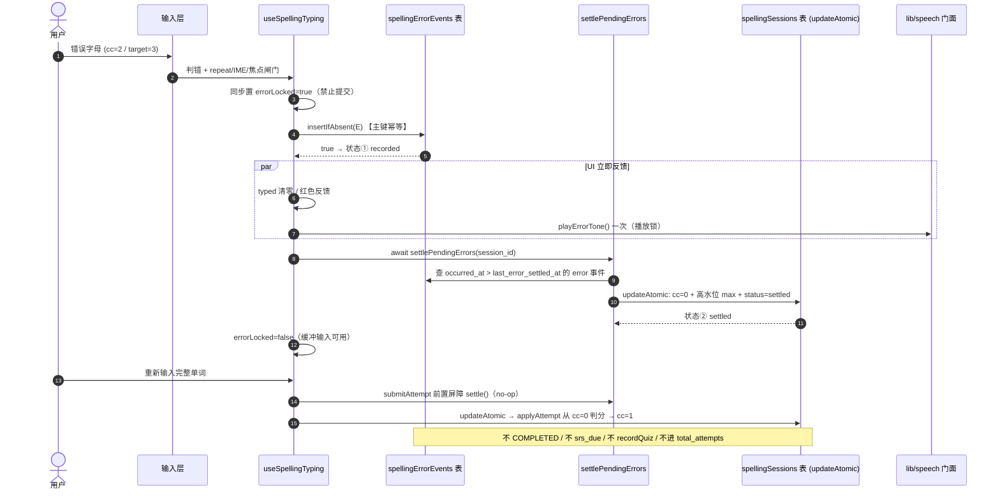
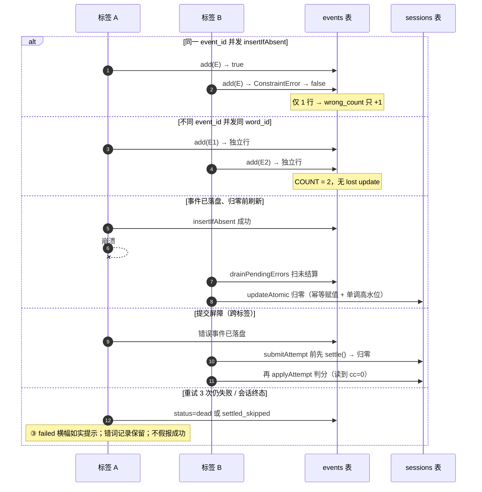

# 单词默写 V2 · Phase 1.1 技术设计可靠性复核与修订报告

> **状态：设计修订，未实施、未验证。** 本轮零源码改动、零迁移、零 git 写操作，完成后停止等待负责人批准。
> 承接：`Phase1-技术设计报告.md`（下称「V1 设计」）。本报告的结论**取代** V1 设计中被点名修订的部分；未被点名的部分继续有效。
> 证据标注规则：`【实测】`=本轮只读命令/源码核对所得；`【设计依据】`=基于规范或现有代码的推理；`【待验证假设】`=必须实施后用测试证明的推断。**推断一律不写成已验证事实。**

---

## 0. 复核结论摘要与基线

### 0.1 一句话结论

**V1 设计的幂等模型不成立，必须推翻重做。** V1 把「一次 `put()` 整份文档替换不撕裂」误当成「`get → check → put` 读改写序列原子」，因此 P0-1 指出的两个并发缺口真实存在；V1 的 `applied_event_ids` 保留 128 个上限也会在死信延迟重试与长期离线后造成重复计数（P0-3）；V1 把 UI 反馈与归零持久化解耦，会在 `consecutive_correct=2 / target=3` 时打开竞态窗口（P0-2）。

**修订后的核心模型**：
1. **错词计数不再是「读改写累加器」**，改为 **append-only 事件表**，`wrong_count = 事件行数聚合`。主键 `event_id` 本身就是永久幂等凭证，永不清理。
2. 新增两个平台无关的存储原语：`insertIfAbsent`（主键冲突即幂等返回 false）与 `updateAtomic`（单表单事务内读改写）。
3. **归零与答题共用 `updateAtomic` 串行化**；错误事件引入 `errorLocked` 门闩 + `settlePendingErrors()` 提交前置屏障 + 会话文档 `last_error_settled_at` 高水位。
4. 取消 `processed_error_events` 字典与 128 上限，取消 `spellingMistakes` 累加行与 `mistakes_applied` 状态。

### 0.2 只读基线【实测，2026-11-04 19:10 前后】

| 项 | 结果 |
| --- | --- |
| Git HEAD | `760e999`（与上轮一致） |
| 暂存区 | 6 个 `A`（B12 系列）未变 |
| 工作区 | 已跟踪改动 50 项（上轮 51，减少 1 项）、未跟踪 122 项；`web.ts` +13 行（v11）、`App.tsx` +4/-1、`main.tsx` +29/-11 仍是**他人未提交改动** |
| **Dexie 最高版本** | `src/services/storage/web.ts` L198 `version(11).stores({ wordLearningSessions })`；全仓 Grep `version(1x)` **只到 11，无任何 `version(12)`** |
| `TableService` | `types.ts` L21-43：`get/put/add/delete/toArray/bulkGet/bulkPut/count/whereIndex/whereStartsWith/clear`，**无事务方法**；`web.ts` L219-225 `put`/`add` 直接透传 Dexie |
| `add` 语义差异 | `web.ts` L223-225 → Dexie `Table.add()`（主键重复抛 ConstraintError）；`memory.ts` L113-117 → **直接 `rows.set`，不检查冲突**。两个驱动行为不一致【实测】 |
| 索引白名单 | `web.ts` L248-257 / `memory.ts` L151-163 `whereIndex` 未建索引即抛错；`memory.ts` L20-41 / L43-64 / L66-87 三张穷尽映射 |
| owner | `TableService` **不自动按 owner 过滤**【实测，web.ts L215-271 全程无 owner 条件】；`DEFAULT_OWNER='guest'`（`spellingSession.ts` L55） |
| StrictMode | `main.tsx` L25 `<React.StrictMode>` 仍在【实测】 |
| 前提卡 | 上层正本 `shutree/产品前提卡-给协作方.md`（2026-10-31 版），本轮已重读；纯设计不影响其条目 → **未改动** |

### 0.3 Q9 重新核对结论【实测】

- 当前 Dexie **最高 v11**，**尚未出现 v12**，V1 报告 Q9 担心的「并行任务已占用 v12」**目前未发生**。
- 但风险**未解除**：v11 本身仍是他人未提交改动，且工作区同时有 50 个已跟踪改动文件；实施前必须再次核对 `web.ts` 最高版本号，并做一次「v12 版本号登记」，再动迁移。
- 结论：Q9 **部分解决（当前无冲突）→ 仍需实施前复核**，不标记为已解决。

---

## 1. P0-1：跨标签并发幂等 —— 否定 V1 并给出可证明方案

### 1.1 先承认 V1 的错误

V1 第 2.3 节写「投影 M：一次 `spellingMistakes.put()` 内同时完成 `wrong_count+1` 与 `applied_event_ids` 加入 `event_id` → 单文档原子，重放时若 `event_id` 已在集合内则跳过 +1」。

**这不成立**，理由：

> `put()` 原子只保证「一次整份文档替换不会被撕裂」，**不保证「先 `get`、再检查、再 `put`」这三步之间没有其他写入**。`TableService.get()`（web.ts L215-217）与 `put()`（L219-221）是**两个独立 IndexedDB 事务**；两个标签页可交错执行。

【设计依据】设错词行初值 `wrong_count=n, applied_event_ids=[]`：

| 时序 | 标签 A（事件 E1） | 标签 B（事件 E2） |
| --- | --- | --- |
| t1 | `get` → `{n, []}` | |
| t2 | | `get` → `{n, []}` |
| t3 | `put({n+1, [E1]})` | |
| t4 | | `put({n+1, [E2]})` ← 覆盖 A 的写入 |

结果：**丢失一次计数**（lost update），且 `applied_event_ids` 互相覆盖。同一 `event_id` 并发时，两边都读到「未含 E」→ 都 `+1` → **重复计数**。两个方向都被 P0-1 命中。因此 **V1 的物化错词行 + `applied_event_ids` 方案整体废弃**。

### 1.2 修订模型：append-only 事件表（真相源）

**表 `spellingErrorEvents`，主键 `event_id`，只追加、不更新计数、不清理**（完整字段见第 6 章）。每个错误字母事件通过新原语 `insertIfAbsent(E)` 写入：

```ts
// 设计伪代码，未实施；平台 API 只在 services/storage/web.ts 内
insertIfAbsent(value: T): Promise<boolean>   // true=本次插入；false=主键已存在
// web 实现：try { await table.add(value); return true }
//           catch (e) { if (isConstraintError(e)) return false; throw e }
// memory 实现：if (rows.has(key)) return false; rows.set(key, copy(value)); return true
```

> **为什么不直接用现有 `add()`**：`memory.ts` L113-117 不检查主键冲突【实测】，直接用会让单测与生产行为分叉。新增 `insertIfAbsent` 在两驱动中统一语义，**不改**现有 `add()`（避免影响 `reviewLog` / `diagnose` 自增表）。这是必须落地的一条有限扩展。

`wrong_count` 不再是字段，而是**派生量**：

```
wrong_count(owner, word_id) =
  COUNT(events WHERE owner = $owner
                AND word_id = $word_id
                AND kind = 'error'
                AND occurred_at > COALESCE(last_reset_at(owner, word_id), 0))
last_wrong_at = MAX(occurred_at) 同上过滤
```

### 1.3 P0-1 三条证明【设计依据，需 T23/T24/T32 实测确认】

**① 同一 `event_id` 并发投影不会重复增加 `wrong_count`**
- 两个标签页同时 `insertIfAbsent(E)`。【设计依据】IndexedDB 对同一 object store 的 readwrite 事务按创建顺序串行调度；`Table.add()` 在主键已存在时抛 `ConstraintError`；Dexie 的 `add()` 同理透传该错误（web.ts L223-225）。
- 因此两个请求中**恰有一个** `return true`，另一个 `return false`（被识别为「已记录」，不新增行）。
- `wrong_count` 是**行数**，不是累加器：无论哪边先执行，最终该 `event_id` 只有一行 → 计数只增 1。
- 补充：`memory` 驱动由 `rows.has(key)` 在同步 JS 单线程内判定，同样只有一个返回 true。

**② 不同 `event_id` 并发更新同一 `word_id` 不会丢失计数**
- 每次事件写**独立主键的独立行**，不存在共享可变行 → 没有「读到旧值再写回」。
- N 个并发事件 = N 行（各自 `event_id` 唯一）→ 聚合 `COUNT` = N，**无 lost update**。
- 这正是放弃「每词一行累加器」的原因：把并发写从「竞争同一文档」变成「追加不同文档」。

**③ `get → check → put` 的并发风险重新评估**
- 修订后**错词链路完全没有读改写**：写入是 `insertIfAbsent`（单请求），读取是 `whereIndex` 聚合（只读）。P0-1 针对错词计数的风险从根上消除。
- **残留的读改写只有一处**：会话文档的 `consecutive_correct` 归零与 `applyAttempt` 判分。V1 的 `mutate()`（`spellingSession.ts` L166-183）是「`getResumableSession()` → 纯函数 → `SESSIONS.put()`」三段独立事务，**同样存在 lost update**（阶段 E 已记录「多标签非原子互斥」为已知限制）。
- 因此新增 `updateAtomic(key, reducer)`：在 `web.ts` 内用 `db.transaction('rw', table, ...)` 把「读最新 → 纯函数 → put」放进**同一个 IDB 事务**，reducer 必须是同步纯函数；`memory.ts` 用同步等价实现。`mutate()` 改为调用它（业务纯函数 `applyAttempt` 不变 → SRS 语义不变）。
- **不宣称解决全部多标签互斥**：单文档读改写被串行化，但「两个标签各持一份会话文档副本」的既有冲突模型不变，仍由 `getActiveSessions()` + UI 人工裁决（阶段 E 已知限制维持现状）。

### 1.4 事件状态字段的并发更新

事件行仍需 `status` / `attempts`（死信与重试）。这些字段用 `updateAtomic(event_id, reducer)` 更新，与计数正确性**解耦**：即使两个标签并发更新 `status` 导致后者覆盖前者，也不会改变「该事件只有一行」这一事实。【设计依据】状态字段仅用于加速与展示，不参与 `wrong_count` 判定。

---

## 2. P0-2：错误归零与后续答题竞态

### 2.1 构造实际时序（V1 会失败）

前置【实测依据】：`applyAttempt` 正确分支 `consecutive_correct+1`，达标置 `COMPLETED`（`spelling.ts` L525-533）；`srs_due = correct && COMPLETED && !srs_reported`（L489）；`submitAttempt` → `fulfillSrsHandoff` → `recordQuiz`（`spellingSession.ts` L253-265、L445）；`Spelling.tsx` L201-223 的 `busy` 闸门只挡连点提交。

**V1 时序（错误事件与 UI 解耦，存在窗口）**

| t | 事件 | 会话 `cc` |
| --- | --- | --- |
| t0 | 第 3 遍拼写中，`cc=2`，`target=3` | 2 |
| t1 | 按错一个字母 → 生成 E，`outbox.put(E)` 异步发起，UI 立即反馈并解锁 | 2 |
| t2 | 用户立即重新输入完整单词（软键盘联想 / 快速连打）→ `submitAttempt` 调用 `mutate()`，**读到旧会话** | 2 |
| t3 | `applyAttempt` 判 correct → `cc=3` → `COMPLETED` → `srs_due=true` | 3 |
| t4 | `fulfillSrsHandoff` 调 `recordQuiz(word_id,true,'spelling')`，**不可逆** | 3 |
| t5 | 归零投影 S 才完成，把 `cc` 写回 0 | 0 |

结果：错误被算作「第 3 次连对」，SRS 被错误交接，且 `COMPLETED` 后归零毫无意义。**V1 的「UI 反馈与持久化解耦」直接制造了这个窗口。**

### 2.2 修订后的严格时序（同标签页）

新增机制：
- **`errorLocked` 门闩**：错误判定的同一同步块内立即置位（复用 `Spelling.tsx` L202-204 的 `busy` 机制，但语义独立，命名区分）。置位期间：允许继续键入字母到缓冲区，**禁止触发 `submitAttempt` / `skip`**。
- **`settlePendingErrors(session_id)` 提交前置屏障**：`submitAttempt` / `skip` 在 `mutate()` 之前 `await` 它；它扫描事件表中该会话 `occurred_at > session.last_error_settled_at` 的 `kind='error'` 事件，对每个用 `updateAtomic` 归零并推高水位（单调 `max`），幂等可重入。
- **会话文档新增 `last_error_settled_at?: number`**（高水位），取消 V1 的 `processed_error_events` 字典。

| t | 步骤 | 持久化状态（Q3 三态） | `cc` |
| --- | --- | --- | --- |
| t0 | `cc=2 / target=3` | — | 2 |
| t1 | 判错成立 → 生成 `event_id` → 置 `errorLocked=true` → UI 立即反馈（红色/提示音/typed 清零） | 过渡 | 2 |
| t2 | `await EVENTS.insertIfAbsent(E)` | **① recorded** | 2 |
| t3 | `await settlePendingErrors(sid)` → `updateAtomic` 单事务内：`cc=0`、`last_error_settled_at=max(...)`、事件行 `status='settled'` | **② settled** | 0 |
| t4 | `errorLocked=false`，缓冲输入可用；用户此时才可能提交 | settled | 0 |
| t5 | `submitAttempt` → `await settlePendingErrors(sid)`（no-op，高水位已覆盖）→ `mutate()`/`updateAtomic` 判分：从 `cc=0` 起算 → `cc=1`，**不 COMPLETED、不 `srs_due`、不 `recordQuiz`** | settled | 1 |
| t6 | 后续连对 3 次才 COMPLETED，此时才走既有 SRS 交接 | settled | 3 |

**证明（同标签页）**【设计依据，需 T26/T27/T32 实测】：
1. t1 的门闩是**同步**置位，早于任何 `await`；t2/t3 全部 `await` 完成后才在 t4 解锁。用户在 t1–t4 之间敲完整个单词只进入输入缓冲，不产生 `submitAttempt` 调用 → 不存在「归零完成前判分」的路径。
2. t5 的屏障是**二次保险**：即使门闩被意外绕过（异常、热更新、代码路径遗漏），`settlePendingErrors` 会在 `mutate()` 之前把未结算事件归零。
3. `settle` 与 `mutate` 都走 `updateAtomic`（同一 object store 的 rw 事务串行化），且由 `await` 排序 → `applyAttempt` 读到的**一定是归零后的最新文档**，不可能读到 `cc=2`。
4. 若 t2 或 t3 失败：`errorLocked` **不解锁**，重试 N 次；仍失败 → 事件行标 `dead`（③ failed），UI 显示待同步横幅 + 重试入口，**提交仍被禁止**，绝不带着旧 `cc` 放行。
5. **全程不调用 `submitAttempt` 传错误 input**，不产生 `AttemptResult`，满足「不允许通过伪造完整错误答题来解决」。`applyAttempt` / `skipWord` / `srs_due` / `aggregateSession` 函数体与语义不动。

### 2.3 三个步骤的顺序与失败恢复（明确定义）

| 顺序 | 步骤 | 原子性 | 失败处理 |
| --- | --- | --- | --- |
| ① | `insertIfAbsent(E)` 事件落盘 | 单请求主键幂等 | 重试 3 次；仍失败 → 不解锁、如实提示「错误记录未保存」，**不假报成功** |
| ② | `settlePendingErrors(sid)` 会话归零 + 高水位 | `updateAtomic` 单事务 | 重试 3 次；仍失败 → 事件行 `dead`、保持锁定；刷新/启动由 `drainPendingErrors()` 重放 |
| ③ | 错词本可见性 | **无需额外写入**（聚合视图直接读事件表） | 不存在「第三步写失败」；缓存若未来引入，只作展示加速，可重建、不参与正确性 |
| ④ | UI 解锁 / 提示音 / 红色反馈 | 纯 UI | 提示音失败不影响①②；播放锁独立 |

> V1 的「outbox → 投影 M → 投影 S → 状态更新」四步被压缩为「**事件落盘 → 归零（含状态更新）→ 解锁**」三步；错词本不再是投影目标，因此「部分投影成功」只剩「事件已落盘、归零未完成」一种组合（见第 8 章矩阵）。

### 2.4 会话终态与暂停的处理（不误处理事件）

`drainPendingErrors()` / `settlePendingErrors()` 按 `event.session_id` **精确 `SESSIONS.get(id)`**，禁止用 `getResumableSession()`（L141-148 返回「最新」会话，多标签时会写错文档）：

| 会话状态 | 处理 |
| --- | --- |
| `IN_PROGRESS` 且当前词非终态 | 正常归零 + 推进高水位 |
| `PAUSED` | 事件保持 `pending`、**不消耗 attempts**、不归零；`resume` 后先 `drainPendingErrors()` 再解锁输入（暂停态本就不允许输入） |
| `SESSION_COMPLETED` / `ABANDONED` / 会话不存在 | 归零**跳过**，事件行标 `settled_skipped`（错词记录保留，符合「立即入册」），不写任何会话文档、不触发 SRS |
| `id` 不匹配或 `word_id` 不在队列 | 同上跳过，并记录原因码（不记录隐私） |
| 事件在会话结束后因死信延迟重试到达 | 按上述终态规则判定，**绝不把归零写到别的会话** |

---

## 3. P0-3：幂等凭证保留

### 3.1 重新评估「最多 128 个」

V1 让 `spellingMistakes.applied_event_ids` 有界保留 128 个，用于 `wrong_count+1` 去重。**该方案有不可接受的漏洞**：

| 场景 | V1 会怎样 |
| --- | --- |
| 死信延迟重试（几天后） | 老 `event_id` 已被淘汰 → 重放时判定「未处理」→ **重复 +1** |
| 部分投影成功（+1 已写、状态未更新） | 重放时若凭证被淘汰/覆盖 → 重复 +1 |
| 长期离线（本地累积 >128 事件） | 高频词的早期凭证被挤出 → 任何重放都可能重复计数 |
| 刷新恢复 | 依淘汰时点而定，结果不确定 |

【设计依据】累加型计数的幂等凭证**必须永久保留**，否则「凭证清理」与「延迟重放」在时间上无界冲突，任何 LRU/TTL 上限都不能证明安全。

### 3.2 修订方案：凭证即主键，永不清理

- **取消** `applied_event_ids`、取消 128 上限、取消 `spellingMistakes` 累加行、取消 `mistakes_applied` 状态。
- 每个错误事件**本身就是一条永久记录**（`spellingErrorEvents` 行），`event_id` 主键即幂等凭证。`insertIfAbsent` 在任何时刻重放都得到同一结果：已存在 → `false` → 不增行 → 计数不变。
- **四类场景逐一覆盖**：
  - 死信延迟重试：几天/几月后重放，主键仍在 → 不重复。
  - 部分投影成功：只有「事件已落盘、归零未完成」一种组合；重放 `settle` 是**赋值 + 单调高水位**，天然幂等。
  - 长期离线：事件全部本地累积，无网络依赖、无 TTL、无淘汰。
  - 刷新恢复：IDB 持久行，`drainPendingErrors()` 按 `status`/高水位重放。
- **关键二分（本轮新增的设计原则）**：
  - **累加型**（错词计数）→ 凭证必须永久保留 → 用 append-only 主键。
  - **赋值型**（`cc=0`、高水位 `max`）→ 天然幂等 → **无需凭证字典**，高水位单调即可；清理/重放都不会造成重复计数。
  - 因此会话文档只新增一个 `last_error_settled_at?: number`，不再存任何 `event_id` 集合。
- **容量治理（未解决，需裁定 D3）**：永久保留意味着事件表单调增长。【待验证假设】按每日 100 个错误字母、每行约 200–300 B 估算，约 7–11 MB/年（**估算值，非实测**）。本轮**不实施任何压缩/归档**，因为压缩会削弱永久凭证；若未来需要压缩，必须先设计「cutoff 屏障 + 快照行 + 旧事件拒绝规则」，并重新证明幂等，属独立评审范围。

### 3.3 「移除错词」的修订

改为追加一条 `kind='reset'` 事件（带 `owner/word_id/occurred_at`），聚合时用 `last_reset_at = MAX(reset.occurred_at)` 过滤更早的 error 行：
- 不物理删除历史 → 不破坏凭证；
- 之后再次答错 → 新 error 行 `occurred_at > last_reset_at` → 计数从 1 开始；
- 重复移除生成多条 reset 事件，取 `MAX` 仍幂等。
- 备选「物理删除该词所有事件」会**破坏凭证**，列为不推荐（D6 待裁定）。

---

## 4. 其他修订

### 4.1 Q3：三个持久化状态及 UI 展示（明确定义）

> 说明：V1 的 Q3 只给了两个口径；这里按复核要求展开为**三态**，此为本报告对「Q3 三个状态」的解释，请负责人确认（D7）。

| 状态 | 判定条件 | UI 展示 | 是否允许继续答题 |
| --- | --- | --- | --- |
| **① recorded** | 事件行 `insertIfAbsent` 成功；归零未完成 | 红色反馈 + 提示音一次 + typed 清零；「正在记录本次错误…」轻提示；连对暂不刷新 | **否**（`errorLocked=true`） |
| **② settled** | `settlePendingErrors` 成功（含 `settled_skipped` 终态跳过） | 轻提示消失，连对显示 `0/N`，单词可重新输入 | **是** |
| **③ failed**（dead / 未落盘） | ①或②重试 3 次仍失败 | 常驻横幅「有 N 条错误记录待同步」+ 重试按钮；不显示「已记录」 | **否**（人工重试成功或负责人裁定放行前保持锁定） |

- 三态由事件行 `status` + 会话 `last_error_settled_at` 共同推导，启动/进入页面时 `drainPendingErrors()` 负责把 ①/③ 收敛到 ②。
- UI 禁止出现「假成功」：③ 状态下不得显示已入册数字（沿用方案 §8「不假报成功」）。

### 4.2 StrictMode 的监听器生命周期（纠正 V1 T03 的表述）

【实测】`main.tsx` L25 仍启用 `<React.StrictMode>`。

- React 18 开发模式下 StrictMode 执行 **mount → 清理 effect → 再 mount**：`useEffect` 里注册的键盘监听器会「添加 → 移除 → 添加」，**任一时刻只有一个活跃监听器**；它**不会重复派发同一个用户键盘事件**。生产构建不双调用。
- 因此 V1 T03 把「StrictMode effect 双调用」与「多监听器重复触发用户事件」并列是**表述错误**，本轮拆开：
  - **T03a**：`drainPendingErrors()` / `insertIfAbsent` 等由 effect 触发的**副作用**会在开发环境跑两次 → 必须幂等、可重入（这是真实的）。
  - **T03b**：监听器生命周期 → mount/cleanup/mount 后恰有 1 个活跃监听器，单次物理按键只产生 1 个事件（用 cleanup 函数验证，而非靠幂等兜底）。
  - **T03c**：真正的重复触发来源是 `event.repeat`（长按）与**遗漏 cleanup 的重复注册**，与 StrictMode 无关，由 T02/T03b 覆盖。
- `event_id` 仍按「判错成立的第一时间」生成，不依赖 effect 次数。

### 4.3 owner 与 word_id 的主键 / 查询隔离契约（明确定义）

- **主键**：`spellingErrorEvents` 主键为 **`event_id`（全局 UUID）**，**不是 `word_id`**。理由：`word_id` 是业务去重键，跨 owner 不唯一；若用作主键，未来多账号会互相覆盖（V1 的 `spellingMistakes` 主键 `word_id` 有此缺陷，已废弃）。
- **索引**：`'event_id, owner, word_id, session_id, kind, occurred_at, status'`（全部进入 `INDEXED_FIELDS` 白名单，否则 `whereIndex` 抛错）。
- **查询隔离契约**：`TableService` **不自动过滤 owner**【实测 web.ts L215-271】。所有错词查询必须显式 `whereIndex('owner', currentOwner)` 或读取后按 `owner` 过滤；聚合键为 **`(owner, word_id)`**。当前 `DEFAULT_OWNER='guest'`（`spellingSession.ts` L55），但不得假设永远单 owner。
- `clearAll()`（web.ts L289-291）清空所有表、所有 owner，仅供测试/设置页「清除数据」，不得作为错词移除手段。
- 会话屏障按 `session_id` 精确读，同时校验 `session.owner === event.owner`，跨 owner 事件不归零。

### 4.4 保留既有语义与约束（逐条确认）

| 项 | 结论 |
| --- | --- |
| SRS 统计语义 | **不变**。`applyAttempt` / `skipWord` / `buildResult.srs_due` / `aggregateSession` / `fulfillSrsHandoff` / `recordQuiz` 的调用时机与函数体不动；`mutate()` 仅把写入机制换成 `updateAtomic`，业务纯函数不变 |
| `request_id` / `processed_requests` | **不变**，仍只服务整词提交与跳过；错误事件走 `event_id` 独立键空间 |
| `App.tsx` | **不改**。错词本复用已注册的 `/collection/:id`（L153）；`Spelling.tsx` 等改动不涉及路由注册 |
| 结果页统计 | **不变**。错误字母不进 `total_attempts` 分母 |
| 阶段 E 已知限制 | 多标签非原子互斥、SRS at-least-once、冲突提示非实时 → **不宣称修复** |
| 前提卡 | 本轮纯设计 → 未改动；工作区副本被暂存删除、正本在上层的情况仍未处理 |

---

## 5. 修订后的数据模型与 Dexie v12 迁移

### 5.1 表定义（替代 V1 的双表方案）

**`spellingErrorEvents`（唯一新增表，append-only）**

| 字段 | 说明 |
| --- | --- |
| `event_id` (PK) | 全局 UUID，一次错误字母 / 一次 reset 一个 |
| `kind` | `'error' \| 'reset'` |
| `owner` | `'guest'` 起，隔离键 |
| `session_id` / `word_id` | 归零定位与聚合分组 |
| `word` / `ipa?` / `definition_zh?` / `pos?` | 真实快照，来源 `SpellingWordState`（L84-103），缺失显示「未收录」 |
| `occurred_at` | 事件发生时间（高水位比较基准） |
| `status` | `'recorded' \| 'settled' \| 'settled_skipped' \| 'dead'`（仅加速/展示，**不参与计数正确性**） |
| `attempts` / `last_error_code?` | 重试与死信（只记错误码，不记隐私） |

索引：`'event_id, owner, word_id, session_id, kind, occurred_at, status'`。

**会话文档新增**：`SpellingSession.last_error_settled_at?: number`（旧文档缺失按 0 处理）。取消 V1 的 `processed_error_events`。`cloneSession`（`spelling.ts` L424-430）用 `...s` 展开，天然带上新字段，**无需改该函数体**（比 V1 更少改动）。

**不再新增**：`spellingMistakes` 表、`spellingErrorOutbox` 表、`applied_event_ids`、`processed_error_events`。

### 5.2 v12 迁移形态（伪代码，未执行）

```ts
// web.ts，追加在现有 version(11) 之后；历史 version 一行不改
this.version(12).stores({
  spellingErrorEvents: 'event_id, owner, word_id, session_id, kind, occurred_at, status',
})
```

- 纯新增表、无 `upgrade()`，旧数据零改动（沿用 v9/v10/v11 惯例，web.ts L177-200）。
- 需同步修改位置：① `domain/types.ts` `StorageSchema` L374-401；② `PrimaryKeyMap` L406-427；③ 新增实体类型；④ `web.ts` `INDEXED_FIELDS` L56-79；⑤ `ShushuDB` 成员 L83-103；⑥ `version(12)`；⑦ 顶部索引注释；⑧ `memory.ts` 三张穷尽映射（L20-41 / L43-64 / L66-87）；⑨ `services/storage/types.ts` 新增 `insertIfAbsent` / `updateAtomic`；⑩ `web.ts` / `memory.ts` 两个驱动的对应实现。
- **迁移测试**：照 `scripts/test_spelling_migration.ts` 的 v9→v10 夹具（L18-19 fake-indexeddb、L44-63 旧 stores 快照、L66-123 先建旧库 close、L129-132 后动态 import 触发升级）新增 `v11 → v12` 用例；并新增「`insertIfAbsent` 在 dexie 与 memory 两驱动行为一致」的对照测试。
- **回滚**：代码回退 v11 不破坏旧数据（新表残留被忽略）。

---

## 6. 交付②：新的错误事件时序图

### 6.1 正常路径（含门闩与屏障）



### 6.2 并发与崩溃恢复路径



> 两张图均为**设计态**；`updateAtomic` 的事务串行化、Dexie `add` 冲突行为、双标签时序必须由第 7/8 章矩阵中的 T23/T24/T26/T28/T32 实测确认，实施前不得声称为已验证。

---

## 7. 交付③：并发与崩溃恢复矩阵

| # | 并发 / 崩溃场景 | 旧 V1 结果 | 修订后期望 | 正确性依据 | 验证层 |
| --- | --- | --- | --- | --- | --- |
| C01 | 同 `event_id` 两标签并发投影 | 重复 +1 | 只 1 行，`wrong_count` 只 +1 | 主键 `insertIfAbsent` | I / B 双标签 |
| C02 | 不同 `event_id` 并发同 `word_id` | lost update | 行数 = N，聚合 = N | 无共享可变行 | I / B |
| C03 | `get→check→put` 交错（注入延迟） | 重复/丢失 | 错词链路无该流程；会话链路走 `updateAtomic` 单事务 | 事务串行化 | I |
| C04 | 事件行已写、归零事务前崩溃 | outbox pending 重放 | `drainPendingErrors` 按高水位重放，归零幂等 | 赋值 + 单调 max | I / B 刷新 |
| C05 | 归零事务成功、事件 `status` 更新失败 | 状态不一致 | 重启后按高水位判定已结算，不重复归零 | 高水位为准 | I |
| C06 | 两个标签并发 `settle` 同一事件 | 状态互相覆盖 | 都执行赋值 0，结果一致 | 赋值幂等 | I / B |
| C07 | 两标签并发 `settle` 与 `applyAttempt` | `cc=2` 被判为第 3 次 | `updateAtomic` 串行 + 前置屏障 → 判分从 0 起 | 事务串行化 + await 排序 | I / B |
| C08 | 错误事件已落盘，另一标签立即提交 | 可能错误 COMPLETED | 屏障先归零，不 COMPLETED、不 `recordQuiz` | 前置屏障 | B |
| C09 | 事件 `add` 尚未落盘时另一标签已提交 | — | **残留窗口，未解决**：如实记录，不宣称覆盖 | 物理先后 | B / 待裁定 D4 |
| C10 | 会话 PAUSED 时事件待结算 | 可能消耗 attempts | 保持 pending、不消耗、resume 后先 drain | 状态判定 | I |
| C11 | 会话 COMPLETED/ABANDONED/不存在 | 可能误写别的会话 | `settled_skipped`，只按 `session_id` 精确读并校验 owner | 精确读 + 校验 | I |
| C12 | 死信 3 次后延迟数日重试 | 凭证淘汰 → 重复 +1 | 凭证为永久主键，重放不加行 | append-only | I (模拟时钟) |
| C13 | 长期离线累积 10k 事件后刷新 | 凭证淘汰风险 | 全量保留、聚合一致、无重复 | 无淘汰 | I (压力) |
| C14 | `reset` 事件与 error 事件并发 | V1 无 reset | 按 `occurred_at` 与 `MAX(reset)` 聚合，结果确定 | 时间线聚合 | I |
| C15 | `clearAll()` 后事件表 | 可能残留假数据 | 表被清空，错词本走 EmptyState，不造数 | 既有行为 | I |
| C16 | memory 驱动 vs dexie 驱动 `insertIfAbsent` | 行为分叉 | 同输入同输出 | 两驱动统一实现 | U / I |

---

## 8. 交付④：对原 22 项测试的修订与补充

> 标记：**保留**=断言不变；**修订**=改期望或前提；**废弃**=该场景在新模型中不存在；**新增**=T23 起。

| # | 原测试 | 处理 | 修订要点 |
| --- | --- | --- | --- |
| T01 | 单个错误字母 | 修订 | 增加三态断言：recorded → settled；断言事件行 1 条、`cc=0`、无 `AttemptResult`、无 `recordQuiz` |
| T02 | 长按 repeat | 保留 | 补充：与 StrictMode 无关，独立验证 `event.repeat` |
| T03 | StrictMode / 多监听器 | **修订拆分** | T03a effect 副作用跑两次必须幂等；T03b mount→cleanup→mount 后恰 1 个活跃监听器、单次按键 1 事件；T03c 重复注册防护 |
| T04 | 同词连续错 3 字母 | 修订 | `wrong_count` = 事件行数 3（不再读累加字段） |
| T05 | Backspace / IME / 快捷键 | 保留 | 不变 |
| T06 | 双标签同时错同一词 | **修订** | 拆为同 `event_id`（只 1 行）与不同 `event_id`（N 行）两组，明确无 lost update |
| T07 | outbox 已写、投影 M 前刷新 | **废弃** | 无投影 M；由 C04「事件已落盘、归零前刷新」取代 |
| T08 | 投影 M 成功、状态未更新崩溃 | **废弃** | 无累加状态；由 C05 取代 |
| T09 | 归零失败 | 修订 | 改为 `updateAtomic` 失败 → 保持锁定、attempts+1、事件行 `dead` |
| T10 | 会话结束/放弃/不存在 | 修订 | 期望改为 `settled_skipped` + 事件保留 + 不写任何会话 |
| T11 | PAUSED 时事件 | 保留 | 补充 resume 后先 drain 再解锁 |
| T12 | 连续 3 次失败 | 修订 | ③ failed 横幅 + 重试入口；**提交保持锁定**，不假报成功 |
| T13 | 并发 drain | **修订** | 证明 `insertIfAbsent` / `updateAtomic` 幂等；明确不解决会话级互斥 |
| T14 | 移除后再答错 | 修订 | 改为追加 `reset` 事件，计数从 1 起；不物理删历史 |
| T15 | 错词本练习再错 | 保留 | 补充 `source` 不影响事件写入 |
| T16 | 设置 1/3/5/8 切换 | 保留 | 不变 |
| T17 | `target=1` | 保留 | 不变 |
| T18 | v11→v12 迁移 | 修订 | 表数量由 2 → 1；新增两驱动 `insertIfAbsent` 一致性断言 |
| T19 | 活跃会话冲突 | 保留 | 不变 |
| T20 | 词条已删 | 保留 | 不变 |
| T21 | ipa/释义缺失 | 保留 | 不变 |
| T22 | 结果页不污染 | 保留 | **强化**：断言屏障未改变 `applyAttempt` 调用参数与 `recordQuiz` 次数 |

**新增测试**

| # | 场景 | 期望 |
| --- | --- | --- |
| T23 | 同一 `event_id` 并发 `insertIfAbsent`（两 IDB 连接） | 一 true 一 false，仅 1 行 |
| T24 | 不同 `event_id` 并发同 `word_id` | N 行、聚合 N、无丢失 |
| T25 | 注入延迟强制 `get→check→put` 交错 | 错词链路不存在该序列；会话链路不出现旧值覆盖 |
| T26 | **P0-2 时序**：`cc=2/target=3`，错误后立刻完整输入 | 判分从 `cc=0` 起、`cc=1`、无 COMPLETED、`recordQuiz` 0 次 |
| T27 | 归零期间输入缓冲 | 解锁后按新状态判定，缓冲不触发提交 |
| T28 | 跨标签：A 事件已落盘 → B 提交 | 屏障先归零，B 不误判第 3 次 |
| T29 | 跨标签残留窗口（A `add` 未落盘、B 已提交） | **如实记录为已知残留**，不宣称通过 |
| T30 | 死信延迟 30 天重试 + 长期离线 + 刷新 | 凭证永久，不重复计数 |
| T31 | 部分成功（事件已落盘、归零失败、状态更新失败） | 恢复后收敛到 settled，计数一致 |
| T32 | `updateAtomic` 并发交错（dexie + memory 双驱动） | 串行化，无 lost update |
| T33 | `insertIfAbsent` 两驱动语义一致 | 同输入同输出 |
| T34 | owner 隔离：两 owner 同 `word_id` | 按 `(owner, word_id)` 分组不串 |
| T35 | `reset` 事件 + 后续 error | 计数归零后从 1 起，重复 reset 幂等 |
| T36 | StrictMode 监听器生命周期 | cleanup 生效、恰 1 个活跃监听器 |
| T37 | 三态 UI | recorded/settled/failed 各自文案与锁定行为 |
| T38 | 事件表容量压力（模拟 N 行） | 聚合查询可用；性能为【待验证假设】，不设硬指标 |
| T39 | `last_error_settled_at` 单调性 | 时钟回拨/乱序事件不导致跳过归零（或如实暴露风险） |

---

## 9. 交付⑤：已解决 / 未解决 / 需负责人裁定

### 9.1 已解决（设计层面，实施后仍需测试确认）

| 项 | 解决方式 |
| --- | --- |
| P0-1 同一 `event_id` 并发 | append-only 主键 + `insertIfAbsent` |
| P0-1 不同 `event_id` 同词丢计数 | 取消共享累加行，改行数聚合 |
| P0-1 `get→check→put` 风险 | 错词链路彻底移除读改写；会话链路改 `updateAtomic` 单事务；明确不等同单次 put 原子 |
| P0-2 归零与答题竞态（同标签） | `errorLocked` 门闩 + `await` 因果链 + `settlePendingErrors` 屏障 + 高水位 + `updateAtomic` 串行 |
| P0-2 终态/暂停误处理 | 按 `session_id` 精确读 + 状态判定 + `settled_skipped` |
| P0-2 不伪造错误答题 | 不产生 `AttemptResult`，不改 `applyAttempt` |
| P0-3 凭证淘汰 | 取消 128 上限；主键即永久凭证；累加/赋值二分 |
| P0-3 死信/部分成功/长期离线/刷新 | 第 3.2 节逐条覆盖 |
| Q3 三态 | 第 4.1 节（解释待确认） |
| Q9 当前版本冲突 | 实测最高 v11、全仓无 v12（**仍需实施前复核**） |
| StrictMode 表述 | 拆分 effect 副作用与监听器生命周期 |
| owner 契约 | 主键 `event_id`，聚合键 `(owner, word_id)`，显式过滤 |
| 保留 SRS / `recordQuiz` / `applyAttempt` / 结果统计 / `App.tsx` | 第 4.4 节逐条确认 |

### 9.2 未解决 / 明确的能力边界

1. **跨标签残留窗口（C09/T29）**：若标签 A 的错误事件 `add` 尚未落盘、标签 B 的 `submitAttempt` 已完成，`recordQuiz` 可能先发生。本设计**不宣称**覆盖；阶段 E 的「多标签非原子互斥」仍是已知限制。
2. **事件表容量增长**：永久保留带来单调增长；压缩/归档会削弱凭证，本轮不实施（估算见 3.2，为待验证假设）。
3. **Dexie `constraintError` 与 `db.transaction` 行为的真机验证**：【设计依据】基于 IDB 事务调度规范与 `Table.add()` 语义，尚未在双标签 Edge 实测；T23/T32 必须实机跑。
4. **时钟回拨 / 同毫秒乱序**：`last_error_settled_at` 依赖 `occurred_at` 单调；跨标签同毫秒事件需 `>=` + `event_id` 去重，T39 验证，尚未证明。
5. **memory 驱动与 dexie 驱动的语义对齐**需实现后测（T33）。
6. **`updateAtomic` 改动 `mutate()` 写入骨架**：业务纯函数不变，但写入路径变化需回归全部 6 套既有 spelling 测试。
7. 原 Q1/Q2/Q4–Q8/Q10–Q13 中**未答项**仍未裁定（见 9.3）。

### 9.3 需要负责人裁定

| # | 事项 | 推荐 |
| --- | --- | --- |
| D1 | 是否批准新增 `insertIfAbsent` / `updateAtomic` 存储原语，并让 `mutate()` 改用后者（业务纯函数不变） | **批准**，否则 P0-1/P0-2 无法成立 |
| D2 | 是否批准 `submitAttempt` / `skip` 增加 `settlePendingErrors()` 前置屏障 | **批准**（不改 `applyAttempt`） |
| D3 | 事件表永久保留、不压缩，接受容量增长 | **接受**（容量估算待实测） |
| D4 | 是否接受跨标签残留窗口（C09），或要求「单会话单标签写锁」等更强方案 | **接受并如实标注**（更强方案属扩大范围） |
| D5 | ③ failed 状态下是否允许人工放行继续答题 | **不放行**（直到重试成功） |
| D6 | 移除错词采用 `reset` 事件（append）还是物理删除 | **reset 事件**（不破坏凭证） |
| D7 | 确认 Q3 三态定义与文案、以及 ① recorded 期间是否允许继续键入（缓冲） | **允许缓冲、禁止提交** |
| D8 | 原 Q2（设置下一轮 vs 下一个词生效）、Q11（范围边界：是否含显示/隐藏、快捷键、移动端、实时统计）、Q12（扩展 `selection_mode` / `source`）等仍未答 → 维持待裁定 | 按 V1 推荐，请一并批复 |
| D9 | v12 实施前版本号登记与并行任务协调方式 | 实施前再核对一次 `web.ts` |

---

## 10. 交付⑥：更新预计改动文件及风险清单

> 仅列相对 V1 **有变化**的条目；未列条目沿用 V1 第 6 章。风险 = 对现有功能/数据的潜在影响。

| 文件 | V1 计划 | Phase 1.1 修订 | 风险 | 说明 |
| --- | --- | --- | --- | --- |
| `src/services/storage/types.ts` | 未列 | **新增** `insertIfAbsent` / `updateAtomic` 到 `TableService` | **高** | 平台无关抽象；所有驱动必须实现 |
| `src/services/storage/web.ts` | v12 + 2 表 | v12 + **1 表**；新增两原语实现（`db.transaction` 只在本文件） | **高** | v11 是他人未提交改动；D9 |
| `src/services/storage/memory.ts` | 补 3 张映射 | 补映射 + **两原语同步等价实现** | 中 | 修掉 `add` 不检查冲突的驱动分叉（不改原 `add`） |
| `src/domain/types.ts` | +2 实体 | **+1 实体** `SpellingErrorEvent` + 1 张 `StorageSchema` / `PrimaryKeyMap` | 中 | 该文件已被并行任务改动 |
| `src/domain/spelling.ts` | 新增 `cloneSession` 一行浅拷贝 | **取消该改动**；仅 `SpellingSession` 加 `last_error_settled_at?` | 中 | `cloneSession` 用 `...s` 天然兼容【实测 L424-430】 |
| `src/domain/spellingSession.ts` | 新增编排函数 | 新增 `settlePendingErrors` / `drainPendingErrors`；`mutate()` 改走 `updateAtomic`；`submitAttempt`/`skip` 加前置屏障 | **高** | 业务纯函数与 SRS 语义不变；需全量回归 |
| `src/domain/spellingErrorOutbox.ts`（V1 拟新增） | 新增 | **取消** | — | 事件表承担日志职责，不再单独 outbox 服务 |
| `src/domain/spellingMistakes.ts`（V1 拟新增） | 新增 | **改为** `spellingErrorEvents.ts`：事件写入、聚合、reset、屏障辅助纯函数 | 中 | 无累加器、无读改写 |
| `src/pages/Spelling.tsx` | 逐字母输入层 | 增加 `errorLocked` 门闩、输入缓冲、三态 UI、失败横幅与重试入口 | **高** | 复用现有 `busy` 机制但语义独立 |
| `src/pages/SpellingMistakesPanel.tsx`（拟新增） | 列表/移除/再练 | 改为**聚合视图**：按 `(owner, word_id)` 分组、reset 移除、按最近/次数排序 | 中 | 无物化表可读 |
| `src/main.tsx` | 挂 drainOutbox | 挂 `drainPendingErrors()`（可选） | 中 | 已被并行任务改动（+29/-11），慎改 |
| `scripts/test_spelling_*.ts` | 新增 2–3 个 | 新增并发/崩溃/双驱动对照测试；v11→v12 迁移改为单表 | 低 | 既有 6 套断言不改 |
| `scripts/check_spelling_browser.mjs` | 扩展 S10+ | 扩展双标签并发、刷新恢复、三态 UI、失败横幅 | 低 | 复用 S1–S9 夹具 |
| **明确不改** | — | `App.tsx`、Reader/ASR/转写/格式转换、`server/`、依赖版本、前提卡、`applyAttempt`/`recordQuiz`/`srs_due`/`aggregateSession` 函数体 | — | 安全约束与红线 |

---

## 11. 交付说明与停止点

- **改了什么**：仅新增本报告 `产品方案/打字/Phase1.1-可靠性复核与修订报告.md`，并在 `.workbuddy/memory/2026-11-04.md` 追加一条工作日志。未改源码、配置、数据库、Git 暂存区或工作区已有文件。
- **验证了什么（全部只读）**：重核 HEAD/暂存区/工作区；实测 `web.ts` 最高 `version(11)`、全仓无 `version(12)`；实测 `TableService.add` 在 dexie 与 memory 两驱动语义不一致；实测 `TableService` 无事务、无 owner 自动过滤；实测 `main.tsx` StrictMode 仍在、`cloneSession` 用展开、`Spelling.tsx` 已有 `busy` 闸门；重读前提卡正本。**未执行四项验证**（`tsc`/`npm test`/`build`/`check_pwa.py`）：本轮零源码改动，且 `npm run build` 会写 `dist/`，与「不修改工作区」约束冲突；实施阶段必须全量执行并分别报告当前工作树 / 提交树结论。
- **没做什么**：无实现、无迁移、无 true 并发实测；P0-1/P0-2/P0-3 的证明均为【设计依据】，需 T23–T39 与真机双标签验证后才能改写为「已验证」；容量、时钟、跨标签残留窗口均未解决。
- **前提卡判定**：纯设计不影响其页面清单/数据来源/红线/技术栈/实测事实 → 未改动；工作区副本被暂存删除、正本在上层 `shutree/` 的情况仍未处理，仅在此指出。
- **需要决策**：第 9.3 节 D1–D9（D1/D2/D3/D4 为进入实施的最低限度），以及 V1 中仍未答的 Q2/Q11/Q12 等。

**已停止，等待负责人最终批准后，方可进入源码实施阶段。**
