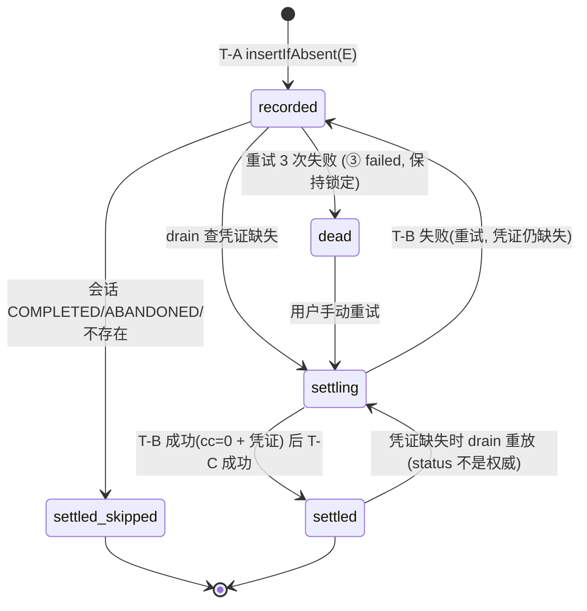
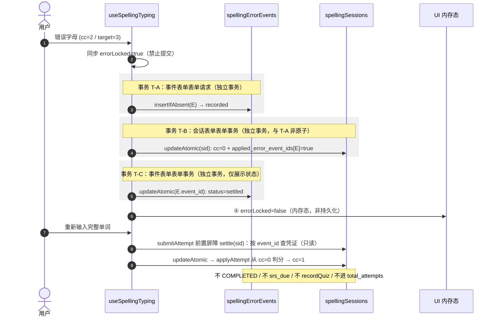
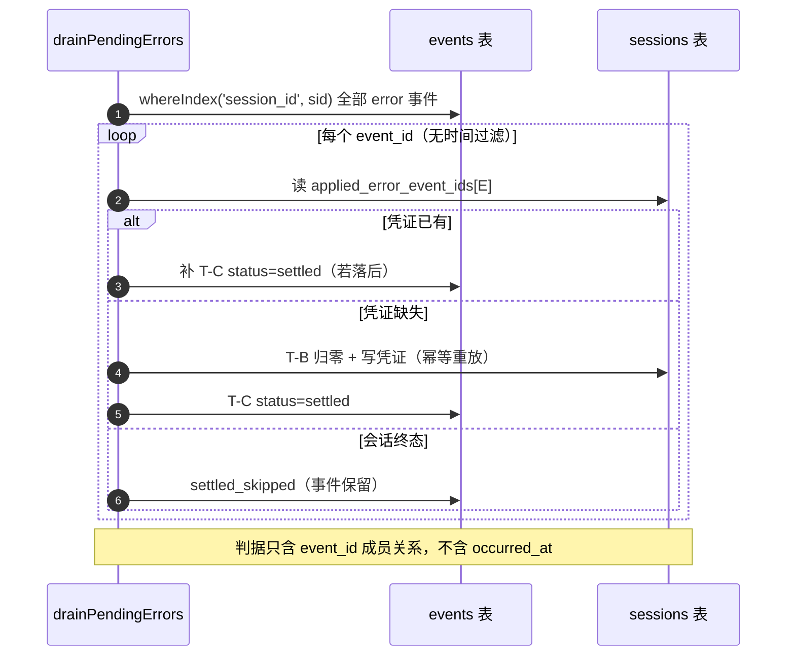

# 单词默写 V2 · Phase 1.2 最终设计闭环报告

> **状态：设计修订，未实施、未验证。** 本轮零源码改动、零迁移、零 git 写操作；完成后停止，等待负责人最终批准。
> 承接：`Phase1-技术设计报告.md`（V1）、`Phase1.1-可靠性复核与修订报告.md`（V1.1）。本报告结论**取代** V1/V1.1 中被点名修订的部分，其余继续有效。
> 标注：`【实测】`=本轮只读命令/源码核对；`【设计依据】`=基于规范/现有代码的推理；`【待验证假设】`=需实施后测试证明。**推断不写成已验证事实。**

---

## 0. 基线重核【实测：2026-11-04 19:26 前后】

| 项 | 结果 |
| --- | --- |
| Git HEAD | `760e999`（与前三轮一致） |
| 暂存区 | 6 个 `A`（B12 系列）**未变，未擅自处理**；工作区 `产品前提卡-给协作方.md` 副本仍为 `D `（暂存删除） |
| 工作区 | 已跟踪改动 50 项、未跟踪 122 项 |
| 并行任务文件 | `src/services/storage/web.ts` +13（v11）、`src/App.tsx` +4/-1、`src/main.tsx` +29/-11、`src/domain/types.ts` +13/-2。**本轮只读，未覆盖任何一项** |
| `domain/types.ts` 并行改动内容 | 补 v11 的 `WordLearningSession` import + `StorageSchema` / `PrimaryKeyMap` 追加 `wordLearningSessions`；另有 `ReadingType` 加 `'transcript'`、`ReadingDoc.segments?`。未来加表必须追加在**该最新工作树之后** |
| **Dexie 最高版本** | `web.ts` L198 `version(11)`；源码中**无 v12** |
| 🔴 **v12 规划冲突（本轮新发现）** | 全仓 Grep `version(12)` 命中三份**并行架构设计文档**：`述树统一书籍资产与知识问答架构设计-V1.2-阶段1实施计划.md` L209-214、`V1.2.1-架构复核.md` L294、`V1.2.4-阶段1B执行计划.md` L183-188。内容均为 `this.version(12).stores({ readings:'...,owner', annotations:'...,owner' })`，并明确「不依赖 B2 实施完成即可先定 v12 schema」、迁移夹具须「先建 version 110 补齐全部 v11 表 → 再 120」（Dexie 把 schema version ×10 写进原生 IDB）。**这是规划层面的版本号占用，非代码已落地**，但两任务若各自追加 v12 必然冲突 |
| 前提卡正本 | 上层 `shutree/产品前提卡-给协作方.md`，mtime `2026-10-31 11:50`（未变），本轮已重读锚点；纯设计不影响其条目 → **未改动** |
| `uuid` 工具 | `Spelling.tsx` L18 `import { uuid } from '@/lib/uuid'`，可复用生成 `tab_id`（不引入新平台 API） |
| 打字目录 | 已有 Phase0（225 行）、Phase1（510 行）、Phase1.1（534 行）三份报告，均未改动 |

**Q9 / D9 结论更新**：上一轮「当前无 version(12)」只对**源码**成立；对**并行设计**不成立。实施前必须与并行任务协调版本号（可能顺延本任务到 v13，或把两组 schema 合并进同一个 v12），并遵守对方已记录的 ×10 迁移夹具约束。此项列为**未解决，需负责人裁定 D9**。

---

## 1. P0-1：取消对客户端时间戳单调性的依赖

### 1.1 先撤销 V1.1 的两个时间戳判据

V1.1 有两个地方依赖 `occurred_at` 单调，均不成立：

1. **结算高水位** `last_error_settled_at`：`drainPendingErrors` 只处理 `occurred_at > last_error_settled_at` 的事件。系统时钟回拨、同毫秒、跨标签乱序、或「事件已落盘但高水位已被另一标签推进」都会让事件 `occurred_at <= 高水位` 而**被永久跳过**；归因链断裂且不可恢复。
2. **reset 过滤** `occurred_at > MAX(reset.occurred_at)`：`reset` 与 `error` 的时间戳乱序会让旧错误重新计入或后续错误被误清。

**同时纠正 V1.1 §3.2 的一处论断**：V1.1 写「赋值型归零天然幂等 → 凭证可淘汰」。这在「归零之后又有正确提交」的时间线下**不成立**：若凭证被淘汰后重放旧错误事件，会把用户新累积的 `consecutive_correct` 又清成 0，错误地丢失进度。因此凭证在**活跃会话期内不可淘汰**（见 1.4）。

> 仅增加 T39 测试不能修复设计：测试只能暴露时钟回拨，不能改变「判据含时间戳」这一结构性缺陷。本轮修改的是**协议本身**。

### 1.2 修订后的结算协议：内容寻址，判据不含时间

**会话文档新增**【设计提案】：

```ts
interface SpellingSession {
  // ...既有字段不变
  applied_error_event_ids?: Record<string, true>   // 结算凭证，与 cc 同文档同事务
  active_tab_id?: string                          // P0-3 单会话写锁，见第 3 章
}
```

**废弃**：`last_error_settled_at`（V1.1 高水位）、`processed_error_events`（V1 字典）均不再使用。`occurred_at` 保留在事件行，但**仅用于 UI 显示最近错误时间与排序，不参与任何正确性判据**。

**结算判定（drain / 提交前置屏障统一）**：

```
for E in EVENTS.whereIndex('session_id', sid) where E.kind === 'error':
    if session.applied_error_event_ids?.[E.event_id] === true: continue   // 已结算
    SESSIONS.updateAtomic(sid, s => applyTypingErrorEvent(s, E))          // 事务 T-B
    EVENTS.updateAtomic(E.event_id, e => ({ ...e, status: 'settled' }))   // 事务 T-C，仅展示
```

`applyTypingErrorEvent`（纯函数，同步）在**同一个 `updateAtomic` 事务内**完成两件事：`queue[i].consecutive_correct = 0` 与 `applied_error_event_ids[E.event_id] = true`。判据只有 `event_id` 的集合成员关系，**没有任何时间比较、序号比较或顺序假设**。

`cloneSession`（`spelling.ts` L424-430）需补一行浅拷贝 `applied_error_event_ids: { ...(s.applied_error_event_ids ?? {}) }` 以维持「不修改入参」的纯度——**这修正了 V1.1「连那一行都不用改」的说法**（V1.1 当时只加了一个 number 字段）。

### 1.3 证明：任何已持久化错误事件都不会因时间戳较小被永久跳过

**命题**【设计依据，须 T40/T42 等实测确认】：设事件 E 已通过 `insertIfAbsent` 落盘。则 E 的归零要么已完成，要么一定会被执行一次；与 `E.occurred_at` 的数值无关。

**证明**：
1. 结算循环对 E 的判定条件只有 `applied_error_event_ids[E.event_id]` 是否为 `true`；`occurred_at` 不出现在判据中。
2. 若凭证**不存在** → 循环必然进入 `updateAtomic`，执行 `applyTypingErrorEvent`（归零 + 写凭证），E 不会被跳过。
3. 若凭证**存在** → 由于凭证与归零在**同一个单表事务 T-B** 内原子写入，凭证存在 ⟺ 该事件的归零已完成。不存在「凭证已推进但归零未做」的中间态。
4. 事件行的 `status` 也不是判据（P0-2 明确其可落后/超前），因此不存在第二条会跳过 E 的路径。
5. 循环通过 `whereIndex('session_id', sid)` 枚举该会话**全部** error 事件，不做时间范围裁剪、不做 LIMIT、不依赖主键顺序。
6. ∴ 时钟回拨、同毫秒、跨标签乱序、事件晚到、刷新、长期离线、延迟重试均不改变判定结果。∎

**五类场景逐条对照**：

| 场景 | 旧高水位方案的失败 | 新协议 |
| --- | --- | --- |
| 系统时钟回拨 | 新事件 `occurred_at` 小于高水位 → 永久跳过 | `event_id` 无时间语义，凭证缺失 → 必执行 |
| 同毫秒事件 | `>` 跳过第二个 / `>=` 重复处理 | 两个不同 `event_id` → 两个独立凭证条目 |
| 跨标签乱序 | 高水位被先完成的事务推进，晚到事件被跳过 | 两标签并发 `updateAtomic` 串行化；第二个事务读到凭证已存在 → 跳过（归零已完成） |
| 事件已落盘但凭证已推进 | 视为「未结算」重复归零或「已结算」跳过，语义含混 | 凭证存在即证明归零已完成（原子），不算跳过 |
| 刷新 / 长期离线 / 延迟重试 | 依赖本地时钟连续性 | 凭证与事件均持久化，重放按 id 判定 |

`occurred_at` 的唯一残余影响：UI「最近错误时间」显示与排序可能乱序（时钟回拨时）。**这不影响计数或结算正确性**，且属可接受的产品表现；若产品要求严格展示顺序，需另立独立的展示序号（仍不得用于结算），列为待裁定。

### 1.4 凭证生命周期（与「永久错词凭证」区分）

| 凭证 | 存放 | 淘汰规则 | 理由 |
| --- | --- | --- | --- |
| 错词计数凭证 | 事件表 `event_id` 主键（append-only） | **永不淘汰** | 累加型，淘汰会重复计数（V1.1 P0-3 结论仍有效） |
| 结算凭证 | 会话文档 `applied_error_event_ids` | **活跃期内不淘汰**；会话终态（COMPLETED/ABANDONED）后可整体清空 | 归零虽是赋值，但淘汰后重放会误伤之后新累积的连对进度（1.1 的纠正） |
| 事件 `status` | 事件行 | 可覆盖/可落后 | 非正确性依据，仅 UI/加速 |

量级【待验证假设】：结算凭证每错误事件 1 条，与既有 `processed_requests`（每整词提交 1 条，`spelling.ts` L147）同量级，不引入新量级；但会话单文档会随练习量增长，需 T45 压力实测。

### 1.5 reset 事件去时间戳化（数据生命周期第 1 条）

**废弃** V1.1 的 `MAX(reset.occurred_at)` 过滤，改为内容寻址：

```ts
// reset 事件（append-only，不物理删除任何历史行）
interface SpellingResetEvent {
  event_id: string
  kind: 'reset'
  owner: string
  word_id: string
  covered_event_ids: string[]   // 生成时该 (owner, word_id) 下所有活动 error 的 id 快照
}
```

活动错词本聚合：

```
covered = ∪ { r.covered_event_ids | r.kind==='reset' ∧ r.owner=$owner ∧ r.word_id=$wid }
active  = { e.event_id | e.kind==='error' ∧ e.owner=$owner ∧ e.word_id=$wid } \ covered
wrong_count   = |active|
last_wrong_at = MAX(e.occurred_at for e in active)   // 仅展示，不参与判定
```

- 完全无时间比较；重复 reset 幂等（集合并集）；reset 生成期间并发落盘的新 error 不在 `covered` 中 → 正常计入（语义合理：reset 之后的新错误应显示）。
- **产品语义**：reset = 从**活动错词本**移除，**不等于物理删除历史**。历史 error 行、历史 reset 行永久保留；是否提供「查看已移除历史」入口由负责人裁定（D6）。
- 用户移除后该词再次答错 → 新 error 的 `event_id` 不在任何 `covered` → `wrong_count` 从 1 起，历史不追溯。

---

## 2. P0-2：明确跨表事务边界

### 2.1 三个独立事务 + 一个非持久化动作

`TableService` 无跨表事务（`types.ts` L21-43【实测】）；`updateAtomic` 定义为**单表单事务**原语。**下列四步不是一个原子事务，任何相邻两步之间都可能崩溃**：

| 步骤 | 事务 | 表 | 内容 | 是否正确性依据 |
| --- | --- | --- | --- | --- |
| ① | **T-A**（单表单请求） | `spellingErrorEvents` | `insertIfAbsent(E)`：事件落盘，`status='recorded'` | **是**（错词计数 = 行数） |
| ② | **T-B**（单表单事务） | `spellingSessions` | `updateAtomic(sid)`：`cc=0` + `applied_error_event_ids[E]=true` | **是**（状态机 + 结算权威） |
| ③ | **T-C**（单表单事务） | `spellingErrorEvents` | `updateAtomic(E.event_id)`：`status='settled'` | **否**（仅 UI/加速） |
| ④ | —（内存） | 无 | `errorLocked=false`，UI 解锁、允许提交 | 否 |

- ② 与 ③ 分属两张表，**不得描述为一个原子事务**；正确性来自「② 幂等重放」，而非事务原子性。
- 事件 `status` 允许**落后**于会话结算（T-C 失败）或**超前**（重试路径中 T-C 先成功、T-B 失败）；drain 只查 ② 的凭证，不查 ③。
- **权威依据判定表**：

| 关心什么 | 权威来源 | 非权威 |
| --- | --- | --- |
| 连对次数、词状态、是否已结算 | `spellingSessions` 文档（T-B 原子写入） | 事件 `status`、`occurred_at`、UI 三态 |
| 错词计数、最近错误时间 | `spellingErrorEvents` 行数（T-A append-only） | 任何物化缓存 |
| UI 展示三态 | 由 ② 凭证 + ③ status 推导，允许短暂落后 | — |

### 2.2 每个崩溃点的恢复方式

| 崩溃点 | 持久化状态 | 恢复动作 | UI |
| --- | --- | --- | --- |
| T-A 之前 | 无事件 | 无副作用；用户重新输入即可 | 保持锁定（或页面本就未进入反馈） |
| T-A 成功、T-B 之前 | 事件 recorded；凭证缺失 | `drainPendingErrors` 按 `event_id` 执行 T-B → T-C | ③ failed → 收敛为 ② settled，期间保持锁定 |
| T-B 成功、T-C 之前 | 凭证已有、`cc=0`；事件 `status=recorded`（**落后**） | drain 查凭证已有 → **跳过 T-B**，补 T-C | 解锁，不重复归零 |
| T-C 成功、T-B 失败（乱序/重试路径） | 事件 `status=settled`（**超前**）；凭证缺失 | drain **只看凭证** → 执行 T-B；绝不因 `status=settled` 跳过 | 保持锁定直到 T-B 成功 |
| T-B/T-C 均成功、④ 之前 | 全部持久化完成 | 重启后凭证已有，drain 收敛，解锁 | 解锁 |
| 重试 3 次仍失败 | 事件 `status='dead'`；凭证可能仍缺失 | 常驻横幅 + 手动重试入口；**不自动放行** | ③ failed，保持锁定 |
| 会话终态时事件到达 | 事件保留；凭证不写 | 标 `settled_skipped`，不写任何会话文档、不触发 SRS | 无需锁定（会话已结束） |

### 2.3 修订后的事件状态机（交付②之一）



> `settled` 不是终态保证：只要凭证缺失，drain 就会重放 T-B。这正是「status 非权威」的形式化体现。

### 2.4 修订后的时序图（交付②之二，事务边界显式标注）





> 两图均为**设计态**；`rect` 块仅表示「一次独立事务的作用域」，**不表示三个事务合并成一个原子事务**。

---

## 3. P0-3：跨标签竞态与最小写锁（交付③）

### 3.1 两种情形必须区分

| 情形 | 时序 | 当前状态 |
| --- | --- | --- |
| **情形 1**：错误事件**已落盘**，另一标签开始提交 | A 落盘 E → B 的 `submitAttempt` 前置屏障 `settle(sid)` 查凭证 → 执行 T-B 归零 → 再判分 | **已覆盖**（V1.1 屏障 + 本轮凭证协议） |
| **情形 2**：错误事件**尚未落盘**，另一标签**已经提交** | B 已 `mutate` 判分 `cc=2→3` → `COMPLETED` → `srs_due` → `recordQuiz` **不可逆**；A 之后才落盘并归零 | **未解决，不宣称覆盖**。V1.1 §9.2 已如实标注，本轮不粉饰 |

情形 2 的本质：两个标签页同时对**同一会话**写入，且错误事件的 `insertIfAbsent` 尚未进入 IDB 事务队列时，另一标签的提交事务已提交。仅靠屏障（读已落盘事件）无法消除，因为屏障看不到「尚未落盘」的事件。

### 3.2 最小范围方案 L2：会话文档内单写者锁（推荐）

不引入新表、不引入新平台 API、不依赖时钟或心跳：

- **字段**：`SpellingSession.active_tab_id?: string`。
- **tab_id**：复用现有 `uuid()`（`Spelling.tsx` L18 `@/lib/uuid`），标签页进入 `/spelling` 时生成一次。
- **获取锁**（校验与写入同一事务，避免 `get→check→put`）：
  ```ts
  SESSIONS.updateAtomic(sid, s => {
    if (s.active_tab_id && s.active_tab_id !== myTab) throw new Error('TAB_LOCK_HELD')
    return { ...s, active_tab_id: myTab }
  })
  ```
- **所有会话写**（settle / submitAttempt / skip / pause / resume / abandon）在 `updateAtomic` reducer 内校验 `s.active_tab_id === myTab`，不匹配抛 `TAB_LOCK_LOST` → UI 进入冲突面板。
- **释放**：`pagehide` / `visibilitychange` 时 best-effort `updateAtomic` 清空；**崩溃/关闭不保证释放**。
- **失效恢复（不依赖时钟）**：残留 `active_tab_id` → 新标签显示「另一标签页正在默写」+「接管」/「返回复习」；接管 = 用户**显式确认**后 `updateAtomic` 覆写 `active_tab_id`；旧标签复活后下一次写入校验失败 → 只读/冲突面板，不双写。沿用 `Spelling.tsx` L90-91、L159-165 既有的「多会话交用户裁决」UI 风格，不自动裁决。
- **可靠性分析**：同一时刻只有一个标签能写会话 → 情形 2 消失。接管瞬间若有旧标签 in-flight 事务，`updateAtomic` 串行化保证不撕裂；旧标签事务在事务内读最新文档，提交后校验锁已失，后续不再写。残留窗口仅剩「接管确认与旧标签最后一个 in-flight 事务提交之间」，且该事务不会覆盖新标签写入——**仍需真实双标签浏览器实测（T43/T44）**，不宣称零风险。
- **UX**：单标签零感知；多标签时第二标签不是白屏而是明确冲突面板；接管文案明确「会使另一标签页的默写失效」；接管后旧标签不会静默继续写。
- **范围**：只锁 `/spelling` 的会话写入路径，不锁全局存储、不改其它模块、不改 `App.tsx`。
- **备选 L1（不推荐本轮）**：BroadcastChannel 活跃探测可自动判断旧标签是否存活、体验更好，但需新增 `src/services/tabLock/web.ts`（平台 API 边界扩展）并单独评审；列为 D4 备选。

### 3.3 若仍选择接受残留窗口，风险接受条件（供负责人签署）

| 项 | 内容 |
| --- | --- |
| 产品影响 | 极端情况下错误字母被算作连对、单词提前 `COMPLETED`、`recordQuiz` **误交接且不可逆**（SRS 排程被提前）、错词本与状态机不一致、用户少练一个词 |
| 发生条件 | 两个标签页同时对**同一会话**操作，且错误事件尚未落盘时另一标签已提交 |
| 发生概率 | **无实测数据，不得编造**；只能表述为「低频但非零」 |
| 接受条件（须全部满足） | ① 产品明确声明「不支持多标签同时练习同一会话」并在 UI 提示；② 阶段 E 已知限制「多标签非原子互斥」保持现状，交付中**不宣称已修复**；③ 负责人书面接受 SRS 误交接不可逆；④ 在交付说明与前提卡（若届时同步）如实记录；⑤ T29 明确标记为「已知残留、不通过」而非跳过 |

> 本报告**推荐采纳 L2**，但不擅自替负责人决定；D4 状态为「待批准」。

---

## 4. 数据生命周期（补齐设计）

### 4.1 reset 只是从活动错词本移除

见 1.5：`reset` 是 append-only 事件，携带 `covered_event_ids`；历史 `error` 行与历史 `reset` 行**永久保留**，不物理删除。活动错词本 = 差集聚合。是否提供「已移除历史」查看入口 → D6 待裁定。

### 4.2 用户彻底清除本地数据

- 现有 `clearAll()`（`web.ts` L289-291）为 `Promise.all(TABLE_NAMES.map(n => db[n].clear()))`，**逐表并发清空、非事务**，可能部分成功【实测】。
- 设计约束：
  1. 清除入口在**存在活跃默写会话时禁用**并提示「请先结束默写」，避免 in-flight 写入与清除交错；
  2. 二次确认 + 明确文案「不可恢复」；
  3. 清除后重置全部 UI 状态与 `tab_id`/锁字段，错词本走 `EmptyState`，**不重建、不造数**；
  4. 清除后所有 `event_id` 与结算凭证一并消失；若清除后仍有 in-flight 事件重放，会重新入册——如实说明，不称为错误（用户已明确清空，重放来自清除前未完成的输入）；
  5. `clearAll` 的非事务性为已知风险，需 C24/T47 覆盖「清除中途失败 → 部分表残留」的展示与恢复（提示重新清除，不自动补数据）。
- 只有这一条路径会物理删除历史事件；「移除错词」与「压缩归档」都不是物理删除。

### 4.3 容量、聚合查询与 IndexedDB 配额（全部标为待验证）

- **V1.1 的 7–11 MB/年 是估算，不是实测结论**【按用户要求明确更正】。估算方法：`每日错误字母数 × 每行字节数 × 365`，其中两个参数**均无实测数据**；该区间是【待验证假设】，不得引用为事实。
- **聚合查询**：错词本页 `whereIndex('owner', currentOwner)` 取全量该 owner 事件 → 内存按 `word_id` 分组、计算 `covered` 并集，复杂度 O(N + Σcovered)。N 大时的首屏耗时**无实测数据**；可引入物化缓存，但必须由事件表可重建、且不参与正确性判定。
- **IndexedDB 配额**：浏览器按 origin 配额，未申请持久化时数据可能在存储压力下被驱逐 → 错词历史丢失风险。`navigator.storage.estimate()` / `persist()` 属平台 API，只能在 `src/services/` 内封装，本轮**不实施**；建议设置页未来展示用量与持久化状态。
- 结论：容量、性能、配额三项均需 T45 压力测试与真机验证后才能给出数字。

### 4.4 未来压缩 / 归档必须满足的幂等条件（本轮不实施）

若未来要把 N 条旧 `error` 折叠成一条 `snapshot` 并删除旧行，必须同时满足：

1. 被删的每个 `event_id` 所属会话已终态，或已在 `applied_error_event_ids` 中（无未结算重放）；
2. 写入不可变 `snapshot` 行，含 `count` 与 `covered_event_ids`（或等价摘要）；
3. **必须永久保留一份「已压缩 event_id 摘要」**，使旧 `event_id` 若被延迟重放能被识别为「已计入」——否则 `insertIfAbsent` 会因行已删而成功，造成重复计数；
4. 删除旧行与写入 `snapshot` 必须在**同一单表事务**内（`TableService` 现无 `bulkDelete`，需新增原语并两驱动对齐）；
5. 压缩结果可被事件表重算校验，且压缩过程本身幂等（重复压缩不增 count）。

条件 3 与「减少存储」的目标存在张力，**本轮不实施压缩**，列为未来独立评审；这也是 D3「永久保留」边界的一部分。

---

## 5. 交付⑤：D1–D9 逐项裁定表（**全部待批准，无一标记为已批准**）

> 上轮 D8（「遗留 Q 项打包」）已拆解为下方 Q2/Q11/Q12 与「其它遗留」两处；本表保留 D1–D9 编号便于对照。**负责人尚未明确确认任何一项。**

| 编号 | 独立事项 | 事务 / 失败语义（重点） | 推荐 | 状态 |
| --- | --- | --- | --- | --- |
| **D1** | 新增 `insertIfAbsent` + `updateAtomic` 存储原语，`mutate()` 改走 `updateAtomic` | **事务**：单表单事务、reducer 同步纯函数、T-A/T-B/T-C 三个独立事务不得合并；**失败**：抛错不静默、重试 3 次→`dead`、UI 不放行；业务纯函数 `applyAttempt` 不变 | 批准 | **待批准** |
| **D2** | `submitAttempt` / `skip` 增加 `settlePendingErrors(sid)` 前置屏障 | **事务**：屏障 = 读事件表（只读）+ 逐个 `updateAtomic` 会话表，**不是跨表原子事务**；**失败**：屏障失败即拒绝提交，不带着旧 `cc` 放行 | 批准 | **待批准** |
| **D3** | 事件表永久保留 + 数据删除边界 | 活跃会话结算凭证不淘汰、终态后可清；错词凭证永不淘汰；reset 逻辑移除不物理删；**只有用户 `clearAll()` 才物理删除**；压缩需独立评审 | 批准 | **待批准** |
| **D4** | 跨标签风险处置：采纳 L2 单会话写锁 **或** 接受残留窗口 | 采纳 L2：`active_tab_id` + 事务内校验 + 崩溃后用户接管；若接受窗口须满足 3.3 全部 5 条接受条件 | **采纳 L2** | **待批准** |
| **D5** | `failed` 状态不得放行 | 重试成功前保持 `errorLocked`；常驻横幅 + 手动重试；**不显示「已入册」数字、不假报成功** | 批准 | **待批准** |
| **D6** | `reset` 事件的产品语义 | 从活动错词本移除、历史保留、再次答错从 1 起；是否提供「已移除历史」入口待定 | 批准（不提供历史入口） | **待批准** |
| **D7** | Q3 三态与缓冲输入 | recorded：允许键入缓冲、**禁止提交**；settled：解锁、连对显示 `0/N`；failed：保持锁定 + 横幅 | 批准 | **待批准** |
| **D8** | 其它遗留 Q 项（V1 的 Q1/Q3–Q8/Q10/Q13）处置 | 逐项沿用 V1.1 推荐，实施前一次性确认，不打包默认通过 | 逐项确认 | **待批准** |
| **D9** | v12 版本登记与并行任务协调 | 🔴 实测：并行设计文档已规划 `version(12)`（readings/annotations + owner），且记录 Dexie ×10 迁移夹具（v110→v120）。须登记协调：顺延本任务到 v13，或两组 schema 合并进同一 v12；**实施前再次核对 `web.ts` 最新版本** | 先协调再定号 | **待批准** |

### 5.1 单独列出的三项产品/范围裁定（负责人特别点名）

| 项 | 推荐内容 | 说明 | 状态 |
| --- | --- | --- | --- |
| **Q2** | 四档设置采用 **C1「下一轮会话生效」**：当前会话全程用创建时快照，设置变更只影响新建会话，UI 明示「从下一轮默写开始生效」 | 若负责人本意是 C2「下一个单词生效」，需批准新增纯函数 `applyTargetFromNextWord` 并接受同轮目标不一致 | **待确认**（本指令中「Q2 设置下一轮会话生效」按推荐值理解，**未擅自标记为已批准**） |
| **Q11** | 本轮范围 = 逐字母输入核心 + 独立错词本 + 四档设置 + A–F 设计；**不含**显示/隐藏、Space+G/H 快捷键、移动端图标与响应式、实时统计与视觉完善 | 后者属原需求 Phase 1 后半 / Phase 2 / Phase 4，仅预留接口 | **待确认** |
| **Q12** | 为区分错词本练习来源，扩展 `selection_mode:'mistakes'` 与 `SpellingSession.source?: 'normal'|'mistakes'` | 不改 `applyAttempt` / `selectWords` 既有三分支语义；若拒绝，则「来源可区分」需求无法满足，需另定方案 | **待批准** |

---

## 6. 交付④：完整测试矩阵

> 保留 C01–C16 与 T23–T39（详见 V1.1 第 7、8 章，本轮不改动其编号与结论，仅按第 1–3 章修订其期望中的时间戳判据）。新增 C17–C24 / T40–T47 如下，每项含前置状态、并发时序、预期持久化结果、失败恢复结果、验证层级。
> 层级：**设计证明**（协议推导）｜**自动化**（tsx + fake-indexeddb / 双 IDB 连接）｜**真机**（puppeteer-core + Edge 双标签，端口 4174）。

| # | 场景 | 前置状态 | 并发 / 崩溃时序 | 预期持久化结果 | 失败恢复结果 | 层级 |
| --- | --- | --- | --- | --- | --- | --- |
| **C17/T40** | 时钟回拨 | 会话 `cc=2`、已有结算凭证 `{E1}`；系统时间被调回 1 年前 | 产生 E2（`occurred_at` 远小于 E1）→ 落盘 → 结算 | E2 凭证写入、`cc=0`、错词行数 +1；**不得因时间戳小被跳过** | 重启后重放 E2 判定一致 | 设计证明 + 自动化 + 真机（模拟时钟） |
| **C18/T41** | 跨表事务部分成功 | 三个独立事务边界已注入故障点 | 遍历 5 个断点（T-A 前 / A 后 / B 后 / C 后 / 解锁前）分别崩溃 | 每个断点后，权威状态（会话凭证 + 事件行数）自洽 | drain 按第 2.2 表收敛到 settled；无重复归零、无重复计数 | 设计证明 + 自动化 |
| **C19/T42** | 事件状态落后/超前于会话结算 | 构造 `status='settled'` 但凭证缺失；及 `status='recorded'` 但凭证已有 | drain 分别运行 | 只看凭证：前者执行 T-B，后者跳过 T-B 补 T-C | 状态收敛，`cc` 与凭证一致 | 设计证明 + 自动化 |
| **C20/T43** | 两标签同一会话写入（采纳 L2） | 会话 `active_tab_id=A` | A 归零事务 in-flight；B 尝试提交 → reducer 校验锁失败 | B 写入被拒、会话文档只反映 A 的提交；无双写 | B 显示冲突面板；接管后 A 下次写入被拒 | 自动化 + **真机双标签** |
| **C21/T44** | 写锁持有者崩溃 / 关闭页面 | `active_tab_id=A` 残留 | A 崩溃（无 `pagehide` 释放）→ 新标签 B 进入 → 用户点「接管」→ A 复活尝试写 | B 覆写 `active_tab_id=B` 成功；A 后续写入抛 `TAB_LOCK_LOST` | 无锁死、无自动过期依赖时钟；旧标签进只读 | 自动化 + **真机双标签** |
| **C22/T45** | 事件表长期增长 | 注入 N 行（含多词、多次 reset） | 连续写入 + 刷新 + 聚合查询 | 计数/最近时间与逐行重算一致；无淘汰导致的重复 | 容量、首屏耗时、配额用量**产出实测数字**（替换 7–11 MB/年估算） | 自动化（压力） + 真机 |
| **C23/T46** | reset 与后续 error 的顺序 | 词 W 有 3 条 error；`covered_event_ids` 已生成 | 时钟回拨 / 同毫秒 / 乱序落盘下：reset 与第 4 条 error 交错 | 第 4 条 error 不在 `covered` → 计入（count=1）；前 3 条被覆盖不计；重复 reset 幂等 | 重启后按 id 集合重算一致，不依赖时间戳 | 设计证明 + 自动化 |
| **C24/T47** | 用户彻底清除本地数据 | 活跃会话、事件表有数据、有 in-flight 写入 | 触发 `clearAll()`；中途注入一表 `clear` 失败 | 成功时所有表空、UI 走 EmptyState、锁字段与 tab_id 重置 | 部分成功时如实提示「重新清除」，不自动造数、不自动补齐 | 自动化 + 真机 |

### 6.1 完整编号索引

| 范围 | 来源 | 本轮处置 |
| --- | --- | --- |
| T01–T22 | V1 第 4 章（V1.1 第 8 章逐项修订） | 保留 V1.1 的保留/修订/废弃标注；其中涉时间戳的期望按第 1 章改为 `event_id` 判据 |
| T23–T39 | V1.1 第 8 章新增 | **全部保留**；T39（高水位单调性）修订为「验证凭证集合不含时间戳判据」 |
| T40–T47 | 本报告 C17–C24 | 新增，详见上表 |
| C01–C16 | V1.1 第 7 章 | **全部保留**；C05/C07 中「高水位」表述改为「结算凭证」 |
| C17–C24 | 本报告 | 新增，详见上表 |

**既有测试保护**：`scripts/test_spelling*.ts` 6 套既有断言不改；新增用例独立文件并追加到 `package.json` L11 的 `test` 链；`scripts/check_spelling_browser.mjs` 已有 S1–S9，扩展 S10+ 覆盖 C20/C21/C24 的真机双标签分支。

---

## 7. 交付⑥：变更文件清单与风险清单（相对 V1.1 的增量）

> 仅列**有变化**的条目；其余沿用 V1.1 第 10 章。风险 = 对现有功能/数据的潜在影响。

| 文件 | V1.1 计划 | Phase 1.2 修订 | 风险 | 说明 |
| --- | --- | --- | --- | --- |
| `src/domain/spelling.ts` | 仅加 `last_error_settled_at?` | **改为** `applied_error_event_ids?` + `active_tab_id?`；`cloneSession` L424-430 补一行浅拷贝 | 中 | 修正 V1.1「不用改 cloneSession」的说法；`SpellingSession` 类型在该文件，不与并行任务冲突 |
| `src/domain/types.ts` | +1 实体 + 1 张表映射 | 不变，但**必须以当前工作树为基线追加**（并行任务已改 13 行，补了 v11 类型） | **高** | 不覆盖他人改动；D9 版本号协调 |
| `src/domain/spellingErrorEvents.ts`（拟新增） | 事件写入/聚合/屏障辅助 | 增加：`covered_event_ids` reset 聚合、按 `event_id` 凭证的 drain、无时间戳判据 | 中 | 设计核心 |
| `src/domain/spellingSession.ts` | `settlePendingErrors` / `drainPendingErrors` / `mutate` 改事务 | **增加**：`updateAtomic` reducer 内 `active_tab_id` 锁校验与 `TAB_LOCK_HELD/LOST`；`acquireLock`/`releaseLock`/`takeoverLock` | **高** | 业务纯函数与 SRS 语义不变；需全量回归 6 套既有 spelling 测试 |
| `src/pages/Spelling.tsx` | 门闩 + 三态 UI | **增加**：`tab_id` 生成（复用 L18 `uuid`）、锁冲突面板（复用 L90-91/L159-165 风格）、接管确认、`pagehide` 释放 | **高** | 主战场；不改 `App.tsx` |
| `src/services/storage/types.ts` / `web.ts` / `memory.ts` | 新增 `insertIfAbsent` / `updateAtomic` | 不变；**新增** `clearAll` 非事务性说明（不擅自改其实现） | **高** | `web.ts` 是他人未提交改动文件；D9 |
| `src/pages/SpellingMistakesPanel.tsx`（拟新增） | 聚合视图 | 改为按 `covered_event_ids` 差集聚合；移除 = 追加 reset 事件 | 中 | 无物化表 |
| `scripts/test_spelling_*.ts` | 并发/崩溃/双驱动 | 新增 C17–C24 / T40–T47；T39 修订 | 低 | 既有断言不改 |
| `scripts/check_spelling_browser.mjs` | 双标签/三态 | 新增锁获取、接管、崩溃恢复、清除数据场景 | 低 | 复用 S1–S9 夹具 |
| **明确不改** | — | `App.tsx`、Reader/ASR/转写/格式转换、`server/`、依赖版本、前提卡、`applyAttempt`/`recordQuiz`/`srs_due`/`aggregateSession` 函数体、已暂存 B12 文件 | — | 安全约束 |

---

## 8. 交付⑦：未解决问题及其对产品正确性的影响

| # | 未解决问题 | 对产品正确性的影响 | 处置 |
| --- | --- | --- | --- |
| U1 | **跨标签情形 2**（事件未落盘、另一标签已提交） | SRS 误交接**不可逆**、单词提前 COMPLETED、错词本与状态机不一致 | 推荐 L2 写锁；若接受窗口须签 3.3 五条风险接受条件；D4 待批准 |
| U2 | 🔴 **v12 与并行任务规划冲突**（实测发现三份并行设计文档已规划 v12） | 两任务各自追加 v12 会导致 schema 覆盖；Dexie ×10 机制下迁移夹具错误可能**重建/丢表** | D9：实施前登记协调、重核 `web.ts` 最新版本、遵守 v110→v120 夹具约束 |
| U3 | 容量 / 聚合性能 / IndexedDB 配额**无实测** | 长期使用可能首屏变慢、配额压力下历史被驱逐 | T45 产出实测数字；7–11 MB/年仅估算不得引用为事实 |
| U4 | `updateAtomic` 在 Dexie 中的事务作用域、`insertIfAbsent` 两驱动语义**未实测** | 并发证明的前提未验证，可能出现驱动行为分叉 | T23/T32/T33 + 真机双标签 |
| U5 | `clearAll()` 非事务（`Promise.all` 逐表 clear） | 清除可能部分成功，残留数据 | C24/T47；UI 提示重新清除，不自动造数 |
| U6 | 时钟回拨影响 UI「最近错误时间」排序 | **仅展示层**，不影响计数/结算 | 可接受；如产品要求严格顺序需另立展示序号 |
| U7 | 压缩/归档未实施（条件 3 与减存储目标冲突） | 长期容量增长无治理手段 | 本轮明确不实施，未来独立评审 |
| U8 | L2 写锁的「用户接管」UX 与旧标签失效提示 | 多标签体验需产品确认；接管不当可能让用户以为数据丢失 | D4/D7 一并裁定 |
| U9 | 所有 P0 证明目前均为【设计依据】 | 未实测前不得对外声称「并发已解决」 | 实施后以 T40–T47 + 真机双标签结果替换表述 |
| U10 | 负责人尚未批准 D1–D9 / Q2 / Q11 / Q12 任一项 | 设计未闭环，不得进入实施 | 本报告停止点 |

---

## 9. 交付说明与停止条件

- **改了什么**：仅新增本报告 `产品方案/打字/Phase1.2-最终设计闭环报告.md`，并在 `.workbuddy/memory/2026-11-04.md` 追加一条工作日志。未改源码、配置、数据库、Git 暂存区或工作区已有文件；未覆盖 `web.ts` / `App.tsx` / `domain/types.ts` 等并行修改；未擅自处理已暂存 B12 文件；未改前提卡；未实施 v12。
- **验证了什么（全部只读）**：重核 HEAD `760e999`、暂存 6 个 `A`、工作区 50 项已跟踪改动 / 122 未跟踪；重核 `web.ts` 最高 `version(11)`、源码无 v12；**新发现三份并行设计文档已规划 `version(12)`** 及 ×10 迁移夹具；核对 `domain/types.ts` 并行 diff 内容；重读前提卡正本（mtime 未变）；确认 `uuid` 工具位置。**未运行任何会写入工作区的验证命令**（`tsc`/`npm test`/`build`/`check_pwa.py` 均未执行；`npm run build` 会写 `dist/`，与本轮约束冲突）。实施阶段必须全量执行四项并分别报告当前工作树 / 提交树结论。
- **没做什么**：无实现、无迁移、无真机并发实测；P0-1 的证明是【设计依据】，须 T40/T42 等实测后才能改称「已验证」；容量与配额无实测数字。
- **前提卡判定**：纯设计，不影响页面清单 / 数据来源 / 红线 / 技术栈 / 实测事实 → **未改动**。另如实指出：工作区副本仍为暂存删除状态，正本在上层 `shutree/` 不在 git 内；实施阶段若需同步应改正本并先重读最新锚点。
- **需要决策**：第 5 章 D1–D9 全表 + Q2/Q11/Q12 三项，**全部为「待批准 / 待确认」，无一标记为已批准**。最低限度：D1、D2、D3、D4、D9。
- **7 项交付**：① 本报告（第 0–9 章）② 事件状态机 + 2 张修订时序图（第 2.3/2.4 节）③ 跨表事务与跨标签竞态分析（第 2、3 章）④ 完整测试矩阵 C01–C24 / T01–T47（第 6 章）⑤ D1–D9 逐项裁定表（第 5 章）⑥ 变更文件与风险清单（第 7 章）⑦ 未解决问题及影响（第 8 章）。

**报告完成，已停止。等待负责人最终批准后，方可进入源码实施阶段。**
