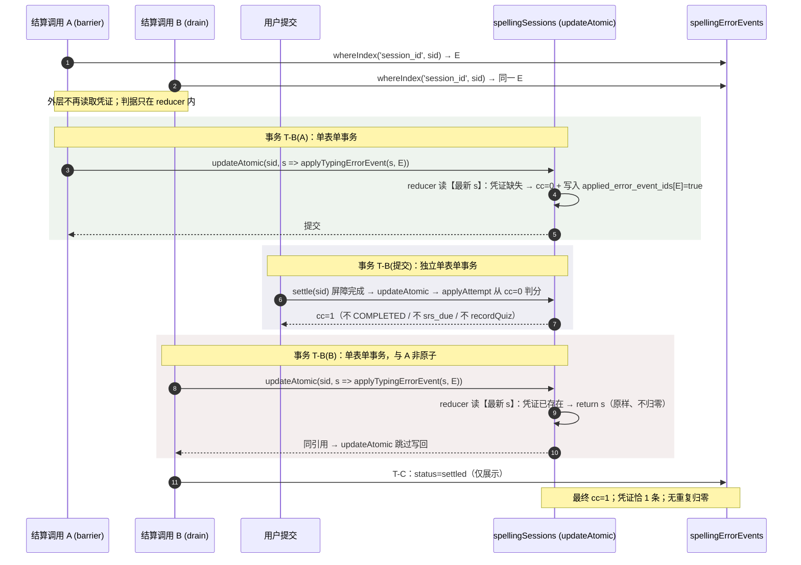
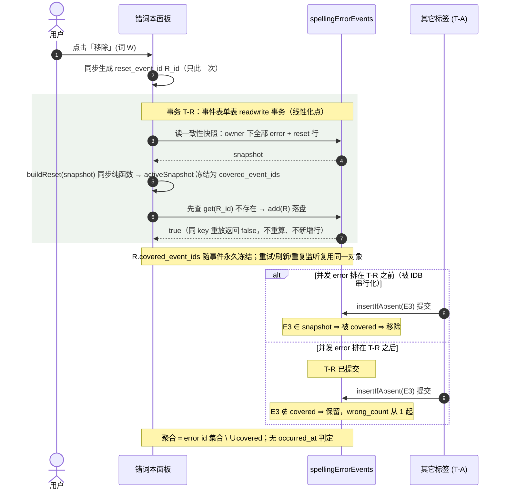
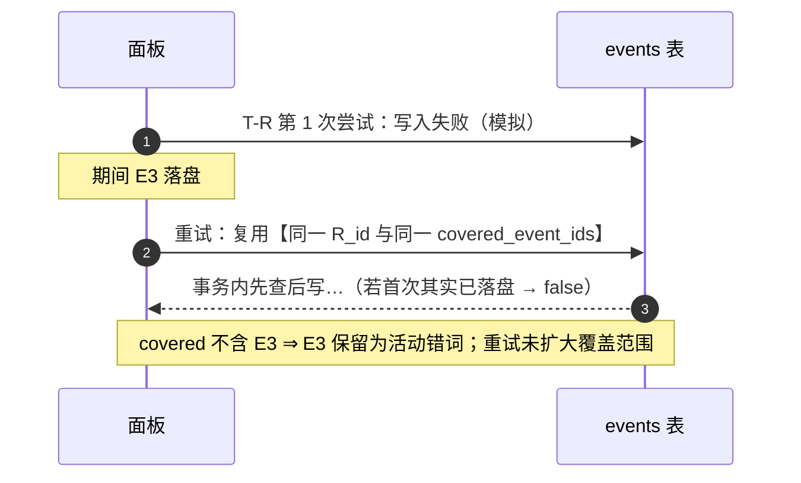
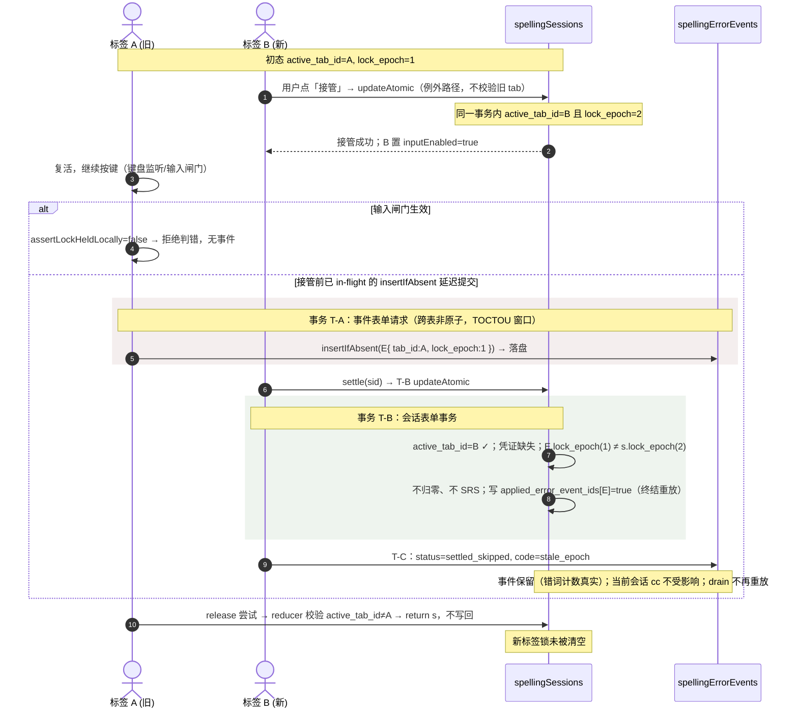
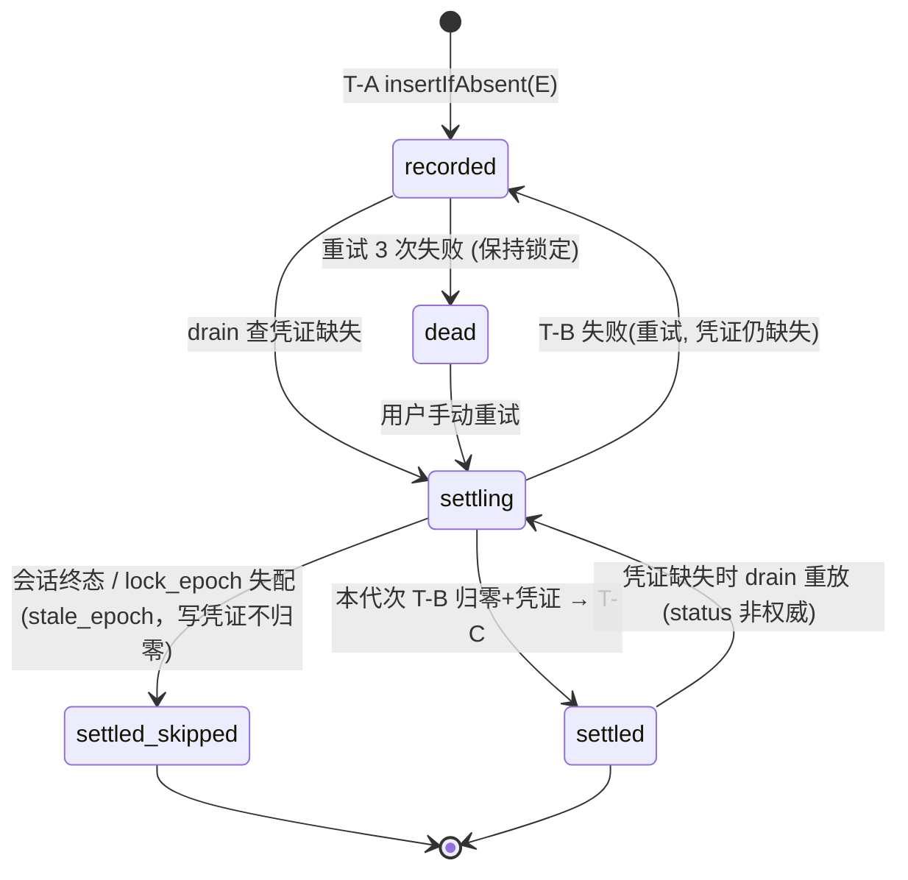

# 单词默写 V2 · Phase 1.2.1 最终准入补充审查报告

> **状态：设计补充审查，未实施、未验证、未批准。** 本轮零源码改动、零迁移、零 git 写操作；完成后停止，等待负责人审批。
> 承接：`Phase1.2-最终设计闭环报告.md`（下称 V1.2），并追溯 `Phase1.1-可靠性复核与修订报告.md`（V1.1）、`Phase1-技术设计报告.md`（V1）。**本报告结论只取代 V1.2 中被点名修订的三处**，其余继续有效。
> 标注：`【实测】`=本轮只读命令/源码核对；`【设计依据】`=基于规范/现有代码的推理；`【待验证假设】`=需实施后测试证明。**推断不写成已验证事实。**
> 本轮审查对象：P0-1 结算凭证的事务内二次检查、P0-2 reset 的线性化与原子快照、P1-3 L2 写锁覆盖全部会话写入路径。

---

## 0. 基线重核与产品口径保护

### 0.1 只读基线【实测，本轮重新执行】

| 项 | 结果 | 与 V1.2 对比 |
| --- | --- | --- |
| Git HEAD | `760e999f785797e8b008943aca1809964686cc15`（`760e999 A5-1 响应式布局改造验收交付报告`） | 未变 |
| 暂存区 | 6 个 `A`（B12 系列：4 份报告 + `api/b12-phase-b-verify.py` + `reports/stage-b12-overview.md`） | 未变，**未擅自处理** |
| 工作区 | 50 项已跟踪改动（`产品前提卡-给协作方.md` 副本仍为 `D ` 暂存删除）、大量未跟踪并行文档 | 未变，本轮只读 |
| **Dexie 最高版本** | `src/services/storage/web.ts` L198 `version(11)`；源码中**无 v12** | 未变 |
| 🔴 **设计原语/字段落地检查（本轮新增证据）** | 全仓 `src/` Grep `insertIfAbsent\|updateAtomic\|active_tab_id\|applied_error_event_ids\|covered_event_ids\|lock_epoch\|transactAtomic` → **零匹配** | 证明 V1.1/V1.2 的全部原语与字段**仍是设计态，源码一行未落地**；本轮修订不存在「覆盖已写好代码」的风险 |
| `web.ts` 事务能力 | Grep `transaction` → **零匹配**；`put` L219、`add` L223-224、`toArray` L231-232、`whereIndex` L256、`clearAll` L289 | `TableService` 确无跨表/单表事务 API，新原语必须在 `web.ts` 内用 `db.transaction` 新增（平台 API 不越界） |
| `memory.ts` 同步性 | L129-131 `toArray()` = `[...this.rows.values()].map(...)` 包在 `Promise.resolve` 中，**构造是同步的**；L151-163 `whereIndex` 同理 | 成为 `appendFromSnapshot` 在 memory 驱动中「快照与追加之间不让出执行权」的依据（见 2.3） |
| `spellingSession.ts` 写入面 | 导出 `getResumableSession` L141 / `getSessionById` L150 / `mutate`(私有) L166 / `createSession` L197 / `submitAttempt` L253 / `skip` L267 / `pause` L283 / `resume` L288 / `abandon` L297 / `repairSrsHandoff` L350 / `fulfillSrsHandoff`(私有) L433 | **无** `acquireLock` / `takeover` / `release` / `assertLock`，均为设计态新增（P1-3 逐项核对锚点） |
| `Spelling.tsx` 输入面 | L97 `busy`、L101 `inputRef`、L202/226/242 三处 `busy` 闸门、L378/L420 冲突与暂停面板、L520 `ref`、L523 `onKeyDown`、**L534 `disabled={busy}`** | 「取得锁之前不能启用输入」的落点已定位 |
| `spelling.ts` | L424-430 `cloneSession`，L428 已有 `processed_requests: { ...s.processed_requests }` 浅拷贝范例 | V1.2 指出需补 `applied_error_event_ids` 浅拷贝，本轮保留该结论 |
| 前提卡正本 | 上层 `shutree/产品前提卡-给协作方.md`（2026-10-31 版，mtime 未变）；红线 L660-661 / L1007-1008「绝不编造数据」「已写好的代码不要动」 | 本轮纯设计，**未改动** |
| 🔴 **v12 并行规划冲突** | 全仓 Grep `version(12)` 仍命中三份并行架构文档：`V1.2-阶段1实施计划.md` L212/L214、`V1.2.4-阶段1B执行计划.md` L185/L266/L290、`V1.2.1-架构复核.md` L294 | 与 V1.2 完全一致，**未见新增落地、也未见撤销**；D9 状态不变（详见第 7 章） |

**本轮未运行** `tsc --noEmit` / `npm test` / `npm run build` / `python scripts/check_pwa.py`：零源码改动，且 `npm run build` 会写 `dist/`，与「不修改工作区」约束冲突。实施阶段必须全量执行并分别报告当前工作树 / 提交树结论。

### 0.2 产品口径保护（逐条确认，本轮一概未改）

| # | 负责人既定口径 | 本轮设计中的保障点 | 是否改动 |
| --- | --- | --- | --- |
| 1 | 每个错误字母**独立产生一条**错误事件 | 事件表 `event_id` 主键，一次判错一行；`insertIfAbsent` 不合并 | **未改** |
| 2 | 一次拼写三个错误字母计**三次** | `wrong_count` = 行数；T04 与新增 C38/T61 断言 3 行 | **未改** |
| 3 | 同一事件重试 / 重放 / 重复监听**不得重复计数** | `event_id` 主键幂等 + **P0-1 的 reducer 内二次检查**（结算侧） | **未改，仅加固** |
| 4 | 真实再次按错属于**新事件** | 新 `event_id`，不在任何凭证 / `covered` 中 | **未改** |
| 5 | 长按 `event.repeat` **单独按既定输入规则测试** | 沿用 T02 / T03c / C38，不修改规则、不与 StrictMode 混谈 | **未改** |
| 6 | reset 只从**活动错词本**移除，**不物理删除历史** | append-only reset 行 + 差集聚合；只有 `clearAll()` 物理删除 | **未改** |
| 7 | 移除后再次答错，活动计数**从 1 开始** | 新 error 的 `event_id` 不在任何 `covered_event_ids` 中 | **未改** |
| 8 | 不伪造完整错误答题、不污染 SRS、不改 `applyAttempt`/`recordQuiz`/`App.tsx` | 沿用 V1.2 §7「明确不改」清单 | **未改** |

---

## 1. P0-1：结算凭证必须在 `updateAtomic` 的同步 reducer 内二次检查

### 1.1 旧设计（V1.2 §1.2、§2.4 第二张图）

V1.2 的 drain 伪代码：

```text
for E in EVENTS.whereIndex('session_id', sid) where E.kind === 'error':
    if session.applied_error_event_ids?.[E.event_id] === true: continue   // ← 外层读取
    SESSIONS.updateAtomic(sid, s => applyTypingErrorEvent(s, E))          // ← 假定凭证缺失
    EVENTS.updateAtomic(E.event_id, e => ({ ...e, status: 'settled' }))
```

**问题一（实现断层）**：幂等判据写在 `updateAtomic` **之外**，reducer 内没有任何检查。V1.2 §1.3 证明第 6 条明确写「两标签并发 `updateAtomic` 串行化；**第二个事务读到凭证已存在 → 跳过**（归零已完成）」——但该「读到」在伪代码中并不存在于事务内。**证明与实现不一致**：`updateAtomic` 内部重读到最新 `s` 只保证「不读旧值」，不保证「凭证缺失」；reducer 若无条件归零，第二次事务照样把 `cc` 清成 0。

**问题二（外层读取不可作最终判据）**：外层 `session` 是一次**独立只读请求**的快照，与后续 `updateAtomic` 之间可插入任意次写入。即便外层读到「凭证缺失」，进入事务时凭证可能已存在；即便外层读到「凭证已存在」而 `continue`，也可能漏掉 T-C 的状态收敛（V1.2 §2.2 允许 status 落后）。外层判据既非必要也非充分。

### 1.2 风险时序（负责人点名的 A/B 场景，逐拍展开）

前置：会话 `sid`，`cc=2`、`target_correct=3`、`applied_error_event_ids={}`，错误事件 E 已由 T-A 落盘。A 与 B 是**同一 `myTab` 下的两个并发结算调用**（例如 `settlePendingErrors()` 提交前置屏障与启动期 `drainPendingErrors()` 并发，或 StrictMode 下两个 effect 各跑一次 drain；两者都通过锁校验，见 1.3 末段说明）。

| t | 动作 | 会话 `cc` | 凭证 |
| --- | --- | --- | --- |
| t0 | A、B 各自外层读 `session` → 均判定「凭证缺失」 | 2 | `{}` |
| t1 | A 进入 T-B `updateAtomic`，reducer 无条件归零 + 写凭证，提交 | **0** | `{E:true}` |
| t2 | 用户重新输入完整单词并正确提交 → `applyAttempt` 走第三次 `updateAtomic`（排在 A 之后），从 `cc=0` 判分 | **1** | `{E:true}` |
| t3 | **B 的 T-B 才获得事务执行权**；`updateAtomic` 读到最新 `s`（`cc=1`、凭证已有），但 reducer **不检查凭证** → 再次 `cc=0` + 重写凭证 | **0 ← 丢失** | `{E:true}` |
| t4 | 结果：用户刚累积的 1 次连对被抹掉；`updated_at` 被 B 改写；若目标为 1，本应 `COMPLETED` 的词被拖回，SRS 交接被延后 | 0 | — |

**结论**：`updateAtomic` 的「单事务内读最新文档」解决的是 lost update，**不解决重放幂等**。二者是不同性质的问题；只有 reducer 内的凭证成员检查能关闭 t3 这条路。

> 附带风险：若外层判据被当作「最终依据」并用于 `continue` 跳过 T-C，则 V1.2 §2.2「T-B 成功、T-C 之前崩溃 → drain 补 T-C」的恢复路径会失效。删除外层判据同时修掉这一处。

### 1.3 修订方案（事务内二次检查为唯一最终判据）

**（a）领域纯函数 `applyTypingErrorEvent` 改为自包含幂等**

```ts
// src/domain/spellingErrorEvents.ts（拟新增）或 spelling.ts 内，纯函数、无 IO、不改入参
export function applyTypingErrorEvent(
  s: SpellingSession,
  E: { event_id: string; word_id: string },
): SpellingSession {
  // ① 唯一的最终幂等判据：在 updateAtomic 的同步 reducer 内读【最新文档】
  //    凭证已存在 ⇒ 本事件对该会话已终结处理 ⇒ 原样返回，绝不再次归零
  if (s.applied_error_event_ids?.[E.event_id] === true) return s

  // ② 归零与凭证写入：同一会话文档、同一 updateAtomic 事务，原子生效
  return {
    ...s,
    queue: zeroCurrentConsecutiveCorrect(s.queue, E.word_id),
    applied_error_event_ids: {
      ...(s.applied_error_event_ids ?? {}),
      [E.event_id]: true,
    },
    updated_at: Date.now(),
  }
}
```

- `return s` 返回**同一对象引用**，供 `updateAtomic` 识别「无变化」（见 (c)）；该分支不得改 `cc`、`updated_at`、队列或任何字段。
- `cloneSession`（`spelling.ts` L424-430）按 V1.2 结论补 `applied_error_event_ids: { ...(s.applied_error_event_ids ?? {}) }` 一行浅拷贝，维持「不修改入参」的纯度（L428 已有同类范例）。

**（b）删除外层判据，drain 无条件调用 `updateAtomic`**

```text
for E in EVENTS.whereIndex('session_id', sid) where E.kind === 'error':
    SESSIONS.updateAtomic(sid, s => applyTypingErrorEvent(s, E))   // 判据只在 reducer 内
    EVENTS.updateAtomic(E.event_id, e => decideEventStatus(e, ...)) // T-C，仅展示/终止标记
```

外层 `session` 快照不再参与任何正确性判定。`whereIndex('session_id', sid)` 仍枚举该会话**全部** error 事件，不做时间范围裁剪、不做 LIMIT、不依赖主键顺序 —— V1.2 §1.3 的「不含时间戳」结论完整保留。

**（c）`updateAtomic` 契约补一条（新增，待批准 D10）**

> reducer 返回**同一引用**时，`updateAtomic` 应**跳过写回**（不执行 `put`）。

理由：避免「凭证已存在」分支产生一次无意义写回，也避免实现方在该分支误写 `updated_at`。即便实现为「总是写回」，由于读与写在同一个 IDB rw 事务内、同 store 的其它 rw 事务被串行阻塞，也不会覆盖并发写入 —— 但「跳过写回」是更清晰、更可测的契约（新增 C27/T50 断言）。

**（d）并发正确性证明**【设计依据，须 C25/T48 实测】

设 A、B 与用户提交共三次 `updateAtomic(sid, ...)`，IDB 对同一 object store 的 rw 事务按创建顺序串行执行：

1. 若 A 先：A 读凭证缺失 → 归零 + 写凭证；用户提交读 `cc=0` → `cc=1`；B 读凭证**已存在** → `return s`（不变、不写回）→ **最终 `cc=1`**，凭证恰 1 条。✔ 命中负责人给定预期。
2. 若 B 先：对称，B 归零，A 读到凭证已存在 → 原样返回 → 用户提交后 `cc=1`。✔
3. 若用户提交插在 A 与 B 之间且**在 A 之前**（即提交先于任何归零）：则提交从 `cc=2` 判为 `cc=3` → `COMPLETED` → SRS 交接。**这条路径由 V1.2 的 `errorLocked` 门闩 + 提交前置屏障关闭**（提交前必须 `await settle(sid)`，屏障完成才允许判分），不属于本 P0-1 的修订范围，也不因本次改动而放宽。
4. 凭证存在 ⟺ 该事件对本会话**已终结处理**（见 2.3(6)/3.3(d) 的语义扩展说明），因此任何后续重放都不会改变 `cc`。∎

**（e）为何「有 L2 写锁」仍需本次修订**（避免错误地认为二者可互相替代）

- L2 锁是 **D4 待批准项**，未获批准前不得作为正确性前提；
- 采用 L2 后，**同一标签内** `settlePendingErrors()` 与 `drainPendingErrors()` 仍可并发，二者持有**相同** `myTab`，都能通过 `active_tab_id` 校验，仍会形成 A/B 交错；
- 锁校验与凭证检查是**不同层面**的防御：前者管「谁可以写这个会话」，后者管「同一事件是否已生效」。缺一不可。

**（f）与 SRS 的隔离**：全程不产生 `AttemptResult`、不进 `total_attempts` 分母、不触发 `srs_due`、不调用 `recordQuiz`；`applyAttempt` / `aggregateSession` 函数体与语义不动。

### 1.4 事务边界（更新 V1.2 §2.1 表）

| 步骤 | 事务 | 表 | 本轮修订 | 是否正确性依据 |
| --- | --- | --- | --- | --- |
| ① | **T-A** 单表单请求 | `spellingErrorEvents` | 不变（P1-3 增加前置锁校验与行内身份，见第 3 章） | **是**（错词计数 = 行数） |
| ② | **T-B** 单表单事务 | `spellingSessions` | **reducer 内二次检查凭证；命中则 `return s` 且 `updateAtomic` 跳过写回** | **是**（状态机 + 结算唯一权威） |
| ③ | **T-C** 单表单事务 | `spellingErrorEvents` | 不变 | 否（仅展示 / 终止标记） |
| ④ | —（内存） | 无 | 不变 | 否 |

三个事务**仍是互相独立的单表事务**，不得合并描述为一个原子事务；正确性来自 ② 的幂等重放而非跨表原子性。V1.2 §2.2 五个崩溃点恢复表继续有效（T-B 成功、T-C 之前崩溃 → drain 因 reducer 内凭证命中而跳过归零、补 T-C）。

### 1.5 更新后的 Mermaid 时序图（取代 V1.2 §2.4 第二张 drain 图）



---

## 2. P0-2：reset 的线性化点与原子快照

### 2.1 旧设计（V1.2 §1.5）

V1.2 把 reset 去时间戳化，改为携带 `covered_event_ids` 快照：

```ts
interface SpellingResetEvent {
  event_id: string
  kind: 'reset'
  owner: string
  word_id: string
  covered_event_ids: string[]  // 「生成时」该 (owner, word_id) 下所有活动 error 的 id 快照
}
```

**未定义的三件事**：①「生成时」到底指哪个时刻（读快照与写 reset 是两个独立请求，中间可插入任意写入）；② 失败重试 / 刷新重放时**是否重新计算**快照；③ 重复监听产生第二条 reset 时，`covered` 并集是否会扩大。V1.1 §3.3 的 `MAX(reset.occurred_at)` 过滤**已废弃，本轮明确不得复用**（`occurred_at` 不参与任何先后判定）。

### 2.2 风险时序（六类交错，全部不得用 `occurred_at` 判断先后）

| # | 场景 | 旧设计的失败 | 对数据正确性的影响 |
| --- | --- | --- | --- |
| S1 | 读活动快照 `{E1,E2}` → 并发落盘 `E3` → 写 `reset({E1,E2})` | 线性化点未定义：`E3` 究竟算「移除前」还是「移除后」无定论 | 用户点「移除」后列表仍残留 1 个错词，且不同标签可能给出不同结果 |
| S2 | **reset 写入失败 → 期间 `E3` 落盘 → 重试时重算快照得 `{E1,E2,E3}`** | 重试 ≠ 用户新操作，却把 `E3` 一并覆盖 | **最严重**：用户并未二次确认，新错误被静默清除，活动计数丢失 |
| S3 | 重复监听 / 重复派发同一「移除」点击，各自生成新 `event_id` 与新快照 | 两条 reset 落入 `covered` 并集，第二条覆盖第一条之后的新错 | 同 S2，且刷新后重算结果不稳定 |
| S4 | 刷新恢复：启动 drain 重放 reset 时按「当前活动」重算 | 把刷新前后累积的新错一并清掉 | 历史错词莫名消失 |
| S5 | 时钟回拨 / 同毫秒 / 跨标签乱序 | 若退回 `occurred_at` 比较，旧错复活或新错被误清 | 聚合结果不确定 |
| S6 | 两标签同时点「移除」+ 同时按错 | 两次快照互相覆盖，无全序 | 结果依赖调度顺序，不可复现 |

### 2.3 修订方案：确定性 reset 事件 + 单表事务原子快照

**（1）确定性幂等键，快照在事件对象内冻结**

用户一次「移除」操作在**开始时**生成一次 `reset_event_id`（复用 `@/lib/uuid`），并在**同一时刻**计算 `covered_event_ids` 后**写入事件对象**。任何重试 / 重放 / 重复监听 / 刷新恢复都携带**同一个不可变对象**：

```ts
const R: SpellingResetEvent = {
  event_id: resetId,              // 一次用户操作只生成一次；重试复用，绝不重算
  kind: 'reset',
  owner, word_id,
  covered_event_ids: frozenIds,   // 冻结快照，随事件一同持久化
  occurred_at: Date.now(),        // 仅 UI 展示，不参与任何判定
}
await EVENTS.appendFromSnapshot(
  { field: 'owner', value: owner },
  snapshot => buildReset(snapshot, R),   // 见 (3)：同步纯函数
)
```

`insertIfAbsent` / `appendFromSnapshot` 对同一 `reset_event_id` 返回 `false` 即幂等：**不重算、不新增行、不扩大 covered**。判据只含 `reset_event_id` 与 `covered_event_ids` 的集合成员关系，无时间比较。

**（2）线性化点的正式定义**

> **reset 的生效时刻 = 事件表单表 readwrite 事务内「读取一致性快照 → 写入 reset 行」这一段原子操作的提交点。**

【设计依据，须 C28/T51、C31/T54 实测】IndexedDB 对同一 object store 的 readwrite 事务按创建顺序串行调度；同一 rw 事务内的 `toArray()` 与 `add()` 之间不会有其它事务插入。因此快照与 reset 行具有唯一全序位置：

- 并发的 error 写入（T-A）排在 T-R **之前** → 进入快照 → 被移除（复合「用户点移除时已存在的错误」）；
- 排在 T-R **之后** → 不在快照 → 保留为活动错词（复合「移除之后的新错误」）。

两种结果各有确定的产品语义，**没有中间态**，且都不依赖 `occurred_at`。S1/S6 由此收敛。

**（3）现有存储原语不足 → 最小新增原语 `appendFromSnapshot`（待批准 D11）**

【实测】`TableService`（`services/storage/types.ts`）只有 `get/put/add/delete/toArray/bulkGet/bulkPut/count/whereIndex/whereStartsWith/clear`；`insertIfAbsent` 不能携带读，`updateAtomic` 面向**单 key** 读改写，二者都无法表达「读一批 + 写一条」在同一事务内。最小新增：

```ts
/**
 * 单表 readwrite 事务内：读一致性快照 → 同步纯函数生成待追加行 → 写入。
 * true = 本次插入；false = 主键已存在（幂等重放，不重算快照、不改任何行）。
 * build 必须是同步纯函数：禁止 await / 禁止 IO / 禁止读取可变外部状态。
 */
appendFromSnapshot<T>(
  scope: { field: string; value: string | number },
  build: (snapshot: readonly T[]) => T,
): Promise<boolean>
```

- **`web.ts` 实现要点**（平台 API 只在本文件）：
  ```ts
  return db.transaction('rw', this.table, async () => {
    const rows = await this.table.where(scope.field).equals(scope.value).toArray()
    const row = build(rows as readonly T[])
    // 优先「先查后写」，不依赖异常捕获：同一 rw 事务内无 TOCTOU
    if (await this.table.get(row[pk])) return false
    await this.table.add(row)
    return true
  })
  ```
  ⚠️ **不可把「`add` 抛 ConstraintError 后 catch 掉」当作主方案**：Dexie 事务内抛出的错误若处理不当会 abort 整个事务，导致 reset 反复失败。若实现方选择 catch，必须由 C31/T54 实测确认「catch 后事务仍可提交」，否则退回「先查后写」。`scope.field` 必须已在 `INDEXED_FIELDS` 白名单内，否则应按既有约定抛错。
- **`memory.ts` 实现要点**（一致性要求）：**整段同步执行**，直接读 `this.rows`（L129-131 的同步构造范式），**不得 `await this.toArray()`** —— `Promise.resolve` 会让出微任务队列，破坏线性化。形如：
  ```ts
  const snapshot = [...this.rows.values()].filter(r => r[scope.field] === scope.value).map(r => this.copy(r))
  const row = build(snapshot)
  const key = row[PRIMARY_KEY[this.name]]
  if (this.rows.has(key)) return Promise.resolve(false)
  this.rows.set(key, this.copy(row))
  return Promise.resolve(true)
  ```
- **两驱动一致性要求（全部须 C31/T54 覆盖）**：① 相同 `build` 输入产生逐字段相同的行（含确定性 `reset_event_id`）；② 主键冲突返回 `false` 且不改变任何行；③ 并发 N 次同 key 恰有 1 个 `true`；④ `build` 抛错 → 事务回滚、零行写入；⑤ `snapshot` 只读不可变（`readonly T[]`），驱动须传副本而非内部引用；⑥ 「快照读取与追加写入之间不让出执行权」—— Dexie 靠 IDB 事务锁，memory 靠同步代码段，二者语义等价。

**（4）快照内容与聚合判据**

`buildReset` 在同一事务快照内计算**活动集**而非全量历史，以控制数组长度：

```text
errIds   = { e.event_id | snapshot 中 kind='error'  ∧ owner=$owner ∧ word_id=$wid }
covered0 = ∪ { r.covered_event_ids | snapshot 中 kind='reset' ∧ owner=$owner ∧ word_id=$wid }
activeSnapshot = errIds \ covered0          // 冻结为 R.covered_event_ids

// 全局聚合（任意时刻重算，结果与历史顺序无关）
covered = ∪ { r.covered_event_ids | r.kind='reset' ∧ owner ∧ word_id }
active  = { e.event_id | e.kind='error' ∧ owner ∧ word_id } \ covered
wrong_count   = |active|
last_wrong_at = MAX(e.occurred_at for e in active)   // 仅 UI 展示
```

- 快照需读**全部**该 owner 的 error + reset 行才能算差集（事件表为单表，事务内可一次 `where('owner')` 取回后内存过滤）；随历史增长的事务耗时**无实测数据**，列为 U14。
- 无 `occurred_at` 比较；重复 reset 因同一 `reset_event_id` 只 1 行而幂等（S2/S3/S4 收敛）。
- **产品语义保持**：reset 只从活动错词本移除、不物理删历史；移除后再次答错，新 `event_id` 不在任何 `covered` → `wrong_count` 从 1 起。

**（5）事务边界（新增 T-R 行，更新 V1.2 §2.1 表）**

| 事务 | 表 | 内容 | 与其它事务的关系 |
| --- | --- | --- | --- |
| **T-R**（新增） | `spellingErrorEvents` | 单表 rw 事务：读快照 → 写 reset 行 | 与 T-A/T-C **同表但仍是独立事务**，仅被 IDB 串行化；**不涉会话表**，不是跨表事务 |
| T-A / T-B / T-C | 见 1.4 | 不变 | T-R 与 T-B 之间无原子性保证，也不需要 |

**（6）⚠️ 协议语义的一处必要扩展（须 D12 一并裁定）**

V1.2 §1.2 把凭证定义为「该事件的归零已完成」（`凭证存在 ⟺ 归零已完成`）。第 3 章引入 stale 事件后需要「跳过归零但不再重放」，故凭证语义必须扩展为：

> `applied_error_event_ids[event_id] = true` ⟺ **该事件对本会话已终结处理**（归零，或按规则跳过归零）。

- P0-1 的证明**仍然成立**：凭证存在 ⟹ 任何重放都 `return s` ⟹ 不改变 `cc`；只需把 §1.3 证明第 3 条的表述由「归零已完成」改为「已终结处理」。
- 若**不**给 stale 事件写凭证，由于 V1.2 明确规定「`status` 非权威、drain 只看凭证」，stale 事件会被**无限重放**（每次都判定跳过、都不写凭证），形成永久 pending。这是必须一并修订的一致性问题。

### 2.4 更新后的 Mermaid 时序图（T-R 原子快照）





---

## 3. P1-3：L2 写锁必须覆盖全部会话写入路径

### 3.1 旧设计（V1.2 §3.2）

V1.2 只规定「**所有会话写**（settle / submitAttempt / skip / pause / resume / abandon）在 `updateAtomic` reducer 内校验 `s.active_tab_id === myTab`」。缺口有四处：

| 缺口 | 说明 |
| --- | --- |
| ① `error event insert` 未覆盖 | 事件表写入是 `insertIfAbsent` 单请求，**不经过会话表 `updateAtomic`**，完全绕开锁校验 |
| ② `takeover` / `release` 语义未定义 | 前者是「改锁本身」，不能套用 `=== myTab`；后者若不校验，旧标签可清掉新标签的锁 |
| ③ 取得锁之前未禁用输入 | `Spelling.tsx` L534 只有 `disabled={busy}`，页面挂载即启用 `onKeyDown`（L523） |
| ④ 事件行无持锁身份 | settle 无法识别「旧代次写入的延迟事件」，会把它当作本代次事件反复尝试归零 |

### 3.2 风险时序

| # | 时序 | 后果 |
| --- | --- | --- |
| R1 | A 持锁 → B 用户显式接管（`active_tab_id=B`）→ **A 复活且键盘监听仍活跃** → 用户在 A 继续打字判错 → `insertIfAbsent(E)` 无锁校验直接落盘 | 错词 `+1`；A 的 settle 因 `active_tab_id=B` 被拒 → 凭证永远缺失 → drain 每次重放都失败 → **永久 pending / dead**，且错词本出现不属于当前会话的词 |
| R2 | A 在 t1 校验锁通过并 `await insertIfAbsent(E)`；t2 B 接管；t3 A 的写入提交 | 校验与写入是**跨表两个独立请求**，典型 TOCTOU；「校验通过」不保证写入时仍持锁 |
| R3 | 页面挂载即注册 keydown，用户在 `acquireLock()` 完成前按键 | 未持锁即生成事件，同 R1 |
| R4 | 旧标签 `release` 无条件清空 `active_tab_id` | 把新标签刚取得的锁清掉，第三标签可再次抢锁 → 双写复活 |

### 3.3 修订方案

**（a）取得锁之前不启用输入（硬闸门）**

`Spelling.tsx` 挂载时 `inputEnabled = false`；仅 `acquireLock()` 成功返回后才置 `true`。三处落点：

- L523 `onKeyDown` 首行 `if (!inputEnabled) return`（或在 `inputEnabled` 为 false 时**不注册**全局 keydown）；
- L534 `disabled={busy || !inputEnabled}`；
- L202 / L226 / L242 三处 `busy` 闸门并列 `if (!inputEnabled) return`。

冲突面板、接管确认、暂停面板沿用 L378 / L420 既有 UI 风格；未取锁时显示「正在取得本会话的写入权…」而非可输入状态。

**（b）新增锁代次字段（待批准 D12）**

```ts
interface SpellingSession {
  // ...既有字段 + V1.2 的 applied_error_event_ids / active_tab_id
  lock_epoch?: number    // 每次成功 takeover 在同一 updateAtomic 内 +1
}
interface SpellingErrorEvent {
  // ...V1.1 定义字段
  tab_id: string         // 写入时的持锁标签
  lock_epoch: number     // 写入时的锁代次快照
}
```

【实测】`lock_epoch` 与 `tab_id` 是**行内字段，不是索引字段**：Dexie `stores()` 字符串只列索引，新增行内字段**不改变 schema、不额外触发版本号升级**（详见第 7 章）。settle 按既有 `session_id` 索引取事件，epoch 在 reducer 内比较。

**（c）`error event insert` 的锁校验契约（新增 `appendErrorEventIfOwner`）**

```text
1. 同步 assertLockHeldLocally(myTab)        —— 内存标志，仅 acquireLock 成功后为 true（关闭 R3）
2. await SESSIONS.get(sid)                 —— 独立【只读请求】，精确按 sid，不用 getResumableSession
   校验 active_tab_id === myTab && lock_epoch === myEpoch
   否则：拒绝落盘 → UI 冲突面板（关闭 R1/R4 的入口）
3. 构造 E（含 tab_id=myTab、lock_epoch=myEpoch、session_id、word_id、event_id）
4. await EVENTS.insertIfAbsent(E)          —— T-A，独立单表请求
5. 不再二次校验（写入已成事实）；由 settle 的 (d) 按 epoch 收敛
```

⚠️ **步骤 2 与 4 是跨表两个独立请求，不是原子事务，TOCTOU 窗口仍在**（U11）。`assertLock` 的读不得包装成 `updateAtomic`，也不得宣称「校验与写入原子」。

**（d）settle 的代次校验与 stale 事件处置（关闭永久 pending）**

在 T-B 的 `updateAtomic` 同步 reducer 内，按以下顺序判定：

```ts
function settleReducer(s: SpellingSession, E: ErrorEvent, myTab: string) {
  if (s.active_tab_id !== myTab) throw new Error('TAB_LOCK_LOST')   // 冲突面板
  if (s.applied_error_event_ids?.[E.event_id] === true) return s     // P0-1 二次检查（最高优先）
  if (E.lock_epoch !== (s.lock_epoch ?? 0)) {
    // 旧代次事件：不归零、不触发 SRS，但写凭证以终结重放（见 2.3(6)）
    return {
      ...s,
      applied_error_event_ids: { ...(s.applied_error_event_ids ?? {}), [E.event_id]: true },
    }
  }
  return applyTypingErrorEvent(s, E)                                  // 本代次：归零 + 写凭证
}
```

- T-C 把 stale 事件标为 `settled_skipped` + 原因码 `stale_epoch`（不记隐私）；**事件行保留**，错词计数仍真实（用户确实按错了）。
- 因为写了凭证，drain 不再无限重放；因为不归零，新标签的连对进度不受影响；因为不 `COMPLETED`，不触发 `srs_due` / `recordQuiz`。
- **产品影响须如实告知负责人**：旧标签的错误会计入错词本但**不影响当前会话连对**。是否接受属 D12 裁定范围。

**（e）九条路径逐项核对表（负责人点名清单，全部覆盖）**

| # | 路径 | 写哪张表 | 锁校验位置 | 失败行为 | 需 epoch |
| --- | --- | --- | --- | --- | --- |
| 1 | `error event insert` | 事件表（T-A） | 前置 `assertLockHeldLocally` + `SESSIONS.get(sid)` 校验；行内带 `tab_id`/`lock_epoch`；**跨表非原子** | 拒绝落盘 → 冲突面板；已 in-flight 落盘者由 settle 判 stale | 是 |
| 2 | `settle` (T-B) | 会话表（`updateAtomic`） | reducer 内 `active_tab_id===myTab` + epoch 校验 + **凭证二次检查** | `TAB_LOCK_LOST` → 冲突面板；stale → 写凭证 + `settled_skipped` | 是 |
| 3 | `submitAttempt` | 会话表（`mutate`→`updateAtomic`，源码 L253） | reducer 内；提交前 `settle(sid)` 屏障 | `TAB_LOCK_LOST` → 不判分、不 SRS | 是 |
| 4 | `skip` | 会话表（源码 L267） | reducer 内 + 前置屏障 | 同上 | 是 |
| 5 | `pause` | 会话表（源码 L283） | reducer 内 | `TAB_LOCK_LOST` → 不改状态 | 是 |
| 6 | `resume` | 会话表（源码 L288） | reducer 内；**resume 成功后先 `drainPendingErrors()` 再解锁输入** | 同上 | 是 |
| 7 | `abandon` | 会话表（源码 L297） | reducer 内 | 同上 | 是 |
| 8 | `takeover` | 会话表（**改锁本身**） | **唯一例外**：不校验 `active_tab_id===myTab`；改为「用户显式确认 + 无条件覆写 `active_tab_id=myTab` + **`lock_epoch+1`**，三者在同一 `updateAtomic` 内完成」 | 未确认不执行；确认后旧标签全部写入被拒 | 是（递增） |
| 9 | `release` | 会话表（清空 `active_tab_id`） | reducer 内校验 `s.active_tab_id === myTab` 才清；**不匹配则 `return s` 不写回** | 旧标签不得清掉新锁（关闭 R4） | 否 |

> 【实测】`mutate()`（`spellingSession.ts` L166）是 3–7 的共同写入骨架；`acquireLock`/`takeover`/`release`/`assertLock`/`appendErrorEventIfOwner` 在源码中**不存在**（Grep 零匹配），均为设计态新增。1–7 全部经 `updateAtomic` 或前置校验，无遗漏路径。

**（f）事务边界（不得合并描述）**

- 所有 `updateAtomic` 仍是**单表单事务**；`assertLock` 的 `SESSIONS.get` 是**独立只读请求**；`insertIfAbsent` 是**独立单表请求**；`appendFromSnapshot` 是**另一张表的单表事务**。四者不构成跨表原子事务。
- 锁的可靠性来自：① 同一会话文档 rw 事务串行化；② 接管在同一 `updateAtomic` 内原子递增 `lock_epoch`；③ stale 事件可识别且可终结。**不来自跨表原子性**。
- V1.2 §3.1「情形 2」的残留窗口由 `lock_epoch` **降级**：不再死锁、不再误归零、不再误触发 SRS，但错词本仍可能多一条 stale 记录（U11）。**不宣称已完全消除**。

**（g）备选 L3（不推荐本轮）**：把 error insert 并入会话表单事务内的原子校验（或引入真正跨表事务）可彻底消除 TOCTOU，但需新增跨表事务原语或把事件写进会话文档，超出「最小范围写锁」边界，且会放大单文档体积。列为未来评审，不实施。

### 3.4 更新后的 Mermaid 时序图（接管 + 旧标签继续输入 + stale 识别）



### 3.5 修订后的事件状态机（更新 V1.2 §2.3）



> `settled_skipped` 的语义由「会话终态跳过」扩展为「会话终态跳过 **或** 旧锁代次跳过」，两者都**写凭证以终结重放**、都不归零、都不触发 SRS。该扩展须 D12 批准。

---

## 4. Mermaid 图索引与 V1.2 图的处置

| V1.2 原图 | 本轮处置 | 对应新图 |
| --- | --- | --- |
| §2.3 事件状态机 | **替换** | 3.5（新增 stale 分支） |
| §2.4 图 1 正常路径 | **沿用 + 两点注释**：T-B 的 `rect` 内注明「reducer 内二次检查凭证」；T-A 之前注明「`assertLock` 已完成、`inputEnabled=true`」 | 不重画，按注释更新 |
| §2.4 图 2 drain | **替换** | 1.5（A/B 并发 + reducer 内检查 + 跳过写回） |
| §3.2 锁示意（文字） | **补充** | 3.4（接管 / 旧标签输入 / stale） |
| — | **新增 ×2** | 2.4（T-R 原子快照、reset 重试复用快照） |
| **V1.2 §2.4 图 2 判据** | **作废**：外层 `if 凭证已有 → continue` 不再是正确性依据 | 1.5 |

所有 `rect` 块仍只表示「**一次独立事务的作用域**」，不表示多个事务合并成原子事务。

---

## 5. 测试矩阵更新（保留旧编号，新增用新编号）

### 5.1 完整编号索引（旧编号一律不覆盖、不改写结论）

| 范围 | 来源 | 本轮处置 |
| --- | --- | --- |
| **T01–T22** | V1 第 4 章 / V1.1 第 8 章修订 | **全部保留**（含 T07/T08 废弃标注、T03a/b/c 拆分） |
| **T23–T39** | V1.1 第 8 章新增 | **全部保留**；T39 按 V1.2 已修订为「验证凭证集合不含时间戳判据」，本轮不变 |
| **T40–T47** | V1.2 第 6 章（C17–C24） | **全部保留** |
| **C01–C16** | V1.1 第 7 章 | **全部保留**；C05/C07 中「高水位」表述按 V1.2 改为「结算凭证」，本轮不变 |
| **C17–C24** | V1.2 第 6 章 | **全部保留** |
| **C25–C38 / T48–T61** | **本轮新增** | 见 5.2；**新编号，不占用、不覆盖任何旧编号** |

### 5.2 新增用例（14 项）

> 层级：**设计证明**（协议推导，未实测前不得称「已验证」）｜**自动化**（tsx + fake-indexeddb / 双 IDB 连接 / memory+dexie 双驱动对照）｜**真机**（puppeteer-core + Edge 双标签，端口 4174）。
> 「预期持久化结果」与「失败恢复结果」为断言目标，**不是实测结论**。

| # | 场景 | 前置状态 | 并发 / 崩溃时序 | 预期持久化结果 | 失败恢复结果 | 层级 |
| --- | --- | --- | --- | --- | --- | --- |
| **C25/T48** | **P0-1 负责人点名时序** | `cc=2/target=3`，E 已落盘，凭证 `{}` | A、B 同时结算同一 E；A 先归零+写凭证 → 用户正确提交 `cc=1` → B 最后进入 reducer | **最终 `cc=1`**；凭证恰 `{E:true}`；`updated_at` 不被 B 改写；无 `AttemptResult` | 刷新后 drain 不重放归零 | 设计证明 + 自动化（双 IDB 连接）+ **真机双标签** |
| **C26/T49** | 外层判据被绕过 / 删除 | 同上 | 删除外层 `if` 后并发；或外层读到 stale 凭证但事务内已更新 | reducer 内检查生效，结果与 C25 一致 | 同上 | 设计证明 + 自动化 |
| **C27/T50** | 同引用跳过写回 | 凭证已存在，期间有并发的 `pause` 写入 | `updateAtomic` 命中 `return s` | 不执行 `put`；不覆盖 `status`/`paused_at`/`updated_at` 等并发字段 | 重放无副作用 | 自动化（双驱动） |
| **C28/T51** | **P0-2 T-R 与 T-A 线性化** | 词 W 有 2 条活动 error | 注入并发 error 分别排在 T-R 之前 / 之后 | 前者进入 `covered`（移除）；后者不在（保留，`count=1`）；两种结果各自自洽 | 重启后按 id 集合重算一致；**判据不含 `occurred_at`** | 设计证明 + 自动化 |
| **C29/T52** | **P0-2 reset 重试复用快照** | 首次 T-R 写入失败，期间 `E3` 落盘 | 重试复用**同一 `reset_event_id` 与同一 `covered_event_ids`** | `covered` 不含 `E3`；`E3` 保留为活动错词；无第二条 reset 行 | 刷新后不扩大覆盖范围 | 自动化 + 真机 |
| **C30/T53** | 重复监听 / 刷新重放 reset | 同一「移除」被派发 3 次 + 启动 drain 重放 | 全部携带同一 `R` 对象 | `appendFromSnapshot` 首次 `true`、其余 `false`；`covered` 并集不变 | 无幽灵 reset 行 | 自动化 |
| **C31/T54** | `appendFromSnapshot` 两驱动一致性 | 同输入、并发 N 次同 key、`build` 抛错 | 覆盖 2.3(3) 六条一致性要求 | 恰 1 个 `true`；`build` 抛错时零行写入；`snapshot` 为只读副本 | 主键冲突不改任何行 | 自动化（U/I 双驱动） |
| **C32/T55** | 时钟回拨 + 乱序下 reset/error 交错 | 系统时间调回、同毫秒落盘 | reset 与后续 error 多种交错 | 按 id 集合重算一致；旧错不复活、新错不误清 | 重启一致 | 设计证明 + 自动化 |
| **C33/T56** | **P1-3 取锁前不启用输入** | 页面挂载、`acquireLock()` 未完成 | 立即按键 / 点击提交 | 零事件落盘、零判分、零 `recordQuiz`；`disabled` 生效 | 取锁成功后正常启用 | 自动化 + 真机 |
| **C34/T57** | **P1-3 旧标签接管后继续输入** | A 持锁 epoch=1，B 接管 epoch=2 | A 复活继续打字；in-flight `insertIfAbsent` 延迟提交 | A 的新输入被闸门拒绝；已落盘事件判 stale → 写凭证 + `settled_skipped`，**不归零、不 SRS、无永久 pending** | B 的 `cc` 不受影响；drain 不重放 | 自动化 + **真机双标签** |
| **C35/T58** | **P1-3 延迟异步写入（TOCTOU）** | A 已通过 `assertLock` 并 `await insertIfAbsent` | await 期间 B 接管；A 的写入随后提交 | 事件以 `lock_epoch=1` 落盘；settle 判 stale（同 C34） | 无死锁、无误归零 | 自动化 + **真机双标签** |
| **C36/T59** | `takeover` 原子递增 + 旧标签 `release` | A 持锁 | B 接管（同事务 `active_tab_id=B` + `epoch+1`）；A 随后 `release` | 锁仍为 B；epoch 恰 +1；A 的 release `return s` 不写回 | 第三标签不能趁机抢锁 | 自动化 + 真机 |
| **C37/T60** | **九条路径逐项锁校验** | 失锁标签 | 对 1–9 每条注入一次写入 | 全部拒绝或按表处置；无一条产生 `COMPLETED` / `srs_due` / `recordQuiz` | 冲突面板与原因码正确 | 自动化（矩阵式） |
| **C38/T61** | **产品口径回归** | 见 0.2 | 一次拼写 3 个错误字母；同一事件重试/重放/重复监听；真实再次按错；`event.repeat` 长按；移除后再答错 | 3 行错误事件；同一事件不重复计数；真实再错产生新 `event_id`；长按沿用 T02/T03c 既定规则；移除后 `wrong_count=1` | 刷新后全部一致 | 自动化 + 真机 |

### 5.3 验证层级纪律

- 第 1–3 章的所有并发证明均为【设计依据】。**未跑 C25–C38 / T48–T61 与真机双标签之前，不得对外声称「并发已解决」「reset 已线性化」「写锁已全覆盖」。**
- 自动化测试用 fake-indexeddb 双连接模拟两标签；真机用 `scripts/check_spelling_browser.mjs` 的 puppeteer-core + Edge 双标签（端口 4174）。
- **既有测试保护**：`scripts/test_spelling*.ts` 6 套既有断言不改；新增用例放独立文件并追加到 `package.json` L11 的 `test` 链；`check_spelling_browser.mjs` 已有 S1–S9，V1.2 规划扩展 S10+ 覆盖 C20/C21/C24，本轮再加 C33/C34/C35/C36 的双标签与输入闸门分支。

---

## 6. D1–D9 / Q2 / Q11 / Q12 状态复核

> **负责人尚未批准 V1.2 中的任何一项。本轮逐项复核后一律保持原状态，无一标记为已批准 / 已确认。** 新增的待裁定项使用 D10–D13 新编号，不改动 D1–D9 编号。

| 编号 | V1.2 状态 | 本轮复核结论与影响 | **本轮状态** |
| --- | --- | --- | --- |
| **D1** 存储原语 `insertIfAbsent`+`updateAtomic`、`mutate` 改走后者 | 待批准 | 需**补两条契约**：`updateAtomic` 同引用跳过写回（1.3c）、新增 `appendFromSnapshot`（2.3(3)）。范围扩大，更需批准 | **待批准** |
| **D2** `submitAttempt`/`skip` 前置屏障 | 待批准 | 屏障不变；但 `settle` 内需增 epoch 校验与凭证二次检查 | **待批准** |
| **D3** 事件表永久保留 / 删除边界 | 待批准 | reset 的 `covered_event_ids` 快照数组随历史增长，须并入 T45/C22 容量实测；压缩时需保留摘要的难度上升（见 4.4 条件 3） | **待批准** |
| **D4** 跨标签处置（采纳 L2 或接受残留窗口） | 待批准 | L2 覆盖范围由 6 条会话写扩大到 9 条路径 + 事件表写入 + `lock_epoch`；**不因本轮修订自动生效** | **待批准** |
| **D5** `failed` 不得放行 | 待批准 | stale 事件**不是** `failed`：写凭证 + `settled_skipped`，不锁 UI、不显示待同步横幅；需负责人确认这一分类 | **待批准** |
| **D6** reset 产品语义 | 待批准 | 线性化点定义后，「移除瞬间并发落盘的新错是否保留」需产品确认（2.3(2) 两种结果） | **待批准** |
| **D7** Q3 三态与缓冲输入 | 待批准 | 新增 stale 是否需要在 UI 提示（建议不提示，仅日志原因码） | **待批准** |
| **D8** 其它遗留 Q 项打包 | 待批准 | 不变 | **待批准** |
| **D9** v12 版本登记与并行任务协调 | 待批准 | 本轮重核冲突仍在（第 7 章）；**不擅自决定版本号** | **待批准** |
| **Q2** 四档设置「下一轮会话生效」 | 待确认 | 按推荐值理解，**未擅自标记为已批准** | **待确认** |
| **Q11** 本轮范围边界 | 待确认 | 不变；错词本页直接练习（无会话锁场景）仍在范围外，见 U12 | **待确认** |
| **Q12** `selection_mode:'mistakes'` / `source` | 待批准 | 不变 | **待批准** |

### 6.1 本轮新增待裁定项（全部「待批准」，不占用旧编号）

| 编号 | 事项 | 关联 | 若不批准的影响 | **状态** |
| --- | --- | --- | --- | --- |
| **D10** | `updateAtomic` 增加「reducer 返回同一引用 → 跳过写回」契约 | P0-1 | 仍可用「总是写回」实现，但需额外证明不覆盖并发字段（C27/T50） | **待批准** |
| **D11** | 新增 `appendFromSnapshot` 单表事务原语 + 2.3(3) 六条两驱动一致性要求 | P0-2 | reset 无法原子线性化，S2/S3/S4 缺陷无法修复 | **待批准** |
| **D12** | `SpellingSession.lock_epoch` + 事件行 `tab_id`/`lock_epoch` + **凭证语义扩展为「已终结处理」** + stale 事件「计入错词本但不归零」的产品口径 + `settled_skipped` 语义扩展 | P1-3 / 2.3(6) / 3.5 | 旧标签延迟事件将永久 pending；V1.2 凭证定义与实现不一致 | **待批准** |
| **D13** | 「取得锁之前不启用输入」UX 与 reset 线性化点的产品语义（与 D6 关联，单独列出便于批复） | P1-3 / P0-2 | 未持锁即产生事件；移除瞬间新错的去留无产品结论 | **待批准** |

---

## 7. v12 并行规划冲突复核（不擅自决定版本号）

| 文件 | 行号 | 内容 | 本轮是否变化 |
| --- | --- | --- | --- |
| `述树统一书籍资产与知识问答架构设计-V1.2-阶段1实施计划.md` | L212 / L214 | `this.version(12).stores({ readings: '...,owner', annotations: '...,owner' })`；Dexie 把 schema version ×10 写进原生 IDB，存量库升级夹具须**先建 version 110 补齐全部 v11 表与索引 → 再 120**，否则从 v1 重放会重建/丢表 | 未变 |
| `述树统一书籍资产与知识问答架构设计-V1.2.4-阶段1B执行计划.md` | L185 / L266 / L290 | 同样的 `version(12)` + `owner` 定义；G10 迁移失败回滚演练、v110→v120 夹具回退演练 | 未变 |
| `述树统一书籍资产与知识问答架构设计-V1.2.1-架构复核.md` | L294 | 同样声明 `storage/web.ts` 仅 `version(12)` | 未变 |
| `src/services/storage/web.ts` | L198 | **源码最高仍 `version(11)`，无 v12** | 未变 |

**结论**：

1. 冲突性质与 V1.2 一致 —— **规划层面已占用 v12，代码层面尚未落地**。两任务若各自追加 v12 必然冲突，且 ×10 迁移夹具错误可能重建/丢表。
2. **本轮不擅自决定版本号**：顺延到 v13、或与并行任务合并进同一 v12，均由 D9 协调后裁定；实施前须再次核对 `web.ts` 最新版本并遵守 v110→v120 夹具约束。
3. **本轮新增内容不额外增加版本号需求**：`lock_epoch`（会话文档）、`tab_id` / `lock_epoch`（事件行）、`covered_event_ids`（事件行）都是**行内字段**，Dexie `stores()` 字符串只声明索引字段；`appendFromSnapshot` 是 `TableService` 方法而非 schema 变更。因此本轮修订**不新增表、不新增索引、不触发额外版本升级** —— 但仍需 D9 决定事件表本身落在哪个版本。
4. `domain/types.ts` 仍是并行改动文件（工作区 `M`）；未来加实体类型必须追加在**当前最新工作树之后**，不得基于 HEAD 覆盖他人改动。

---

## 8. 仍未解决问题及其对数据正确性的影响

### 8.1 V1.2 的 U1–U10 复核

| # | 未解决问题 | 本轮变化 | 对产品正确性的影响 | 状态 |
| --- | --- | --- | --- | --- |
| U1 | 跨标签情形 2（事件未落盘、另一标签已提交） | **降级但未消除**：`lock_epoch` 使旧代次事件不再死锁 / 误归零 / 误触发 SRS，但错词本仍可能多一条 stale 记录 | SRS 误交接风险显著降低；残留为错词计数口径（需 D12 裁定） | 仍在 |
| U2 | 🔴 v12 与并行任务规划冲突 | 未变，第 7 章重核 | 两任务各自追加 v12 → schema 覆盖 / 重建丢表 | 仍在，D9 |
| U3 | 容量 / 聚合性能 / IDB 配额无实测 | **范围扩大**：新增 `covered_event_ids` 快照数组 | 7–11 MB/年仍是【待验证假设】，不得引用为事实；T45/C22 需覆盖快照增长 | 仍在 |
| U4 | 原语未实测 | **范围扩大**：新增 `appendFromSnapshot`，且 Dexie 事务内「先查后写」与 catch 语义待验证（U13） | 并发证明的前提未验证，可能出现驱动行为分叉 | 仍在 |
| U5 | `clearAll()` 非事务 | 未变 | 清除可能部分成功 | 仍在 |
| U6 | 时钟回拨影响 UI 时间排序 | 未变 | 仅展示层 | 仍在 |
| U7 | 压缩 / 归档未实施 | 复杂度上升：`covered_event_ids` 使「已压缩 event_id 摘要」更难构造 | 长期容量无治理手段 | 仍在 |
| U8 | 接管 UX 与旧标签提示 | 新增 stale 是否需要 UI 提示待 D7 | 多标签体验未定案 | 仍在 |
| U9 | 所有 P0 证明目前均为【设计依据】 | **新增 1–3 章的证明同样是设计依据** | 未实测前不得声称并发已解决 | 仍在 |
| U10 | 负责人尚未批准 D1–D9 / Q2 / Q11 / Q12 | 新增 D10–D13 亦未批准 | 设计未闭环，不得进入实施 | 仍在 |

### 8.2 本轮新增未解决问题

| # | 未解决问题 | 对数据正确性的影响 | 处置 |
| --- | --- | --- | --- |
| **U11** | `error insert` 的 `assertLock`（读会话表）与 `insertIfAbsent`（写事件表）是**跨表两个独立请求**，TOCTOU 窗口仍在 | 接管瞬间旧标签 in-flight 事件可能落盘为 stale：**错词计数多 1**（是真实错误但不属当前会话）；不影响 `cc`、不触发 SRS | 如实标注，不宣称覆盖；D12 裁定是否接受；彻底消除需 L3 跨表事务（不推荐本轮） |
| **U12** | 无活跃会话的错词本页面若未来允许直接练习 / 直接移除，没有会话锁可校验 | 本轮 Q11 范围内不实施 → **当前无数据正确性影响**；但未来开放前必须补锁范围 | 记录为范围边界，实施前重评 |
| **U13** | `appendFromSnapshot` 在 Dexie 事务内处理主键冲突的两种实现（先查后写 / catch ConstraintError）**未实测**；若 catch 导致事务 abort，reset 会反复失败 | reset 可能永远无法落盘，用户「移除」无效果 | C31/T54 实测；主方案固定为「先查后写」，catch 仅在实测通过后才允许 |
| **U14** | reset 快照需在同一事务内读该 owner 全部 error + reset 行，事务耗时 / Dexie 事务阻塞 / 超时**无实测数据** | 极端容量下 reset 可能失败或阻塞其它写入 | 并入 T45/C22 压力测试产出实测数字，不编造阈值 |
| **U15** | 凭证语义扩展为「已终结处理」后，`settled` 与 `settled_skipped` 都可能对应凭证已存在；V1.2 §2.2 恢复表的表述需按此重述 | 若实施方沿用旧表述，可能误判「凭证存在 ⟹ 一定归零过」，在审计/统计场景产生错误结论 | D12 批准后同步修订 V1.2 §1.2/§1.3/§2.2 的措辞；本轮只提出，不改旧报告 |

---

## 9. 交付说明与停止条件

- **改了什么**：仅新增本报告 `产品方案/打字/Phase1.2.1-最终准入补充审查报告.md`，并在 `.workbuddy/memory/2026-11-04.md` 追加一条工作日志。**未改源码、配置、数据库、Git 暂存区或工作区已有文件**；未覆盖 `web.ts` / `App.tsx` / `domain/types.ts` / `main.tsx` 等并行改动；未擅自处理已暂存 B12 文件；未改前提卡；未实施 v12 或任何迁移。
- **验证了什么（全部只读）**：`git rev-parse` / `git log -1` / `git diff --cached --name-status` / `git diff --name-status` / `git ls-files --others` 重核基线；Grep `this.version(` 确认 `web.ts` 最高 v11；**全仓 `src/` Grep 确认 V1.1/V1.2 的设计原语与字段零落地**；Grep `transaction` 确认 `web.ts` 无事务 API；Grep `version(12)` 复核三份并行文档行号未变；Read 核对 `memory.ts` L100-175、`spellingSession.ts` 导出函数行号、`Spelling.tsx` 输入面、`spelling.ts` `cloneSession`；重读前提卡红线 L660-661 / L1007-1008。**未运行任何会写入工作区的验证命令**。
- **没做什么**：无实现、无迁移、无真机并发实测；P0-1 / P0-2 / P1-3 的证明均为【设计依据】；容量与配额无实测数字；`appendFromSnapshot` 的 Dexie 事务行为待实测（U13）。
- **前提卡判定**：纯设计，不影响页面清单 / 数据来源 / 红线 / 技术栈 / 实测事实 → **未改动**。工作区副本仍为暂存删除状态，正本在上层 `shutree/` 不在 git 内；实施阶段若需同步应改正本并先重读最新锚点。
- **需要决策**：D1–D9（V1.2 全表）+ **D10–D13（本轮新增）** + Q2 / Q11 / Q12，**全部为「待批准 / 待确认」，无一标记为已批准**。最低限度：D1、D2、D4、D9、D10、D11、D12。
- **本轮 8 项交付**：① 三个问题逐项「旧设计 / 风险时序 / 修订方案 / 事务边界」（第 1–3 章）② 更新的 Mermaid 图（1.5 / 2.4 / 3.4 / 3.5，共 5 张 + 图索引第 4 章）③ C01–C24 / T01–T47 完整索引 + 新增 C25–C38 / T48–T61（第 5 章）④ 验证层级纪律（5.3）⑤ D1–D9 / Q2 / Q11 / Q12 状态复核 + D10–D13 新增待裁定（第 6 章）⑥ v12 并行规划冲突复核（第 7 章）⑦ 未解决问题 U1–U15 及对数据正确性的影响（第 8 章）⑧ 产品口径保护清单与变更文件边界（0.2 / 第 9 章）。

### 9.1 相对 V1.2 的变更文件清单（增量）

| 文件 | 增量 | 风险 |
| --- | --- | --- |
| `src/domain/spelling.ts` | `applyTypingErrorEvent` 改为**自包含幂等**（reducer 内二次检查 + 同引用返回）；`cloneSession` L424-430 补浅拷贝（V1.2 已列）；`SpellingSession` 加 `lock_epoch?` | 中 |
| `src/services/storage/types.ts` / `web.ts` / `memory.ts` | 新增 `appendFromSnapshot` + 两驱动实现；`updateAtomic` 契约补「同引用跳过写回」 | **高**（`web.ts` 是他人未提交改动文件；D1/D10/D11/D9） |
| `src/domain/spellingSession.ts` | 新增 `assertLock` / `acquireLock` / `takeoverLock` / `releaseLock` / `appendErrorEventIfOwner`；9 条路径 reducer 校验；stale 处置与凭证语义扩展 | **高**（需全量回归 6 套既有 spelling 测试） |
| `src/domain/spellingErrorEvents.ts`（拟新增） | 确定性 reset 事件、冻结 `covered_event_ids`、差集聚合、`settleReducer` | 中 |
| `src/pages/Spelling.tsx` | `inputEnabled` 闸门、取锁后才启用输入、epoch 传递、接管确认 | **高**（主战场，不改 `App.tsx`） |
| `scripts/test_spelling_*.ts` / `check_spelling_browser.mjs` | 新增 C25–C38 / T48–T61；扩 S10+ | 低 |
| **明确不改** | `App.tsx`、Reader/ASR/转写/格式转换、`server/`、依赖版本、前提卡、`applyAttempt` / `recordQuiz` / `srs_due` / `aggregateSession` 函数体、已暂存 B12 文件、V1.2 之前的四份报告 | — |

---

**报告完成，已停止。等待负责人审批后，方可进入源码实施阶段。**
