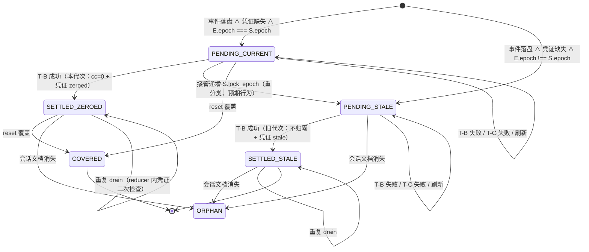
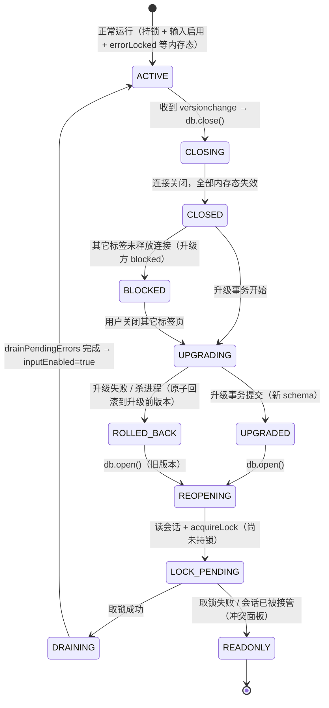

# 单词默写 V2 · Phase 1.2.3 统计判据与升级中断恢复补充审查

> **状态：纯设计、只读审计，未实施、未验证、未批准。** 零源码改动、零迁移、零 git 写操作；完成后停止，不进入实施。
> 承接：`Phase1.2.2-准入裁定补丁.md`（下称 1.2.2）、`Phase1.2.1-最终准入补充审查报告.md`（1.2.1）、`Phase1.2-最终设计闭环报告.md`（V1.2）。**本报告只处理本轮点名的 P0 / P1 / P2 事项**；对 1.2.2 中被修订的部分逐处标注。
> **不解除 G9、不决定 Dexie version、不把任何待批准设计写成已批准。**

## 0.1 五类证据标注（本报告全篇强制使用）

| 标签 | 含义 |
| --- | --- |
| `【只读核实】` | 本轮通过 Read / Grep / git 只读命令，在**当前工作树源码或文档**中直接看到的事实 |
| `【设计推导】` | 基于已核实源码与既有设计协议的推理，**未实测** |
| `【待自动化】` | 需 fake-indexeddb / 双 IDB 连接 / 双驱动测试证明 |
| `【待真机】` | 需 puppeteer-core + Edge 双标签（含 Chromium / Firefox 矩阵）证明 |
| `【需批准】` | 设计提案，负责人未裁定前不得实施、不得视为生效 |

> 一个结论可同时带多个标签（如 `【设计推导】【待自动化】`）。**`【只读核实】` 只描述源码现状，不代表该设计已落地。**

## 0.2 只读基线【只读核实】

| 项 | 结果 | 与 1.2.2 对比 |
| --- | --- | --- |
| Git HEAD | `760e999f785797e8b008943aca1809964686cc15` | 未变 |
| 暂存区 | 6 个 `A`（B12 系列） | 未变，**未擅自处理** |
| `产品方案/打字/` | `?? 产品方案/打字/`，目录内 6 份报告 + 需求文档 | 旧报告未改动 |
| 源码 Dexie 最高版本 | `src/services/storage/web.ts` L198 `version(11)`（L181 v9 / L190 v10 / L198 v11） | 未变，**源码无 v12/v13/v14** |
| `web.ts` 的 `db.on` / `versionchange` / `blocked` | Grep → **零匹配** | 未变，与 V1.2.7 L250「缺少监听」一致 |
| 设计原语落地检查 | 全仓 `src/` Grep `insertIfAbsent\|updateAtomic\|appendFromSnapshot\|lock_epoch\|applied_error_event_ids\|covered_event_ids\|SpellingMistakes\|spellingErrorEvents\|active_wrong_count\|total_error_events` → **零匹配** | 未变，V1.1–1.2.2 全部仍是设计态 |
| 前提卡 | 上层 `shutree/产品前提卡-给协作方.md`（2026-10-31 版）；红线「绝不编造数据」「已写好的代码不要动」见 L660-661 / L1007-1008 | 本轮纯设计 → **未改动** |
| G9 / D9 | **仍阻塞**，未取得并行架构负责人书面协调结果 | **本轮不解除、不决定版本号** |

**本轮未运行** `tsc --noEmit` / `npm test` / `npm run build` / `python scripts/check_pwa.py`：零源码改动，且 `npm run build` 会写 `dist/`，与保护范围冲突。实施阶段必须全量执行并分别报告当前工作树 / 提交树结论。

## 0.3 本轮只读核实清单（第 2 章的证据基础）

| 文件 / 位置 | 只读核实到的内容 |
| --- | --- |
| `src/domain/spelling.ts` L58-62 | `SpellingSessionStatus = 'IN_PROGRESS' \| 'PAUSED' \| 'SESSION_COMPLETED' \| 'ABANDONED'` |
| 同文件 L39 | 注释：「暂停超过这个时长提示用户「恢复或放弃」（方案 §4.3，7 天）。**MVP 不静默删除历史**」 |
| 同文件 L439 | `session.status = 'SESSION_COMPLETED'`（队列全部终态时），**改状态、不删文档** |
| 同文件 L638 / L642-644 / L650-651 | `pauseSession` / `resumeSession` / `abandonSession` 均返回 `{ ...cloneSession(session), status: ... }` 整份覆盖，**不删除** |
| `src/domain/spellingSession.ts` L107-115 | `getAllSessions()` = `SESSIONS.toArray()` 全表读 + 按 `started_at` 倒序；`listHistory(limit)` = `getAllSessions().slice(0, limit)`，**只读、不清理** |
| 同文件 L121-153 | `getActiveSession` / `getActiveSessions` / `getResumableSession`（`IN_PROGRESS` 或 `PAUSED`）/ **`getSessionById(id)` = `SESSIONS.get(id)` 精确读** |
| 同文件 L166-183 | `mutate()` = `getResumableSession()` → 纯函数 → `SESSIONS.put()`（整份写回，非事务、无 CAS） |
| 同文件 L283-303 | `pause` / `resume` / `abandon` 全部走 `SESSIONS.put()`，**无 delete** |
| 同文件 L343-351 | 注释：「会话自然结束（SESSION_COMPLETED）后 `getResumableSession()` 返回 null」「现改为**扫描全部会话**（含 SESSION_COMPLETED / ABANDONED）」→ `repairSrsHandoff` 依赖终态文档仍可读 |
| 同文件全文 | Grep `delete\|clear\|archive\|prune\|remove` 仅命中注释里的 `removeFromVocab`（**词条**硬删除，非会话文档）。**`spellingSession.ts` 中不存在任何删除会话文档的代码** |
| `src/services/storage/web.ts` L289-291 | `clearAll()` = `await Promise.all(TABLE_NAMES.map((n) => db[n].clear()))` —— **逐表并发清空、非事务**，可能部分成功 |
| `src/services/storage/types.ts` L51 | 注释「清空全部本地学习数据（设置页「清除数据」用）」；但本轮 `src/` Grep `clearAll(` 只命中 `web.ts` / `memory.ts` / `types.ts` 三处定义与 `Import.tsx` L518、`ConvertPanel.tsx` L186 两个**页面局部同名函数**（UI 状态清空），**未找到 `storage.clearAll()` 的调用点** |
| `src/services/storage/web.ts` L227-228 | `TableService.delete(key)` 存在；`learning.ts` 用它删 vocab / annotations / readings / recitations，`auth/web.ts` 删的是 `storage.table('session')`（**不是 `spellingSessions`**） |
| `src/main.tsx` L21-31 | 启动顺序 `initStorage()` → `reconcileTranscriptReadings()` → `render`；**无 `drainPendingErrors()` 钩子**（设计态），启动期不做错词本结算 |
| 全仓 `src/` | `SpellingMistakes` / `spellingErrorEvents` / `active_wrong_count` / `total_error_events` → **零匹配**：错词本聚合入口在源码中不存在，属设计态 |
| 并行文档 `...V1.2.7-...门禁审查版.md` | L250 / L254-256 / L262 / L269-272 / L275 / L287 / L300 / L402 / L411：`versionchange` 中须 `db.close()`；升级方 `blocked` 弹窗；升级事务原子、失败回滚到升级前版本；Dexie 不可就地降级；D3 待裁定；门禁「不满足可以进入条件」 |

---

## 1. P0 · 补齐 D12 的 stale 判定漏洞

### 1.1 漏洞复现（按负责人给出的时序逐拍展开）

| t | 动作 | 持久化状态 | 1.2.2 D12 矩阵的分类 |
| --- | --- | --- | --- |
| t0 | 标签 A 持锁，`S.lock_epoch = 1`；A 校验锁通过并 `await insertIfAbsent(E)` | 会话 epoch=1 | — |
| t1 | 标签 B 用户显式「接管」，`active_tab_id=B` 且 **`S.lock_epoch = 2`**（同一 `updateAtomic`） | 会话 epoch=2 | — |
| t2 | A 的 in-flight `insertIfAbsent(E)` 落盘，事件行带 **`E.lock_epoch = 1`**（写入时冻结） | 事件 E 存在，凭证**缺失** | — |
| t3 | T-B 尚未执行 / 执行失败 / 崩溃 | 凭证仍缺失 | — |
| t4 | 错词本聚合读 `S.applied_error_event_ids[E]` → `undefined` | — | 1.2.2 §1.3 矩阵把「凭证缺失、会话活跃」归为**本代次有效 error（待结算）** → **计入 `active_wrong_count`** ❌ |

**【设计推导】结论**：1.2.2 的矩阵在「凭证缺失」分支只判断了「会话是否活跃」，**没有判断代次**，把旧代次待处理事件误判为当前代次待结算事件。这个误判在 T-B 长期失败（死信 / 用户离开页面）时会**持续显示**，不是瞬时抖动。

### 1.2 五个必答问题（逐条明确回答）

| # | 问题 | 回答 | 标注 |
| --- | --- | --- | --- |
| Q1 | 当前 D12 矩阵是否会将上述事件错误计入 `active_wrong_count`？ | **会**。1.2.2 §1.3 把「凭证缺失 + 会话活跃」单列为本代次有效 error，无代次比较；t4 必然命中该行。这是 1.2.2 的真实缺陷，本报告予以承认并修订 | `【设计推导】` |
| Q2 | 凭证缺失时，是否必须比较事件 `lock_epoch` 与会话 `lock_epoch`？ | **必须**。凭证缺失时唯一可用的、持久化的、与时间无关的代次判据就是这对整数比较。`status` 非权威（`T-C` 可能失败）、`occurred_at` 已废弃、`active_tab_id` 只标识当前持锁者不标识事件归属 | `【设计推导】【待自动化】` |
| Q3 | 如何区分当前代次待结算事件和旧代次待处理事件？ | 凭证缺失时：`E.lock_epoch === S.lock_epoch` → **`PENDING_CURRENT`**（当前代次待结算，计入 active）；否则 → **`PENDING_STALE`**（旧代次待处理，**不计入** active）。凭证已存在时以凭证为准（`'zeroed'` / `'stale'`），不再做代次比较。详见 1.3 | `【设计推导】【待自动化】` |
| Q4 | T-B 未完成、T-C 失败、页面刷新、重复 drain 时，两个统计指标是否始终一致？ | **是**，前提是采用 1.3 的分类函数。证明见 1.6：`active` 集合成员关系在上述四种情况下不变；`total_error_events` 恒等于事件行数，任何情况都不变。例外只有「接管」与「reset」引起的**主动重分类**，二者都有明确产品语义且 `total` 不变 | `【设计推导】【待自动化】` |
| Q5 | 不依赖 `status`、`occurred_at` 的前提下，如何证明统计结果正确？ | 分类函数的输入只有：① `event_id` 在凭证 / `covered` 集合中的成员关系；② 持久化整数 `E.lock_epoch` 与 `S.lock_epoch`；③ `kind` / `owner` / `word_id` 分组。全部可读、可重算、可持久化。完整证明见 1.6 | `【设计推导】【待自动化】` |

### 1.3 修订后的分类函数 `classify(E, S)`【设计提案】

```ts
type StatClass =
  | 'COVERED'          // 被 reset 覆盖
  | 'SETTLED_ZEROED'   // 凭证 = 'zeroed' / true（本代次已归零）
  | 'SETTLED_STALE'    // 凭证 = 'stale'（旧代次已终结、不归零）
  | 'PENDING_CURRENT'  // 凭证缺失 ∧ 代次相等（当前代次待结算）
  | 'PENDING_STALE'    // 凭证缺失 ∧ 代次落后（旧代次待处理）
  | 'ORPHAN'           // 会话文档不存在
  | 'UNCLASSIFIABLE'   // 代次字段缺失的脏数据

function classify(E: ErrorEvent, S: SpellingSession | null, covered: Set<string>): StatClass {
  // ① reset 覆盖优先（内容寻址、幂等、单调）
  if (covered.has(E.event_id)) return 'COVERED'
  if (!S) return 'ORPHAN'                                  // ⑤ 见第 2 章
  // ② 已终结处理的凭证是最高权威：一旦写入，不再随代次变化
  const v = S.applied_error_event_ids?.[E.event_id]
  if (v === 'stale') return 'SETTLED_STALE'
  if (v === 'zeroed' || v === true) return 'SETTLED_ZEROED'
  // ③ 凭证缺失 → 代次比较（本轮新增的兜底判据）
  if (typeof E.lock_epoch === 'number' && typeof S.lock_epoch === 'number') {
    return E.lock_epoch === S.lock_epoch ? 'PENDING_CURRENT' : 'PENDING_STALE'
  }
  // ④ 脏数据保守处理：不猜测、不编造
  return 'UNCLASSIFIABLE'
}

// 两个指标（口径唯一化）
const active = allErrors.filter(E =>
  ['PENDING_CURRENT', 'SETTLED_ZEROED'].includes(classify(E, S_by_session[E.session_id], covered)))
const active_wrong_count = active.length
const total_error_events  = allErrors.length   // 与分类无关，恒为 kind='error' 行数
```

**优先级说明（必须按此顺序，不得调换）**【`【设计推导】`】：

1. `COVERED` 最高：reset 是用户主动移除，覆盖一切其它分类；
2. **凭证优先于代次**：若某旧代次事件在接管前已完成 T-B 并写入 `'zeroed'`，它的归零已作用于**共享的**会话文档，属于真实生效的错误，仍计入 active；若已写 `'stale'`，则明确不计入。凭证一旦写入就是终局，不因后续接管而重分类；
3. 只有**凭证缺失**时才回退到代次比较 —— 这正是 t4 场景的修复点；
4. `ORPHAN` / `UNCLASSIFIABLE` 保守**不计入** active、计入 total，不抛错、不白屏、不编造数字。

> `S` 必须按 `E.session_id` 用 `getSessionById(id)` 精确读【`【只读核实】` L150-153】；**禁止**用 `getResumableSession()`（L141-148 返回「最新」会话，会把事件挂到错误文档上，V1.1 §2.4 已明确）。

### 1.4 状态转换表



| 状态 | 计入 `active_wrong_count` | 计入 `total_error_events` | 出现在错词本列表 | 说明 |
| --- | --- | --- | --- | --- |
| `PENDING_CURRENT` | ✅ | ✅ | ✅ | 当前代次待结算：错误真实发生在当前会话，归零未完成不应影响入册 |
| `SETTLED_ZEROED` | ✅ | ✅ | ✅ | 已归零，正常活动错词 |
| `PENDING_STALE` | ❌ | ✅ | ❌ | **本轮修复点**：旧代次 in-flight，T-B 未跑 |
| `SETTLED_STALE` | ❌ | ✅ | ❌ | 旧代次已终结 |
| `COVERED` | ❌ | ✅ | ❌ | 已被 reset 移除（历史保留） |
| `ORPHAN` | ❌ | ✅ | ❌ | 会话文档不存在，见第 2 章 |
| `UNCLASSIFIABLE` | ❌ | ✅ | ❌ | 脏数据，保守处理 |

### 1.5 完整恢复矩阵（两个指标在各崩溃点的一致性）

| # | 场景 | 持久化状态 | `classify(E,S)` | `active_wrong_count` | `total_error_events` | T-B 成功后是否变化 | 恢复动作 |
| --- | --- | --- | --- | --- | --- | --- | --- |
| R1 | **T-B 尚未执行**（点名场景） | 事件在、凭证缺失、`E.epoch=1`/`S.epoch=2` | `PENDING_STALE` | 0 | 1 | 变 `SETTLED_STALE` → 仍 0 | drain 按 `event_id` 重放 T-B；统计无需等待 T-B |
| R2 | **T-B 执行失败 / 抛错** | 同上（凭证仍缺失） | `PENDING_STALE` | 0 | 1 | 同 R1 | 重试 3 次 → `dead`；统计保持锁定横幅，不假报成功 |
| R3 | **T-B 前崩溃 / 页面刷新** | 事件行持久化、凭证缺失 | `PENDING_STALE` | 0 | 1 | 同 R1 | 启动 / 进页 `drainPendingErrors()` 重放；`classify` 纯函数重算一致 |
| R4 | **T-C 失败 / status 落后** | 凭证已写、事件 `status='recorded'` | `SETTLED_STALE` 或 `SETTLED_ZEROED` | 按凭证 | 1 | 不变 | drain 补 T-C；**`status` 不参与 classify** |
| R5 | **T-C 超前（重试路径先写 settled）** | `status='settled'` 但凭证缺失 | `PENDING_STALE` / `PENDING_CURRENT` | 按代次 | 1 | 收敛 | drain 只看凭证，绝不以 status 跳过 |
| R6 | **重复 drain / 重复监听** | 凭证已有 | `SETTLED_*` | 不变 | 1 | 不变 | P0-1 reducer 二次检查 `return s`，不新增行、不改凭证 |
| R7 | **当前代次待结算**（对照） | 凭证缺失、`E.epoch === S.epoch` | `PENDING_CURRENT` | 1 | 1 | 变 `SETTLED_ZEROED` → 仍 1 | 正常 T-B 归零 |
| R8 | **接管递增 epoch** | `S.epoch 1→2`，仅影响凭证缺失事件 | `PENDING_CURRENT → PENDING_STALE` | 1 → 0（**预期重分类**） | **恒 1** | — | 已 `SETTLED_*` 的事件不受影响（凭证优先） |
| R9 | **reset 覆盖** | `covered_event_ids` 含 E | `COVERED` | -1（单调减） | **恒 1** | 不变 | D11 内容寻址、幂等 |
| R10 | **时钟回拨 / 同毫秒 / 乱序落盘** | 判据不含时间 | 不变 | 不变 | 1 | 不变 | 无时间比较 |
| R11 | **会话文档消失**（`clearAll` 部分成功 / 未来物理删除） | `S = null` | `ORPHAN` | 0 | 1 | 不变 | 见第 2 章；不抛错、不造数 |
| R12 | **代次字段缺失的脏数据** | `E.lock_epoch` 或 `S.lock_epoch` 未定义 | `UNCLASSIFIABLE` | 0 | 1 | 不变 | 保守排除；不猜测归属 |

> R1–R3 是本轮 P0 的核心：**统计不再等待 T-B**，因此 T-B 未完成 / 失败 / 崩溃 / 刷新都不改变 `active_wrong_count`。

### 1.6 不依赖 `status` / `occurred_at` 的正确性证明【设计推导】

**命题**：设 `classify` 如 1.3 定义，`active(E) := classify(E) ∈ {PENDING_CURRENT, SETTLED_ZEROED}`。则除「接管」与「reset」两类主动重分类外，T-B 是否完成、T-C 是否成功、页面刷新、重复 drain 均不改变 `active` 集合与 `total_error_events`。

**证明**：

1. **输入集合**：`classify` 只读取 ① `E.event_id` 在 `covered` / `applied_error_event_ids` 中的成员关系；② 持久化整数 `E.lock_epoch` 与 `S.lock_epoch`；③ `E.kind` / `E.owner` / `E.word_id` 与 `S` 的存在性。`status`、`occurred_at`、客户端时钟、UI 三态、内存锁标志**均不在输入中**。
2. **T-B 成功的影响**：`PENDING_CURRENT → SETTLED_ZEROED`（二者都 ∈ active），`PENDING_STALE → SETTLED_STALE`（二者都 ∉ active）。两种转换都不改变 `active` 成员关系。∎
3. **T-B 未完成 / 失败 / 崩溃 / 刷新**：状态保持 `PENDING_*`，按 2 与「T-B 成功」给出同一 `active` 结论；所有输入（事件行、会话文档的 epoch 与凭证）都是持久化字段，刷新后重算逐项相同。∎
4. **T-C 失败 / 超前**：`status` 不是 `classify` 的输入（1），故零影响；V1.2 §2.1 已确立「status 非正确性权威」。∎
5. **重复 drain**：T-B 的 reducer 内凭证二次检查（1.2.1 P0-1）保证不重复归零、不重复写凭证；`insertIfAbsent` 保证不新增事件行 → `covered` / 凭证 / 事件行三个输入集合均不变 → `classify` 输出不变。∎
6. **`total_error_events`**：定义为 `kind='error'` 的行数，与 `classify`、凭证、`status`、epoch、reset 全部解耦；append-only 表只增不删（除非 `clearAll()`），故恒为行数。∎
7. **两个例外（非不一致，是产品语义）**：接管递增 `S.lock_epoch` 会把**凭证缺失**事件从 `PENDING_CURRENT` 单向重分类为 `PENDING_STALE`（该事件已不属于当前代次）；reset 让 `covered` 单调增长，把事件单向移出 active。两者方向确定、幂等、且 `total` 不变；已 `SETTLED_*` 的事件因「凭证优先」不参与接管重分类。∎

**残余前提**【`【待自动化】`】：`E.lock_epoch` 必须在事件写入时**正确冻结**为当时校验通过的代次（1.2.1 §3.3(c) 步骤 2-3）；若实现漏写或写错，`classify` 会给出错误分类。由 C47/T70、C51/T74 覆盖。

### 1.7 对 1.2.2 的连带修订（逐处标注）

| 位置 | 1.2.2 原文 | 本报告修订 | 影响 |
| --- | --- | --- | --- |
| §1.3 三类事件矩阵 | 「本代次有效 error：凭证为 `'zeroed'`（**或会话活跃且凭证缺失、待结算**）」 | 凭证缺失时必须**先做代次比较**，拆为 `PENDING_CURRENT` / `PENDING_STALE` | **修复 P0 漏洞** |
| §1.4 `classify` 判据 | 只读凭证，未定义凭证缺失分支 | 补 1.3 的 5 级优先级 | 判据闭合 |
| §1.5 连带修订表 | 未列本项 | 新增本表 | — |
| U11 描述 | 「残留从错词计数多 1 精确化为历史指标 +1、活动错词本不变」 | **仅在 T-B 完成后成立**；本轮补上 T-B 未完成时的兜底判据，使该结论在任意时刻成立 | 口径闭环 |
| 1.2.1 §3.3(d) `settleReducer` | stale 写凭证 `'stale'` | 不变；但明确「统计不等待 T-B」，凭证是**结算权威**而非**统计前提** | 职责澄清 |

### 1.8 新增自动化测试设计

| # | 场景 | 断言要点 | 层级 |
| --- | --- | --- | --- |
| **C47/T70** | **点名场景**：A 旧 epoch / B 接管 / A in-flight 落盘 / T-B 未跑 | `classify=PENDING_STALE`；`active_wrong_count=0`；`total_error_events=1`；随后 T-B 成功 → 仍 `0/1` | `【待自动化】` + `【待真机】` |
| **C48/T71** | 凭证缺失 ∧ `E.epoch === S.epoch` | `PENDING_CURRENT` → `1/1`；T-B 后 `SETTLED_ZEROED` → 仍 `1/1` | `【待自动化】` |
| **C49/T72** | R1–R6 矩阵（T-B 未跑/失败/崩溃、T-C 失败/超前、刷新、重复 drain） | 每行两指标与 1.5 表逐项一致；断言实现**未读取** `status` / `occurred_at` | `【待自动化】` |
| **C50/T73** | 接管递增 epoch | 凭证缺失事件 `1/1 → 0/1`；已 `SETTLED_*` 事件不变；`total` 恒 1 | `【待自动化】` + `【待真机】` |
| **C51/T74** | 凭证优先级 > epoch | 旧代次但已 `'zeroed'` → 计入；已 `'stale'` → 不计入；`E.lock_epoch` 缺失 → `UNCLASSIFIABLE` | `【待自动化】` |
| **C52/T75** | `covered` 优先级最高 | reset 覆盖 `PENDING_CURRENT` / `SETTLED_ZEROED` / `PENDING_STALE` 三类均不计入 active，total 不变 | `【待自动化】` |
| **C53/T76** | 脏数据容错 | 缺 `lock_epoch` / 缺 `session_id` / `S=null` → 不抛错、不白屏、不编造数字；UI 走空态或历史视图 | `【待自动化】` |

> 详细编号与验证层级汇总见第 5 章。

---

## 2. P1 · session 文档生命周期只读核对

### 2.1 生命周期核对表【全部 `【只读核实】`】

| 环节 | 源码位置 | 实际行为 | 是否删除会话文档 |
| --- | --- | --- | --- |
| 创建 | `spellingSession.ts` L197 `createSession` | 遇活跃会话抛 `SESSION_CONFLICT`，否则 `SESSIONS.put()` 新文档 | 否 |
| 提交 / 跳过 | L253 `submitAttempt` / L267 `skip` → L166 `mutate` | `getResumableSession()` → 纯函数 → `SESSIONS.put()` 整份覆盖 | 否 |
| 暂停 | L283 `pause` → `spelling.ts` L638 | `{ ...cloneSession(s), status:'PAUSED', ... }` → `put` | 否 |
| 恢复 | L288 `resume` → `spelling.ts` L642-644 | 从 `PAUSED` 读 → `put` 回 `IN_PROGRESS` | 否 |
| 完成 | `spelling.ts` L439 | `session.status = 'SESSION_COMPLETED'`（队列全终态） | 否 |
| 放弃 | L297 `abandon` → `spelling.ts` L650-651 | `{ ...cloneSession(s), status:'ABANDONED', ended_at, ... }` → `put` | 否 |
| 历史列表 | L107 `getAllSessions` / L113 `listHistory` | `toArray()` + 倒序 + `slice(limit)`，**纯只读**；L139 注释「本层不吞掉历史」；`spelling.ts` L39「MVP 不静默删除历史」 | 否 |
| SRS 补交 | L343-351 `repairSrsHandoff` | 注释明确「扫描**全部会话**（含 SESSION_COMPLETED / ABANDONED）」→ **依赖终态文档仍存在** | 否 |
| 删除 / 归档 / 清理 | `spellingSession.ts` 全文 Grep | **无任何 `delete` / `clear` / `archive` / `prune` 调用**；`learning.ts` 的 delete 针对 vocab / annotations / readings / recitations；`auth/web.ts` 的 delete 针对 `storage.table('session')`（**非 `spellingSessions`**） | 否 |
| 物理清空 | `web.ts` L289-291 `clearAll()` | `Promise.all(TABLE_NAMES.map(n => db[n].clear()))`，**逐表并发、非事务** | **是，且可能部分成功** |
| 清空入口 | `types.ts` L51 注释 + `src/` Grep `clearAll(` | 注释写「设置页『清除数据』用」，但本轮**未找到 `storage.clearAll()` 的调用点**；`Import.tsx` L518 / `ConvertPanel.tsx` L186 是页面局部同名 UI 状态清空函数 | 见 2.2 |
| 恢复入口 | L121-153 | `getActiveSession` / `getActiveSessions` / `getResumableSession` / **`getSessionById`（精确读）** | 否 |
| 错词本聚合入口 | 全仓 `src/` Grep | **零匹配**，`spellingErrorEvents` / `SpellingMistakesPanel` / 两个统计指标均不存在 | — |
| 启动期恢复 | `main.tsx` L21-31 | `initStorage()` → `reconcileTranscriptReadings()` → render；**无 `drainPendingErrors()`** | — |

### 2.2 明确回答：`session_id` 对应的会话文档是否可能先于错误事件消失？

**【只读核实 + 设计推导】分四种路径回答：**

| 路径 | 是否可能 | 依据 |
| --- | --- | --- |
| 常规生命周期（创建→暂停→恢复→完成→放弃） | **不可能** | 全部只改 `status` 并 `put`，文档保留；`repairSrsHandoff` 还依赖终态文档可读【只读核实 L343-351】 |
| 历史列表 / 归档 / 静默清理 | **当前不可能** | 源码无删除代码，且 `spelling.ts` L39 明确「MVP 不静默删除历史」【只读核实】 |
| **`clearAll()` 非事务部分成功** | **可能，且是现有源码能力内唯一现实路径** | `Promise.all` 逐表 `clear()`【只读核实 L289-291】：若 `spellingSessions` 清空成功而 `spellingErrorEvents` 未清空（或反之），即产生 orphan。U5 / C24 / T47 已记录该非事务风险 |
| 未来引入历史物理清理 / 存储配额驱逐 | **可能（未来 / 外部）** | 当前不存在；配额驱逐属 V1.2 U3 存储层风险，非代码删除 |

> 注意：`clearAll()` 全表一起清空且全部成功时**不产生 orphan**（两边同时消失）。orphan 只在**部分成功**时出现。

### 2.3 处理方案（不增加表 / 索引、不修改 schema、不破坏 append-only 与产品口径）

| 方案 | 内容 | 约束符合性 | 标注 |
| --- | --- | --- | --- |
| **A（推荐，立即可用）** | **会话文档只做逻辑终态，不物理删除**；历史清理若未来实现，只允许改 `status` / 打归档标记，**禁止 `delete` 会话文档**。错词本聚合用 `getSessionById(E.session_id)` 精确读【只读核实 L150-153】，容忍返回 `null` | 不加表 / 索引 / schema；不改 append-only；不改产品口径；**与现有源码行为一致** | `【设计推导】【需批准】` |
| **B（orphan 容错）** | `S = null` → `classify = ORPHAN`：不计入 `active_wrong_count`、计入 `total_error_events`；UI 提示「部分数据可能未完全清除，请重新清除」，错词本走 `EmptyState` 或历史视图；**不自动造数、不自动补齐、不重建会话** | 沿用 U5 / C24 / T47 既有口径；不编造数据 | `【设计推导】【需批准】` |
| **C（未来若确需物理删除，本轮不实施）** | 删除会话文档**之前**执行「终态封存」：把该会话所有未结算事件的处置结论写成事件表内 **append-only `kind='settlement'` 行**（新增**事件种类**，不是新表、不是新索引、不改 `stores()` 声明），携带 `session_id` / `event_id` / `settlement` / `lock_epoch` 快照，按 `settlement_event_id` 幂等。聚合优先级：会话凭证 > 封存行 > 代次比较 > `ORPHAN` | 不加表 / 索引 / schema；append-only 保持；但引入**双凭证源**，须证明优先级与一致性 | `【设计推导】【需批准】` |
| **D（明确禁止）** | 为修复 orphan 而**删除 / 重写历史 error 事件行**，或把会话凭证**复制进事件行**做「自包含」判据 | ❌ 违反 append-only 红线；双写会造成凭证与 `cc=0` 不再同事务原子，破坏 P0-1 | `【设计推导】` |

**为什么 A 能解决问题**：`classify` 需要的 `S.lock_epoch` 与凭证都在会话文档里；只要文档不物理删除，`PENDING_CURRENT` / `SETTLED_ZEROED` 就能被正确识别，错词本不会因会话终态而突然清空。`clearAll` 部分成功是唯一缺口，由 B 兜底。

**对产品口径的保护**【`【设计推导】`】：所有方案都**不删除历史 error 行**，因此 `total_error_events` 恒等于行数；「reset 只从活动错词本移除」「移除后再次答错从 1 起」「一次拼写三个错误字母计三次」均不受影响；A 与现有源码行为一致，不改变任何既有页面表现。

### 2.4 新增测试

| # | 场景 | 断言要点 | 层级 |
| --- | --- | --- | --- |
| **C54/T77** | 会话 PAUSED / SESSION_COMPLETED / ABANDONED 后聚合 | 文档仍可读；`getSessionById` 返回非 null；`active_wrong_count` 不因终态归零；`repairSrsHandoff` 仍可扫到 | `【待自动化】` |
| **C55/T78** | `clearAll()` 部分成功（注入一表 `clear` 失败） | orphan 事件 `0/1`；UI 提示重新清除；无造数、无异常、无白屏 | `【待自动化】` + `【待真机】` |
| **C56/T79** | 未来「逻辑归档」与封存行（方案 A / C） | 逻辑归档只改 status 不 delete；封存行幂等、优先级正确、与会话凭证不冲突 | `【待自动化】【需批准】` |

---

## 3. P1 · 补齐 U16 升级中断恢复协议

### 3.1 前提与两条铁律

**背景**【`【只读核实】`】：并行架构 V1.2.7 L254-256 / L275 / L287 要求 `web.ts` 补 `db.on('blocked')` 与 `db.on('versionchange')`，其中 **`versionchange` 中须调用 `db.close()`**；升级事务原子、失败回滚到升级前版本；Dexie 不可就地降级；D3 仍待裁定、门禁未通过。本任务源码当前 `web.ts` 无这些监听（本轮 Grep 零匹配）。

> **铁律 1**：**不得声称 `db.close()` 后原事务仍可继续。** 连接关闭后，该连接上任何**未确认提交**的事务一律按「未提交」处理；不依赖「close 时 in-flight 事务是被中止还是被允许跑完」这一实现差异 —— 恢复逻辑**只认持久化状态**。若某事务其实已提交，凭证与事件行的幂等重放也会收敛到同一结果。
>
> **铁律 2**：**重新打开数据库 ≠ 已取得写锁。** `db.open()` 只恢复连接；必须重新 `getSessionById` 读会话、重新执行 `acquireLock()`（校验 / 覆写 `active_tab_id` + **重新读取** `lock_epoch`）、重新 `drainPendingErrors()`，最后才置 `inputEnabled=true`。

### 3.2 升级阶段状态机



### 3.3 七场景恢复矩阵（每场景含 5 要素）

| # | 场景 | 持久化状态 | 恢复入口 | 幂等依据 | 用户可见状态 | 测试层级 |
| --- | --- | --- | --- | --- | --- | --- |
| **S1** | **T-A 已提交、T-B 未提交** | 事件行在（`status` 任意）、会话凭证缺失、`S.lock_epoch` 已持久化 | 重新连接后 `drainPendingErrors()` 按 `event_id` 重放 T-B | `insertIfAbsent` 主键幂等 + T-B reducer 内凭证二次检查（1.2.1 P0-1）；统计侧由 1.3 `classify` 保证 T-B 前后 `active` 不变 | 「数据升级中…」→ 升级完成后短时「正在记录本次错误…」，**输入保持禁用**直至 drain 收敛 | `【设计推导】【待自动化】` + `【待真机】` |
| **S2** | **T-B 已提交、T-C 未提交** | 凭证已写、`cc=0`；事件 `status` 落后（`recorded`） | drain 查凭证 → **跳过 T-B**，补 T-C | 凭证是结算唯一权威；`status` 非权威，可落后 | 升级后直接可继续输入，不重复归零、不显示重复错误 | `【设计推导】【待自动化】` + `【待真机】` |
| **S3** | **`versionchange` 触发 `db.close()`** | **已提交事务的结果保留**；未确认提交的事务按「未提交」处理（铁律 1）；事件行 / 会话文档 / 凭证均不被修改 | 丢弃全部内存态 → 等待升级 → 重新 `db.open()` → 走 3.2 恢复链 | 正确性只依赖持久化（事件主键、凭证、`covered`、`lock_epoch`），内存态可丢弃可重建 | 「数据升级中，请稍候」+ 输入禁用 + 缓冲输入清空并提示重输（**不静默丢失、不自动重放按键**） | `【设计推导】` + `【待真机】`（fake-indexeddb 无法完整模拟 close） |
| **S4** | **旧标签重新打开数据库** | 同上；连接恢复但 `active_tab_id` / `lock_epoch` 可能已被另一标签改写 | `getSessionById` → **`acquireLock()`** → `drainPendingErrors()` → 解锁 | 锁校验与写入在同一 `updateAtomic`（1.2.1 §3.3）；`lock_epoch` **必须重新读取**，不得沿用内存旧值 | 「正在恢复默写…」；若锁已被接管 → 冲突面板（铁律 2） | `【设计推导】【待自动化】` + `【待真机】` |
| **S5** | **升级 blocked** | 升级事务未提交，库仍是升级前版本；事件 / 会话文档原样 | 升级方弹窗提示「关闭其他标签页以完成更新」（V1.2.7 L254）；本任务页面**保持只读**、不发起新写入 | 无写入即无需幂等；已落盘事件与凭证不动 | 明确提示 + 只读，不静默失败、不假报升级完成 | `【设计推导】` + `【待真机】` |
| **S6** | **升级完成后重新取得锁** | 新 schema 生效；事件表 / 会话表数据原样保留（additive `.stores()`，V1.2.7 L257） | `db.open()` → `getSessionById` → `acquireLock()` → `drainPendingErrors()` → `inputEnabled=true`，**五步缺一不可** | 取锁走 `updateAtomic` 校验 / 覆写；`myTab` 可复用（标签页生命周期内 uuid），但 `myEpoch` **必须重读**；drain 按凭证幂等 | 恢复正常输入；连对次数、错词本与升级前一致 | `【设计推导】【待自动化】` + `【待真机】` |
| **S7** | **升级失败时旧版本页面的行为** | 升级事务原子回滚到**升级前版本**（V1.2.7 L256 / C5）；数据完整；Dexie **不可就地降级**（L262） | 旧版本页面重新 `db.open()` 后**重新校验 schema 版本与锁状态**，不得假定仍持锁；按 3.2 恢复链重走 | 回滚后持久化状态 = 升级前状态，S1/S2 的 drain 规则同样适用 | 「数据升级未完成，已恢复上一版本，请重试」+ 只读 / 重试入口；**不声称已在新版本、不沿用旧锁** | `【设计推导】` + `【待真机】` |

### 3.4 幂等依据与内存态失效清单

**正确性只依赖以下持久化状态**【`【设计推导】`】：`spellingErrorEvents` 行（`event_id` 主键、`lock_epoch` 冻结值、`covered_event_ids`）、`spellingSessions` 文档（`applied_error_event_ids` 凭证、`lock_epoch`、`active_tab_id`、`cc`）。

**`db.close()` 后一律失效、必须从持久化重建的内存态**：

| 内存态 | 重建方式 |
| --- | --- |
| `errorLocked` / `inputEnabled` | 由 `drainPendingErrors()` 收敛结果决定，取锁前恒为「锁定 / 禁用」 |
| `lockHeldLocally` / 锁标志 | 重新 `acquireLock()` |
| `myEpoch` | **从 `getSessionById` 重新读取 `S.lock_epoch`**，禁止沿用 |
| `myTab` | 可复用标签页生命周期内的 `uuid()`，但必须经 `acquireLock()` 重新验证 |
| 输入缓冲 / 逐字母进度 | 丢弃并提示重输，不自动重放按键 |
| 三态 UI（recorded / settled / failed） | 由凭证 + 事件行重算推导 |
| drain 循环引用 / 锁冲突面板状态 | 重建 |
| `status` 派生的展示态 | 由凭证重算，`status` 落后不影响 |

**T-A / T-B / T-C 三事务在升级中断下的收敛**【`【设计推导】`】：T-A 幂等靠主键；T-B 幂等靠 reducer 内凭证二次检查；T-C 的 `status` 非权威，失败或超前都不影响结算与统计。三者仍是**互相独立的单表事务**（V1.2 §2.1），本报告不把它们合并描述为原子事务。

### 3.5 与 G9 的边界

- 本协议的 `versionchange` / `blocked` / `db.close()` 能力**由并行架构任务负责落地**【`【只读核实】` V1.2.7 L254-256 / L287】，本任务只设计自身的恢复侧行为；
- **本轮不解除 G9、不决定 Dexie version、不修改 `web.ts`、不代替并行负责人裁定**（V1.2.7 D3 仍待裁定、门禁未通过）；
- 协议中「升级完成后重新取得锁」等步骤属于**设计提案**【`【需批准】`】，在 G9 关闭前不得实施；
- 新增 U18：`versionchange` 期间 `lock_epoch` 与会话文档版本的一致性**未实测**【`【待真机】`】。

### 3.6 新增测试

| # | 场景 | 断言要点 | 层级 |
| --- | --- | --- | --- |
| **C57/T80** | S1（T-A 提交 / T-B 未提交 + versionchange） | 重连后 drain 重放 T-B 恰一次；`cc=0`；两指标与 1.5 表一致 | `【待自动化】` + `【待真机】` |
| **C58/T81** | S2（T-B 提交 / T-C 未提交 + versionchange） | 不重复归零；补 T-C；`status` 落后不影响 | `【待自动化】` + `【待真机】` |
| **C59/T82** | S3（`db.close()` 中断 in-flight） | 未确认事务按未提交处理；**断言实现未声称原事务继续**；按持久化重放收敛 | `【待自动化】` + `【待真机】` |
| **C60/T83** | S4（重新 open ≠ 取得锁） | `db.open()` 后 `inputEnabled=false`；未 `acquireLock` 前所有 9 条写入路径均被拒；`myEpoch` 重读 | `【待自动化】` + `【待真机】` |
| **C61/T84** | S5（升级 blocked） | 页面只读、零写入、有明确提示；用户关闭其它标签后恢复链继续 | `【待真机】` |
| **C62/T85** | S6（升级成功后五步恢复链） | 五步缺一不可；注入「跳过 acquireLock」应被测试判定为失败 | `【待自动化】` + `【待真机】` |
| **C63/T86** | S7（升级失败回滚 / 旧版本页面） | 回滚后数据 = 升级前；重新校验版本与锁；不沿用旧锁、不假报新版本 | `【待真机】` |
| **C64/T87** | 真机矩阵 | Edge 双标签 + Chromium / Firefox 各跑 V1.2.7 C6 三用例（含升级中途杀进程）；本任务恢复链与升级流程叠加验证 | `【待真机】` |

---

## 4. P2 · 统一统计指标文案

### 4.1 两个指标定义【`【设计推导】`，口径沿用 1.2.2 §1.2】

| 指标 | 精确定义 | 含 stale | 含已 covered | 用途 |
| --- | --- | --- | --- | --- |
| `active_wrong_count` | **当前活动错词事件数** = `classify ∈ {PENDING_CURRENT, SETTLED_ZEROED}` 的 `kind='error'` 行数 | 否 | 否 | 错词本列表、徽标、排序、重练选词 |
| `total_error_events` | **历史错误事件行数** = 该 `(owner, word_id)` 下全部 `kind='error'` 行数 | 是 | 是 | 审计 / 历史视图 / 容量统计 |

### 4.2 UI 文案表【`【需批准】`】

| 指标 | 推荐文案 | 禁用文案 | 理由 |
| --- | --- | --- | --- |
| `active_wrong_count` | 「待重练错词 **N**」「当前错词 **N** 条」 | 「你错了 N 次」「拼错 N 次」 | 计数单位是**事件行**，不是「答题次数」；一个词可有多条事件 |
| `total_error_events` | 「历史错误记录 **N** 条」「累计错误事件 **N**」 | 「历史犯错 **N** 次」「你一共拼错 **N** 次」「累计错误次数 N」 | 见 4.3 |
| 两者同屏 | 必须分别标注、不得共用一个「错误次数」标签 | 「错误次数 N」（无口径说明） | 避免用户把两个数字理解为同一件事的不同视图 |

### 4.3 为什么不能把历史事件数标为「用户历史犯错次数」【`【设计推导】`】

1. **产品口径 2**：「一次拼写三个错误字母计三次」→ 用户主观是「拼错 1 次」，系统记 **3 条事件**。标成「次数」会系统性放大约 3 倍（该倍数是口径示例，**不是实测统计**）。
2. `total_error_events` 含 **stale 事件**（旧标签被接管后的错误）与**已被 reset 覆盖的事件**，用户未把这些理解为「我又犯了一次错」。
3. `event.repeat` 长按按既定输入规则处理（T02 / T03c / C38），其计数方式也不等同于主观「一次」。
4. 前提卡红线「绝不编造数据」：把「事件行数」表述为「犯错次数」属于**未经数据支持的语义转换**。

> 建议（【`【需批准】`】）：若产品确需「犯错次数」类指标，须**另立定义**（例如按「一次完整拼写尝试」聚合），并单独给出数据源与统计规则；本轮不新增指标、不擅自定义。

### 4.4 新增测试

| # | 场景 | 断言要点 | 层级 |
| --- | --- | --- | --- |
| **C65/T88** | UI 文案静态与渲染断言 | 两个指标分别标注；页面不出现禁用文案；一次 3 错字母场景显示「3 条」而非「3 次」；空数据走 `EmptyState` | `【待自动化】` + `【待真机】` |

---

## 5. 测试矩阵增量

### 5.1 编号索引（**旧编号全部保留，不覆盖、不改写结论**）

| 范围 | 来源 | 本轮处置 |
| --- | --- | --- |
| T01–T47 / C01–C24 | V1 / V1.1 / V1.2 | **全部保留** |
| T48–T61 / C25–C38 | 1.2.1 | **全部保留** |
| T62–T69 / C39–C46 | 1.2.2 | **全部保留**（其中 C45/T68 的分类期望按本报告 1.3 增补 epoch 兜底分支，**编号与场景名不变**） |
| **T70–T88 / C47–C65** | **本报告新增** | 19 项，见 5.2；**新编号，不占用任何旧编号** |

### 5.2 新增用例汇总

| # | 归属 | 场景 | 证据层级 |
| --- | --- | --- | --- |
| C47/T70 | P0 | 点名场景：凭证缺失 + epoch 落后，T-B 未跑 | `【待自动化】【待真机】` |
| C48/T71 | P0 | 凭证缺失 + epoch 相等 → `PENDING_CURRENT` | `【待自动化】` |
| C49/T72 | P0 | R1–R6 恢复矩阵六行两指标一致性 | `【待自动化】` |
| C50/T73 | P0 | 接管递增 epoch 的主动重分类 | `【待自动化】【待真机】` |
| C51/T74 | P0 | 凭证优先级 > epoch；代次字段缺失容错 | `【待自动化】` |
| C52/T75 | P0 | `covered` 优先级最高 | `【待自动化】` |
| C53/T76 | P0 | 脏数据 / `S=null` 不抛错不造数 | `【待自动化】` |
| C54/T77 | P1 生命周期 | 会话终态后文档可读、聚合不受影响 | `【待自动化】` |
| C55/T78 | P1 生命周期 | `clearAll()` 部分成功 → orphan 容错 | `【待自动化】【待真机】` |
| C56/T79 | P1 生命周期 | 逻辑归档 / 封存行（方案 A / C） | `【待自动化】【需批准】` |
| C57/T80 | P1 U16 | S1：T-A 提交 / T-B 未提交 | `【待自动化】【待真机】` |
| C58/T81 | P1 U16 | S2：T-B 提交 / T-C 未提交 | `【待自动化】【待真机】` |
| C59/T82 | P1 U16 | S3：`db.close()` 中断 in-flight | `【待自动化】【待真机】` |
| C60/T83 | P1 U16 | S4：重新 open ≠ 取得锁 | `【待自动化】【待真机】` |
| C61/T84 | P1 U16 | S5：升级 blocked | `【待真机】` |
| C62/T85 | P1 U16 | S6：升级成功后五步恢复链 | `【待自动化】【待真机】` |
| C63/T86 | P1 U16 | S7：升级失败回滚 / 旧版本页面 | `【待真机】` |
| C64/T87 | P1 U16 | 真机矩阵（双标签 + Chromium/Firefox + 杀进程） | `【待真机】` |
| C65/T88 | P2 | UI 文案静态与渲染断言 | `【待自动化】【待真机】` |

### 5.3 验证层级纪律

- 本报告所有并发 / 恢复 / 分类证明均为 `【设计推导】`。**未跑 C47–C65 / T70–T88 与真机矩阵之前，不得声称「stale 判定已修复」「升级中断已可恢复」「统计口径已验证」。**
- 自动化：fake-indexeddb 双连接 + memory/dexie 双驱动；`db.close()` / `versionchange` / `blocked` 的完整语义**只能真机验证**（`【待真机】`）。
- 真机：puppeteer-core + Edge 双标签（端口 4174），升级场景按 V1.2.7 C6 覆盖 Chromium + Firefox。
- 既有 6 套 `test_spelling*.ts` 断言不改；新增独立文件追加 `package.json` L11 的 `test` 链；`check_spelling_browser.mjs` 扩 S10+。

---

## 6. 裁定状态汇总（**补充内容 ≠ 批准**）

> 负责人尚未批准任何一项。本报告为 P0 / P1 / P2 补齐了设计，**状态一列无一被标成已批准 / 已确认 / 已解除**。

| 编号 | 本轮补充 | **状态** |
| --- | --- | --- |
| D1–D8 | 无 | **待批准** |
| **D9 / G9** | 本轮**不解除**；未取得并行负责人书面协调结果；未决定 Dexie version | **阻塞中（需外部明确书面输入）** |
| D10 | 无（1.3 的 `classify` 不依赖 D10，`updateAtomic` 契约不变） | **待批准** |
| D11 | 无 | **待批准** |
| D12 | 本报告**修订其 stale 判定**（1.3 分类函数、1.4 状态转换、1.5 恢复矩阵、1.6 证明） | **待批准（含本轮修订）** |
| D13 | 无 | **待批准** |
| Q2 / Q11 / Q12 | 无 | **待确认 / 待批准** |
| **D14（新增）** | 凭证缺失时的 `lock_epoch` 兜底判据 + 5 级分类优先级 + 状态转换表 + 两指标一致性证明 | **需批准** |
| **D15（新增）** | 会话文档「只逻辑终态、不物理删除」约束 + `ORPHAN` 容错口径 + 未来「终态封存行」方案（方案 C，本轮不实施） | **需批准** |
| **D16（新增）** | U16 升级中断恢复协议（七场景、两条铁律、内存态失效清单） | **需批准** |
| **D17（新增）** | 两个统计指标的 UI 文案表与禁用文案清单 | **需批准** |

> 新增 D14–D17 不改动 D1–D13 的编号与状态。**最低限度仍需裁定**：D1、D2、D4、D9（外部）、D10、D11、D12、D14、D15、D16。

---

## 7. 未解决问题增量

> U1、U3–U10、U12–U15 结论不变；以下仅列**有变化**的项。

| # | 变化 | 对数据正确性的影响 | 状态 |
| --- | --- | --- | --- |
| **U2 / G9** | 仍阻塞；本轮未取得协调结果、未决定版本号 | 未协调即迁移 → schema 覆盖 / ×10 夹具错误重建丢表 | **阻塞中** |
| **U11** | 1.2.2 的「活动错词本不含 stale」结论此前**仅在 T-B 完成后成立**；本轮 1.3 的 epoch 兜底把它扩展到 T-B 未跑 / 失败 / 崩溃 / 刷新 | 修复后 TOCTOU 残留不再污染 `active_wrong_count`；`total_error_events` 仍 +1 | **口径待批准（D12/D14）** |
| **U16** | 由「冲突风险」升级为**七场景恢复协议**；明确两条铁律 | 协议未实测；`versionchange`/`blocked` 能力由并行任务落地，归属未定 | **需批准 + 待真机（D16 / G9 验收第 4 条）** |
| **U17（新增）** | 会话文档 orphan 仅在 `clearAll()` **部分成功**时现实存在；未来物理清理 / 配额驱逐亦可能 | orphan 事件按 `0/1` 处理会让错词本变空，需 UI 明确提示「重新清除」，不得静默接受 | `【需批准】`（D15 / C55/T78） |
| **U18（新增）** | 升级窗口内 `S.lock_epoch`、`applied_error_event_ids`、`active_tab_id` 与事件行 `lock_epoch` 的一致性**未实测**；`db.close()` 对 in-flight 事务的实现差异未实测 | 若重连后读到半更新状态，可能错误分类或重复归零 | `【待真机】`（C64/T87） |

---

## 8. 保护范围逐条核对

| 约束 | 本轮执行 | 证据 |
| --- | --- | --- |
| 不修改源码、配置、数据库、迁移、Git 暂存区 | 是 | 本轮所有 Write / Edit 仅落在本报告与工作日志；`src/` 无本轮新增改动；暂存区 6 个 `A` 未变 |
| 不覆盖 `App.tsx` / `web.ts` / `domain/types.ts` / `memory.ts` 等并行改动 | 是 | 仅 Read / Grep，无写入 |
| 不修改前提卡 | 是 | 纯设计，红线沿用；正本在上层 `shutree/`，工作区副本仍为暂存删除状态，仅如实指出 |
| 不决定 Dexie version、不解除 G9 | 是 | 第 6 章 D9 仍「阻塞中」；第 3.5 节明确边界；未给出任何版本决定 |
| 不把任何待批准设计写成已批准 | 是 | 第 6 章全表状态为「待批准 / 待确认 / 需批准 / 阻塞中」；D14–D17 新增项亦为「需批准」 |
| 只新增本轮报告，追加日志前重读日志末尾 | 是 | 报告为新增文件；日志追加前已 Read 末尾确认无并行追加 |
| 完成后停止，不进入实施 | 是 | 本报告末尾即停止点 |

---

## 9. 交付说明、当前准入状态与剩余阻塞项

- **改了什么**：仅新增本报告 `产品方案/打字/Phase1.2.3-统计判据与升级中断恢复补充审查.md`，并在 `.workbuddy/memory/2026-11-04.md` 追加一条工作日志。**未改源码、配置、数据库、Git 暂存区或工作区已有文件**；未覆盖并行改动；未改前提卡；未实施任何迁移或版本决定。
- **只读核实了什么**：Git 基线、`web.ts` 最高 v11、设计原语与错词本聚合入口在 `src/` 零落地、`web.ts` 无 `db.on`/`versionchange`/`blocked`；**逐行核对 session 文档生命周期**（`spelling.ts` L39/L58-62/L439/L638/L642-644/L650-651、`spellingSession.ts` L107-153/L166-183/L283-303/L343-351）、`clearAll()` 非事务逐表清空、`main.tsx` 启动顺序；重核 V1.2.7 的 `versionchange` / `blocked` / 原子回滚 / 不可降级 / D3 待裁定 / 门禁结论。
- **没做什么**：无实现、无迁移、无真机实测；P0 分类函数、P1 生命周期方案、U16 恢复协议、P2 文案**全部为设计提案**；所有证明为 `【设计推导】`，须 C47–C65 / T70–T88 与真机矩阵验证后才能改写表述。
- **五类标注**：全篇使用 `【只读核实】` / `【设计推导】` / `【待自动化】` / `【待真机】` / `【需批准】`，表格「证据层级」列逐项标注。

### 9.1 当前准入状态

> **未获准入，不得进入源码实施。** D1–D8、D10–D13、Q2、Q11、Q12 全部「待批准 / 待确认」；新增 D14–D17 全部「需批准」；**D9 / G9 仍阻塞，未取得并行架构负责人对 v12/v13 的明确书面协调结果。**

### 9.2 剩余阻塞项（按优先级）

| # | 阻塞项 | 类型 | 解除条件 |
| --- | --- | --- | --- |
| B1 | **G9 / D9**：v12 与 v13 均被并行任务规划、D3 待裁定、门禁未通过 | **外部依赖，最高优先** | 并行架构负责人书面回复 1.2.2 §6.4 的 5 条验收标准并留痕 |
| B2 | **D12 / D14**：stale 判定修订与 epoch 兜底判据 | 设计裁定 | 负责人批准 1.3 分类函数、1.4 状态转换表、1.5 恢复矩阵 |
| B3 | **D15**：会话文档不物理删除 + orphan 容错口径 | 设计裁定 | 批准方案 A/B；方案 C 若采纳需另行评审双凭证源一致性 |
| B4 | **D16**：U16 升级中断恢复协议 | 设计裁定 + 外部依赖 | 批准协议；且 G9 验收第 4 条明确 `blocked`/`versionchange` 归属与双标签中断恢复约定 |
| B5 | **D17**：统计指标 UI 文案 | 产品裁定 | 批准文案表，或另立「犯错次数」指标定义 |
| B6 | D1 / D2 / D4 / D10 / D11 既有最低裁定集 | 设计裁定 | 逐项批准（1.2.2 §9 已列） |
| B7 | 所有 P0 / P1 证明仍为 `【设计推导】` | 验证 | C47–C65 / T70–T88 自动化 + 真机双标签 / Chromium+Firefox 矩阵实测 |
| B8 | 容量 / 聚合性能 / IndexedDB 配额无实测（U3 / U14） | 验证 | T45 / C22 压力测试产出实测数字；7–11 MB/年仍为估算，不得引用为事实 |
| B9 | U18：升级窗口内 epoch / 凭证一致性未实测 | 验证 | C64/T87 真机验证 |

**报告完成，已停止。等待负责人审批；G9 关闭前不得进入任何 schema / 迁移实施。**
