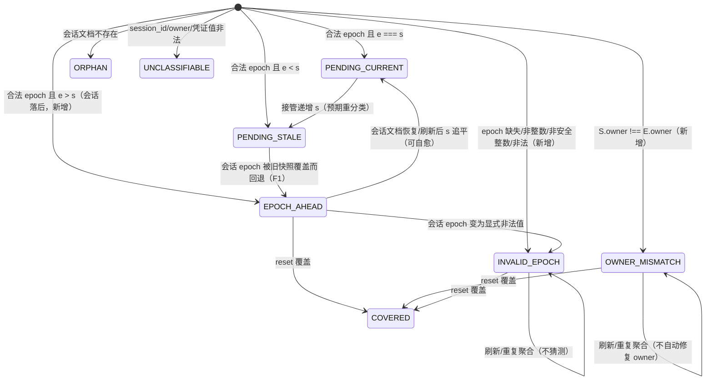

# 单词默写 V2 · Phase 1.2.3.1 分类边界与聚合快照补充审查

> **状态：纯设计、只读审计，未实施、未验证、未批准。** 零源码改动、零迁移、零 git 写操作；完成后停止，不进入实施。
> 承接：`Phase1.2.3-统计判据与升级中断恢复补充审查.md`（1.2.3）、`Phase1.2.2-准入裁定补丁.md`（1.2.2）、`Phase1.2.1-最终准入补充审查报告.md`（1.2.1）。**本报告只处理本轮点名的 P0-1 / P0-2 / P1 事项**，对 1.2.3 中被修订的部分逐处标注。
> **不解除 G9、不决定 Dexie version、不把任何待批准设计写成已批准、不未经批准增加表 / 索引 / 修改 schema。**

## 0.1 五类证据标注（沿用 1.2.3，全篇强制）

| 标签 | 含义 |
| --- | --- |
| `【只读核实】` | 本轮通过 Read / Grep / git 只读命令，在**当前工作树源码或既有报告**中直接看到的事实 |
| `【设计推导】` | 基于已核实源码与既有设计协议的推理，**未实测** |
| `【待自动化】` | 需 fake-indexeddb / 双 IDB 连接 / 双驱动测试证明 |
| `【待真机】` | 需 puppeteer-core + Edge 双标签（含 Chromium / Firefox 矩阵）证明 |
| `【需批准】` | 设计提案，负责人未裁定前不得实施、不得视为生效 |

## 0.2 只读基线与本轮核实清单【`【只读核实】`】

| 项 | 结果 |
| --- | --- |
| Git HEAD | `760e999`；暂存区 6 个 `A`（B12 系列）未变；`产品方案/打字/` 为未跟踪目录，旧报告未改 |
| 源码 Dexie 最高版本 | `src/services/storage/web.ts` L198 `version(11)`；**源码无 v12/v13/v14** |
| **`TableService` 契约** | `src/services/storage/types.ts` L21-43：`get/put/add/delete/toArray/bulkGet/bulkPut/count/whereIndex/whereStartsWith/clear`，**无事务、无只读快照方法**；L20 注释「单表读写能力」 |
| **`StorageService` 契约** | 同文件 L45-53：`driver` / `table(name)` / `open()` / `clearAll()`，**同样无事务 / 快照方法** → 跨表快照只能加在**存储门面**，不能挂在单表服务上 |
| `web.ts` / `memory.ts` 事务能力 | Grep `transaction\|db.on\|versionchange\|readSnapshot` → **零匹配**（仅命中 `readonly` 修饰符）；源码无任何事务实现 |
| `memory.ts` 读语义 | L103-105 `get()`、L129-130 `toArray()`、L151-163 `whereIndex()` 均为**同步构造 + `Promise.resolve`**；`await` 会让出微任务队列 |
| `web.ts` L289-291 | `clearAll()` = `Promise.all(TABLE_NAMES.map(n => db[n].clear()))`，**逐表并发、非事务** |
| `spellingSession.ts` L166-183 | `mutate()` = `getResumableSession()` → 纯函数 → `SESSIONS.put()`，**读改写非事务、无 CAS**（阶段 E 已知限制） |
| **1.2.3 §1.3 L93-107 原文** | `classify()` 的 L102-103 为 `if (typeof E.lock_epoch === 'number' && typeof S.lock_epoch === 'number') { return E.lock_epoch === S.lock_epoch ? 'PENDING_CURRENT' : 'PENDING_STALE' }`；L95 `covered` 优先、L96 `!S → ORPHAN`、L98-100 凭证优先、L105-106 兜底 `UNCLASSIFIABLE` |
| **G9 协调状态** | 全仓 `*架构设计*.md` Grep `spellingErrorEvents\|单词默写\|打字输入\|默写 V2` → **仅命中** `多端兼容改造-阶段1-响应式桌面架构设计.md` L43 / L90 的**页面清单**（`/spelling` 路由），无任何针对本任务的版本号 / schema 协调结论；`V1.2.7-...门禁审查版.md` L402 `D3 … 待裁定`、L408 门禁结论仍未通过 |
| 前提卡 | 上层 `shutree/产品前提卡-给协作方.md`（2026-10-31 版）；红线 L660-661 / L1007-1008。本轮纯设计 → **未改动** |

**本轮未运行** `tsc --noEmit` / `npm test` / `npm run build` / `python scripts/check_pwa.py`：零源码改动，且 `npm run build` 会写 `dist/`。实施阶段须全量执行并分别报告当前工作树 / 提交树结论。

---

## 1. P0-1 · 修订 epoch 分类边界

### 1.1 漏洞确认【`【只读核实】` + `【设计推导】`】

1.2.3 §1.3 L102-103 的判据是「`typeof === 'number'` 即比较，不等一律 `PENDING_STALE`」。三个缺口：

1. **未来 epoch 被误判为 stale**：`E.lock_epoch > S.lock_epoch` 时也返回 `PENDING_STALE`，而 `PENDING_STALE` 的产品语义是「旧代次、用户当前不需要重练」—— 会把一个本应有效的错词**静默移出活动错词本**。
2. **只检查 `typeof === 'number'`**：`NaN`、`Infinity`、浮点数、负数、超过 `Number.MAX_SAFE_INTEGER` 的值都会通过 `typeof` 检查，随后被 `!==` 判为 `PENDING_STALE`。
3. **未校验 owner / `session_id`**：`S` 由 `getSessionById(E.session_id)` 取得【`【只读核实】` `spellingSession.ts` L150-153】，但若 `S.owner !== E.owner`，等于用**别的 owner 的凭证**分类本事件，破坏 1.2.1 §4.3 的 `(owner, word_id)` 隔离契约。

### 1.2 「未来 epoch」为何是真实可达状态（不是理论边角）【`【设计推导】`】

| # | 构造路径 | 依据 |
| --- | --- | --- |
| F1 | **`mutate()` 非事务导致会话文档被旧快照覆盖**：A 读到 `S.epoch=2` 并让事件 E 落盘（`E.epoch=2`）；B 持有一份更早的 `S` 副本（`epoch=1`），其 `get→纯函数→put` 整份写回 → `S.epoch` 回退为 1 | `spellingSession.ts` L166-183【只读核实】；D1 计划改 `updateAtomic` 但**尚未批准 / 未实施** |
| F2 | **G9 升级失败回滚**：升级事务原子回滚到升级前版本，会话文档可能回到接管前的 `epoch` | V1.2.7 L256 / C5【只读核实，1.2.3 已核】 |
| F3 | **备份恢复 / `clearAll()` 部分成功**：会话文档来自旧快照，事件表来自较新状态 | `web.ts` L289-291 非事务【只读核实】；U5 / U17 |

> `E.epoch > S.epoch` 的语义是「**会话文档落后于已落盘事件**」，属于数据不一致，**不是**「事件属于旧代次」。二者处置相反：前者必须报警并保留可恢复性，后者才是不计入活动错词本。

### 1.3 修订后的分类表（五类必答 + 新增异常类别）【`【设计提案】【需批准】`】

> 优先级语义**不变**：`covered` 仍最优先、凭证仍优先于 epoch 比较。新增的「结构校验」是**读取凭证之前的合法性门**（不能信任别的 owner 的凭证），不改变二者相对顺序。

| # | 条件 | 类别 | 计入 `active` | 计入 `total` | 说明 |
| --- | --- | --- | --- | --- | --- |
| 1 | `covered.has(E.event_id)` | `COVERED` | ❌ | ✅ | reset 覆盖，最高优先（沿用） |
| 2 | `session_id` 缺失 / 非字符串 / 空 | `UNCLASSIFIABLE` | ❌ | ✅ | 无合法查表键，不猜测 |
| 3 | `S = null`（会话文档不存在） | `ORPHAN` | ❌ | ✅ | 沿用 1.2.3 §2.3 方案 A/B |
| 4 | `E.owner` 缺失 / 非法 | `UNCLASSIFIABLE` | ❌ | ✅ | 隔离键非法 |
| 5 | `S.owner !== E.owner` | **`OWNER_MISMATCH`（新增）** | ❌ | ✅ | **隔离破坏**，绝不使用该会话的凭证 |
| 6 | 凭证 = `'stale'` | `SETTLED_STALE` | ❌ | ✅ | 沿用（凭证优先） |
| 7 | 凭证 = `'zeroed'` 或 `true` | `SETTLED_ZEROED` | ✅ | ✅ | 沿用，兼容旧布尔值 |
| 8 | 凭证为其它非 `undefined` 值 | `UNCLASSIFIABLE` | ❌ | ✅ | **新增**：凭证值非法不得回落到 epoch 比较 |
| 9 | epoch 合法且 `E === S` | `PENDING_CURRENT` | ✅ | ✅ | 必答 1 |
| 10 | epoch 合法且 `E < S` | `PENDING_STALE` | ❌ | ✅ | 必答 2 |
| 11 | epoch 合法且 `E > S` | **`EPOCH_AHEAD`（新增）** | ❌ | ✅ | 必答 3：会话落后，不得当 stale |
| 12 | epoch 缺失 / 非整数 / 非安全整数 / 负 / `NaN` / `Infinity` / 字符串 / `bigint` | **`INVALID_EPOCH`（新增）** | ❌ | ✅ | 必答 4：**不得猜测为 stale** |
| 13 | `S.lock_epoch === undefined`（旧会话文档） | 按 `0` 兼容后再走 9–11 | 依 9–11 | ✅ | 见 1.5 兼容规则 |
| 14 | `S.lock_epoch` 显式写了非法值 | `INVALID_EPOCH` | ❌ | ✅ | 不默认、不猜测 |

> `OWNER_MISMATCH` / `EPOCH_AHEAD` / `INVALID_EPOCH` / `UNCLASSIFIABLE` 在 UI 上可归为同一「数据异常」横幅，但**内部原因码必须区分**（恢复入口不同，见第 3 章）。

### 1.4 修订后的 `classify` 伪代码【`【设计推导】【需批准】`】

```ts
type StatClass =
  | 'COVERED' | 'SETTLED_ZEROED' | 'SETTLED_STALE'
  | 'PENDING_CURRENT' | 'PENDING_STALE'
  | 'ORPHAN' | 'UNCLASSIFIABLE'
  | 'EPOCH_AHEAD' | 'INVALID_EPOCH' | 'OWNER_MISMATCH'   // 本轮新增

// 事件侧：缺失即非法，绝不默认（防止把旧/未来代次猜成初始代次）
function eventEpoch(v: unknown): number | null {
  return typeof v === 'number' && Number.isSafeInteger(v) && v >= 0 ? v : null
}
// 会话侧：仅 undefined 按 0 兼容（旧文档从未经历 takeover）；显式非法值不默认
function sessionEpoch(v: unknown): number | null {
  if (v === undefined) return 0
  return typeof v === 'number' && Number.isSafeInteger(v) && v >= 0 ? v : null
}

function classify(
  E: ErrorEvent,
  sessions: ReadonlyMap<string, SpellingSession | undefined>,
  covered: ReadonlySet<string>,
): StatClass {
  if (covered.has(E.event_id)) return 'COVERED'                       // ① covered 优先（不变）
  if (typeof E.session_id !== 'string' || !E.session_id) return 'UNCLASSIFIABLE'
  const S = sessions.get(E.session_id)
  if (!S) return 'ORPHAN'                                             // ② 结构门
  if (typeof E.owner !== 'string' || !E.owner) return 'UNCLASSIFIABLE'
  if (S.owner !== E.owner) return 'OWNER_MISMATCH'                    // ③ 隔离门（新增）

  const v = S.applied_error_event_ids?.[E.event_id]                   // ④ 凭证优先（不变）
  if (v === 'stale') return 'SETTLED_STALE'
  if (v === 'zeroed' || v === true) return 'SETTLED_ZEROED'
  if (v !== undefined) return 'UNCLASSIFIABLE'                        // 凭证值非法（新增）

  const e = eventEpoch(E.lock_epoch), s = sessionEpoch(S.lock_epoch)  // ⑤ epoch 三分支
  if (e === null || s === null) return 'INVALID_EPOCH'
  if (e === s) return 'PENDING_CURRENT'
  if (e < s)   return 'PENDING_STALE'
  return 'EPOCH_AHEAD'                                                // e > s
}

const active = errors.filter(E =>
  ['PENDING_CURRENT', 'SETTLED_ZEROED'].includes(classify(E, sessions, covered)))
const active_wrong_count = active.length
const total_error_events  = errors.length        // 恒为 kind='error' 行数，与分类解耦
```

> `sessions` 由第 2 章的**一致性快照**一次性提供（不在 `classify` 内逐个 `await getSessionById`），避免混合快照。

### 1.5 旧数据兼容性表【`【设计推导】【需批准】`】

| 旧形态 | 兼容规则 | 理由 |
| --- | --- | --- |
| 凭证值 `true`（1.2.1 布尔设计） | 读作 `'zeroed'` | 1.2.2 §1.4 已定，本轮保留 |
| `applied_error_event_ids` 字段缺失 | 空集合 | 旧会话文档未结算过任何事件 |
| `S.lock_epoch` 字段缺失（`undefined`） | 按 `0`（初始代次） | 旧文档从未经历 takeover；若事件侧合法且为 0 → `PENDING_CURRENT`，不会把全库错词判成异常 |
| `S.lock_epoch` 显式写了 `null` / 字符串 / 负数 | `INVALID_EPOCH` | 显式非法 ≠ 字段缺失，不默认、不猜测 |
| `E.lock_epoch` 缺失（按旧设计写入的行） | `INVALID_EPOCH` | **事件侧绝不默认 0**，否则会把旧代次 / 未来代次猜成初始代次 |
| `E.session_id` 缺失 | `UNCLASSIFIABLE` | 无查表键 |
| reset 行 `covered_event_ids` 缺失 | 该 reset **不贡献** `covered` | 保守：不猜测它覆盖了哪些事件（宁可多显示，不可静默移除） |
| `status` 任意值 / `occurred_at` 任意值 | 不参与判据 | 沿用 V1.2「status 非权威、时间不参与判定」 |
| `E.owner` 与 `S.owner` 不一致 | `OWNER_MISMATCH` | 隔离破坏，绝不静默合并 |

> 【`【只读核实】`】源码中 `spellingErrorEvents` / `applied_error_event_ids` / `lock_epoch` 全部零落地，因此「旧数据」指**未来实施后按更早设计写入的行或迁移前遗留**，**不是当前生产数据**；本表不得被引用为「已存在历史数据」的证据。

### 1.6 状态转换图增量【`【设计推导】`】



### 1.7 对 1.2.3 的连带修订表【`【需批准】`】

| 位置 | 1.2.3 原文 | 本轮修订 |
| --- | --- | --- |
| §1.3 `StatClass` | 7 类 | 增 `EPOCH_AHEAD` / `INVALID_EPOCH` / `OWNER_MISMATCH` 3 类 |
| §1.3 L102-103 | `typeof === 'number'` + `!==` 一律 stale | `eventEpoch` / `sessionEpoch` 规范化 + 三分支比较 + 非法值独立类别 |
| §1.3 L96 `!S → ORPHAN` | 在凭证之前直接判定 | 前移为「结构校验门」：先校验 `session_id` / `owner` 匹配，再读凭证 |
| §1.3 L98-100 凭证 | 只识别三种合法值 | 新增「凭证值其它非 `undefined` → `UNCLASSIFIABLE`」，防止回落到 epoch 比较 |
| §1.4 状态图 | `PENDING_STALE` 由 `e !== s` 进入 | 拆为 `e < s`（stale）/ `e > s`（ahead）/ 非法（invalid）三个入口 |
| §1.5 R8 | 「接管递增 epoch」 | 补「epoch 回退」反向路径（F1），标为异常而非预期重分类 |
| §1.6 证明第 7 条 | 「接管重分类是单向」 | 修正为「接管单向；**epoch 回退属异常，不在单向证明范围内**」 |
| §1.2.3 §1.7 连带修订表 | 未列本项 | 新增本表 |

### 1.8 新增测试设计（C66–C72 / T89–T95）

| # | 场景 | 断言要点 | 层级 |
| --- | --- | --- | --- |
| **C66/T89** | epoch 三分支边界矩阵（`e=s` / `e<s` / `e>s`，含 `0` 与 `MAX_SAFE_INTEGER`） | 分别得 `PENDING_CURRENT` / `PENDING_STALE` / `EPOCH_AHEAD`；`active` 依次为 1/0/0，`total` 恒 1 | `【待自动化】` |
| **C67/T90** | epoch 非法值矩阵（缺失 / `null` / 负 / 1.5 / `NaN` / `Infinity` / `'2'` / `2n` / `MAX_SAFE_INTEGER+1`） | 全部 `INVALID_EPOCH`，**无一条被判为 `PENDING_STALE`** | `【待自动化】` |
| **C68/T91** | 未来 epoch 构造（F1：旧快照 `put` 覆盖导致 `S.epoch` 回退；F2 升级回滚；F3 部分清除） | `EPOCH_AHEAD`；不得静默移出活动视图；`total` 仍含该事件；刷新后 `s` 追平可自愈 | `【待自动化】` + `【待真机】` |
| **C69/T92** | owner / `session_id` 不匹配矩阵 | `session_id` 缺失 → `UNCLASSIFIABLE`；指向不存在 → `ORPHAN`；指向其它 owner → `OWNER_MISMATCH`；**断言未使用对方会话的凭证** | `【待自动化】` |
| **C70/T93** | 优先级回归 | `covered` > 结构门 > 凭证 > epoch；凭证值非法（如 `'unknown'`）→ `UNCLASSIFIABLE` 且**不回落** epoch 比较 | `【待自动化】` |
| **C71/T94** | 旧数据兼容 | `true`→zeroed；凭证字典缺失；`S.lock_epoch` 缺失按 0；`E.lock_epoch` 缺失 → `INVALID_EPOCH`；reset 缺 `covered_event_ids` 不贡献 covered | `【待自动化】` |
| **C72/T95** | 两驱动 `classify` 一致性 | 同一输入在 dexie / memory 下输出逐字段相同的类别与两个指标 | `【待自动化】` |

---

## 2. P0-2 · 统计聚合快照一致性

### 2.0 当前设计的读取路径【`【只读核实】`】

1.2.2 §1.4 / 1.2.3 §1.3 的聚合路径为：

```text
EVENTS.whereIndex('owner', owner)            → 全量 error + reset 行（一次只读请求）
按 (owner, word_id) 分组，算 covered 并集
for 每个 error E: SESSIONS.get(E.session_id) → 逐个独立只读请求（getSessionById）
classify(E, S, covered) → active_wrong_count / total_error_events
```

`TableService` L21-43 与 `StorageService` L45-53 **均无事务 / 快照方法**【只读核实】，因此上述全部是**多次独立只读请求**，彼此之间没有快照隔离。

### 2.1 五个必答问题（逐条明确回答）

| # | 问题 | 回答 | 标注 |
| --- | --- | --- | --- |
| Q1 | 这些数据目前是否计划在一个 readonly transaction 中读取？ | **否**。1.2.2 / 1.2.3 只规定了「按 `session_id` 精确 `SESSIONS.get`」与「`whereIndex('owner')` 取事件」，未定义任何事务边界；源码 `TableService` / `StorageService` 也没有事务或快照原语 | `【只读核实】` |
| Q2 | 接管或 reset 在聚合过程中发生，是否可能出现混合快照？ | **会**。见 2.2 的三组时序：error 集来自旧快照、`S.epoch` / `covered` 来自新快照，同一次渲染内混杂两个时刻的状态。因当前设计**不写物化缓存**（V1.2 §4.3），影响限于展示，但数字不可信且不可复现 | `【设计推导】【待自动化】` |
| Q3 | Dexie 与 memory 驱动如何保证相同的读取语义？ | 见 2.3 的最小原语 `readSnapshot`：跨表 readonly 事务（Dexie）/ 整段同步不 await（memory），业务层拿到一份 `SnapshotViews` 并交给**同步纯函数** `computeStats`。六条一致性要求见 2.3 | `【设计推导】【待自动化】` |
| Q4 | 采用跨表 readonly transaction 是否会与 G9 的 schema 升级安排冲突？ | **设计不冲突，实施仍受 G9 管辖**。① 事务的表名是运行时字符串列表，**不新增表 / 索引、不改 `stores()`、不触发版本升级**，因此不依赖具体版本号；② 但 `types.ts` / `web.ts` / `memory.ts` 是并行改动文件，落地须满足 G9 验收第 5 条（合并顺序与冲突解决人）；③ 升级窗口 `db.close()` 会让事务失败，须交 U16 恢复链，**不得在此原语内重试**；④ 本轮**不解除 G9、不决定 Dexie version** | `【设计推导】【需批准】` |
| Q5 | 不采用跨表事务时，版本复核与重试机制如何避免无限重试？ | 见 2.4 备选 B：双哨兵（`S.lock_epoch` + error/reset 行数）版本复核，**重试上限 3 次 + 退避 + 手动刷新入口**，超限显示「数据正在更新，请稍后重试」，**绝不无限重试**。但该方案**无法证明严格线性化**，且行数哨兵本身也可能读到混合状态，故**不推荐** | `【设计推导】【需批准】` |

### 2.2 混合快照的三组时序【`【设计推导】【待自动化】`】

| # | 时序 | 混合结果 |
| --- | --- | --- |
| M1 | t0 读 error 集（含 `E`，`E.epoch=1`）→ t1 另一标签接管 `S.epoch 1→2` → t2 读 `S` | E 被判 `PENDING_STALE`（不计入）；若接管发生在 t2 之后则被判 `PENDING_CURRENT`（计入）。**同一份数据两次打开给出不同数字** |
| M2 | t0 读 error 集 → t1 另一标签追加 reset `R`（`covered` 含 E）→ t2 读 reset 集 | 若 reset 集是在 t1 之后读的，E 被覆盖；若 error 集与 reset 集分属前后两个时刻，可能出现「新 error 未被任何 reset 覆盖」或「旧 error 被新 reset 覆盖」的不确定组合 |
| M3 | t0 读 `S`（凭证缺失）→ t1 drain 完成 T-B 写入凭证 `'zeroed'` → t2 读 error 集 | 事件集是新快照、会话凭证是旧快照（或反之），`classify` 在「凭证缺失走 epoch」与「凭证已有走 zeroed」两条路径间摇摆 |

> 三者共同特征：**不是数据被写坏，而是「同一次聚合读到了两个时刻」**。1.2.3 §1.6 的正确性证明以「`classify` 是纯函数、输入确定」为前提；若输入本身是混合快照，该证明的前提不成立 —— 这是本轮必须补的一致性边界。

### 2.3 最小设计方案 A（推荐）：`readSnapshot` 跨表只读快照【`【设计提案】【需批准】`】

**（a）落点**：加在 **`StorageService` 门面**（`types.ts` L45-53），**不是** `TableService` —— 后者是单表能力，跨表事务必须能看到多张表【`【只读核实】` L20 注释】。

```ts
interface SnapshotViews {
  /** 事务内同步取全表副本；不得 await、不得调用业务层异步函数 */
  all<K extends TableName>(name: K): readonly StorageSchema[K][]
  /** 事务内同步按主键取副本 */
  byKey<K extends TableName>(name: K, key: PrimaryKey<K>): StorageSchema[K] | undefined
}

interface StorageService {
  // ...既有 driver / table / open / clearAll
  readSnapshot<T>(
    tables: readonly TableName[],
    reader: (views: SnapshotViews) => T,   // 同步纯函数：禁止 await / IO / 读取可变外部状态
  ): Promise<T>
}
```

**（b）业务侧纯函数**：`computeStats(views, owner)` 在 `reader` 内一次性取齐 `errors` / `resets` / `sessions`（按 `session_id` 从同一快照的会话表副本构造 `Map`），计算 `covered` 并集与 `classify`，返回 `{ active_wrong_count, total_error_events, abnormal_counts }`。`classify` 内**不得**再 `await getSessionById`。

**（c）线性化点与一致性边界**：

| 驱动 | 线性化点 | 保证 |
| --- | --- | --- |
| Dexie | `db.transaction('r', tables, ...)` **事务开始** | 事务内所有读来自同一事务视图；其它写事务不能在该 r 事务持有相关表期间插入修改，快照内部自洽 |
| memory | 同步代码段**开始** | 单 JS 线程 + 整段同步不 `await` → 期间无其它写入插入 |

> **一致性边界（必须如实表述）**：快照内部**非混合**，但**允许稍旧**；不承诺是「最新状态」，不承诺与事务提交后其它标签的写入同步。错词本展示可接受稍旧快照，刷新后重取。这与 1.2.3 §1.6 的证明配合：输入确定 ⟹ 该次聚合结果确定；不同时刻的两次聚合允许不同（接管 / reset 的主动重分类），但**每次内部自洽**。

**（d）两驱动实现骨架**：

```ts
// web.ts（平台 API 只在本文件）
readSnapshot(tables, reader) {
  return db.transaction('r', tables, async () => {
    const views = await buildViews(tables)  // 仅 await 本事务内、同 db 的表操作
    return reader(views)                    // 同步纯函数，此后不得再 await
  })
}

// memory.ts（整段同步，禁止 await）
readSnapshot(tables, reader) {
  const views = buildViewsSync(tables)      // 直接读 this.rows 副本，不 await toArray()/get()
  return Promise.resolve(reader(views))
}
```

> ⚠️ memory 侧**不得 `await this.toArray()` / `await this.get()`**【`【只读核实】` L103-105 / L129-130 是 `Promise.resolve`】—— `await` 会让出微任务队列，破坏同步段。Dexie 侧 `reader` 内**不得 `await` 外部 Promise 或业务层异步函数**，否则事务上下文失效。

**（e）六条一致性要求**（C74–C75 / T97–T98 覆盖）：① 相同输入两驱动返回逐字段相同结果；② `reader` 内任何 `await` 都应被实现视为契约违反并抛错；③ `tables` 未包含却被调用的表应抛错（不静默读到事务外数据）；④ 并发写事务在 r 事务期间不得造成混合视图；⑤ `reader` 抛错 → 零写入、错误向上抛；⑥ `views` 为只读副本，业务层修改不得污染驱动内部状态。

**（f）与既有原语的边界**：`insertIfAbsent`（单表追加）、`updateAtomic`（单 key 读改写）、`appendFromSnapshot`（D11，单表 rw「读一批+追加一条」）、`readSnapshot`（本轮，**多表 r 一致性读**）四者职责互不替代，不得混用。

**（g）G9 边界重申**：本原语**不新增表、不新增索引、不修改 `stores()`、不触发版本升级**，设计上不依赖版本号；但实现落在三个并行改动文件，**实施须 G9 关闭后按验收第 5 条的合并顺序进行**。升级窗口事务失败 → 交 U16 恢复链（重新 open → 重新取锁 → 重新聚合），**不在此原语内重试**。

### 2.4 备选方案 B（不推荐）：版本复核 + 有界重试【`【设计提案】【需批准】`】

```text
sentinel_before = (S.lock_epoch, errorCount, resetCount)
snapshot = 多次独立只读请求（现有聚合路径）
sentinel_after  = (S.lock_epoch, errorCount, resetCount)
if sentinel_before === sentinel_after → 接受
else → 重试（最多 3 次，指数退避），仍不一致 → 显示「数据正在更新，请稍后重试」+ 手动刷新入口
```

- **避免无限重试**：硬上限 3 次 + 退避 + 超限后**停止自动重试**，转为显式用户操作；绝不循环等待。
- **一致性边界（弱）**：只能保证「两次版本读数相同」，**无法证明严格线性化**；`errorCount` / `resetCount` 自身也是独立请求，可能读到混合状态；`lock_epoch` 不覆盖 reset（reset 不写会话文档），故双哨兵仍可能漏检。
- **结论**：仅作为「G9 未关闭 / 无法改动存储层」时的临时降级，**不得作为最终方案**，也不得据此声称「聚合一致性已解决」。

### 2.5 新增测试设计（C73–C79 / T96–T102）

| # | 场景 | 断言要点 | 层级 |
| --- | --- | --- | --- |
| **C73/T96** | M1–M3 混合快照复现 | 在旧聚合路径注入接管 / reset / drain，证明会出现混合结果；同一数据两次打开数字不一致 | `【待自动化】` |
| **C74/T97** | `readSnapshot` Dexie 跨表 r 事务 | 事务内三张表同视图；并发写在事务期间不产生混合；`reader` 内 `await` 被判定违约 | `【待自动化】` + `【待真机】` |
| **C75/T98** | memory 同步段一致性 | 注入并发写入探针，断言 `reader` 执行期间无写入插入；实现未 `await toArray()/get()` | `【待自动化】` |
| **C76/T99** | 线性化点 / 稍旧边界 | 两次聚合允许不同（接管 / reset 重分类），但每次内部自洽；`total` 恒等行数 | `【待自动化】` |
| **C77/T100** | 升级窗口 `db.close()` | 事务抛错 → 交 U16 恢复链；**断言原语内无重试、无静默成功**；重新 open 后重新聚合 | `【待自动化】` + `【待真机】` |
| **C78/T101** | 备选 B 有界重试 | 版本不一致重试 ≤3 次；超限显示手动入口；**断言无无限循环**；记录其漏检场景 | `【待自动化】` |
| **C79/T102** | G9 / 六条一致性要求 | 不新增表 / 索引 / 不改 `stores()`；`tables` 越界抛错；`views` 只读；`reader` 抛错零写入；两驱动一致 | `【待自动化】` |

---

## 3. P1 · 异常分类的用户可见行为

### 3.1 五问逐项矩阵【`【设计提案】【需批准】`】

| 类别 | 计入活动错词 | 计入历史错误事件 | 进入重练列表 | 显示数据异常提示 | 恢复 / 重新清除入口 |
| --- | --- | --- | --- | --- | --- |
| `ORPHAN`（会话文档不存在） | ❌ | ✅ | ❌ | ✅ 轻提示「部分记录缺少会话信息」 | ✅ 「刷新重试」+「重新清除本地数据」 |
| `UNCLASSIFIABLE`（`session_id` / `owner` / 凭证值非法） | ❌ | ✅ | ❌ | ✅ **常驻横幅**（结构异常，不会自愈） | ✅ 「重新清除本地数据」 |
| `INVALID_EPOCH`（epoch 非法） | ❌ | ✅ | ❌ | ✅ **常驻横幅**（脏数据，不会自愈） | ✅ 「重新清除本地数据」 |
| `EPOCH_AHEAD`（事件 epoch > 会话 epoch） | ❌ | ✅ | ❌ | ✅ 轻提示「数据正在同步」 | ✅ **优先「刷新重试」**（可自愈）+「重新清除」 |
| `OWNER_MISMATCH`（隔离破坏） | ❌ | ✅ | ❌ | ✅ **常驻横幅**（隔离异常，需明确告知） | ✅ 「重新清除本地数据」 |
| 对照：`PENDING_STALE` / `SETTLED_STALE` / `COVERED` | ❌ | ✅ | ❌ | ❌ 正常状态，不提示 | ❌ 无需 |

> 全部异常类别**统一不计入 `active_wrong_count`、统一计入 `total_error_events`、统一不进重练列表**；提示级别与恢复入口按「是否可能自愈」区分。原因码只记内部日志（不记隐私），UI 用统一「数据异常」文案，不向用户暴露字段名。

### 3.2 **不得静默显示为错词本为空**【`【设计推导】【需批准】`】

- 前提卡红线「空数据走 `EmptyState`」只适用于**真的零行**。当 `total_error_events > 0` 而 `active_wrong_count = 0` 且存在异常类别时，这是**有数据但无法归类**，不是空数据。
- 必须显示：「有 **N** 条历史记录暂无法归类，数据可能不完整」+ `total_error_events` + 「刷新重试 / 重新清除」入口；**禁止**只渲染 `EmptyState`（「暂无错词」）、**禁止**把异常数写成 0、**禁止**假报「已同步」。
- 若同时存在正常活动错词与异常记录：正常列表照常显示，另在列表顶部/底部以轻量条目展示「另有 N 条无法归类」及入口，**不互相掩盖**。
- 徽标 / 排序 / 重练选词只使用 `active_wrong_count`，不得用 `total_error_events` 冒充（P2 文案约束沿用 1.2.3 §4）。

### 3.3 恢复入口的行为约束【`【设计推导】【需批准】`】

| 入口 | 允许 | 禁止 |
| --- | --- | --- |
| 「刷新重试」 | 重新 `readSnapshot` + 重新 `classify`；`EPOCH_AHEAD` 在会话文档恢复后可自愈 | 自动改写 `S.lock_epoch`、自动补写凭证、自动重放事件 |
| 「重新清除本地数据」 | 走 `clearAll()` + 二次确认 + 「不可恢复」文案；清除后重置 UI / `tab_id` / 锁字段，走 `EmptyState` | 自动造数、自动补齐、把清除失败说成成功 |
| 两者共同 | 如实说明 `clearAll()` 非事务、可能部分成功（U5），提示可重试 | 静默吞错、静默显示为空 |

- **不自动重建会话文档、不自动迁移 `owner`、不自动修改 `lock_epoch`** —— 这些都属于擅自修复数据，违反「绝不编造数据 / 不猜测」红线。
- `OWNER_MISMATCH` 属隔离破坏，日志需记原因码与 `session_id` 哈希（不记用户标识），供负责人排查；不自动合并两个 owner 的数据。

### 3.4 新增测试设计（C80–C82 / T103–T105）

| # | 场景 | 断言要点 | 层级 |
| --- | --- | --- | --- |
| **C80/T103** | 五类异常 UI 矩阵 | 逐类核对五问（active / total / 重练 / 提示 / 入口）；提示级别正确 | `【待自动化】` + `【待真机】` |
| **C81/T104** | 全异常数据不显示空态 | `total>0 && active=0` 时**不**渲染 `EmptyState`；显示「N 条无法归类」+ 入口；徽标不显示异常数 | `【待自动化】` + `【待真机】` |
| **C82/T105** | 恢复入口行为 | 「刷新重试」只读重算；「重新清除」二次确认后清空；断言无自动造数 / 无自动改 epoch / 无自动迁移 owner；清除部分成功如实提示 | `【待自动化】` + `【待真机】` |

---

## 4. 测试矩阵增量

### 4.1 编号索引（**旧编号全部保留，不覆盖、不改写结论**）

| 范围 | 来源 | 本轮处置 |
| --- | --- | --- |
| T01–T47 / C01–C24 | V1 / V1.1 / V1.2 | **全部保留** |
| T48–T61 / C25–C38 | 1.2.1 | **全部保留** |
| T62–T69 / C39–C46 | 1.2.2 | **全部保留** |
| T70–T88 / C47–C65 | 1.2.3 | **全部保留**（C47/T70 等用例的分类期望按本报告 1.3 增补边界分支，**编号与场景名不变**） |
| **T89–T105 / C66–C82** | **本报告新增** | 17 项，见 4.2；**新编号，不占用任何旧编号** |

### 4.2 新增用例汇总

| # | 归属 | 场景 | 层级 |
| --- | --- | --- | --- |
| C66/T89 | P0-1 | epoch 三分支边界矩阵 | `【待自动化】` |
| C67/T90 | P0-1 | epoch 非法值矩阵（不得猜测 stale） | `【待自动化】` |
| C68/T91 | P0-1 | 未来 epoch 构造（F1/F2/F3） | `【待自动化】【待真机】` |
| C69/T92 | P0-1 | owner / `session_id` 不匹配矩阵 | `【待自动化】` |
| C70/T93 | P0-1 | 优先级回归 + 凭证值非法 | `【待自动化】` |
| C71/T94 | P0-1 | 旧数据兼容 | `【待自动化】` |
| C72/T95 | P0-1 | 两驱动 `classify` 一致性 | `【待自动化】` |
| C73/T96 | P0-2 | M1–M3 混合快照复现 | `【待自动化】` |
| C74/T97 | P0-2 | `readSnapshot` Dexie 跨表 r 事务 | `【待自动化】【待真机】` |
| C75/T98 | P0-2 | memory 同步段一致性 | `【待自动化】` |
| C76/T99 | P0-2 | 线性化点 / 稍旧边界 | `【待自动化】` |
| C77/T100 | P0-2 | 升级窗口 `db.close()` 交 U16 | `【待自动化】【待真机】` |
| C78/T101 | P0-2 | 备选 B 有界重试（无无限循环） | `【待自动化】` |
| C79/T102 | P0-2 | G9 / 六条一致性要求 | `【待自动化】` |
| C80/T103 | P1 | 五类异常 UI 矩阵 | `【待自动化】【待真机】` |
| C81/T104 | P1 | 全异常数据不显示空态 | `【待自动化】【待真机】` |
| C82/T105 | P1 | 恢复入口行为约束 | `【待自动化】【待真机】` |

### 4.3 验证层级纪律

- 本报告所有分类 / 快照 / 恢复证明均为 `【设计推导】`。**未跑 C66–C82 / T89–T105 与真机矩阵之前，不得声称「分类边界已闭合」「聚合一致性已解决」「异常提示已验证」。**
- 自动化：fake-indexeddb 双连接 + memory/dexie 双驱动；跨表 r 事务与 `db.close()` / `versionchange` 的完整语义须 `【待真机】`。
- 真机：puppeteer-core + Edge 双标签（端口 4174），升级场景按 V1.2.7 C6 覆盖 Chromium + Firefox。
- 既有 6 套 `test_spelling*.ts` 断言不改；新增独立文件追加 `package.json` L11 的 `test` 链；`check_spelling_browser.mjs` 扩 S10+。

---

## 5. 裁定状态汇总（**补充内容 ≠ 批准**）

> 负责人尚未批准任何一项；本报告为 P0-1 / P0-2 / P1 补齐设计，**状态一列无一标成已批准 / 已确认 / 已解除**。

| 编号 | 本轮补充 | **状态** |
| --- | --- | --- |
| D1–D8 | 无 | **待批准** |
| **D9 / G9** | 本轮**不解除**；Grep 并行架构文档未发现针对本任务的协调结论；V1.2.7 D3 仍「待裁定」；未决定 Dexie version | **阻塞中（需外部明确书面输入）** |
| D10 / D11 / D13 | 无（`readSnapshot` 是**新原语**，不并入 D10/D11） | **待批准** |
| D12 | 分类边界被本报告修订（1.3 / 1.4 / 1.6） | **待批准（含本轮修订）** |
| D14 | 1.2.3 的 epoch 兜底判据被本报告细化为三分支 + 异常类别 | **待批准（含本轮修订）** |
| D15 / D16 / D17 | 无 | **待批准 / 需批准** |
| Q2 / Q11 / Q12 | 无 | **待确认 / 待批准** |
| **D18（新增）** | epoch 三分支边界、新增 3 个异常类别、结构校验前置门、旧数据兼容规则 | **需批准** |
| **D19（新增）** | `readSnapshot` 跨表只读快照原语（方案 A 推荐）与备选 B 有界重试（不推荐） | **需批准** |
| **D20（新增）** | 异常分类的用户可见行为、禁止静默空态、恢复入口约束 | **需批准** |

> 新增 D18–D20 不改动 D1–D17 的编号与状态。**最低限度仍需裁定**：D1、D2、D4、D9（外部）、D10、D11、D12、D14、D15、D16、D18、D19、D20。

---

## 6. 未解决问题增量

> U1–U17 结论不变（U18 仍 `【待真机】`）；以下仅列**有变化 / 新增**的项。

| # | 变化 | 对数据正确性的影响 | 状态 |
| --- | --- | --- | --- |
| **U11** | 1.2.3 的「活动错词本不含 stale」在 `E.epoch > S.epoch` 时原会**静默丢错词**；本轮把该路径改判为 `EPOCH_AHEAD` 并报警 | 修复后不会静默丢失；但该事件仍不计入 active，需用户刷新 / 清除 | **口径待批准（D12/D14/D18）** |
| **U18** | 升级窗口内 epoch / 凭证一致性未实测；本轮新增 `readSnapshot` 在 `db.close()` 时交 U16 恢复链 | 事务失败若被静默吞掉会展示混合/空数据 | `【待真机】`（C77/T100、C64/T87） |
| **U19（新增）** | **混合快照**：1.2.2 / 1.2.3 的聚合是多次独立只读请求，1.2.3 §1.6 证明的「输入确定」前提不成立 | 同一次渲染可能混杂两个时刻，数字不可信、不可复现（不写物化缓存故不固化） | `【需批准】` D19 + `【待自动化】` C73–C76 |
| **U20（新增）** | **`EPOCH_AHEAD` 的根因未修**：`mutate()`（`spellingSession.ts` L166-183）仍是 `get→纯函数→put` 非事务，可把 `S.lock_epoch` 覆盖回旧值；D1 计划改 `updateAtomic` 但尚未批准 / 未实施 | 分类层只能**检测并报警**，不能阻止回退发生；实施时若不同时批准 D1，该异常会真实出现 | **待批准（D1）**；本轮只修分类，不修写入路径 |
| **U21（新增）** | `readSnapshot` 落在 `types.ts` / `web.ts` / `memory.ts` 三个并行改动文件，合并顺序与冲突解决人未定 | 若绕过 G9 直接落地可能覆盖并行任务改动 | **G9 验收第 5 条**；实施须 G9 关闭 |

---

## 7. 保护范围逐条核对

| 约束 | 本轮执行 | 证据 |
| --- | --- | --- |
| 不修改源码、配置、数据库、迁移、Git 暂存区 | 是 | 本轮 Write / Edit 仅落在本报告与工作日志；`src/` 无本轮新增改动；暂存区 6 个 `A`、HEAD `760e999` 未变 |
| 不覆盖 `App.tsx` / `web.ts` / `domain/types.ts` / `memory.ts` 等并行改动 | 是 | 仅 Read / Grep，无写入 |
| 不修改前提卡 | 是 | 纯设计；正本在上层 `shutree/`，工作区副本仍为暂存删除状态，仅如实指出 |
| 不决定 Dexie version、不解除 G9 | 是 | 第 5 章 D9 仍「阻塞中」；2.1 Q4 / 2.3(g) / U21 明确边界；未给出任何版本决定 |
| 不将待批准设计改写为已批准 | 是 | 第 5 章全表为「待批准 / 待确认 / 需批准 / 阻塞中」；D18–D20 新增项亦为「需批准」 |
| 不未经批准增加表 / 索引 / 修改 schema | 是 | `readSnapshot` 是 `StorageService` 方法，不新增表 / 索引、不改 `stores()`；分类新增的是**枚举类别**与行内判据，非 schema；方案 C（1.2.3 封存行）本轮未推进 |
| 只新增报告；追加日志前重读末尾 | 是 | 报告为新增文件；日志追加前已 Read 末尾确认无并行追加 |
| 完成后停止，不进入实施 | 是 | 本报告末尾即停止点 |

---

## 8. 交付说明、G9 与全部审批状态

- **改了什么**：仅新增本报告 `产品方案/打字/Phase1.2.3.1-分类边界与聚合快照补充审查.md`，并在 `.workbuddy/memory/2026-11-04.md` 追加一条工作日志。**未改源码、配置、数据库、Git 暂存区或工作区已有文件**；未覆盖并行改动；未改前提卡；未实施任何迁移或版本决定。
- **只读核实了什么**：Git 基线、源码最高 v11、`TableService` L21-43 / `StorageService` L45-53 无事务与快照方法、`web.ts` 无 `db.transaction` / `db.on`、`memory.ts` L103-130 `Promise.resolve` 语义、`clearAll()` 非事务、`mutate()` 非事务；**逐行引用 1.2.3 §1.3 L93-107 原文**确认漏洞；Grep 并行架构文档确认**无针对本任务的版本协调结论**、V1.2.7 D3 仍待裁定。
- **没做什么**：无实现、无迁移、无真机实测；`classify` 修订、`readSnapshot` 原语、异常 UI 行为**全部为设计提案**；所有证明为 `【设计推导】`，须 C66–C82 / T89–T105 与真机矩阵验证后才能改写表述。
- **五类标注**：全篇使用 `【只读核实】` / `【设计推导】` / `【待自动化】` / `【待真机】` / `【需批准】`，表格逐项标注。

### 8.1 G9 与全部审批状态（明确结论）

> **G9 仍阻塞，未解除。** 本轮 Grep 并行架构文档未发现任何针对 `spellingErrorEvents` / 本任务的版本号或 schema 协调结论；`V1.2.7` L402 的 D3 仍「待裁定」、L408 门禁结论未通过。**未决定 Dexie version、未指定 v12/v13/v14、未代为协调。**
>
> **全部审批状态**：D1–D17、Q2、Q11、Q12 全部保持「待批准 / 待确认 / 需批准」；新增 D18、D19、D20 全部「需批准」；**无任何一项被标记为已批准 / 已确认 / 已解除**。

### 8.2 剩余阻塞项（按优先级）

| # | 阻塞项 | 类型 | 解除条件 |
| --- | --- | --- | --- |
| B1 | **G9 / D9**：v12、v13 均被并行任务规划，D3 待裁定、门禁未通过 | **外部依赖，最高优先** | 并行架构负责人书面回复 1.2.2 §6.4 的 5 条验收标准并留痕 |
| B2 | **D18 / D14 / D12**：分类边界修订（三分支 + 3 类异常 + 结构门 + 旧数据兼容） | 设计裁定 | 批准 1.3 / 1.4 / 1.5 / 1.7 |
| B3 | **D19**：`readSnapshot` 原语（方案 A）与备选 B 取舍 | 设计裁定 | 批准 2.3；确认 G9 验收第 5 条的合并顺序 |
| B4 | **D20**：异常分类 UI 与恢复入口 | 产品裁定 | 批准 3.1 / 3.2 / 3.3 |
| B5 | **D1**：`mutate()` 改 `updateAtomic`（U20 根因） | 设计裁定 | 与 B2 一并批准，否则 `EPOCH_AHEAD` 会真实出现 |
| B6 | D2 / D4 / D10 / D11 / D15 / D16 / D17 既有裁定集 | 设计裁定 | 逐项批准 |
| B7 | 所有 P0 / P1 证明仍为 `【设计推导】` | 验证 | C66–C82 / T89–T105 自动化 + 真机双标签 / Chromium+Firefox 矩阵 |
| B8 | U18 / U19：升级窗口一致性、混合快照未实测 | 验证 | C74–C77 / C64 真机与自动化 |
| B9 | 容量 / 聚合性能 / IndexedDB 配额无实测（U3 / U14） | 验证 | T45 / C22 压力测试；7–11 MB/年仍为估算，不得引用为事实 |

**报告完成，已停止。等待负责人审批；G9 关闭前不得进入任何 schema / 迁移实施。**
