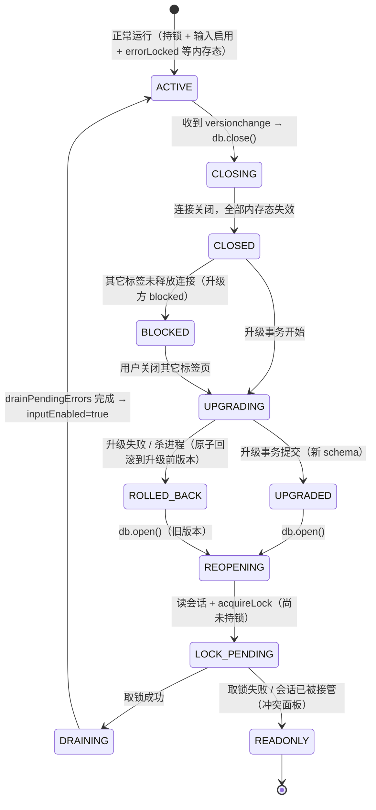

# U16 · 升级中断恢复协议（设计稿）

> **文档性质**：设计文档（非源码、非运行时验证结果）。本轮依据《Dexie版本协调-实施授权清单.md》第一阶段权限撰写，属于「可新建经授权的设计文档」范围。
> **权威来源**：`产品方案/打字/Phase1.2.3-统计判据与升级中断恢复补充审查.md` §3（L278–357）、`Phase1.2.2-准入裁定补丁.md` U16（L524）、`Phase1.2.1-最终准入补充审查报告.md` §3（L2 写锁）。
> **证据层级标记**：本文所有并发/恢复/分类结论均为 `【设计推导】`；标 `【待自动化】`/`【待真机】` 者尚未实测，不得声称「升级中断已可恢复」。**G9 不关闭**。
> **关键事实**：`versionchange`/`blocked`/`db.close()` 能力由**并行架构任务**负责落地（`Phase1.2.2` U16 要求 web.ts 补监听、V1.2.7 L254-256/L287）；本任务**只设计自身的恢复侧行为**。当前 web.ts **无**这些监听（Grep 零匹配），本协议为设计提案，`【需批准】` 后在 G9 关闭前不得实施。

---

## 1. 两条铁律（不可违反）

> **铁律 1**：**不得声称 `db.close()` 后原事务仍可继续。** 连接关闭后，该连接上任何**未确认提交**的事务一律按「未提交」处理；不依赖「close 时 in-flight 事务是被中止还是被允许跑完」这一实现差异——恢复逻辑**只认持久化状态**。若某事务其实已提交，凭证与事件行的幂等重放也会收敛到同一结果。

> **铁律 2**：**重新打开数据库 ≠ 已取得写锁。** `db.open()` 只恢复连接；必须重新 `getSessionById` 读会话、重新执行 `acquireLock()`（校验 / 覆写 `active_tab_id` + **重新读取** `lock_epoch`）、重新 `drainPendingErrors()`，最后才置 `inputEnabled=true`。

---

## 2. 升级阶段状态机

---

## 3. 逐拍时序与持久化边界（T-A / T-B / T-C）

三条写入链路在升级中断语境下是**互相独立的单表事务**（V1.2 §2.1），本报告**不**把它们合并描述为原子事务。每拍的「持久化边界」即该拍完成后可被恢复逻辑依赖的**唯一真相源**。

| 拍 | 事务 | 写入目标 | 持久化边界（该拍成功提交后才算数） | 未提交时的恢复语义 |
| --- | --- | --- | --- | --- |
| **T-A** | `insertIfAbsent(E)` | `spellingErrorEvents` 行（`event_id` 主键、`tab_id`、`lock_epoch`、`session_id`、`word_id`、`kind`、`status` 任意） | 事件行已落盘即视为「已发生」；主键冲突=`false`=幂等 | 未提交→事件不存在；重放时按 `event_id` 重新 `insertIfAbsent`，天然幂等 |
| **T-B** | `updateAtomic` 会话归零 + 凭证 | `spellingSessions` 文档（`applied_error_event_ids[E]=true`、`cc`、`lock_epoch`、`active_tab_id`） | reducer 内**二次检查凭证**；命中即 `return s` 跳过写回 | 未提交→凭证缺失；drain 重放 T-B 恰一次（见 §6 S1） |
| **T-C** | 事件状态标记 | `spellingErrorEvents.status`（`settled`/`settled_skipped` 等） | **非权威展示态**；落后或超前均不影响结算与统计 | 未提交→`status` 落后；由凭证重算，不影响 |

**顺序约束**：T-A 必须先于 T-B 落盘（事件行是结算依据）；T-C 只能在 T-B 之后，且仅为展示。若 T-A 已提交而 T-B 未提交（崩溃点 ①），恢复入口为重新连接后 `drainPendingErrors()` 按 `event_id` 重放 T-B；统计侧由 `classify`（`Phase1.2.3` §1.3）保证 T-B 前后 `active` 不变。

---

## 4. 幂等规则（正确性只依赖持久化状态）

正确性只依赖以下持久化状态，内存态一律可重建：

- `spellingErrorEvents` 行：`event_id` 主键、`lock_epoch` 冻结值、`covered_event_ids`（reset 快照）。
- `spellingSessions` 文档：`applied_error_event_ids` 凭证、`lock_epoch`、`active_tab_id`、`cc`。

| 机制 | 幂等依据 | 失效后果 |
| --- | --- | --- |
| `event_id` 主键 | `insertIfAbsent`：主键冲突即 `false`，不增行、不重复计数 | T-A 重放零副作用 |
| T-B reducer 二次检查 | `applied_error_event_ids[E]===true` → `return s` | T-B 重放恰一次，不重复归零 |
| `lock_epoch` 代次 | stale 事件（旧代次）写凭证 + `settled_skipped`，不归零、不 SRS | drain 不再无限重放 |

> T-A/T-B/T-C 三者仍是**互相独立的单表事务**；本报告不把它们合并描述为原子事务。T-C 的 `status` 非权威，失败或超前都不影响结算与统计。

---

## 5. 重启后的 drain 流程（五步缺一不可）

升级完成 / 旧版本回滚 / versionchange 重连后，恢复链路**严格按序**：

1. **`db.open()`** —— 仅恢复连接，**不**代表持锁。
2. **`getSessionById(sid)`** —— 重新读取会话文档，**重新读取 `S.lock_epoch`**（禁止沿用内存旧值 `myEpoch`）。
3. **`acquireLock()`** —— 在 `updateAtomic` 内校验 / 覆写 `active_tab_id=myTab` 并**重读** `lock_epoch`，取得本标签写锁。
4. **`drainPendingErrors()`** —— 按 `event_id` 重放未结算事件：T-A 已落盘、凭证缺失者补 T-B（reducer 二次检查防重复），T-C 补状态标记。
5. **`inputEnabled=true`** —— 仅当 1–4 全部完成，才启用输入与键盘监听。

> 注入「跳过 acquireLock（步骤 3）」的测试应被判定为**失败**（C62/T85）。`src/main.tsx` 当前**无** `drainPendingErrors()` 钩子（`Phase1.2.3` L51），该钩子为**设计提案，无约定**。

---

## 6. 七场景崩溃点恢复矩阵（每场景含 5 要素）

| # | 场景 | 持久化状态 | 恢复入口 | 幂等依据 | 用户可见状态 | 测试层级 |
| --- | --- | --- | --- | --- | --- | --- |
| **S1** | **T-A 已提交、T-B 未提交** | 事件行在（`status` 任意）、会话凭证缺失、`S.lock_epoch` 已持久化 | 重新连接后 `drainPendingErrors()` 按 `event_id` 重放 T-B | `insertIfAbsent` 主键幂等 + T-B reducer 内凭证二次检查；`classify` 保证 T-B 前后 `active` 不变 | 「数据升级中…」→ 升级完成后短时「正在记录本次错误…」，**输入保持禁用**直至 drain 收敛 | `【设计推导】【待自动化】` + `【待真机】` |
| **S2** | **T-B 已提交、T-C 未提交** | 凭证已写、`cc=0`；事件 `status` 落后（`recorded`） | drain 查凭证 → **跳过 T-B**，补 T-C | 凭证是结算唯一权威；`status` 非权威，可落后 | 升级后直接可继续输入，不重复归零、不显示重复错误 | `【设计推导】【待自动化】` + `【待真机】` |
| **S3** | **`versionchange` 触发 `db.close()`** | **已提交事务的结果保留**；未确认提交的事务按「未提交」处理（铁律 1）；事件行 / 会话文档 / 凭证均不被修改 | 丢弃全部内存态 → 等待升级 → 重新 `db.open()` → 走 §2 恢复链 | 正确性只依赖持久化（事件主键、凭证、`covered`、`lock_epoch`），内存态可丢弃可重建 | 「数据升级中，请稍候」+ 输入禁用 + 缓冲输入清空并提示重输（**不静默丢失、不自动重放按键**） | `【设计推导】` + `【待真机】`（fake-indexeddb 无法完整模拟 close） |
| **S4** | **旧标签重新打开数据库** | 同上；连接恢复但 `active_tab_id` / `lock_epoch` 可能已被另一标签改写 | `getSessionById` → **`acquireLock()`** → `drainPendingErrors()` → 解锁 | 锁校验与写入在同一 `updateAtomic`（§3.3）；`lock_epoch` **必须重新读取**，不得沿用内存旧值 | 「正在恢复默写…」；若锁已被接管 → 冲突面板（铁律 2） | `【设计推导】【待自动化】` + `【待真机】` |
| **S5** | **升级 blocked** | 升级事务未提交，库仍是升级前版本；事件 / 会话文档原样 | 升级方弹窗提示「关闭其他标签页以完成更新」（V1.2.7 L254）；本任务页面**保持只读**、不发起新写入 | 无写入即无需幂等；已落盘事件与凭证不动 | 明确提示 + 只读，不静默失败、不假报升级完成 | `【设计推导】` + `【待真机】` |
| **S6** | **升级完成后重新取得锁** | 新 schema 生效；事件表 / 会话表数据原样保留（additive `.stores()`，V1.2.7 L257） | `db.open()` → `getSessionById` → `acquireLock()` → `drainPendingErrors()` → `inputEnabled=true`，**五步缺一不可** | 取锁走 `updateAtomic` 校验 / 覆写；`myTab` 可复用（标签页生命周期内 uuid），但 `myEpoch` **必须重读**；drain 按凭证幂等 | 恢复正常输入；连对次数、错词本与升级前一致 | `【设计推导】【待自动化】` + `【待真机】` |
| **S7** | **升级失败时旧版本页面的行为** | 升级事务原子回滚到**升级前版本**（V1.2.7 L256 / C5）；数据完整；Dexie **不可就地降级**（L262） | 旧版本页面重新 `db.open()` 后**重新校验 schema 版本与锁状态**，不得假定仍持锁；按 §2 恢复链重走 | 回滚后持久化状态 = 升级前状态，S1/S2 的 drain 规则同样适用 | 「数据升级未完成，已恢复上一版本，请重试」+ 只读 / 重试入口；**不声称已在新版本、不沿用旧锁** | `【设计推导】` + `【待真机】` |

---

## 7. 内存态失效清单与重建方式

`db.close()` 后一律失效、必须从持久化重建的内存态：

| 内存态 | 重建方式 |
| --- | --- |
| `errorLocked` / `inputEnabled` | 由 `drainPendingErrors()` 收敛结果决定，取锁前恒为「锁定 / 禁用」 |
| `lockHeldLocally` / 锁标志 | 重新 `acquireLock()` |
| `myEpoch` | **从 `getSessionById` 重新读取 `S.lock_epoch`**，禁止沿用 |
| `myTab` | 可复用标签页生命周期内的 `uuid()`，但必须经 `acquireLock()` 重新验证 |
| 输入缓冲 / 逐字母进度 | 丢弃并提示重输，不自动重放按键 |
| 三态 UI（recorded / settled / failed） | 由凭证 + 事件行重算推导 |
| drain 循环引用 / 锁冲突面板状态 | 重建 |
| `status` 派生的展示态 | 由凭证重算，`status` 落后不影响 |

---

## 8. 与 G9 的边界（保留阻塞，不写已解决）

- 本协议的 `versionchange` / `blocked` / `db.close()` 能力**由并行架构任务负责落地**（`Phase1.2.2` U16，`【只读核实】` V1.2.7 L254-256/L287），本任务只设计自身的恢复侧行为。
- **本轮不解除 G9、不决定 Dexie version、不修改 web.ts、不代替并行负责人裁定**（V1.2.7 D3 仍待裁定、门禁未通过）。
- 协议中「升级完成后重新取得锁」等步骤属于**设计提案** `【需批准】`，在 G9 关闭前不得实施。
- 新增 U18：`versionchange` 期间 `lock_epoch` 与会话文档版本的一致性**未实测** `【待真机】`。

---

## 9. 新增测试（仅登记，不执行）

| # | 场景 | 断言要点 | 层级 |
| --- | --- | --- | --- |
| **C57/T80** | S1（T-A 提交 / T-B 未提交 + versionchange） | 重连后 drain 重放 T-B 恰一次；`cc=0`；两指标与 1.5 表一致 | `【待自动化】` + `【待真机】` |
| **C58/T81** | S2（T-B 提交 / T-C 未提交 + versionchange） | 不重复归零；补 T-C；`status` 落后不影响 | `【待自动化】` + `【待真机】` |
| **C59/T82** | S3（`db.close()` 中断 in-flight） | 未确认事务按未提交处理；**断言实现未声称原事务继续**；按持久化重放收敛 | `【待自动化】` + `【待真机】` |
| **C60/T83** | S4（重新 open ≠ 取得锁） | `db.open()` 后 `inputEnabled=false`；未 `acquireLock` 前所有 9 条写入路径均被拒；`myEpoch` 重读 | `【待自动化】` + `【待真机】` |
| **C61/T84** | S5（升级 blocked） | 页面只读、零写入、有明确提示；用户关闭其它标签后恢复链继续 | `【待真机】` |
| **C62/T85** | S6（升级成功后五步恢复链） | 五步缺一不可；注入「跳过 acquireLock」应被测试判定为失败 | `【待自动化】` + `【待真机】` |
| **C63/T86** | S7（升级失败回滚 / 旧版本页面） | 回滚后数据 = 升级前；重新校验版本与锁；不沿用旧锁、不假报新版本 | `【待真机】` |
| **C64/T87** | 真机矩阵 | Edge 双标签 + Chromium / Firefox 各跑 V1.2.7 C6 三用例（含升级中途杀进程）；本任务恢复链与升级流程叠加验证 | `【待真机】` |

---

## 10. 未解决项（本设计稿不闭合）

1. `spellingErrorEvents` 表未建立（v14 未实施）——持久化位置仍为设计态。
2. `drainPendingErrors()` 无启动钩子（`main.tsx` 无该调用）——恢复入口未实现。
3. U16 仅处「七场景恢复协议设计提案」阶段，尚未批准为生效协议、未实现、未验证——**当前仍不能证明升级中断不丢事件**。
4. `versionchange`/`blocked`/`db.close()` 由并行架构任务落地，本任务不替代其裁定（D3 待裁定）。
5. 解除阻塞条件：v14 表落地 + drain 钩子 + U16 恢复链成文 + 真机双标签升级窗口回归通过，且经审核人（责任矩阵 §三）书面确认。

> **提交状态**：本协议为设计文档，依据第一阶段权限撰写。**未运行任何构建/测试/迁移/真机操作，未修改源码/配置/数据库/Git。** 等待项目负责人复核。
