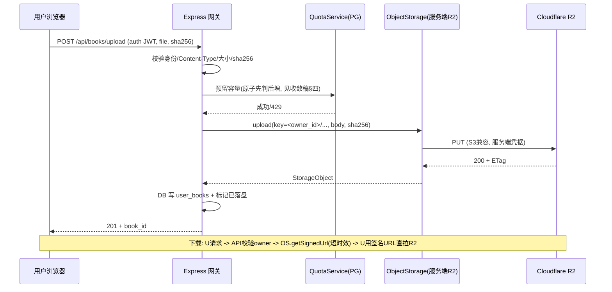

# 述树统一书籍资产与知识问答架构设计 · V1.2.11 — Cloudflare R2 对象存储接入架构设计

> **文档性质**：**对象存储接入架构设计（只读设计 + 技术验证方案）**，**不构成注册、购买、配置或上传授权**。
> 本文件在 V1 / V1.1 / V1.2–V1.2.11 基础上，针对本轮任务二（Cloudflare R2 接入）给出完整设计：**存储分类、适配层接口、安全边界、成本测算模型、与现有词库接缝、上传/下载流程、阶段实施依赖**。
>
> ⚠️ **红线与边界声明**：本轮**只设计，不注册、不购买、不配置、不上传 Cloudflare R2**（用户预计两天后办完 Mastercard 再使用 R2）。未执行任何 DDL/DML、未改 `.env`/密钥、未启停服务、未 `git add/commit/reset/clean`、未要求用户提供银行卡/SSH 密钥等敏感凭据、未覆盖/清理其他 Agent 文件。
>
> ⚠️ **与 V1.1 的关系**：V1.1 §3.3 曾将 Supabase Storage（B3）列为文件存储「可选」；本稿将目标对象存储**明确为 Cloudflare R2**，即以 R2 替代 B3 的 Supabase Storage 选项——**认证仍走 Supabase Auth（B1）**，文件走 R2，二者解耦，不引入 Supabase Storage 依赖。
>
> 标注约定：**【事实】**= 代码/配置实测；**【推断】**= 逻辑推论；**【推荐】**= 本稿建议；**【待核实】**= 须开通 R2 后实测/查价；**【待裁定】**= 须负责人拍板。

---

## 〇、本轮只读核查基线（R2 相关事实）

| 项 | 值 |
|---|---|
| 基线 HEAD | `760e999` |
| 工作区状态 | 大量未提交改动；本文件不触碰、不提交、不回退任何并行 Agent 改动 |
| 现有词库接缝 | 【事实】`src/data/dataClient.ts` 是唯一数据出口；基址优先级：运行期内联覆盖 → `VITE_DATA_BASE_URL` → 同源回退 `/data/linguabase/v1/`；含目录穿越防护、超时、重试、并发去重、有界 LRU 缓存（48 条） |
| 词库体量 | 【事实】`data/linguabase/v1/`（410MB，含 353MB 英文释义分片），**不在 public/、已 gitignore**；生产经 `VITE_DATA_BASE_URL` 指向 R2 等对象存储（注释与 README 一致） |
| R2 凭据现状 | 【事实】前端/服务端**均无 R2 SDK**；仅有 `scripts/upload_data.py`（boto3，S3 兼容，`--dry-run` 已演练 159 对象 / 409.2MB）；环境变量模式为 `S3_ENDPOINT`/`S3_BUCKET`/`S3_PREFIX`/`AWS_ACCESS_KEY_ID`/`AWS_SECRET_ACCESS_KEY` |
| 选 R2 动因 | 【事实】R2 **出口流量免费**（词库反复读取，走流量计费方案账单失控）——README `部署与外部存储方案.md`、P3-待续清单、V1.1 一致 |
| 用户 R2 进度 | 【事实】P3 云端步骤被支付方式阻塞（`P3-待续清单.md`：「暂无可用支付方式，Cloudflare R2 与 Vercel 账号暂不开通」）；用户预计两天后办 Mastercard |

---

## 一、存储分类设计（落实任务 4.1，至少六类）

| # | 类别 | 可见性 | 桶/前缀建议 | 访问控制 | 说明 |
|---|---|---|---|---|---|
| 1 | **公共书籍原始文件 / 词库数据** | 公开只读 | `shushu-public` 桶（或现有词库桶）`/linguabase/v1/...` | 公开读（CORS 放行应用域） | 现有 410MB 词库**原地保留**，不迁移、不混入私有桶 |
| 2 | **用户主动上传的私有书籍（原始文件）** | 私有 | `shushu-private` 桶 `user_id/<uuid>/source/...` | 签名 URL（短时效），服务端校验归属 | 仅用户本人可下载；绝不留永久公开直链 |
| 3 | **私有书籍处理后的文件（标准化正文/分块/衍生）** | 私有 | `shushu-private` 桶 `user_id/<uuid>/normalized/...` | 签名 URL | 与 ② 同用户前缀隔离 |
| 4 | **用户生成的学习资料（学习稿/字幕导出等）** | 私有 | `shushu-private` 桶 `user_id/derived/...` | 签名 URL | 落库归属同 owner |
| 5 | **封面 / 缩略图等衍生资源** | 公开或私有视来源 | `shushu-public` 桶 `/derivatives/...`（公共衍生）或 `shushu-private` 桶 `user_id/derivatives/...`（私有衍生） | 公共公开 / 私有签名 | 公共书封面可公开；用户私有书封面走签名 |
| 6 | **现有词库数据（复核）** | 公开只读 | 同 ① | 公开读 | 见 §五，保持现有客户端兼容 |

> **核心原则**：**不得将所有文件简单放进同一个公共目录**。公共与私有**必须分桶或严格分前缀**，私有文件绝不以公开读权限存放。

---

## 二、对象存储适配层设计（落实任务 4.2）

### 2.1 统一接口（推荐，方法签名按文件生命周期完善）

业务模块**不直接依赖 Cloudflare SDK / boto3 / aws-sdk**。统一抽象 `ObjectStorage`：

```ts
interface StorageObject {
  key: string
  bucket: string
  sha256: string
  sizeBytes: number
  contentType: string
  uploadedAt: string
}

interface ObjectStorage {
  // 上传：服务端携带 owner_id 与内容指纹，禁止前端任意构造 key
  upload(req: {
    bucket: string
    key: string            // 由服务端按前缀规范生成，非客户端自由传入
    body: Buffer | ReadableStream
    contentType: string
    contentSha256: string  // 服务端计算，用于完整性校验
    sizeBytes: number
  }): Promise<StorageObject>

  // 下载：服务端校验归属后返回临时签名 URL（私有）或直接流（公共）
  download(req: { bucket: string; key: string; ownerId?: string }): Promise<StorageObject | { signedUrl: string; expiresAt: number }>

  // 删除：与 DB 级联配合（见 §三/收敛稿 §3.3）
  delete(req: { bucket: string; key: string; ownerId: string }): Promise<void>

  // 下载签名 URL（私有文件）：有效期短（推荐 60–300s），绝不永久
  getSignedUrl(req: { bucket: string; key: string; ownerId: string; expiresSec: number }): Promise<string>

  // 元数据 / 存在性校验：HEAD
  head(req: { bucket: string; key: string }): Promise<{ sizeBytes: number; contentType: string; sha256?: string }>
}
```

> 实现侧可用 Cloudflare R2 的 **S3 兼容 API**（`@aws-sdk/client-s3` 或 `boto3`），凭据仅存服务端（见 §三）。前端**永远不**持有 R2 Secret Access Key，亦不直连 R2 写接口。

### 2.2 R2 Bucket 划分（推荐）

| Bucket | 用途 | 公开访问 | 生命周期 |
|---|---|---|---|
| `shushu-public` | 词库 / 公共衍生 | 开启公开读（自定义域 + CORS） | 版本化 + 长期保留 |
| `shushu-private` | 用户私有文件 | **关闭公开读** | 启用生命周期清理孤儿/过期对象 |

### 2.3 对象 Key 命名规范（推荐）

```
公共：  linguabase/<version>/<file>                      # 词库（现有，不变）
        derivatives/public/<hash>.<ext>                   # 公共衍生
私有：  <owner_id>/<user_book_id>/source/<sha256>.<ext>   # 原始上传
        <owner_id>/<user_book_id>/normalized/<sha256>.<ext>
        <owner_id>/derived/<kind>/<uuid>.<ext>             # 学习资料/私有衍生
```

- **用户目录隔离**：私有 key 一律以 `<owner_id>/` 前缀开头；服务端生成 key 时强制校验 `owner_id = current_user_id()`，拒绝越权前缀。
- **公共资源与私有资源隔离**：分桶 + 前缀双保险。
- **重复上传处理**：按 `content_sha256` 去重（收敛稿 §3.4 / V1.1 §5.4）；同用户同 sha256 不重复落盘，仅建立关系。

### 2.4 上传授权 / 下载签名 URL / URL 有效期 / 文件大小 / Content-Type / SHA256 / 重试

| 项 | 推荐 |
|---|---|
| 上传授权 | **仅服务端**经认证中间件后上传；前端通过业务 API（Express）上传，绝不拿 R2 写凭据 |
| 下载签名 URL | 私有文件一律**短时效签名 URL**（推荐 60–300s）；前端不缓存、不构造 |
| URL 有效期 | 签名为临时；公共文件可直接 CDN 公开 URL（无签名） |
| 文件大小限制 | 单文件沿用 `CONVERT_MAX_FILE_BYTES=50MB` 技术保护（基础设施级，不替代用户配额）；用户总容量由配额服务（收敛稿 §四/§五）约束 |
| Content-Type 校验 | 白名单（pdf/epub/txt/md 等）+ 服务端校验后缀与 magic bytes 一致 |
| SHA256 完整性 | 上传前/后服务端计算 `sha256`，与声明比对；不一致拒绝并清理 |
| 网络中断与重试 | 分块/断点续传（R2 支持 multipart）；失败按 idem_key 幂等重试（收敛稿 §五）；客户端 5xx 重试 ≤3 次，4xx 不重试 |
| 数据库记录与对象一致性 | DB 先记「待确认」→ 对象上传成功 → DB 标记「已落盘」；删除走级联（收敛稿 §3.3），孤儿对象由生命周期/扫描清理 |

---

## 三、安全边界（落实任务 4.3，强制）

| # | 约束 | 状态 |
|---|---|---|
| 1 | R2 凭据只能存在服务端（Express/Worker 环境变量） | 【推荐·强制】前端不得持有 Secret Access Key |
| 2 | 前端不得获得 R2 Secret Access Key | 【推荐·强制】 |
| 3 | 不允许客户端任意构造对象 Key | 【推荐·强制】key 由服务端按 §2.3 规范生成并校验 `owner_id` 前缀 |
| 4 | 私有文件不允许永久公开直链 | 【推荐·强制】仅临时签名 URL |
| 5 | 下载前必须验证用户身份及文件归属 | 【推荐·强制】`owner_id = current_user_id()` + RLS 双重校验 |
| 6 | 不能仅凭对象路径判断访问权限 | 【推荐·强制】须经 API 鉴权，对象 key 不携带可推断的授权 |
| 7 | 不能因 R2 支持公开访问就将私有文件公开 | 【推荐·强制】私桶**关闭公开读** |

> 重申（前提卡红线 §8.7）：第三方 API 令牌只能放后端 `server/.env`；前端代码/`import.meta.env`/`dist/` 均不出现令牌。R2 凭据同理。

---

## 四、成本与配额（落实任务 4.4，建立成本测算模型，不填真实额度）

> ⚠️ **红线**：不得随意填写免费额度，必须先建立成本测算模型。**本文不代填任何未经核实的数值**，仅列出需实际核实的价格项目与测算方法。

### 4.1 成本测算模型（待核实项目清单）

| 成本项 | 说明 | 是否需核实当前价目 |
|---|---|---|
| **R2 存储费** | 每 GB-月（标准存储） | ✅ 待核实 |
| **Class A 操作费** | 写/列举等，每百万次 | ✅ 待核实 |
| **Class B 操作费** | 读/取元数据等，每百万次 | ✅ 待核实 |
| **出网流量费** | R2 对**互联网**出网（注意：R2 宣称出网免费，但仍须核实当前免费额度与超限计费） | ✅ 待核实 |
| **请求次数（业务侧）** | 上传/下载/转换/检索次数 → 影响 Class A/B 操作费 | 依产品侧额度（待裁定 Q17） |
| **AI Token / LLM 调用** | 第三方 LLM 按 token 计费（免费期仅观测，见收敛稿 C-7） | ✅ 待核实单价 |
| **OCR / ASR 第三方服务** | PaddleOCR 若走云端、ASR 引擎成本 | 依实施期选型 |
| **格式转换 CPU** | 自托管 Worker 算力（本机/云主机） | 依部署形态 |

### 4.2 基础设施技术限制 vs 用户配额（区分）

| 维度 | 基础设施技术限制（保留，不删） | 用户配额（按人，公平使用） |
|---|---|---|
| 文件大小 | `CONVERT_MAX_FILE_BYTES=50MB`、连接池、HNSW `ef_search` 白名单 | 单用户总容量上限（total） |
| 超时 | `CONVERT_TIMEOUT_SECONDS=300`、LLM 双超时 | 每用户每日上传/转换/问答次数 |
| 速率 | 检索令牌桶（速率类，独立于用量） | 每用户每秒/每日检索次数 |
| 并发 | Worker 并发/队列 | 每用户并发任务数 |

> 二者**正交**：技术限制保护平台稳定性，用户配额管「每人能用多少」（收敛稿 §八 / V1.2.9 §3.1 注）。

### 4.3 R2 上传/下载流程图（Mermaid）



---

## 五、R2 与现有词库接缝（落实任务 4.5）

| 核对项 | 结论 |
|---|---|
| `VITE_DATA_BASE_URL` | 【事实】现有数据基址变量，**保持不变**；前端 `dataClient.ts` 已支持运行期内联覆盖 → env → 同源回退。R2 接入仅改变该变量的值（生产指向 R2 公共桶），**前端代码零改动** |
| 词库文件加载路径 | 【事实】`repository.ts` 经 `fetchData` 拉取 `index.json`/`books/*`/`defs/*` 等相对路径；路径即版本（`/linguabase/v1/`）。R2 接入**不改变**加载逻辑 |
| 公共静态 vs 私有文件是否不同桶 | 【推荐】词库公共桶（`shushu-public`）与私有桶（`shushu-private`）**分离**；公共桶沿用现有路径规范，私有桶新增用户前缀 |
| 现有词库资源迁移是否必要 | **【推荐】不必要、不迁移**。410MB 词库已在 `data/linguabase/v1/`，仅改 `VITE_DATA_BASE_URL` 指向 R2 公共桶即可；**不因接入 R2 贸然迁移现有 410MB 词库**（任务 4.5 明确要求） |
| 客户端兼容 | 【事实】`dataClient.ts` 的 `resolveBase()` 已支持 `VITE_DATA_BASE_URL` 与运行期覆盖，**保持现有客户端兼容**；R2 仅作为该变量的后端存储，前端无感知 |

> 结论：**R2 接入对现有词库是「换基址、不迁数据、不改前端」**；新增的私有存储是独立的桶与前缀体系，与公共词库互不影响。

---

## 六、阶段实施依赖图（Mermaid）

```mermaid
flowchart TD
    A[用户办理 Mastercard + 注册 R2] --> B[R2 建桶 + CORS + 公开访问配置]
    B --> C[服务端 ObjectStorage 适配层实现 S3兼容]
    D[Supabase Auth B1 接入] --> E[真实 sub 可用]
    E --> F[私有上传/下载 校验 owner_id]
    C --> F
    G[QuotaService 配额服务] --> F
    F --> H[阶段1B 私有书/知识库/问答上线]
    B -.前置.-> H
    D -.前置.-> H
    G -.前置.-> H
    note "本稿仅设计; 实际执行须待负责人裁定 D1-D7 + R2 开通 + 阶段1B门禁通过"
```

---

## 七、尚待核实 / 待裁定清单

| # | 项 | 类型 |
|---|---|---|
| 1 | R2 当前存储/Class A·B 操作/出网免费额度与超限计费 | 【待核实】开通后查价 |
| 2 | 各资源免费额度具体数值（AI/存储/上传/转换/检索） | 【待裁定 Q17】产品侧基于成本测算给定 |
| 3 | 是否采用 R2 替代 V1.1 B3 的 Supabase Storage | 【裁定建议】是（本文），待负责人确认 |
| 4 | R2 自定义域 vs `r2.dev` 临时域 | 【待核实】依赖域名是否在 Cloudflare 托管 |
| 5 | 私有桶生命周期清理规则（孤儿/过期对象） | 【推荐】TTL + 孤儿扫描，待实施期定参 |

---

## 八、最终声明

> **V1.2.11 R2 接入架构设计仅为对象存储接入设计稿，不代表获得注册、购买、配置或上传授权。**
> 本稿所有「推荐」均为基于 V1–V1.2.11、本轮实测代码/配置与产品前提卡的**建议**；凡标注「待核实/待裁定」之处须开通 R2 后实测或负责人拍板。本轮未注册/购买/配置/上传 Cloudflare R2、未要求用户提供银行卡/SSH 密钥、未执行任何 DDL/DML、未改 `.env`/密钥、未启停服务、未 `git add/commit/reset/clean`、未覆盖/清理其他 Agent 文件。本稿完成后立即停止，等待审阅与明确授权。

---

*本文件为 V1.2.11 Cloudflare R2 接入架构设计，独立新增，不覆盖 V1–V1.2.10 任何文档。*
