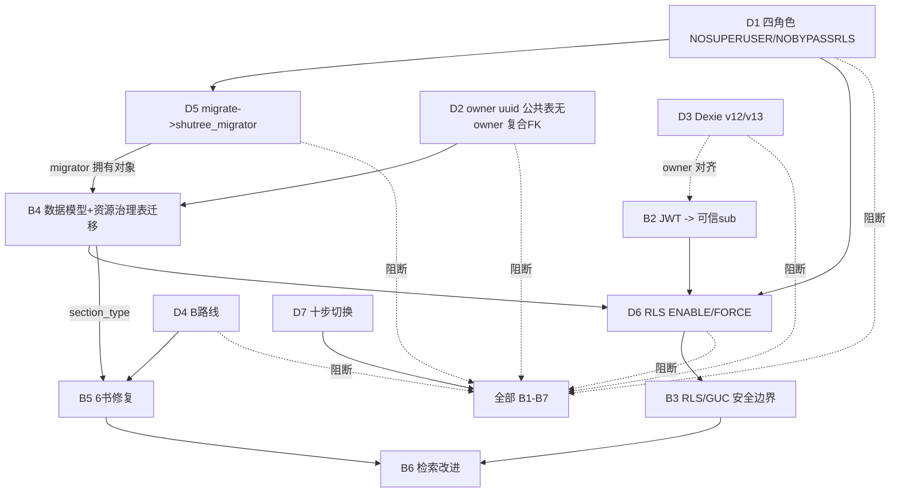

# 述树统一书籍资产与知识问答架构设计 · V1.2.11 — D1–D7 及 Q21–Q28 负责人决策稿

> **文档性质**：**项目负责人决策文件（Decision Brief）**，**不构成实施授权**。
> 本文件在 V1.2.8（D1–D7 决策稿）、V1.2.9（资源治理）、V1.2.10（技术审查）、V1.2.11 架构收敛稿基础上，**逐项归档**尚未批准的架构决策，供项目负责人裁定。
>
> ⚠️ **红线声明**：所有「推荐选择」均为**推荐 + 理由**，**不等同于已批准决定**。凡「负责人裁定」一栏，均写「待批准」。本文不进入阶段 1B 实施。
>
> ⚠️ **重要更正（相对 V1.2.8 D2）**：V1.2.8 D2 曾**推荐** `owner_id TEXT + '__public__'` 哨兵方案；该方案已被 V1.2.9 §6.1 撤销、V1.2.10 §3.4 重申撤销、本轮 V1.2.11 任务 3.1 **明令禁止**。本稿 D2 以**禁止 `__public__` + `owner_id uuid` + 公共表无 owner** 为最终推荐，**覆盖** V1.2.8 D2 的旧推荐。
>
> 标注约定：**【事实】**= 实测/代码静态证据；**【推断】**= 逻辑推论；**【推荐】**= 本文统一建议；**【待裁定】**= 须项目负责人拍板。

---

## 〇、本轮只读核查基线（与 V1.2.11 收敛稿一致）

| 项 | 值 |
|---|---|
| 基线 HEAD | `760e999` |
| 工作区 | 大量未提交改动；本文件不触碰、不提交、不回退任何并行 Agent 改动 |
| 代码证据 | Dexie v11（无 blocked/versionchange，5 表无 owner）；Auth 本地桩（随机 uuid）；`VITE_DATA_BASE_URL` 词库接缝；均实测一致 |
| 数据库 | 引用 V1.2.7 权威只读探针（DB 静态未变），本轮未重新运行 |

---

## 一、决策矩阵 D1–D7

> 统一格式：**当前事实 / 历史设计 / 技术风险 / 推荐方案 / 不采用的代价 / 依赖关系 / 验收标准 / 回滚方案 / 负责人需要裁定的内容**。

### D1 ｜ 数据库分服务角色

| 项目 | 内容 |
|---|---|
| **当前事实** | 【事实】唯一可登录角色 = `postgres`（`rolsuper`/`rolbypassrls` 全 true）；所有数据访问走 `DATABASE_URL`；现有 8 函数/5 触发器 `prosecdef=false`（无 SECURITY DEFINER 提权）。RLS 被超管完全绕过（P0 真实缺口） |
| **历史设计** | V1.2.2 三类；V1.2.4/1.2.6 两类（app+migrator）；V1.2.7 升四类（app/api/worker/migrator）；V1.2.8 采纳四角色；V1.2.9 维持四角色并明确 `super_admin` 是平台权限标记而非第 5 个 DB 登录角色 |
| **技术风险** | 维持 postgres 超管运行时 → RLS 永久失效；仅两角色则权限粒度粗、攻击面大 |
| **推荐方案** | **采用四角色**：`shutree_app`/`shutree_api`/`shutree_worker`/`shutree_migrator` 全部 `NOSUPERUSER`/`NOBYPASSRLS`/`NOCREATEDB`/`NOCREATEROLE`/`NOINHERIT`；`postgres` 仅保留为管理/迁移管理角色，绝不进运行时连接池或前端；`migrate.ts` 用 `shutree_migrator`（D5） |
| **不采用的代价** | RLS 失效；权限粒度粗；若 `shutree_app` 成表所有者则 RLS 对其失效 |
| **依赖关系** | 无硬前置；与 D5/D6 同轮裁定落地 |
| **验收标准** | ① 四角色 `rolsuper=false`/`rolbypassrls=false`；② 可登录角色 ≥4，`postgres` 不出现于任何运行时连接；③ `shutree_api` 对 `user_*`/`knowledge_*` 写被拒（42501），仅 `discovered_*` SELECT；④ `shutree_app` 无法 `CREATE TABLE`/`ALTER POLICY`；⑤ 临时库冒烟全绿后生产同序列切换无回归 |
| **回滚方案** | 保留原 postgres 连接配置；失败即 `REVOKE` 新授权、`DROP ROLE`（未绑对象时）、`DATABASE_URL` 还原、`ENABLE RLS` 保留不 `DISABLE`；临时库演练失败则不触碰生产 |
| **负责人裁定** | **待批准**：是否采用「四角色 + 无超级用户运行时」（含拆 `shutree_api`/`shutree_worker`） |

### D2 ｜ 数据归属与复合外键（已覆盖 V1.2.8 旧推荐）

| 项目 | 内容 |
|---|---|
| **当前事实** | 【事实】`discovered_*` 等公共表**确无** owner 列（与 V1.2.9/V1.2.10 一致）；本地 Dexie `readings`/`recitations`/`transcripts`/`studyNotes`/`annotations` 五表无 owner（D3 必修） |
| **历史设计** | ⚠️ V1.2.5/1.2.6 = `uuid`；V1.2.7 = `TEXT + '__public__'`；**V1.2.8 D2 曾推荐 `TEXT + '__public__'`**；V1.2.9 §6.1 **撤销**该方案；V1.2.10 §3.4 重申撤销；本轮任务 3.1 **明令禁止 `__public__`** |
| **技术风险** | TEXT 方案装不下 uuid 格式 `sub` 且引入虚拟身份违反产品硬约束；复合 FK 仍为设计态未落地（P0-1）；MATCH SIMPLE 下 NULL 可绕过跨用户校验 |
| **推荐方案** | **最终统一**：① `owner_id uuid NOT NULL`（与 `app_users.sub` 同源，无哨兵）；② 公共表（`discovered_*`/`works`/`editions`/`content_versions`/词典表）**无 owner_id**；③ 父表 `UNIQUE(id, owner_id)`，子表 `FK(id, owner_id)→父(...)` 且**两列均 NOT NULL**；④ 命名/主键采纳 V1.2.7（`works/editions/content_versions` + BIGSERIAL legacy 回溯）；⑤ 表改名采纳 V1.2.7。**V1.2.8 D2 的 `__public__`/TEXT 推荐被本稿正式覆盖** |
| **不采用的代价** | 若坚持 `__public__`：违反产品硬约束（公共书不得用虚拟用户身份）；若仅 owner 单列+应用层保证：无 DB 级强制，违反「不得仅依赖应用层」要求 |
| **依赖关系** | 影响 B4 数据模型；须早于 B4 迁移执行；D1/D6 为其提供角色与 RLS 前置 |
| **验收标准** | ① 父表 `UNIQUE(id, owner_id)` 存在；② 子表复合 FK 双列 NOT NULL（`pg_attribute.attnotnull` 断言）；③ 负向：插入 owner 不匹配父表的子行报 FK 违反（23503）；插入 owner=NULL 报 NOT NULL 违反（非静默绕过）；④ `kb_books` 引用他人 `user_books` 被复合 FK 拒绝；⑤ `user_books.owner_id ≠ user_id` 被触发器/部分 CHECK 拒绝 |
| **回滚方案** | `DROP CONSTRAINT` 复合外键（新增约束可回滚）；公开表 owner 列若回滚需 `DROP COLUMN`（先确认无下游依赖） |
| **负责人裁定** | **待批准**：(a) 禁止 `__public__`、采用 `owner_id uuid`（采纳 V1.2.11）；(b) 公共表无 owner；(c) 表改名 `works/editions/content_versions` 与 BIGSERIAL 是否采纳；(d) `user_id==owner_id` 的 DB 级强制采用触发器还是部分 CHECK |

### D3 ｜ Dexie 本地数据库升级（v12/v13）

| 项目 | 内容 |
|---|---|
| **当前事实** | 【事实】v11 确为当前版本；`readings`/`recitations`/`transcripts`/`studyNotes`/`annotations` 五表无 owner；无 `db.on('blocked')`/`versionchange`；v8 起 `owner` 默认 `'guest'` |
| **历史设计** | V1.2.5 前进式降级；V1.2.6 C（×10 官方确认）；V1.2.7 C（缺 blocked/versionchange）；V1.2.8 D3 推荐 v12 补 owner 索引、v13 owner 可空默认 `'guest'` + 补 blocked/versionchange |
| **技术风险** | 无 blocked → 多标签页升级静默阻塞（P0 关联）；无 owner → 云端账号上线后本地数据无法与 `sub` 关联、且多标签页升级会丢数据/卡死 |
| **推荐方案** | **v12**：为 5 表补 `owner` 索引（原生 120）；**v13**：`owner` 可空默认 `'guest'`（原生 130），补 `db.on('blocked')`+`versionchange`（内 `db.close()`）；v12 升级回调为 5 表存量行补 `owner='guest'`；不降 version；保证升级幂等、不断点丢失数据、新旧客户端兼容 |
| **不采用的代价** | 多标签页静默阻塞；云端账号上线后本地数据无法关联；误发更低版本号 → IDB 拒绝需改回 |
| **依赖关系** | D1 账号体系决定 owner 语义；schema 变更独立，可与 B4/B3 并行；v12 索引可先行 |
| **验收标准** | ① `web.ts` 含 blocked/versionchange（versionchange 内 `db.close()`）；② 真实浏览器双标签页升级全绿；③ 升级中途杀进程→重启可用且为升级前版本→重升成功；④ v11→v12→v13 各表行数 0 丢失；⑤ 四件套全绿 + 预览端口 4174 |
| **回滚方案** | Dexie 不可就地降级；若 v13 有问题，发 v14 修复；极端情况清 IDB 重导（UI 提示）；IDB 数据原状保留 |
| **负责人裁定** | **待批准**：是否批准 v12/v13 前进式升级路径 + 在 `web.ts` 增加 blocked/versionchange 处理 |

### D4 ｜ 六本书章节元数据修复

| 项目 | 内容 |
|---|---|
| **当前事实** | 【事实】6 本书（id=10/44/47/49/51/52）共 11,328 分块 `chapter_title` 全 NULL，但 `embedding` 全非 NULL（向量完好）；生产检索 `chapter_title IS NOT NULL` 过滤将其全部排除；分类（启发式）A=923/B=190/C=10,215/D=0/E=0，100% 可分类 |
| **历史设计** | V1.2.4 B5（carry-forward）；V1.2.5 根因二分；V1.2.6 D（A 放宽/B 补元数据）；V1.2.7 D（A/B/C/D/E 五类 B 优先）；V1.2.8 D4 推荐 B 路线 |
| **技术风险** | A 路线（放宽过滤）会使 front_matter 进正文结果，污染召回、违反「不臆造/不污染」红线 |
| **推荐方案** | **B 路线优先（补元数据不臆造）**：A 类提取锚点词作 `chapter_title`；C 类前向继承最近 A 类章节；B 类标 `section_type='front_matter'` 保持 NULL；D/E 为 0 无需处理。仅改三列，不动 embedding/content |
| **不采用的代价** | A 路线 → 190+ 块 front_matter 混入正文；B 误判 >2% 须回退 unchaptered 独立分类 |
| **依赖关系** | D5/D2 决策下达后启动；B4 提供 `section_type` 列；与 B5/B6 协同 |
| **验收标准** | ① 11,328 块写入 `chapter_title`/`section_type`；② `embedding` 字节级不变（count=58,332）；③ 真实查询召回显著回升，全局 Recall@10≥69/@50≥75 不退化；④ 标注正确率抽样 ≥95%；⑤ 441 paratext 仍 NULL 未误标；⑥ `EXPLAIN` 仍 HNSW |
| **回滚方案** | `UPDATE SET chapter_title=NULL, section_type=NULL WHERE book_id IN(...)`（仅改列值）；向量/索引零影响 |
| **负责人裁定** | **待批准**：是否批准 B 路线，以及不可归章块 `unchaptered` 兜底口径 |

### D5 ｜ 迁移执行器身份

| 项目 | 内容 |
|---|---|
| **当前事实** | 【事实】`migrate.ts` 直连 `DATABASE_URL`（当前 = postgres 超管）；新对象归属 = 连接角色 → 若切 `shutree_migrator`，新表即归其所有 |
| **历史设计** | V1.2.4 §2.3（migrate 用 postgres）；V1.2.6 B6（改用 migrator）；V1.2.7 D5；V1.2.8 D5；V1.2.9 维持 |
| **技术风险** | 迁移仍用 postgres → 新表归超管，运行期切 `shutree_app` 而其为所有者 → RLS 失效；默认权限未设 → 新对象继承超管权限 |
| **推荐方案** | `migrate.ts` 改用 `shutree_migrator` 凭据（如 `DATABASE_URL_MIGRATOR`）；新对象归 migrator、`shutree_app` 非所有者 → 受 RLS；统一 `ALTER DEFAULT PRIVILEGES` |
| **不采用的代价** | RLS 对运行期角色失效；权限泄漏 |
| **依赖关系** | D1 必须先定（migrator 角色定义） |
| **验收标准** | ① 迁移后新表 `relowner=shutree_migrator`；② `shutree_app` 非任何私有表所有者；③ `npm run db:migrate` 可用 migrator 完成；④ 新增对象经 `ALTER DEFAULT PRIVILEGES` 不继承超管权限 |
| **回滚方案** | migrate.ts `DATABASE_URL` 切回 postgres（仅回滚期）；角色与 GRANT 保留无害 |
| **负责人裁定** | **待批准**：是否批准迁移执行器改用 `shutree_migrator` 拥有对象 + `ALTER DEFAULT PRIVILEGES` |

### D6 ｜ RLS 策略（ENABLE vs FORCE）

| 项目 | 内容 |
|---|---|
| **当前事实** | 【事实】当前无 RLS DDL；`postgres` 超管 + 表 owner=postgres → RLS 全失效（P0 真实缺口）。超级用户与 `BYPASSRLS` 无视所有 RLS（V1.2.8 D6） |
| **历史设计** | V1.2.2 §5.2 ENABLE 非 FORCE；V1.2.3（FORCE 会约束所有者）；V1.2.4 B3 ENABLE；V1.2.7 D6；V1.2.8 D6；V1.2.9 §5.1 维持 ENABLE |
| **技术风险** | 误用 FORCE → migrator（所有者）被约束，无法批量回填 owner≠自身行；连 ENABLE 都不做 → 无行级兜底 |
| **推荐方案** | **【推荐】私有表 `ENABLE ROW LEVEL SECURITY`（非 FORCE）** + **CI 断言 `shutree_app` 非表所有者**（V1.2.11 §六.2）。`current_user_id()` 读 GUC；每私有表建 `own` 策略 `USING/WITH CHECK(owner_id=current_user_id())` |
| **不采用的代价** | FORCE 阻断 migrator 跨用户回填；ENABLE 不做 → 无兜底；超管运行 → RLS 失效 |
| **依赖关系** | 强依赖 B2（JWT 提供可信 sub，是 GUC 前置）、D1（受限角色）、B4（私有表已建） |
| **验收标准** | ① `shutree_app` 不设 GUC 查私有表 → 0 行；② A 带 JWT 查自身 → 返回；③ A 按 B id 查 → 0 行；④ A `UPDATE` B 私有书 → 0 行影响；⑤ 同池连接 A 提交后 B 复用 → B 事务内 `current_user_id()`=B 且查 A 行=0；⑥ A 事务 rollback 后新请求不设 GUC 查私有表=0 行；⑦ CI 断言 `shutree_app` 非所有者通过 |
| **回滚方案** | `DROP POLICY`（保留 ENABLE，不 DISABLE）；严禁 `DISABLE ROW LEVEL SECURITY`（V1.2.8 D6 红线） |
| **负责人裁定** | **待批准**：私有表采用 ENABLE 还是 FORCE；是否采纳「CI 断言 `shutree_app` 非所有者」补强 |

### D7 ｜ 实施与切换顺序

| 项目 | 内容 |
|---|---|
| **当前事实** | 【事实】当前 postgres 超管运行时；GUC 由可信后端事务内 `SET LOCAL`；JWT 提供可信 sub 是 GUC/RLS 身份上下文硬前置（V1.2.8 D7） |
| **历史设计** | V1.2.4 §5/§6（依赖图）；V1.2.5 显式 B2→B3 边；V1.2.7 B4 十步切换法；V1.2.8 D7；V1.2.9 轻微扩展（B4 新增资源治理表、B2 新增配额中间件） |
| **技术风险** | 直接对生产改权限/建角色 → 风险失控；顺序错（先 B3 后 B2）→ GUC 悬空 RLS 失效；未先备份即迁移 → 不可恢复 |
| **推荐方案** | **十步切换顺序**：① 全量备份 → ② 还原临时库预演 → ③ 临时库建四角色 → ④ 逐对象 GRANT/REVOKE → ⑤ 业务冒烟 → ⑥ 启用 RLS+策略验证跨用户隔离 → ⑦ 连接池 SET search_path 绑角色 → ⑧ 迁移执行器切 migrator → ⑨ 准备回滚预案 → ⑩ 生产门禁（临时库全过且无回归后方对生产执行同序列）。并行：B2（JWT）+ D6/D3 可并行 |
| **不采用的代价** | 生产直接改 → 无回退演练；顺序错 → RLS 失效；未备份 → 不可恢复 |
| **依赖关系** | 依赖全部 D1–D7 与 B1–B7 完成/就绪；「临时库预演」可并行于各包实施 |
| **验收标准** | ① 临时库十步全过无回归；② B1/B4/B5/B2/B3/B6/B7 验收全绿 |
| **回滚方案** | 临时库演练失败则不触碰生产；生产任一步失败 → REVOKE 新授权、`DROP ROLE`、`DATABASE_URL` 还原、保留 ENABLE RLS；备份可恢复 |
| **负责人裁定** | **待批准**：是否批准「备份→临时库预演→十步切换→生产门禁」顺序；以及 D1–D7 全部下达 |

---

## 二、资源治理 E 与 Q15–Q28 逐项归档（不得遗漏）

> V1.2.9 新增 Q15–Q20（资源治理相关）；V1.2.10 新增 Q21–Q28（配额/幂等/Token/周期/超管豁免/串号/探针豁免）。本稿一并归档，**全部待裁定**。

### 资源治理 E（V1.2.9 §6.3，本轮核心新增）

| 编号 | 问题 | 推荐 | 待裁定 |
|---|---|---|---|
| E1 | 初期免费 + 公平使用模型，额度非会员权益 | 采纳 V1.2.9 §一 | 待批准 |
| E2 | 资源清单与限额维度（AI/存储/文件/转换/检索） | 采纳 V1.2.9 §3.1 | 待批准 |
| E3 | 七条设计原则（追踪真实 user_id / 集中配置 / 透明 / 不因付费差异 / 周期轮转 / 客户端不可自改 / 不经参数绕过） | 采纳 V1.2.9 §3.2 | 待批准 |
| E4 | 服务端强制顺序（auth→quota→business） | 采纳 V1.2.9 §3.3（但扣减语义改先判后增，见 D-配额） | 待批准 |
| E5 | 数据库表 `app_users`/`resource_quota_config`/`resource_usage` | 采纳 V1.2.9 §4.2 | 待批准 |
| E6 | `QuotaService` + `GET /api/quota` 透明展示 | 采纳 V1.2.9 §3.2.3 | 待批准 |
| E7 | 防误设计：额度=治理非会员权益，机制支持未来 tier | 采纳 V1.2.9 §八 | 待批准 |

### Q15–Q28 负责人问题清单

| 编号 | 问题 | 推荐（V1.2.11 收敛稿对应） | 待裁定 |
|---|---|---|---|
| Q15 | 是否确认「初期免费 + 公平使用额度」，明确额度非会员权益 | 是（§八） | 待批准 |
| Q16 | 资源治理表是否批准纳入 B4 迁移；`app_users.role` 两值是否认可 | 是（§三/§八） | 待批准 |
| Q17 | 各资源公平使用限额具体数值由谁给定；是否同意固定日历窗口+轮转 | 产品侧基于成本测算给定（本文不代填） | 待批准 |
| Q18 | 配额强制是否放 JWT 认证后、业务前（超额 429，客户端只读 `GET /api/quota`） | 是（§四/§六） | 待批准 |
| Q19 | `super_admin` 跨用户管理是否采用 SECURITY DEFINER（非新增 BYPASSRLS 角色） | 是（§六） | 待批准 |
| Q20 | 未来商业化是否仅通过 `resource_quota_config.(scope,role)` 与 `app_users.role` 扩展不改机制 | 是（§八） | 待批准 |
| **Q21** | 配额扣减语义：是否接受「先判后增」原子 `UPDATE…WHERE used+cost<=limit`（非 V1.2.9 先增后判） | **是（§四，C-4）** | 待批准 |
| **Q22** | 失败返还策略：计数型失败时是否释放已扣额度（推荐），还是「已发起即消耗」 | **释放（§五.1⑤）** | 待批准 |
| **Q23** | 存储型资源：是否采用「预留—结算」制（先扣容量、失败/清理释放） | **是（§四/§五.2）** | 待批准 |
| **Q24** | AI Token 计量：免费期是否仅按请求次数、Token 仅观测（推荐），还是免费期就按 Token 扣 | **仅观测不扣（§八，C-7）** | 待批准 |
| **Q25** | 配额周期：免费期是否统一「次数类=UTC 自然日轮转、容量类=total 累计」，暂不引入时区/滚动窗口 | **是（§四/§八）** | 待批准 |
| **Q26** | `super_admin` 业务配额豁免：是否豁免；若豁免是否同意「独立统计+速率护栏+审计」 | 产品决策；若豁免须保留三项约束（§八） | 待批准 |
| **Q27** | 本地 Dexie 串号防护：云端账号上线后退出/切换账号本地数据隔离由 D3（v12/v13）承担还是另立方案 | 由 D3 承担（owner 语义对齐 + 多标签页）（§七） | 待批准 |
| **Q28** | 实时探针豁免：进入 1B 前是否需重跑一次最新只读探针确认 `sql/` 仍仅 001–005 | 建议重跑（本稿未重跑）（§〇） | 待批准 |

---

## 三、决策依赖表（D1–D7 与实施工作包）

| 决策/包 | 直接前置 | 并行可准备 | 被谁依赖 |
|---|---|---|---|
| D1 | 无 | 与 D5/D6 权限草案同轮起草 | D2/D5/D6/D7、B1/B3/B4/B6 |
| D5 | D1 | 与 D1 同轮 | B4、D6 |
| D2 | 无硬前置；影响 B4 | 与 B4 并行起草；须早于 B4 执行 | B3/B4/B5/B6/B7 |
| D6 | B2、D1、B4 | 策略 SQL 先写 | B3、B6、B7 |
| D3 | D1 | schema 独立，可与 B4/B3 并行；v12 索引先行 | B7、B2 |
| D4 | D5/D2 下达后；B4 提供 `section_type` | 分类脚本与 B6 协同 | B5、B6 |
| D7 | 全部 D1–D7 与 B1–B7 就绪 | 「临时库预演」贯穿全程 | 全局门禁 |

---

## 四、实施依赖关系图（Mermaid）

---

## 五、是否具备进入阶段 1B 条件

**结论：暂不具备。** 依据：P0-R1 至 P0-R7 七项 P0 无一关闭（R1–R5 为真实代码/DB 缺口，R6/R7 为决策与实现缺口）；本稿为**设计定稿**而非**负责人批准**亦非**实施完成**；具体额度数值仍待产品侧成本测算。进入阶段 1B 充要条件见准入清单文档 §三。

---

## 六、最终声明

> **V1.2.11 D1–D7 决策稿仅为项目负责人决策文件，不构成实施授权。**
> 本文所有「推荐选择」均为基于 V1–V1.2.10 与本轮实测的**建议**，**不等同于已批准决定**；凡标注「待批准」之处均须项目负责人逐项裁定后方可进入阶段 1B 实施。本轮未执行任何 DDL/DML/GRANT/REVOKE、未创建/修改角色、未改 `.env`/DATABASE_URL、未改 Dexie/业务代码、未启停服务、未跑迁移、未 `git add/commit/reset/clean`、未覆盖/清理其他 Agent 文件、未注册/购买 Cloudflare R2。本稿完成后立即停止，等待审阅与裁定。

---

*本文件为 V1.2.11 D1–D7 及 Q21–Q28 负责人决策稿，独立新增，不覆盖 V1–V1.2.10 任何文档。*
