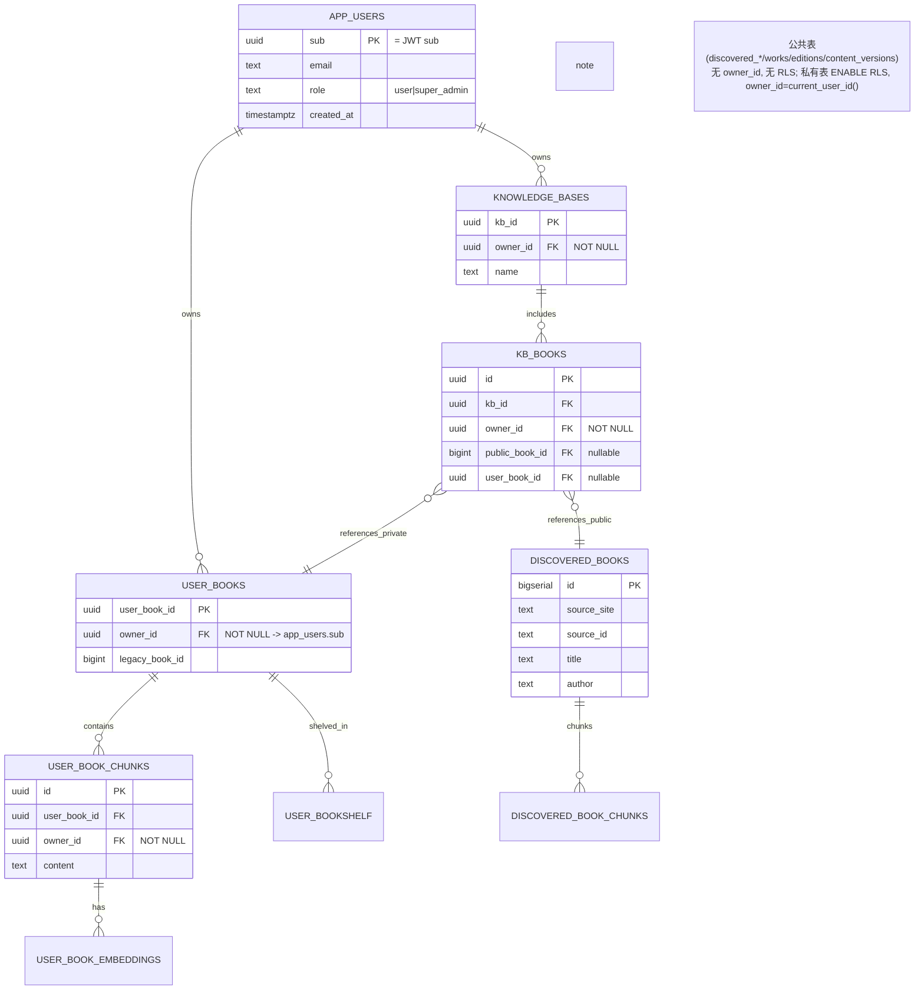

# 述树统一书籍资产与知识问答架构设计 · V1.2.11 — 最终架构收敛稿

> **文档性质**：**最终架构收敛 + 已落实 V1.2.10 问题修订的正式设计稿**。
> 本文件在 V1 / V1.1 / V1.2–V1.2.10 全部历史文档基础上，完成三项使命：
> ① 消除 V1.2.8 / V1.2.9 / V1.2.10 之间的历史冲突；② 将 V1.2.10 审查发现的 5 类技术问题正式落实到架构设计；③ 形成 D1–D7 及资源治理的**最终裁定建议稿**（非已批准决定）。
>
> ⚠️ **红线与边界声明（与 V1.2.8–V1.2.10 一致）**：本轮**仅做架构设计、技术验证方案与文档交付，不进入阶段 1B**。
> 未执行任何 DDL/DML/GRANT/REVOKE、未创建/修改角色、未改 `.env`/DATABASE_URL、未改 Dexie/业务代码、未启停服务、未跑迁移、未 `git add/commit/reset/clean/checkout/stash`、未覆盖/清理其他 Agent 文件、未注册/配置/购买 Cloudflare R2、未要求用户提供银行卡/SSH 密钥等敏感凭据。
>
> 标注约定：**【事实】**= 本轮实测/代码静态证据；**【推断】**= 基于证据的逻辑推论；**【裁定建议】**= 本文基于全部历史证据的统一推荐（**不等同已批准**）；**【待负责人裁定】**= 须项目负责人拍板。
>
> **配套图索引**（均嵌入本文，可独立审阅）：ER 图（§三）、数据流图（§三）、认证与 RLS 流程图（§六）、配额预留—结算时序图（§五）、R2 上传/下载流程图（见 R2 文档 §四）、阶段实施依赖图（见准入清单 §四）。风险清单与未决问题清单见准入清单 §五/§六。

---

## 〇、本轮只读核查基线（与 V1.2.10 一致，已重验）

| 项 | 值 |
|---|---|
| 审查基线 HEAD | `760e999`（A5-1 响应式布局改造验收交付报告，最终归档） |
| 工作区状态 | 大量未提交改动（含 B12 系列报告、`src/components/*`、`src/domain/transcript/*`、`server/asr_service/*` 等）；**本文件不触碰、不提交、不回退任何并行 Agent 改动** |
| 证据文件稳定性 | 本文件引用的代码证据（`src/services/storage/web.ts`、`src/services/auth/web.ts`、`src/data/dataClient.ts`、`src/data/repository.ts`）**均不在并行改动集合的核心 Schema 区域**；Dexie Schema 当前确为 **v11**，无 `blocked`/`versionchange`，与 V1.2.10 证据一致 |
| 数据库实时状态 | **本轮未重新运行** PG 探针（理由同 V1.2.10：PG 服务方式运行、无 DATABASE_URL/只读凭据）；直接引用 V1.2.7 权威只读探针（2026-11-03）结论：DB 静态未变——唯一可登录角色 `postgres`（`rolsuper`/`rolbypassrls` 全 true），9 业务表 RLS=false、owner=postgres，`sql/` 仍为 001–005，无 `app_users`/`resource_*` 表、无 RLS/角色 DDL |
| 新增产物 | 本文件 `V1.2.11`（独立新增，不覆盖 V1–V1.2.10 任一文档）+ 同号 D1–D7 决策稿 + R2 架构设计 + 阶段 1B 准入清单 |

---

## 一、本轮要消除的历史冲突（冲突消解表）

> 完整逐条对照见文末「附录 A · V1.2.8–V1.2.10 历史冲突消解表」。此处给结论性裁定。

| # | 冲突项 | 历史分歧 | **V1.2.11 最终裁定** |
|---|---|---|---|
| **C-1** | `__public__` 虚拟用户身份 | V1.2.7 A 引入；V1.2.8 D2 推荐 `owner_id TEXT + '__public__'`；V1.2.9 §6.1 撤销；V1.2.10 §3.4 重申已撤销 | **【裁定建议】禁止 `__public__`**。公共表**无 owner_id**；私有表 `owner_id uuid NOT NULL` 引用真实用户。V1.2.8 D2 的 `__public__`/TEXT 方案**被本稿正式覆盖** |
| **C-2** | `owner_id` 数据类型 | V1.2.5/1.2.6 = `uuid`；V1.2.7 = `TEXT`；V1.2.8 D2 = `TEXT` | **统一 `uuid`**（与 `app_users.sub` 同源，无哨兵后自洽）。C1/C4/C6 随 C-1 一并消解 |
| **C-3** | 表命名 / 主键类型 | V1.2.7 改名 `works/editions/content_versions` + BIGSERIAL | **采纳 V1.2.7 命名与 BIGSERIAL**（与现有 `discovered_*` 同源，迁移平滑）；但**公共三层模型不带 owner** |
| **C-4** | 配额扣减语义 | V1.2.9 §3.3 伪代码「先增后判」（INSERT…ON CONFLICT DO UPDATE） | **改为原子「先判后增」**（见 §四），消除「幽灵超额计数」 |
| **C-5** | 幂等键 | V1.2.9 缺 `idem_key`；`convert_tasks` 主键每次随机 → 连点重复扣 | **引入 `idem_key` + 预留—结算**（见 §五），防连点/重试/Worker 重复扣 |
| **C-6** | 存储型资源计量 | V1.2.9 未区分容量型与计数型 | **容量型采用预留—结算制**（见 §四/§五） |
| **C-7** | AI Token 免费期 | V1.2.9 未明确 | **免费期仅按请求次数计量，Token 仅观测**（见 §五/§八），不提前设未经测算的限制值 |
| **C-8** | R2 对象存储 | 历史仅把词库当静态公共资源；V1.1 曾提 Supabase Storage（B3）可选 | **目标对象存储定为 Cloudflare R2**（见 R2 文档）；与 V1.1 B1（Supabase Auth）解耦——认证走 Supabase Auth，文件走 R2，**不复用 Supabase Storage** |

---

## 二、总体架构原则（收敛后的统一口径）

1. **离线优先不动摇**：主学习链路（背词/复习/阅读器听书/默写）始终纯本地 Dexie，云端账号上线**不破坏**离线路径（前提卡硬性约束）。
2. **旁路后端只服务云端增强**：OCR、词典扫描入库、格式转换、语义检索、AI 学习稿、用户私有书/知识库/问答——均经独立 `server/`（Express）与 `api/`（FastAPI），主学习链路不依赖其可用性（前提卡 §3.1）。
3. **身份来源**：推荐 Supabase Auth（B1）签发 JWT（`sub`=用户 UUID），保留自托管 PG 承载数据与 RLS（V1.1 §3.3 推荐，与 V1.2.10 一致）。
4. **对象存储**：目标定为 Cloudflare R2（本任务指定），现有 410MB 词库公共桶**保留不动**，新增私有桶与签名 URL 体系（见 R2 文档）。
5. **资源治理 ≠ 会员权益**：初期免费 + 公平使用（fair-use）额度；本阶段不建会员/支付；额度机制支持未来 `scope='role'` tier 而不改 schema（V1.2.9 §八）。
6. **五概念严格分离**：用户身份 / 平台管理权限 / 资源使用额度 / 实际资源消耗 / 云存储对象所有权（见 §八）。

---

## 三、资产归属与数据模型最终裁定（落实任务 3.1）

### 3.1 正式统一原则（【裁定建议】）

- **公共书籍不使用 `owner_id`**：`discovered_books`/`discovered_book_chunks`/`works`/`editions`/`content_versions`/词典表**无 owner 列**，全局可读，无 RLS。
- **禁止使用 `__public__` 虚拟用户身份**（本轮硬约束，C-1）。
- **私有书籍使用真实用户 UUID**：`owner_id uuid NOT NULL REFERENCES app_users(sub)`。
- **私有书籍与用户建立合法外键**：`user_books.owner_id → app_users(sub)`。
- **复合唯一约束 + 复合外键保证跨用户数据隔离**：父表 `UNIQUE(id, owner_id)`，子表 `FOREIGN KEY(id, owner_id) REFERENCES 父(id, owner_id)` 且**两列均 NOT NULL**（关闭 MATCH SIMPLE 绕过）。
- **书架只是用户与书籍的关系**：`user_bookshelf` 不带正文，仅关系。
- **知识库是用户授权 AI 检索的书籍集合**：`knowledge_bases`/`kb_books` 为关系表；从知识库移除书籍**只删关系，不删原书**。
- **删除私有书籍必须级联**：正文 + 分块 + 向量 + 对象存储文件四级一并清理（级联规则见 §3.3）。

### 3.2 收敛后的数据模型（与 V1.2.10 §3.2 一致，正式定稿）

| 表 | 归属主体 | 主键 | 外键 / 唯一约束 | RLS |
|---|---|---|---|---|
| `discovered_books` / `discovered_book_chunks` | 平台（公共） | BIGSERIAL | chunks `(book_id)→discovered_books(id)`；UNIQUE `(book_id,chunk_index)`；**无 owner** | 无 |
| `works`/`editions`/`content_versions` | 平台（公共） | uuid / BIGSERIAL（legacy 回溯） | 无 owner | 无 |
| `app_users` | 真实用户镜像 | `sub uuid PK`（=JWT sub） | — | 表本身仅服务端写 |
| `user_books` | 真实用户 | `user_book_id uuid` | `UNIQUE(user_book_id, owner_id)`；`owner_id uuid NOT NULL REFERENCES app_users(sub)` | ENABLE |
| `user_book_chunks` | 真实用户 | — | 复合 FK `(user_book_id, owner_id)→user_books(...)`（双列 NOT NULL） | ENABLE |
| `user_book_embeddings` | 真实用户 | — | 复合 FK→`user_book_chunks` | ENABLE |
| `user_bookshelf` | 真实用户（关系） | — | 复合 FK→`user_books` | ENABLE |
| `knowledge_bases` | 真实用户 | `kb_id uuid` | `UNIQUE(kb_id, owner_id)`；`owner_id REFERENCES app_users(sub)` | ENABLE |
| `kb_books` | 真实用户（关系） | — | `public_book_id BIGINT REFERENCES discovered_books(id)`（公共，无 owner）+ `user_book_id uuid REFERENCES user_books(user_book_id,owner_id)`（复合锁）+ `owner_id REFERENCES knowledge_bases(kb_id,owner_id)`（复合锁）+ `CHECK` 二选一 | ENABLE |

> **与 V1.2.8 D2 的区别**：V1.2.8 D2 的 `owner_id TEXT + '__public__'` 方案**已废止**；本稿回归 `uuid` 且公共表无 owner。复合 FK 不变量在公私书**混库**下仍成立（公书无 owner、私书 uuid 锁死）。

### 3.3 删除私有书籍的级联规则（【裁定建议】）

| 层级 | 对象 | 删除动作 | 触发方式 |
|---|---|---|---|
| ① 关系 | `kb_books` 中引用该书的行 | 删除关系（移出知识库） | 业务级 |
| ② 正文/分块/向量 | `user_book_chunks` / `user_book_embeddings` | 随 `user_books` 删除级联 | 数据库级 `ON DELETE CASCADE`（同 owner 内） |
| ③ 原书记录 | `user_books` | 删除该 `user_book_id` 行 | 业务级 + 级联 |
| ④ 对象存储文件 | R2 `private/<owner_id>/<user_book_id>/*` | 删除该前缀下全部对象 | 服务端删除（与 DB 事务分离，需补偿/重试） |

> **关键安全约束**：④ 与 ①②③ 跨系统，不得在同事务内强一致。采用「DB 先标记删除 → 异步清理对象存储 → 失败入死信重试」；**绝不允许反向**：先删文件再删 DB（会留下悬空 DB 行指向已删文件）。删除前必须校验 `owner_id = current_user_id()`。

### 3.4 ER 图（Mermaid）



### 3.5 数据流图（Mermaid）

```mermaid
flowchart LR
    U[用户浏览器] -->|JWT| API[Express/FastAPI 网关]
    API --> AUTH[认证中间件: 验JWT -> sub -> SET GUC]
    API --> QUOTA[配额中间件: 原子先判后增]
    API --> PG[(PostgreSQL)]
    PG -->|RLS ENABLE| PRIV[私有表 owner_id=sub]
    PG --> PUB[公共表 无owner 全局读]
    API --> R2[(Cloudflare R2)]
    R2 --> PUBR2[公共词库桶 只读公开]
    R2 --> PRIVR2[私有桶 签名URL]
    WORKER[后台Worker] -->|仅消费已扣任务| PG
    WORKER -->|不重复扣| R2
    note "主学习链路: Dexie 本地, 不依赖本图任何云端组件"
```

---

## 四、配额并发安全最终裁定（落实任务 3.1 / 3.2 / 任务四）

### 4.1 采纳的原子「先判后增」SQL（【裁定建议】，落实任务 3.2 强制要求）

**最小可证明形式**（任务四直接给出的形态，用于 10 额度 / 11 并发证明）：

```sql
UPDATE resource_usage
SET used = used + :cost
WHERE user_id = :user_id
  AND resource_type = :resource_type
  AND period = :period
  AND used + :cost <= quota_limit
RETURNING used;
-- 若 RETURNING 无行 -> 超额 -> 返回 429（used 未变，无幽灵计数）
```

**生产形式**（与 V1.2.9 §4.2 一致，额度配置集中、单一真相源）：

```sql
UPDATE resource_usage u
SET used = used + :cost
FROM resource_quota_config c
WHERE u.user_id = :user_id
  AND u.resource_key = :resource_key
  AND u.window_start = :window_start
  AND c.key = u.resource_key
  AND c.scope = 'all' AND c.role = 'user'   -- 或按用户 role 命中专属行
  AND u.used + :cost <= c.limit_value
RETURNING u.used;
```

### 4.2 强制约束（落实任务 3.2 逐条要求）

| 要求 | 是否采纳 | 说明 |
|---|---|---|
| 不允许 SELECT→判断→UPDATE 三段式扣减 | ✅ 强制禁止 | 三段式在 Read Committed 下存在 check-then-act 竞态，会放行 11 次 |
| 不允许先增加额度再检查是否超额 | ✅ 强制禁止 | 仅用 §4.1 的 `used+cost<=limit` 同语句原子判定 |
| 并发覆盖 10 额度 / 11 请求 | ✅ 必须测试 | 见 §4.3 |
| 证明最终最多 10 次成功 | ✅ 必须证明 | 见 §4.3 |
| 失败请求不得产生幽灵计数 | ✅ 保证 | `UPDATE…WHERE used+cost<=limit` 未命中行则 `used` 不变 |
| 事务隔离 / 唯一键 / 行锁 / 重试 | ✅ 明确 | 见 §4.3 |

### 4.3 并发测试方案（10 额度 / 11 并发）

> **目标**：证明 `limit=10, used=0, 11 个并发请求 cost=1` 下，最终**恰好 ≤10 次**成功，且 `used` 终值 = 成功次数（无幽灵计数）。

```
准备: INSERT resource_usage(user_id, resource_key, window_start, used=0);
      INSERT resource_quota_config(key, limit_value=10, period='total');
并发: 11 个独立连接同时发起 §4.1 的 UPDATE…RETURNING（各带不同 idem_key 见 §五）
判定: 统计 RETURNING 非空次数 = N；断言 N <= 10；断言最终 used = N；
      断言无一行 used > 10；断言失败请求对应的 reservation 行不存在（无幽灵计数）
隔离级别: Read Committed 即可（UPDATE…WHERE 自带行锁，足够；无需 Serializable）
重试: 应用层对 429 不自动重试额度消耗型请求（避免人为放大）；网络层 5xx 重试不得重复扣（idem_key 去重）
```

**技术保证**：PostgreSQL 对同 `(user_id,resource_key,window_start)` 行的 `UPDATE` 加行级排他锁，11 个并发请求在该行上**串行化**；每个请求在锁内原子判断 `used+cost<=limit`，命中才 +1。第 11 个请求看到 `used=10` 时不满足 `10+1<=10` → 不更新、RETURNING 空 → 429。终值恰为 10（或先到者中 ≤10 个）。

---

## 五、幂等、预留与结算（落实任务 3.3）

### 5.1 引入 `idem_key` 的九步生命周期设计

| 步骤 | 动作 | 幂等保证 |
|---|---|---|
| ① 请求创建 | 客户端/前端会话级生成 `idem_key`（UUID）；服务端先查 `quota_reservations` | 连点不重复创建有效任务 |
| ② 配额预留 | 接入层原子扣减（§四）+ 写 `(idem_key, user_id, resource_key, reserved, expires_at)` 同事务 | 网络重试不重复扣额度 |
| ③ Worker 领取任务 | Worker 按 `task_id` 领取，**不**二次扣减 | Worker 重复领取不重复扣费 |
| ④ 任务执行成功 | `UPDATE quota_reservations SET settled=true` | 已结算任务不能再次结算 |
| ⑤ 任务失败 | 计数型：退回已扣（`used=used-1`）；容量型：释放预留字节 | 失败按明确计费规则处理 |
| ⑥ 超时回收 | 预留带 `expires_at`；定时扫描过期未结算→释放 | 悬挂预留自动回收 |
| ⑦ 任务重试 | 重试复用同一 `idem_key`，不新建预留 | 重试不重复扣 |
| ⑧ 配额结算 | 成功确认 consumed；失败释放 | 跨服务一致（接入层扣，Worker 结算） |
| ⑨ 预留释放 | 失败/取消/超时/用户删除/TTL 清理 → `used=used-cost` 或释放字节 | 与 §3.3 ④ 对象存储清理对齐 |

### 5.2 资源类型区分（落实任务 3.3）

| 类型 | 资源 | 计量 | 机制 |
|---|---|---|---|
| **次数类** | AI 问答 / AI 学习稿 / ASR / 格式转换 / 语义检索 | cost=1（任务数/请求数） | 原子 `used+1<=limit`（§四） |
| **容量类** | 云存储 / 单文件大小 | cost=字节（消耗后才知） | **预留—结算制**（先扣容量、失败/清理释放） |
| **Token 类** | AI Token | 观测为主 | **免费期仅观测**，不按 Token 扣；记录供未来 tier；不提前设未经成本测算的限制值（落实 C-7） |

### 5.3 配额预留—结算时序图（Mermaid）

```mermaid
sequenceDiagram
    participant C as 客户端
    participant API as 接入层(Express)
    participant Q as QuotaService(PG)
    participant W as Worker
    participant R2 as R2存储
    C->>API: POST /api/convert (idem_key=K)
    API->>Q: BEGIN; 原子先判后增 + 写 reservation(K,used)
    Q-->>API: RETURNING used (成功)
    API->>Q: INSERT convert_tasks(...)
    API->>R2: 上传文件(预留容量已扣)
    API->>W: 派发任务(仅消费已扣)
    W-->>API: 成功
    API->>Q: UPDATE reservation SET settled=true
    Note over C,W: 失败路径: W失败 -> Q释放预留(used-cost) / R2删除文件
    Note over C,W: 超时: expires_at扫描 -> 释放悬挂预留
```

---

## 六、认证与 RLS 最终裁定（落实任务 3.4）

### 6.1 设计要点（【裁定建议】）

- **真实身份来源**：Supabase Auth（B1）签发 JWT（`sub`=用户 UUID）；`app_users.sub` 镜像该值，**仅服务端可写**，前端只读。本地桩（`src/services/auth/web.ts` 随机 uuid）在接入后替换为 Supabase Auth 客户端。
- **JWT 签发/验证/刷新/过期**：ES256/JWKS（V1.2.8 §D1）；FastAPI 用公钥验签；刷新走 Supabase 会话刷新；前端令牌存 Dexie `session` 表（**不进 localStorage**，合规红线，已现状满足）。
- **身份传递边界**：Express / FastAPI 在**唯一认证中间件**处验 JWT → `SET LOCAL app.current_user_id = sub`；Worker 因脱离 HTTP 会话，**显式携带 `owner_id`**（不依赖 GUC）。
- **GUC 不是认证机制（重点重申）**：任意角色可 `set_config('app.current_user_id',任意值,true)`；RLS 有效的**必要前提**是：① 运行期角色 `NOBYPASSRLS`（D1）；② 全参数化 SQL（现有代码已满足，无注入面）；③ GUC 仅在认证中间件一处可信写入 + 连接池 checkout 重置（防跨请求残留）。
- **客户端不能自定 user_id**：服务端从 JWT 取 `sub`，绝不接受客户端 `user_id` 参数（V1.2.9 §3.2.1/§3.2.7）。
- **当前桩的真实缺口（【事实】）**：`getCurrentSession()` 取 `session` 表**首行**（`web.ts:41-44`），多账号切换会串号——属 D3 / §七 范围，须在云端账号上线前修复。

### 6.2 ENABLE vs FORCE（【待负责人裁定】，给出最终技术建议）

- **【裁定建议】私有表 `ENABLE ROW LEVEL SECURITY`（非 FORCE）** + **CI 断言 `shutree_app` 非表所有者**（V1.2.8 D6 / V1.2.9 §5.1 / V1.2.10 §8.2）。
- 理由：运行时 `shutree_app` 非所有者 → 自动受策略约束；迁移角色 `shutree_migrator` 为所有者可在 ENABLE 下批量回填跨用户行。FORCE 会阻断 migrator 跨用户回填，须配 SECURITY DEFINER 方案，复杂且易错。
- **保留负责人裁定权**：最终由负责人在 D6 拍板 ENABLE 或 FORCE。

### 6.3 RLS 访问矩阵（建议，落实任务 3.4）

| 表 | 匿名 | 普通 user | super_admin | 平台服务角色 |
|---|---|---|---|---|
| `discovered_*`/`works`/`entries`… | SELECT | SELECT | SELECT | `shutree_api`=SELECT |
| `user_books*`/`knowledge_*`/`kb_books` | 拒绝（0 行） | 仅 `owner_id=sub` | 经 SECURITY DEFINER 按 `target_user_id` | `shutree_app`（非所有者）受 RLS |
| `app_users` | 拒绝 | 仅自己行 | 管理服务端 | 否 |
| `resource_usage`/`resource_quota_config` | 拒绝 | 仅自己用量读；无写 | 审计读 | 否（仅 `QuotaService` 服务端写） |
| `convert_*`/`scan_records` | 拒绝（须认证） | 经配额中间件后可写 | 管理 | `shutree_worker`（convert 表 DML） |

### 6.4 认证与 RLS 流程图（Mermaid）

```mermaid
flowchart TD
    C[客户端] -->|JWT 不进URL/localStorage| GW[Express/FastAPI 网关]
    GW --> A[认证中间件: 验JWT ES256 -> sub]
    A -->|失败| X401[401]
    A --> G[SET LOCAL app.current_user_id = sub]
    G --> Q[配额中间件: 原子先判后增]
    Q -->|超额| X429[429 Retry-After]
    Q --> PG[(PostgreSQL)]
    PG --> R[运行期角色 shutree_app NOSUPERUSER/NOBYPASSRLS]
    R --> RLSP[私有表 ENABLE RLS: owner_id=current_user_id]
    R --> RLSPUB[公共表 无RLS 全局读]
    ADM[super_admin] -->|服务端判定 role| SD[SECURITY DEFINER 函数 按 target_user_id 操作 不读GUC]
    note "GUC 不是认证: 任意角色可 set_config; RLS 有效性依赖 ①NOBYPASSRLS ②全参数化 ③GUC仅一处可信写+连接池重置"
```

---

## 七、Dexie v12 / v13 最终裁定（落实任务 3.5，基于真实 v11 Schema）

> 【事实】当前 `src/services/storage/web.ts` 为 **v11**；`readings`/`recitations`/`transcripts`/`studyNotes`/`annotations` **五表无 owner 列与索引**；`vocab`/`reviewLog`/`readingTime`/`collections`/`settings`/`spellingSessions`/`wordLearningSessions` 有 `owner`（v8 引入，存量行补 `'guest'`）；**无 `db.on('blocked')` / `db.on('versionchange')` 监听**；版本规则 forward-only（只新增 version(n)，不改历史版本）。

### 7.1 五项覆盖要求（【裁定建议】）

| 要求 | 裁定 |
|---|---|
| owner 字段如何引入 | **v12**：为 `readings`/`recitations`/`transcripts`/`studyNotes`/`annotations` 补 `owner` 索引（纯新增索引，安全；原生版本号 120）。**v13**：`owner` 可空、默认 `'guest'`（前进式兼容，原生 130） |
| guest 旧数据如何处理 | v12 升级回调为这 5 张表的存量行补 `owner='guest'`（与 v8 四表一致）；v8 已补 `guest` 的表保持不变 |
| 是否允许空 owner | 允许。`owner` 默认 `'guest'`，**不**强制非空——保证纯离线用户（无云端账号）数据继续可读，不破坏离线路径 |
| 本地数据不自动上传 | 云端账号上线后，本地 Dexie 数据**默认留在本地**；仅当用户**主动选择上传**时才与服务端 `owner_id` 关联（与 V1.1 §5.4 一致） |
| 不自动关联服务端账号 | 登录 Supabase 后仅在 `session` 表记 `supabase_uid`；本地阅读/字幕/学习稿不自动与服务端绑定 |
| blocked / versionchange 事件 | v13 补齐 `db.on('blocked')`（提示用户关闭其他标签页）+ `db.on('versionchange')`（内调 `db.close()`） |
| versionchange / 多标签页升级 | 原生 IDB 版本 = `n×10`（v11→110）；升级只跑 >旧版本号回调；多标签页下任一标签触发升级，其余收 `versionchange` 并 `db.close()` |
| 中断恢复 | 升级中途杀进程 → 重启库可用且为升级前版本 → 重新升级成功（IDB 原生保证） |
| 新旧客户端兼容边界 | 旧客户端（v11）打开已升 v12/v13 的库：IDB 会触发其自身升级路径或 blocked；**必须**保证 v12/v13 升级回调幂等、不重放 v1–v11，且不丢失任何现有阅读/字幕/学习稿/批注/朗读数据 |

### 7.2 红线（【裁定建议】）

- **不降 version 号**；升级夹具满足：备份 / 幂等 / 断点恢复 / 多标签页 / 并发新数据。
- **不得为了引入云端账号而破坏纯离线学习路径**——`owner` 默认 `'guest'` 即为此设。
- **不得清空或强制上传现有本地数据**；账号接入是增量能力，旧代码路径保留。

---

## 八、统一免费开放体系（落实任务三，与 V1.2.9 一致并强化）

### 8.1 五概念严格区分（【裁定建议】）

| 概念 | 含义 | 现状 |
|---|---|---|
| 用户身份 | 经认证的稳定 UUID（`sub`） | 当前为本地随机 uuid 桩，无真实身份 |
| 平台管理权限 | `app_users.role ∈ {user, super_admin}` | 当前**无** `app_users`、无 `super_admin` 实体 |
| 资源使用额度 | `resource_quota_config` / `resource_usage` | 设计态，未建表 |
| 实际资源消耗 | `super_admin` 等真实调用 LLM/ASR/转换的用量 | 当前无独立统计 |
| 云存储对象所有权 | R2 对象前缀 `user_id/` / `public/` | 当前仅词库公共桶 |

### 8.2 关键澄清（落实任务三）

- **当前共享 `ADMIN_API_KEY` ≠ 用户管理员身份**：它是「`/dict-ingest` 页内输口令解锁」的共享 Bearer 令牌（前提卡 §3.1），**非 per-user 角色**；`super_admin` 是 `app_users.role` 枚举值，**零实现基础**。
- **不得把 V1.2.9 的 `super_admin` 当成现有系统已具备的能力**：V1.2.9 §7 / V1.2.10 §七 已明确，本稿重申。
- **未来平台管理权限方案**：`app_users.role='super_admin'` 经服务端判定；跨用户管理走 SECURITY DEFINER 函数（V1.2.3 方案 B），**不新增 BYPASSRLS 登录角色**；保留独立用量统计 + 速率护栏 + 审计（防事故性刷爆账单），且**须经服务端可信判定，绝不依赖客户端 `role` 字段**。
- **配额豁免边界（【待负责人裁定】）**：是否对 `super_admin` 豁免业务配额属于产品决策；若豁免，必须保留「独立统计 + 速率护栏 + 审计」的工程技术约束（V1.2.10 §七）。

---

## 九、阶段 1B 准入结论（概要，完整清单见准入文档）

**结论（与 V1.2.10 一致，本次未改变）**：**暂不具备进入阶段 1B 条件。** 依据：
- P0-R1–R7 七项 P0 无一关闭（R1–R5 为真实代码/DB 缺口，R6/R7 为决策与实现缺口）；
- 本稿虽将 V1.2.10 问题落到正式设计，但**设计定稿 ≠ 负责人批准 ≠ 实施完成**（见准入清单 §二状态分阶）；
- 具体资源额度数值仍须产品侧基于成本测算给定（本文不代填）。

---

## 附录 A · V1.2.8–V1.2.10 历史冲突消解表

| # | 冲突项 | V1.2.8 | V1.2.9 | V1.2.10 | **V1.2.11 裁定** |
|---|---|---|---|---|---|
| H1 | `__public__` 哨兵 | D2 推荐 | §6.1 撤销 | §3.4 重申撤销 | **禁止**（C-1） |
| H2 | owner_id uuid↔TEXT | TEXT | 恢复 uuid | uuid | **uuid**（C-2） |
| H3 | 公共书加 owner | V1.2.7 加 | 无 owner | 无 owner | **公共表无 owner** |
| H4 | owner→app_users FK | TEXT 下失效 | 恢复 FK | 恢复 | **uuid FK 成立** |
| H5 | 额度 vs 会员权益 | — | 明确为治理 | 明确 | **公平使用治理**（§八） |
| H6 | 平台权限 vs 会员身份 | — | 分离 | 分离 | **role 仅两值，解耦会员** |
| H7 | super_admin vs NOBYPASSRLS | 方案B | 方案B | 方案B | **SECURITY DEFINER**（§六） |
| N1 | 配额先增后判 vs 先判后增 | 先增后判 | 先增后判 | 建议先判后增 | **先判后增原子**（§四，C-4） |
| N2 | idem_key 缺失 | 缺 | 缺 | 建议引入 | **引入 + 预留结算**（§五，C-5） |
| N3 | 存储型计量 | 未区分 | 未区分 | 建议预留制 | **容量型预留制**（C-6） |
| N4 | AI Token 免费期 | 未明确 | 未明确 | 建议仅观测 | **仅观测不扣**（C-7） |
| N5 | R2 对象存储 | 未涉及 | 曾提 Supabase Storage 可选 | 未涉及 | **目标 Cloudflare R2**（C-8） |

---

## 附录 B · 本轮实际阅读文件清单

1. `述树统一书籍资产与知识问答架构设计-V1.1.md`（基线架构）
2. `述树统一书籍资产与知识问答架构设计-V1.2.8-D1-D7项目负责人决策稿.md`
3. `述树统一书籍资产与知识问答架构设计-V1.2.9-初期免费资源治理修订稿.md`
4. `述树统一书籍资产与知识问答架构设计-V1.2.10-免费开放体系技术审查与实施准入报告.md`
5. `产品前提卡-给协作方.md`（权威约束）
6. `src/services/storage/web.ts`（Dexie v11 Schema，实测）
7. `src/services/auth/web.ts`（本地认证桩，实测）
8. `src/data/dataClient.ts`（R2 词库接缝 `VITE_DATA_BASE_URL`，实测）
9. `src/data/repository.ts`（只读内容仓库层，实测）

---

## 最终声明

> **V1.2.11 仅为架构收敛与问题修订稿，不代表获得代码或数据库实施授权。**
> 本文所有「裁定建议」均为基于 V1–V1.2.10 历史文档、本轮实际读取的代码/数据库结构/配置文件/产品前提卡与既有只读探针结果的**建议**；凡标注「待负责人裁定」之处均须项目负责人逐项裁定后方可进入实施。本轮未执行任何 DDL/DML/GRANT/REVOKE、未创建/修改角色、未改 `.env`/DATABASE_URL、未改 Dexie/业务代码、未启停服务、未跑迁移、未 `git add/commit/reset/clean`、未覆盖/清理其他 Agent 文件、未注册/配置/购买 Cloudflare R2、未要求用户提供敏感凭据。**本文完成后立即停止，等待审阅与明确授权。**

---

*本文件为 V1.2.11 架构收敛稿，独立新增，不覆盖 V1–V1.2.10 任何文档。*

### 7.3 v14 归属与并行任务版本协调附录（来源：《Dexie版本协调-G9-D9-结论(1).md》）

> **状态：项目负责人已授权并批准本方设计裁定；并行架构负责人书面确认仍待取得。代码未实施、未验证。** 本节记录设计协调，不构成 G9 关闭或源码实施放行。
> ⚠️ **该状态为 2026-11-05 上午并入时的快照，已过时。最新执行状态见下方 §7.4；原文保留以免覆盖历史裁定。**

- 单词默写 V2 的 `spellingErrorEvents` 表归 **v14**（原生 IDB 140），纯新增表、无 upgrade 回调。
- v12（五表补 `owner` 索引，原生 120）/ v13（`owner` 默认 `'guest'` + `blocked`/`versionchange`，原生 130）保留给统一书籍资产架构；v12/v13/v14 不合并进同一 version，不挪用、不重排。
- 迁移序列 110→120→130→140 与 v110→v120 夹具顺序为**设计裁定**，非已实施/已验证事实。
- 三文件 `domain/types.ts` / `services/storage/web.ts` / `services/storage/memory.ts` 合入顺序：先书籍资产 v12→v13，后单词默写 V2 v14；冲突最终解决人为并行架构负责人，项目负责人终裁。
- v14 完整 `stores()` 设计声明：`spellingErrorEvents: '&event_id, owner, word_id, session_id, kind, occurred_at, status'`。其中 `event_id` 为主键，其余为普通索引；`lock_epoch`、`tab_id`、`covered_event_ids` 等继续作为行内字段，不新增索引。该声明已获项目负责人本方批准，仍须并行架构负责人书面确认并核对版本合并。
- v12/v13 维护归属：统一书籍资产架构实施方负责；该方存储/Dexie 负责人维护 `web.ts` 单一定义点及升级事件处理。v14 由单词默写 V2 实施方负责，双方交叉复核。具体自然人、账号及排期尚待组织侧指派，不以角色名替代具名责任人。
- 关联闸门：打字链路 G9（`Phase1.2.2` §6.3/§6.4）**未解除**；D9 保持阻塞。L2/U16 恢复设计仅有条件接受，**不承诺升级中断不丢事件**：T-A 写入未提交时事件行可能尚不存在，C09/T29 跨标签残留窗口仍须补充可靠持久化/协调设计，并完成自动化及真机验证。
- G9 状态不得因本节追加而自动变更：五条验收尚未全部勾选、并行架构负责人未书面确认，恢复可靠性验证亦未完成。源码实施、迁移夹具、数据库操作仍须待 G9 准入条件满足并取得单独、明确的实施放行；本次“全部授权”不替代外部架构签署、人员指派或技术验证证据。

> **本节变更记录（2026-11-05）**：依据项目负责人“已上传，全部授权”的指示，将协调文档 §5.2 提案正式并入本正本 §7.3；对状态文字作了必要校正，以反映项目负责人一侧设计已批准、外部架构确认仍待完成。未将未完成事项记为已完成。

**实施授权清单（已并入本 §7.3 作为子表；独立可编辑源见 `Dexie版本协调-实施授权清单.md`）**：G9 关闭与源码实施放行的逐项确认门如下。本 §7.3 的设计裁定须待清单逐项勾选、并取得独立、明确的实施放行后，方可进入源码实施；本节“全部授权”不替代该清单的逐项确认与技术验证证据。

| 编号 | 待确认 / 授权事项 | 决策方 | 当前状态 | 实施前必须 | 勾选 |
|---|---|---|---|---|---|
| Q1 | 指派 v12/v13/v14 具名执行人/审核人/维护人（姓名/账号/排期） | 组织侧/项目负责人 | 缺数据未指派 | 是 | ☐ |
| Q2 | 最终批准 v14 `stores()` 声明并在合并时核对三文件一致性 | 架构+负责人 | 设计接受待复核 | 是（合并时） | ☐ |
| Q3 | 裁定 C09/T29 残留：接受残留标注 或 扩大范围单写者锁 | 项目负责人 | D4=接受残留 | 是 | ☐ |
| Q4 | 批准 U16 升级中断恢复协议成文 | 技术裁决+负责人 | 无实测无约定 | 是（可靠性） | ☐ |
| Q5 | 批准 L2 单会话写锁落地（D4 待批准→批准） | 打字链路负责人 | 待批准 | 是（缓解） | ☐ |
| Q6 | 确认 G9 第4条勾选前提：U16 自动化+真机双标签回归通过 | 负责人+架构 | 未验证 | 是（G9关闭） | ☐ |
| Q7 | 签发独立源码实施放行（区别于「全部授权」） | 项目负责人 | 未签发 | 是 | ☐ |
| Q8 | 确认 v12/v13 维护归属与 `web.ts` 单一定义点责任人 | 组织侧 | 角色已定具名待派 | 是（Q1子项） | ☐ |
| Q9 | 制定真机双标签升级窗口回归验证计划与标准 | 测试/架构 | 待真机 | 是（G9关闭） | ☐ |

> 勾选与放行：任一「实施前必须=是」且未勾选均不得实施；**Q1 与 Q7 为硬门，缺一则不可实施**；Q3/Q4/Q5 未决则恢复可靠性不达标、G9 第 4 条不勾选。


---

### 7.4 §7.3 协调结论的实施状态更新（2026-11-05 · 实施 B / G9 关闭冲刺）

> **性质**：对 §7.3 设计裁定的**执行状态回填**，不改写 §7.3 原文、不代替负责人签字、不宣布 G9 关闭。
> **权威执行记录**：`Dexie版本协调-实施B-交付报告.md`、`G9关闭冲刺-交付报告.md`、`Dexie版本协调-G9-D9-结论.md` §十一 / §十二、`G9-五条证据索引.md`。

- **版本分配已按 §7.3 落地并验证**：v12 / v13 / v14 分版本、不合并；`src/services/storage/web.ts` 现有 `version(12)` / `version(13)` / `version(14)`，原生 IDB 140；v11→v14 迁移测试 25 项全绿。
- **本轮 G9 冲刺零新增 `version()`、零改 `stores()`**：`spellingErrorEvents` 声明仍是 §7.3 原文那条 `&event_id, owner, word_id, session_id, kind, occurred_at, status`；新增的 `tab_id` / `lock_epoch` / `applied_error_event_ids` 等全部是**行内字段**。因此**不需要迁移方案，未触碰存量数据、未触发版本升级**。
- **§7.3 中以下状态已过时**（原文保留作历史）：「代码未实施、未验证」「不承诺升级中断不丢事件」「C09/T29 残留窗口仍须补充可靠持久化/协调设计」。
  - 实施 B 已落地 L2 单写者锁、U16 恢复链、`drainPendingEvents()` 启动钩子、v14 生产写逻辑与页面取锁闸门 / 冲突面板 / 显式接管。
  - 本轮 G9 冲刺新增 `StorageService.atomicBatch` 跨表原子批事务，把「会话锁校验 + 事件行写入 + 会话凭证更新」压进**同一个底层 rw 事务**（`spellingSessions` + `spellingErrorEvents`），消除 U11 跨表 TOCTOU 与 U1 / C09/T29 残留窗口；同时移除写路径「租约过期静默接管」后门。
  - 验证：四件套全绿（29 套测试 0 失败、新增可靠性断言 **118 项**）、真机 Edge 双标签 **18 项**（主回归 10 + 补充崩溃/进程 kill 8）；原始输出在 `验收证据/`。
- **C09/T29 裁定口径**：§7.3 子表「D4=接受残留」为并入时的旧快照；以 `Dexie版本协调-实施授权清单.md` 正本 Q3 / Q5（扩大范围单写者跨标签锁 α）为准。本轮以跨表事务把残留窗口从「降级未消除」推进到**消除**。
- **G9 已于 2026-11-05 18:16 (GMT+8) 标记 CLOSED、D9 解除**：依据项目负责人本对话书面裁决。裁决形态为**负责人单方裁决**，并行架构负责人与双方实施方**未单独书面留痕**，该差异及遗留项见 `G9-负责人确认单.md` C/E 区；逐条证据见 `G9-五条证据索引.md`。未冒充他人签名、未编造账号权限。
- **Q1–Q9 子表为并入时快照**：勾选状态以 `Dexie版本协调-实施授权清单.md` 正本为准；具名自然人 / 账号 / 排期仍由组织侧指派，本节不编造。

> **变更记录（2026-11-05 傍晚）**：依据《Tellshu 项目全面推进授权书》与本轮 G9 冲刺指令，追加 §7.4 并给 §7.3 状态行加过时提示。未删除 §7.3 任何原文，未改动 Q 表勾选框（那是负责人签字位）。
> **补充记录（2026-11-05 18:16 (GMT+8)）**：依据项目负责人本对话书面裁决，G9 标记 CLOSED、D9 解除；本节的 G9 状态表述同步更新，各方单独留痕仍列为遗留项。
