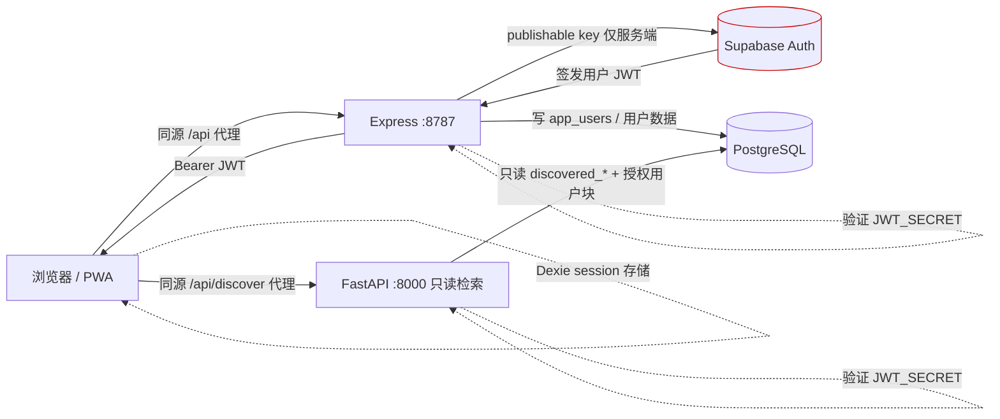
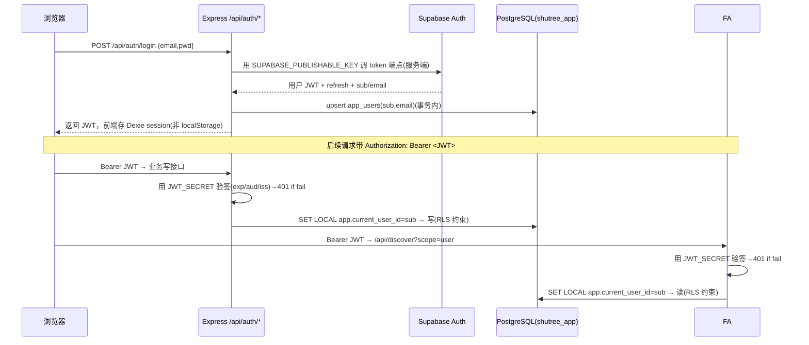
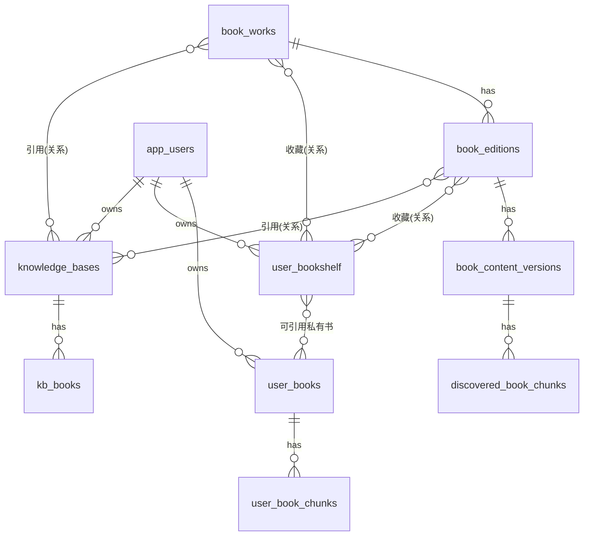

# 述树统一书籍资产与知识问答架构设计 · V1.2.1 — 架构复核

> 本文件是 V1 / V1.1 / V1.2 的**只读架构复核**，不覆盖前四份文档。
> 本轮为**阶段 1A.1（实施前架构复核）**，**全程只读**：未修改任何业务代码、未修改数据库 Schema / 数据 / 索引 / 迁移、未启停 PostgreSQL / Express / FastAPI、未创建或连接 Supabase 项目、未修改 `.env`、未 `git add/commit/reset/clean`。
>
> 标注约定：**【已验证事实】**= 代码 / SQL / 官方文档实测证据；**【历史事实】**= 前序报告已确认；**【推断】**= 尚未验证；**【建议】**= 架构建议；**【待验证】**= 实施前 spike 确认。
>
> ⚠️ **V1.1 §10 / V1.2 §20 的六项决策用户尚未正式批准**。本文件给出的均为「推荐方案 + 理由 + 证据」，不得视为已授权实施。
>
> 特别说明：本轮未读取或输出任何真实密钥；只读 SQL 探针只回显角色名 / 版本 / RLS 状态，绝不打印 `DATABASE_URL` 或口令（复用 `api/config.py:load()` 加载 `server/.env`，与线上同款逻辑）。

---

## 1. Git 基线与工作区保护记录

### 1.1 基线（执行前复核，全程未改动）
- 分支 `master`；HEAD `5cc47ba82291b58d191a3c6e1df83d06e15d4cf0`（`git rev-parse HEAD`）。
- 工作树 **131 条**：暂存 6 / 修改 44 / 删除 1 / 未跟踪 80（`git status --short | awk '{print $1}' | sort | uniq -c`）。
- 与书籍 / 认证 / 同步 / 检索相关的源码文件（本轮目标）：`auth/web.ts`、`sync/remote.ts`、`db.py`、`config.py`、`vite.config.ts`、`retrieve.py`、`ingest-books.py`、`crawl-books.ts`、`storage/web.ts` **均未被本任务改动**。

### 1.2 保护证据（结束时复核）
- 本轮唯一新增文件：`述树统一书籍资产与知识问答架构设计-V1.2.1-架构复核.md`（未跟踪）。
- 只读探针脚本位于系统临时目录 `%TEMP%`（仓库外），未进 git。
- 结束时 `git status --short` 数量仍为 131，仅多出本 V1.2.1（与其它 Agent 的既有漂移无关，非本轮造成）。

---

## 2. 产品前提卡约束核对（权威来源）

**【已验证事实】** 前置卡《产品前提卡-给协作方.md》（113KB，生成日期 2026-10-05，最近修改 2026-10-27）红线与架构约束原文：

| 约束 | 原文位置 | 内容要点 |
|---|---|---|
| 第三方令牌存放 | 红线 #7（行 971–972） | **“第三方 API 令牌只能放后端 `server/.env`（PaddleOCR / 翻译服务）。前端代码、`import.meta.env`、`dist/` 产物里都不允许出现令牌；`.env` 已被 `server/.gitignore` 忽略，不要提交、不要贴进聊天。”** |
| 既有令牌实践 | 行 507 | “PaddleOCR 令牌只在 `server/.env`，前端拿不到（前端只带管理员密钥头）。” |
| 前端代理边界 | 行 1018–1020 | “`/api/*` 由 vite 反向代理转发到 `127.0.0.1:8787`——后端必须同时在跑……不要绕过 vite 直接把前端 API 基址指到别的端口。” |
| Express 定位 | 行 503–504 | “独立旁路后端 `server/`（`Express 4 + pg + multer + dotenv + cors`……**不参与前端打包**）” |
| 权限入口 | 行 762 | “无账号体系。前端 `/dict-ingest` 页内输管理员口令解锁（密钥只存内存）” |
| 令牌落点一致性 | 行 617 | “令牌只在 `server/.env`” |

**【已验证事实】** 代码侧与前提卡一致：`api/config.py:10` 注释“密钥 / DSN 只从 `server/.env` 读，不硬编码、不进仓库”；`api/config.py:115` `load_dotenv(SERVER_ROOT / ".env")`（即 `<root>/server/.env`）。**也就是说 FastAPI 当前也从 `server/.env` 读取凭据，仓库内并不存在独立的 `api/.env`。**

**矛盾点（对 V1.2 的修正）【建议】**：V1.2 §7.1 写成“Supabase 密钥只存服务端 `api/.env`（类比 `server/.env` 红线）”。这既**违反前提卡红线 #7 的 `server/.env` 指定**，也**与 `config.py` 实际加载逻辑不符**。**结论：所有 Supabase 凭据必须落在统一的 `server/.env`，由 Express 与 FastAPI 共用（二者本就读同一文件），不新建 `api/.env`。**

---

## 3. 复核任务一：Supabase Auth 与密钥流向

### 3.1 七个问题的答复

1. **前提卡对第三方 Token 的存放位置如何规定？**【已验证事实】 红线 #7（行 971）规定“第三方 API 令牌只能放后端 `server/.env`”，前端代码 / `import.meta.env` / `dist/` 产物均不得出现。Supabase 属第三方服务，适用此条。

2. **Supabase URL、anon/publishable key、service_role/secret key 的性质？**【已验证事实，Supabase 官方 2026 文档】 见下表与 §3.2。简言之：URL = 项目标识（非机密）；publishable/anon = 公共级密钥，只触达 RLS 允许的数据；service_role/secret = **绕过 RLS 的高权密钥，绝不可离开服务端**。

3. **哪些密钥允许公开、哪些必须保密？**【建议】 唯一“可公开”的是 `SUPABASE_URL`（项目地址，无访问能力）。publishable 密钥 Supabase 官方称“可安全暴露于浏览器”，但**本项目红线 #7 禁止任何第三方令牌进前端**，故仍只放 `server/.env`。service_role/secret **严格保密，永不进前端，且本项目运行期不需要它**（见 §3.5）。

4. **前端是否必须通过后端代理完成 Supabase Auth？**【建议】 **是。** 双重理由：① 红线 #7 禁止前端持有第三方密钥；② 前提卡行 1018 规定前端只走 `/api` 同源代理。即便 anon 密钥“官方允许暴露”，本项目也选择更严格的后端代理。

5. **如果必须代理，应由 Express 还是 FastAPI 负责？**【建议】 **Express（:8787）。** 理由：前提卡行 1018 规定 `/api/*` → 8787；Express 已是通用应用后端（含 admin 中间件、pg 连接），把 `/api/auth/*`、上传、书架、知识库等**状态变更**放在 Express，可使 FastAPI 维持“只读检索”定位（行 317 “FastAPI 未配 CORS，前端只走同源路径”且现有仅 `/api/discover`）。若改由 FastAPI 承担，需新增 vite 代理键序 `/api/auth` → 8000（在 `/api` 之前），并突破其只读定位，**不推荐**。

6. **两个后端之间是否需要通信？**【建议】 **不需要。** 二者各自用 `server/.env` 中的同一 `SUPABASE_JWT_SECRET` 独立验证 Supabase 签发的用户 JWT；验证通过即信任 `sub`。无跨服务信任边界，无需互相调用。

7. **`server/.env` 与 FastAPI 部署边界不一致时如何部署？**【建议】 当前二者同机共读 `server/.env`（`config.py:115`）。若分离部署，仅将 **`DATABASE_URL` + `SUPABASE_JWT_SECRET` + HNSW GUC 参数**复制到 FastAPI 主机；**绝不**复制 `SUPABASE_PUBLISHABLE_KEY` 之外的高权密钥，更不复制 service_role。

### 3.2 密钥分类表

| 名称 | 敏感级别 | 存放位置 | 使用方 | 允许进前端 | 说明 |
|---|---|---|---|---|---|
| `SUPABASE_URL` | 低（项目标识） | `server/.env` | Express / FastAPI | 否（红线 #7） | 仅项目地址，无直接访问能力 |
| `SUPABASE_PUBLISHABLE_KEY`（新版 `sb_publishable_*`；旧 `anon`） | 中（公共级） | `server/.env` 仅服务端 | Express（调 Supabase Auth 注册/登录） | **否**（红线 #7，虽官方称可暴露但本项目禁用） | 映射 PG 角色 `anon`/`authenticated`，只触达 RLS 允许的数据 |
| `SUPABASE_JWT_SECRET` | 高（验签密钥） | `server/.env` | Express / FastAPI（验证用户 JWT） | 否 | 用于校验 Supabase 签发 JWT 的签名/过期/aud；非 API key，不出服务端 |
| `SUPABASE_SERVICE_ROLE_KEY` / `SUPABASE_SECRET_KEY`（旧 `service_role`；新 `sb_secret_*`） | **极高**（绕过 RLS） | **不部署到运行期** | 仅离线管理/迁移工具（如需） | **绝对否** | 官方：“bypasses Row Level Security，must never leave your control”；本项目运行期**不需要**，可整体排除部署面 |
| 用户访问 JWT（Supabase 签发，Bearer） | 高（用户凭证） | 前端 Dexie `session` 表（非 localStorage，沿用 `auth/web.ts:22`） | 浏览器 → Express/FastAPI 请求头 | 否（随请求头走，不硬编码） | 短期有效；刷新走 `/api/auth/refresh` |

> 【已验证事实，Supabase 官方】“Secret keys……bypass every Row Level Security policy……Never put one in a browser, a shipped application, or source control.” “Publishable keys……only reaches what Row Level Security allows.” 另：官方 2026 起弃用 `anon`/`service_role`，改用 `sb_publishable_*`/`sb_secret_*`——本表两命名并列，实施时以项目实际创建的名称为准。

### 3.3 密钥流向图



### 3.4 认证请求流程图



### 3.5 最终推荐方案与前提卡符合性

- **推荐**：统一 `server/.env` 存放 `SUPABASE_URL` / `SUPABASE_PUBLISHABLE_KEY` / `SUPABASE_JWT_SECRET` 三项；**不部署** `SERVICE_ROLE` 密钥（运行期无需，最小化密钥面）。Express 拥有 `/api/auth/*` 及全部状态变更端点；FastAPI 维持只读检索并独立验同一 JWT。**完全符合**红线 #7（`server/.env` 唯一存放点）与行 1018（前端只走 `/api` 代理）。
- **与 V1.2 的差异**：撤回 V1.2 §7.1 的 `api/.env`，改为 `server/.env`；撤回 V1.2 §7.2 步骤 3“FastAPI 加 auth 路由”，改为 Express 加 auth 路由。

---

## 4. 复核任务二：JWT / GUC / RLS 安全模型

### 4.1 🔴 最关键发现：当前 RLS 完全失效

**【已验证事实】** 只读探针（`st_12_ro_roles.py`，连接设为 `readonly`，复用 `config.load()`）实测：
```
current_user: postgres
is_superuser: on
login-capable roles: ('postgres', True, True, True)   # rolsuper=True, rolbypassrls=True
RLS on discovered_*: relrowsecurity=False / relforcerowsecurity=False
```
即：**连接池以 `postgres` 超级用户身份连接，且这是唯一可登录角色。** PostgreSQL 中超级用户与 `BYPASSRLS` 角色**无视所有 RLS 策略**。因此 V1.2 §8 设计的 RLS 在当前部署下**形同虚设**——任何经后端的查询都能绕过 `owner_id` 过滤。

**【建议】** RLS 生效的**前置硬门槛**：必须为运行期连接创建专用受限角色 `shutree_app`（`NOSUPERUSER`、`NOBYPASSRLS`），并将运行期连接池切换到该角色（详见 §5）。此项是 P0 安全门禁，**优先于任何用户数据写入**。

### 4.2 逐项风险答复

1. **谁可以设置 GUC？**【建议】 仅可信后端在事务内 `SET LOCAL app.current_user_id = <sub>`。客户端**无法直接连接数据库**——所有 DB 访问经后端 HTTP，PG 仅监听 `127.0.0.1:5432`（前置卡行 1022），网络隔离是边界的一部分。
2. **客户端能否直连或自设 GUC？**【已验证事实+建议】 客户端只持有 HTTP，拿不到 DB 连接；无法发 `SET`。GUC 由后端在验 JWT 后写入，客户端无法注入。
3. **连接使用什么角色？是否绕过 RLS？**【已验证事实】 当前为 `postgres` 超级用户 → 绕过 RLS（见 §4.1）。**必须改为** `shutree_app`（NOSUPERUSER/NOBYPASSRLS）。
4. **表所有者 / 超级用户 / BYPASSRLS 角色？**【建议】 表由迁移角色（如 `postgres` 或专用 `shutree_migrator`）拥有；运行期用 `shutree_app` 并显式 `GRANT`。对所有私有表启用 `FORCE ROW LEVEL SECURITY`，即便未来角色偶然成为所有者也仍受策略约束。
5. **JWT 验证失败如何处理？**【建议】 统一中间件：HS256 + `SUPABASE_JWT_SECRET` 验签；校验 `exp`（过期）、`aud`（与项目 ref 一致）、`iss`（Supabase 签发方）。任一失败 → **401**，绝不降级放行。
6. **用户 ID 必须从哪个字段取得？**【建议】 仅从**已验证 JWT 的 `sub` 声明**取得；绝不使用客户端传入的 `owner_id` / 查询参数 / 头字段。
7. **如何防止客户端伪造 `owner_id`？**【建议】 服务层忽略任何客户端 `owner_id`；写入时 `owner_id` 一律由中间件从 `sub` 注入（策略 `WITH CHECK` 也绑定 `current_user_id()`）。
8. **连接池复用身份残留？**【已验证事实】 `api/db.py:89` 已用 `set_config('hnsw.ef_search', ..., true)`（事务级、连接归还即清空）证明该模式可用。`app.current_user_id` 同样用 `SET LOCAL`（第三参 `true`）→ 事务 `commit/rollback` 后自动丢弃；`run_query` 在 `finally` 前必 `commit` 或 `rollback`（`db.py:99-100`）后才 `putconn`。**残留风险来自“漏设”或误用裸 `SET`**，故必须强制 `SET LOCAL` 并配泄漏测试。
9. **回滚 / 异常 / 嵌套事务？**【建议】 单条请求 = 单事务；异常走 `rollback` 清空 GUC；嵌套事务中 `SET LOCAL` 在子事务回滚时会随子事务撤销，但外层事务仍有效——故统一在**最外层事务入口**设置，并在响应前提交/回滚。
10. **是否需要 FORCE RLS？**【建议】 **是**，对 `user_books`/`user_book_chunks`/`user_bookshelf`/`knowledge_bases`/`kb_books` 全部 `ALTER TABLE ... FORCE ROW LEVEL SECURITY`。

### 4.3 JWT 验证流程（建议）
```
Authorization: Bearer <jwt>
  → 提取 jwt；若空 → 401
  → jwt.decode(jwt, JWT_SECRET, algorithms=['HS256'], audience=PROJECT_REF, issuer=SUPABASE_ISS)
  → 失败(签名/过期/aud/iss) → 401
  → sub = payload['sub']；SET LOCAL app.current_user_id = sub（事务内）
```

### 4.4 GUC 设置流程（建议，沿用 db.py 模式）
```python
# 在 run_query 取得 conn 后、执行用户 SQL 前：
cur.execute("SELECT set_config('app.current_user_id', %s, true)", (sub,))  # true=事务级
```
`current_user_id()` 函数（`V1.2 §8.2`）：
```sql
CREATE OR REPLACE FUNCTION current_user_id() RETURNS uuid LANGUAGE sql STABLE
AS $$ SELECT nullif(current_setting('app.current_user_id', true), '')::uuid $$;
```

### 4.5 RLS 策略示例 SQL（建议）
```sql
ALTER TABLE user_book_chunks ENABLE ROW LEVEL SECURITY;
ALTER TABLE user_book_chunks FORCE ROW LEVEL SECURITY;
CREATE POLICY own_rw ON user_book_chunks
  FOR ALL TO shutree_app
  USING (owner_id = current_user_id())
  WITH CHECK (owner_id = current_user_id());
-- 同理 user_books / user_bookshelf / knowledge_bases / kb_books
```

### 4.6 连接池安全测试方案（实施时落地）
- **泄漏用例**：同一池连接，请求 A（userA JWT，设 GUC=A，查询，提交→GUC 清空）→ 请求 B（userB JWT，复用同连接，设 GUC=B）。断言 B 的事务内 `current_user_id()`=B，且按 id 直查 A 的私有块返回 **0 行**。
- **回滚残留**：A 事务异常 `rollback` 后，新请求（无 JWT→中间件 401；若绕过后直接查）返回 0 行（GUC 已清空，`owner_id=NULL` 不匹配）。
- **缺失上下文**：不设置 GUC 直接查私有表 → `owner_id = NULL` 为 NULL → 0 行（默认拒绝）。

### 4.7 12 项安全测试（执行方式与验收）

| # | 测试 | 执行方式 | 预期 / 验收 |
|---|---|---|---|
| 1 | A 读自己私有书 | 带 A JWT 查 `user_books` | 允许，返回 A 的书 |
| 2 | A 读 B 私有书 | 带 A JWT 按 B 的 id 查 | 0 行（RLS 拒绝） |
| 3 | A 改 B 的书 | 带 A JWT UPDATE B 的书 | 0 行影响（WITH CHECK 拒绝） |
| 4 | 客户端伪造 owner_id | 请求体带 `owner_id=B` | 服务端忽略，按 `sub` 写入 A |
| 5 | 缺失 JWT | 无 Authorization 头 | 401 |
| 6 | 过期 JWT | 用过期 token | 401 |
| 7 | 错误签名 JWT | 篡改签名 | 401 |
| 8 | 错误 audience JWT | 改 aud | 401 |
| 9 | 复用连接 B 得 A 权限 | 见 §4.6 泄漏用例 | 不得获得 A 权限 |
| 10 | A 异常回滚后复用 | 见 §4.6 | 不得残留 A 身份 |
| 11 | 缺失用户上下文 | 不设 GUC 查私有表 | 默认拒绝（0 行） |
| 12 | 普通应用角色绕过 RLS | `shutree_app` 试越权 | 拒绝（FORCE RLS 生效） |

> 【注意】 GUC 是**可信后端设置的请求上下文，不是身份认证机制**。本复核反复强调：RLS 生效的前提是连接角色受限（§4.1），不能把“使用 `SET LOCAL`”当作连接池安全已证明。

---

## 5. 数据库角色与连接池隔离设计

- **运行期角色 `shutree_app`**：`NOSUPERUSER`、`NOBYPASSRLS`、`NOCREATEDB`、`NOCREATEROLE`；仅 `GRANT` 所需权限（`SELECT` 于 `discovered_*`；`SELECT/INSERT/UPDATE/DELETE` 于私有/书架/知识库表）。
- **迁移角色（如 `postgres` / `shutree_migrator`）**：用于建表、ALTER、回填、离线 ingest；与运行期池隔离。
- **连接初始化**：保留 `api/db.py` 的 `init_statements`（hnsw GUC，行 8–13），**不加任何用户级 GUC**（用户上下文仅按请求 `SET LOCAL`）。
- **连接归还**：`run_query` 末尾 `commit/rollback` → `putconn`；`SET LOCAL` 随事务结束自动丢弃，连接归还后不含上一用户身份。
- **探针现状**：当前 `current_user=postgres`（超管），切换为 `shutree_app` 后公共检索（`discovered_*`）仍可用（已 GRANT SELECT），且 RLS 仅作用于新私有表，不影响现有只读检索。

---

## 6. 复核任务三：公共书 / 私有书 / 书架 / 知识库模型边界

### 6.1 修订后 ER 图



> 【建议】 **从 V1.2 §3.1 撤回**：不在 `discovered_book_chunks` 上加 `owner_id` 列。公共表保持纯公共（无所有者）；私有内容整体迁入 `user_book_chunks`（`owner_id` + RLS）。避免在公共表混入侵权列，正是用户要求“不得混同所有权/书架关系/知识库引用”的落点。

### 6.2 核心表及字段（修订）

| 表 | 所有权 | 访问权限 | 关键字段 |
|---|---|---|---|
| `discovered_books` / `discovered_book_chunks` | 全局公共，**无 owner** | 公共检索/阅读；任何人可读 | 保留 BIGSERIAL `id`；新增 `work_id`/`edition_id`/`content_version_id`/`section_type`（**不加 owner_id**） |
| `book_works` / `book_editions` / `book_content_versions` | 全局逻辑实体 | 公共 | `legacy_book_id bigint`（回溯） |
| `user_books` / `user_book_chunks` | `owner_id`=Supabase `sub` | RLS：`owner_id=current_user_id()` | `owner_id`、`embedding`(私有 HNSW) |
| `user_bookshelf` | `owner_id` | RLS | `target_type`/`target_id`（关系，不复制书） |
| `knowledge_bases` / `kb_books` | `owner_id` | RLS | `scope`；`book_ref_type`/`book_ref_id`（关系） |

### 6.3 四类实体语义（明确区分）
- **公共书籍**：全局共享，不属于任何用户；收藏/入架不改变所有权；进入公共检索与公共知识库引用。
- **私有书籍**：明确 `owner`；仅所有者及被授权者访问；必须经 RLS；不混入公共检索。
- **用户书架**：表示“收藏/管理了哪些书”的**关系**，不代表拥有；可引用公共书或自己有权访问的私有书；移出 ≠ 删书。
- **知识库**：表示“选哪些书作为 AI 问答来源”的**关系**；不改变所有权；删知识库 ≠ 删原书；查询时必须重验每本书的访问权限。

### 6.4 四种操作语义

| 操作 | 作用对象 | 副作用 |
|---|---|---|
| 删除书籍 | 仅私有书（owner） | 级联删 `user_book_chunks`（FK `ON DELETE CASCADE`）；清理引用它的 `kb_books`/`user_bookshelf` |
| 移出书架 | `user_bookshelf` 行 | 书本身不动 |
| 取消知识库引用 | `kb_books` 行 | 书本身不动 |
| 彻底删除 | 私有书硬删（级联） | 公共书**永不**由用户硬删（超管离线操作，不在运行期） |

### 6.5 公共 + 私有混合检索权限过滤流程（建议）
```
scope=public → 仅查 discovered_book_chunks（无需 GUC，无 RLS）
scope=user   → 仅查 user_book_chunks，RLS 自动限 owner=sub
scope=kb     → 取该用户 kb_books 成员：
                public 成员 → discovered_book_chunks（限成员 book 集合）
                user   成员 → user_book_chunks（RLS 限 owner=sub）
              → 两路候选合并后 RRF 融合
```
**权限过滤发生在候选召回之前/之时**（RLS + 成员过滤），私有内容绝不进入他人候选集。

---

## 7. 复核任务四：迁移与本地数据保护

### 7.1 旧 ID 回溯与映射
- **【历史事实】** `discovered_books` 30 行 BIGSERIAL；`discovered_book_chunks` 58,332 行。V1.2 §4.1 在 `book_editions` 保留 `legacy_book_id bigint`。
- **映射性质【建议】**：每个 `discovered_book` → 1 `work` + 1 `edition`（**1:1，唯一、可逆、可审计**）；`legacy_book_id` 提供 `edition_id ↔ BIGSERIAL` 双向回溯；`content_version_id` 由 `book_id` 推得（1 book → 1 content version）。**无一对多/多对一风险**（前提卡 §3.3 实测 30 本无 `(title,author)` 重复）。
- **重复导入**：`(source_site, source_id)` 唯一键幂等（`V1.md:105`），重跑不新增重复。

### 7.2 迁移失败恢复 / 回滚（建议）
- 实施前 `pg_dump shutree > backup_before_stage1.sql`（全库）。
- 新表/新列均可 `DROP`/`DROP COLUMN` 回滚；`discovered_books.id`、向量、HNSW **不动** → 天然安全。
- Dexie v12 的 IDB 版本升级失败：用「先建 version 100（×10 铁律）再 120」的夹具恢复（见工作区记忆踩坑记录）。

### 7.3 Dexie v11→v12 零丢失验证（建议）
- `storage/web.ts` 仅 `version(12).stores({ readings:'...,owner', annotations:'...,owner' })`（V1.2 §9）。
- 验证：用生产同款夹具建 `version(110)` 补齐全部 v11 表/索引 → 升 `120`；断言 v11 全部表行数不变、无表被重建。

### 7.4 `owner` 索引含义澄清
- **【建议】** `owner` = Supabase `sub`（NULL = 仅本地、不上云）。**与认证身份同义，不是新概念**；不自动上传（`owner` 默认 NULL，用户主动勾选才写入）。

### 7.5 六本书章节修复是否只动 metadata
- **【历史事实】** 根因：`ingest-books.py:313-340 build_chapter_anchors` 对空 `chapters[]` 返回空 → 全 NULL（`V1.md`/V1.1 已确认）。
- **【建议】** 修复**仅 `UPDATE chapter_title/chapter_number/section_type`**，不涉及 `content`/`embedding`（两列为独立列，不重建向量）。实施前需先验证脚本只 `UPDATE` 这三列（见 §8）。

### 7.6 迁移前后核对指标 / 不可逆清单
- **核对指标**：`count(*)` `discovered_books`=30、`discovered_book_chunks`=58,332、向量覆盖 100%、HNSW 大小不变、`chapter_title` 非空 46,563 → 修复后 57,891。
- **不可逆操作**：仅 Dexie IDB 版本号提升（可备份恢复）；其余均为可回滚 DDL/DML。

---

## 8. 六本书章节修复风险核查（补充 §7.5）

**【历史事实/风险】** 切块参数 `chunk_size=500 / overlap=80`（`ingest-books.py:71-73`）。即**相邻分块有 80 字符重叠**。

- **字符偏移映射风险【推断→建议】**：若按“全文拼接 + 累计字符偏移”映射章节，会因重叠**重复计数 80 字符/边界**，导致偏移错位。**推荐改为“逐块检测”**：对每块独立扫描章节标题模式，命中即从该块起携带章节，至下一块命中前延续（carry-forward）。逐块法天然免疫重叠与跨块断行。
- **Unicode / 换行风险【建议】**：偏移以 Python `str` 码点计数（非字节），与 PG `text` 码点一致；换行在块边界处由 carry-forward 处理，无需跨块拼接。
- **误判风险【建议】**：章节正则须避免正文内 “Chapter” 误判，修复后**人工抽样核对**章节边界（V1.2 §10.3）。

---

## 9. 复核任务五：BM25 / tsvector / RRF 技术评估

- **PG 版本支持【已验证事实】** 当前 `server_version: 18.6`，原生支持 `tsvector`、`to_tsquery`/`websearch_to_tsquery`、`ts_rank`/`ts_rank_cd`、`GIN` 索引、STORED 生成列。
- **分词策略【建议】**：
  - 英文 Gutenberg → 内置 `english` 配置（英文词干/停用词），无需额外组件。
  - 中文 → **需扩展**（`zhparser`/SCWS 或 `pg_jieba`），**非 PostgreSQL 自带**，属未来部署依赖；当前语料为英文，不影响阶段 1。
- **tsvector ≠ BM25【已验证事实+建议】** PostgreSQL 原生 `ts_rank` 是启发式排序，**不是 BM25**（无 BM25 的饱和度/IDF 精确公式）。真正 BM25 需 `pg_search`（ParadeDB）扩展或自实现。故：**阶段 1 用 `tsvector` + `ts_rank` 作为“词法信号”，RRF 融合；真正的 BM25/Reranker 列为待评估项**（与 V1.1 实证结论一致：81% 未命中位居 Top50 外，重排无解）。
- **生成列 + GIN 成本【建议】** STORED 生成列按词素增量存储；GIN 在写入时维护。书籍为**一次性静态入库**，写入成本一次性；查询为索引扫描，可接受。私有书体量小，成本更低。
- **去重 / 归一 / 融合【建议】**：向量 Top-K ∪ tsvector Top-K → 各自按排名计算 `RRF = Σ 1/(k+rank)`（k≈60）→ 取融合 Top-N。
- **权限过滤时机【建议】** 在候选召回之前/之时：私有范围用 RLS / `id=ANY(ARRAY[...])` 限定可见集合；公共范围无过滤；kb 范围限定成员书。**私有内容绝不进入他人候选集**。
- **本轮不建索引、不改 SQL、不写数据【已验证事实】**：仅给验证方案与推荐（符合本轮只读边界）。

---

## 10. 修订后的阶段 1B 实施顺序（建议）

| 阶段 | 内容 | 前置 |
|---|---|---|
| **P0-安全门禁** | 建 `shutree_app` 角色 + 切换运行期池 + 私有表 `ENABLE/FORCE RLS` + 12 项安全测试 | 无（最高优先） |
| **P0-数据模型** | 扩列（公共表不加 owner_id）、建 `book_*`/`user_*`/`kb_*` 新表、回填映射 | pg_dump |
| **P0-修复** | 6 本书逐块章节修复（仅 metadata） | 回滚预案 |
| **P1-账号/权限** | Express `/api/auth/*` + JWT 中间件 + Dexie `session` 改造 | P0-安全门禁 |
| **P1-Dexie** | v11→v12（owner 索引）+ 升级夹具回归 | 本地备份 |
| **P1-混合检索** | tsvector 生成列 + GIN + RRF 融合 + Recall 复测 | P0-数据模型 |
| **P2-知识库/问答** | 表 + 接口（先 `未接入` 门控）+ 前端页 | P1 全绿 |

---

## 11. 风险清单（P0/P1/P2）

| 风险 | 等级 | 缓解 |
|---|---|---|
| 运行期以 postgres 超管连接 → RLS 失效 | **P0** | 建 `shutree_app` 角色并切换池（§4.1/§5） |
| 密钥误放 `api/.env` 或前端 | P0 | 统一 `server/.env`；红线 #7 |
| 连接池 GUC 残留 | P1 | `SET LOCAL` + 泄漏测试（§4.6） |
| 公共表误加 owner_id 混淆所有权 | P1 | 撤回 V1.2 §3.1（§6.1） |
| 章节修复字符偏移重叠错位 | P1 | 逐块检测替代全局偏移（§8） |
| 中文分词缺组件 | P2 | `zhparser`/`pg_jieba`（未来） |
| 多会话仓库冲突 | P1 | 显式 `git add` 路径，不 `git add .` |

---

## 12. 仍需用户拍板的事项（V1.1 §10 / V1.2 §20，未批准）

1. Supabase Auth：**待最终批准**（推荐 B1）。
2. Supabase Storage（B3 文件存储）：**待最终批准，默认不引入**。
3. 用户主动上传默认关闭：**待最终批准**。
4. 六本书修复纳入阶段 1：**待最终批准**。
5. 本地数据不自动关联服务端：**待最终批准**。
6. BM25 技术方案（tsvector 优先）：**待技术验证及用户批准**。
7. 知识库范围（公共+私有混合检索）：**待最终批准**。

> 以上为推荐 + 理由，**不等同已批准决定**。

---

## 13. 本轮只读执行记录

- **Git 基线**：`master` / `5cc47ba`；状态 131（6A/44M/1D/80??）。目标源码未改动。
- **只读核查**：`产品前提卡-给协作方.md`（红线 #7、行 507/1018、架构）、V1/V1.1/V1.2、 `api/config.py:10,115`、`api/db.py:48-103`、`src/services/auth/web.ts:10-24`、`src/services/sync/remote.ts:16-33`、`vite.config.ts:134-180`。
- **只读 SQL 探针**（`st_12_ro_roles.py`，`readonly=True`，复用 `config.load()`，未打印凭据）：确认 `current_user=postgres`(超管,唯一登录角色)、`server_version=18.6`、关键表 `relrowsecurity=False`（RLS 当前未启用且被超管绕过）。
- **未做**：未改代码/Schema/数据/索引；未启停服务；未建/连 Supabase；未改 `.env`；未 `git add/commit/reset/clean`。
- **新增文件**：仅本 `V1.2.1`（未跟踪）。探针脚本在 `%TEMP%`，未进仓库。

---

> **最终停止条件**：V1.2.1 完成、核查证据齐全（含 DB 角色探针）、工作区变化已验证。**不进入阶段 1B，未获明确授权不动手。** 等待用户审阅并拍板 §12 七项后，再展开正式实施。
