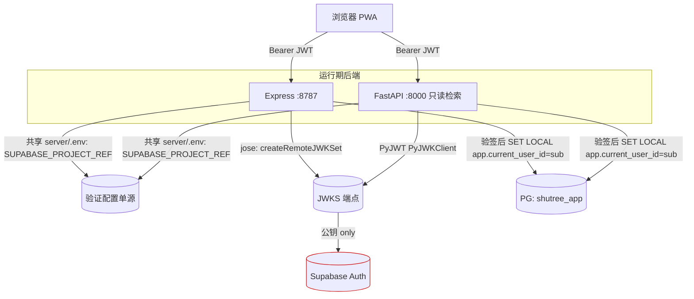

# 述树统一书籍资产与知识问答架构设计 · V1.2.2 — 安全设计补充

> 本文件是 V1.2.1 的**只读安全设计补充**，不覆盖前序文档。
> 本轮为**阶段 1A.2（最后一轮只读安全设计核查）**，**全程只读**：未修改代码 / 数据库 / 配置 / `.env`，未创建 Supabase 项目、未连接 Supabase、未读取真实密钥、未创建角色或执行 GRANT/REVOKE、未启停服务、未 `git add/commit/reset/clean`。
>
> 标注约定：**【已验证事实】**= Supabase 官方文档 / 前序只读探针实测；**【推断】**= 尚未实施验证；**【建议】**= 架构建议；**【待验证】**= 实施前 spike 确认。
>
> ⚠️ **V1.1 §10 / V1.2 §20 的六项决策用户仍未正式批准**。本文件为“推荐设计 + 证据”，不得视为已授权实施。

---

## 1. 官方文档依据及访问日期

**访问日期：2026-10-31（本轮只读核查）**。依据 Supabase 官方文档（均来自 `supabase.com/docs`，未连接任何项目）：

| 文档 | 关键结论（已验证事实） |
|---|---|
| *JWT Signing Keys* | 新系统支持**非对称签名密钥**（RSA / **ES256-P256** / Ed25519）；遗留**对称 JWT secret（HS256）**“No longer recommended”“Available for backward compatibility”。非对称下 Auth 暴露 JWKS：`GET /auth/v1/.well-known/jwks.json`，公钥仅可验证不可签发。轮换无停机、多密钥经 `kid` 共存受信；吊销自动化。 |
| *JWTs* | JWT 头含 `alg`（`HS256\|ES256\|RS256`）、`kid`；校验推荐 `jose` 的 `createRemoteJWKSet` + `jwtVerify`。**HS256 共享密钥官方“strongly recommend against”本地验证**；若被迫用 HS256，应改向 Auth 服务器 `GET /auth/v1/user` 验签。 |
| *JWT Claims Reference* | `iss`= `https://<ref>.supabase.co/auth/v1`（用户令牌）；`aud`= `"authenticated"` 或 `"anon"`（**非项目 ref**）；`sub`= 用户 UUID；`role`= `authenticated/anon/service_role`；`kid` 标识密钥。验证须校验 `exp/iss/aud`。 |
| *API keys*（V1.2.1 已引） | publishable/anon = 公共级（只触达 RLS 允许数据）；secret/service_role = **绕过 RLS**，绝不离开服务端。2026 起弃用 anon/service_role 改 `sb_publishable`/`sb_secret`。 |

**关键判断【建议】**：本项目**尚未创建 Supabase 项目**，因此**不存在“只能用旧机制”的约束**。依官方立场，**默认生产方案 = 非对称 Signing Keys（ES256/P-256）+ JWKS 本地验证**，HS256 仅作为“若团队在创项目后仍保留遗留共享密钥”的兜底，且兜底路径应优先走 Auth 服务器验签而非嵌入密钥。下文明示迁移路径。

---

## 2. JWT 验证架构图

**两服务验证一致性【建议】**：Express（TS）与 FastAPI（Python）**均从同一 `server/.env` 读取** `SUPABASE_PROJECT_REF`（→ JWKS URL）、并共用一组验证参数（`issuer`、`audience`、`allowed_algs`）。`config.py:115` 已确认 FastAPI 读 `server/.env`；Express 同机同文件。验证器各自实现但参数同源 → 规则一致。两服务**无需互相通信**，各自独立验同一 Supabase JWT。

---

## 3. JWKS 缓存和轮换设计（建议）

- **本地验证库**：TS 用 `jose`（`createRemoteJWKSet` + `jwtVerify`）；Python 用 `PyJWT>=2.6` 的 `PyJWKClient`（按 `kid` 解析）。二者均自动缓存 JWKS、在 `kid` 未命中时刷新。
- **缓存时长边界【已验证事实】**：Supabase Edge 对 JWKS 缓存 **10 分钟**；官方要求“不要在应用中缓存更久，否则吊销困难；若缓存更久须提供清除机制”。→ 应用本地缓存 TTL ≤ 10 分钟，并提供**手动 purge**（如运维信号/配置 bump）以便轮换后立即生效。
- **轮换兼容【已验证事实】**：轮换期间 JWKS 同时含 standby + current 公钥（按 `kid`）；旧密钥签发的未过期令牌仍被接受；用户会话不掉线。官方建议吊销 previously-used 密钥前**等待 ≥20 分钟**（覆盖 Edge 缓存 + 在途令牌）。
- **JWKS 不可用（fail-closed）【建议】**：
  1. 首次/刷新失败 → 用**上次成功缓存**继续验签（在 TTL 内）。
  2. 缓存亦过期且持续拉取失败 → **拒绝请求（401），绝不降级为“不验证”**。记录告警。
  3. **绝不以 HS256 共享密钥作为 JWKS 不可用时的静默兜底**（那等于把高权密钥引入运行期，违背 §1）。
- **拒绝非法算法【建议】**：`jwtVerify`/`PyJWKClient` 仅接受 JWKS 中 `alg` 匹配的公钥；额外**显式固定 `allowed_algs=['ES256']`**，拒绝 `alg:none`、`HS256`、`RS256` 及未知算法——库抛错即 401。

---

## 4. 三类 PostgreSQL 角色权限矩阵

**【已验证事实】** 前序只读探针（`st_12_ro_roles.py`，`readonly=True`，复用 `config.load()` 不打印凭据）实测：**当前唯一可登录角色 = `postgres`（`rolsuper=true`、`rolbypassrls=true`、`is_superuser=on`）**，且运行期连接池即以 `postgres` 连接 → **RLS 被超管完全绕过**（见 V1.2.1 §4.1）。下列为**目标角色设计**。

| 维度 | `shutree_app`（运行期） | `shutree_migrator`（迁移） | `postgres`（管理） |
|---|---|---|---|
| 属性 | `NOSUPERUSER`/`NOBYPASSRLS`/`NOCREATEDB`/`NOCREATEROLE`/`NOINHERIT` | `NOSUPERUSER` 或受限；可拥有表、`CREATEDB`（受控） | 现有超管，**不进运行期** |
| 拥有业务表 | **否**（表所有者=迁移角色） | **是**（拥有私有/新表） | 拥有既有 `discovered_*` |
| 运行时连接 | ✅ Express/FastAPI 池 | ❌ 仅离线迁移脚本 | ❌ 禁止作为运行期身份 |
| 私有表权限 | `SELECT/INSERT/UPDATE/DELETE`（受 RLS） | 全权（含跨用户写，用于回填） | 全权（管理） |
| 公共表权限 | `SELECT` | `SELECT`（及写入 `discovered_*`） | 全权 |
| RLS 适用 | **受 RLS 约束**（非所有者） | 所有者豁免（见 §5） | 超管豁免（不可改） |
| 凭据落点 | `server/.env`（运行期） | **仅受控迁移环境/离线**，不进运行期/前端 | 本机/管理员，不进运行期 |

> 【建议】 最小改动路径：运行期从 `postgres` 切换为新建 `shutree_app`；迁移继续用受控的 `postgres`（或新建 `shutree_migrator` 以彻底隔离）。**核心硬门槛：运行期角色绝不能是超级用户**（见 §5）。

---

## 5. GUC 与 RLS 安全边界

### 5.1 表所有者与运行期角色分离【建议】
- 私有表（`user_books`/`user_book_chunks`/`user_bookshelf`/`knowledge_bases`/`kb_books`）由**迁移角色拥有**，`shutree_app` 为非所有者 → 自动受 RLS 约束。
- 公共表（`discovered_*`）`RLS` 关闭；`shutree_app` 仅 `SELECT`。

### 5.2 FORCE ROW LEVEL SECURITY 的适用范围【建议】
- **默认 `ENABLE ROW LEVEL SECURITY`（非 FORCE）** 于私有表：所有者（迁移角色）豁免可批量回填跨用户行；`shutree_app` 非所有者故受约束，满足“私有表必须经过 RLS”。
- **不默认 `FORCE RLS`** 的原因：FORCE 会同时约束表所有者，导致迁移角色无法写入 `owner_id≠自身` 的行（其无身份/GUC）。
- **替代强化（若团队要求 FORCE）**：迁移改用 `SECURITY DEFINER` 过程或在事务内由所有者临时 `ALTER TABLE ... DISABLE/FORCE` 切换；并加 CI 断言 `shutree_app` 不为表所有者。
- 公共表**不启用 RLS**（全局可读）。

### 5.3 超级用户 / BYPASSRLS 不可绕过【已验证事实】
- PostgreSQL 中**超级用户与 `BYPASSRLS` 角色无视所有 RLS 策略，无开关可改**。故运行期角色必须 `NOSUPERUSER` 且 `NOBYPASSRLS`——这是 RLS 生效的前提（V1.2.1 §4.1 实测当前违反）。

### 5.4 应用角色能否自行设置 GUC【已验证事实+建议】
- 任意角色均可在会话/事务级 `SET LOCAL` 自定义 GUC（自定义 GUC 无需预注册，成为 placeholder）；`shutree_app` 技术上可 `SET`。
- **但 GUC 不是身份认证机制**：后端在**验证 JWT 之后**才以服务端变量 `sub` 调 `set_config('app.current_user_id', sub, true)`（参数化，绝不由客户端输入拼接）。客户端无 DB 连接，无法自行 `SET`。
- `current_user_id()` 仅读取该 GUC；真正的身份权威是**已验证的 JWT**。

### 5.5 防止应用角色通过继承/函数绕过 RLS【建议】
- `NOINHERIT`：杜绝 `shutree_app` 从任何组角色继承管理权限。
- **SECURITY DEFINER 函数审计**：此类函数以**所有者**权限运行。若存在由高权角色（postgres/migrator）拥有、且 `shutree_app` 可 `EXECUTE` 的特权函数，可能被滥用绕过 RLS。处置：① 不创建可被 `shutree_app` 调用的跨用户特权 SECURITY DEFINER 函数；② 若必需，函数内部须以调用者的 `current_user_id()` 限定自身行；③ 默认 `REVOKE EXECUTE` 于 `shutree_app`。`current_user_id()` 本身为 `SECURITY INVOKER`（默认）、仅读取 GUC，安全。
- 应用角色无 `CREATEROLE`/`CREATEDB`，无法自建高权角色（测试 #4）。

### 5.6 防止连接池跨用户污染【建议】
- 沿用 `api/db.py:89` 已验证的 `set_config(..., true)`（事务级，连接归还即清空）模式；`run_query` 在 `finally` 前 `commit`/`rollback`（`db.py:99-100`）后 `putconn` → GUC 随事务结束丢弃，连接归还后不含上一用户身份。
- 必配泄漏测试（§7 #7/#8）。

---

## 6. SQL 注入威胁模型（GUC 身份伪造）

**【建议】** 逐项评估“客户端能否借 SQL 注入伪造 GUC 身份”：
1. **客户端无 DB 连接** → 无法发出 `SET`，GUC 伪造对客户**不可达**。
2. **唯一设置 GUC 的是可信后端**，值来自已验证 `sub`（服务端变量），经 `psycopg2` 参数化 `cur.execute("SELECT set_config('app.current_user_id', %s, true)", (sub,))` —— **非字符串拼接**，无注入路径。
3. **参数化查询**（`cur.execute(sql, params)`）阻断 SQLi；应用层不拼接客户端输入成 SQL。
4. 残余风险=后端代码缺陷把客户端输入当作 `sub` → 缓解为代码评审 + `sub` 仅取自 JWT 校验后声明。
**结论**：GUC 身份伪造不构成客户端可达向量；边界可靠性取决于“JWT 验签 → 取 `sub` → 参数化 SET”这条链，且运行期角色非超管/非 BYPASSRLS。

---

## 7. 12 项补充安全测试设计（仅设计，不执行写入）

| # | 测试 | 测试方式 | 预期结果 | 验收 |
|---|---|---|---|---|
| 1 | 应用角色非超管 | `SELECT rolsuper FROM pg_roles WHERE rolname='shutree_app'` | `false` | 断言为假 |
| 2 | 应用角色无 BYPASSRLS | `SELECT rolbypassrls ...` | `false` | 断言为假 |
| 3 | 应用角色非表所有者 | `pg_class.relowner` 比对 `shutree_app` oid | 私有表 relowner ≠ app | 全部不符 |
| 4 | 应用角色不能建高权角色 | 以 `shutree_app` 执行 `CREATE ROLE x CREATEDB SUPERUSER` | 权限拒绝（SQL 错误） | 抛错 |
| 5 | 运行期连接不可用 postgres | 运行期池配置仅含 `shutree_app` DSN；尝试以 postgres 连池 | 拒绝/无此身份 | 连接失败 |
| 6 | 缺失 GUC 默认拒绝私有数据 | 以 `shutree_app` 连接、**不设 GUC** 查 `user_book_chunks` | 0 行（RLS：`owner_id=NULL`） | count=0 |
| 7 | A/B 复用连接权限隔离 | A(userA)设GUC=A提交→B(userB)复用同连接设GUC=B；B按id直查A私有行 | B 仅见自身；查 A 行=0 | 隔离严格 |
| 8 | 回滚后 GUC 不残留 | A 事务设GUC=A后 `rollback`；新事务（无JWT）查私有表 | 0 行 | 无残留 |
| 9 | 应用角色不能经继承获迁移权限 | `shutree_app` 为 `NOINHERIT` 且非任何管理组；尝试迁移特权操作 | 拒绝 | 抛错 |
| 10 | 非法 JWT 全拒 | 单元：构造 `alg=none`/`HS256`/错 `kid`/错 `iss`/错 `aud` 令牌过 `jwtVerify` | 全部抛错→401 | 12 类全拒 |
| 11 | JWKS 轮换期会话不失效 | 轮换后 JWKS 含新旧公钥；旧/新签名令牌均验签 | 均 200，无 401 | 双通 |
| 12 | JWKS 不可用不退化为不验证 | 阻断 JWKS 拉取；TTL 内用缓存续验，超 TTL+失败 | 超 TTL 后请求 401（fail-closed） | 绝不“放行” |

> 测试 #1–#9 为 DB/角色层（实施时落 pgTAP 或脚本）；#10–#12 为 JWT/JWKS 层（单元 + 集成）。

---

## 8. 与 V1.2.1 的差异

| 主题 | V1.2.1 | V1.2.2 |
|---|---|---|
| JWT 验证 | 仅提 HS256 + `SUPABASE_JWT_SECRET` | **默认非对称 ES256 + JWKS 本地验证**；HS256 降为遗留兜底 + 迁移路径 |
| 密钥面 | 列 `SUPABASE_JWT_SECRET` 为运行期 | 运行期**不部署** JWT secret/服务密钥；仅 `SUPABASE_PROJECT_REF` + JWKS 公钥（公开） |
| 角色 | 提 `shutree_app` + `postgres` 两类 | 补全**三类**：`shutree_app`/`shutree_migrator`/`postgres`，含权限矩阵 |
| RLS | 提 `FORCE RLS` | 澄清 **ENABLE（非 FORCE）** 的取舍 + 迁移 SECURITY DEFINER/CI 断言替代方案 |
| 测试 | 12 项混合 | 在原 12 项基础上**新增 12 项角色/JWKS 专项**（共 24 项口径） |
| 威胁模型 | 未单列 | 新增 **SQL 注入 / GUC 伪造** 威胁模型（§6） |

---

## 9. 阶段 1B 前必须满足的 P0 安全门禁

1. **创建 `shutree_app` 角色**（`NOSUPERUSER`/`NOBYPASSRLS`/`NOCREATEDB`/`NOCREATEROLE`/`NOINHERIT`，非表所有者），并将 Express/FastAPI 运行期池切换至该角色（替换当前 `postgres` 超管连接）。
2. **私有表 `ENABLE ROW LEVEL SECURITY`** + RLS 策略 `USING/WITH CHECK (owner_id = current_user_id())`。
3. **JWT 验签落地**：Express/FastAPI 各自实现 JWKS 本地验证（TS `jose` / Python `PyJWT PyJWKClient`），参数同源 `server/.env`；显式 `allowed_algs=['ES256']`、`issuer`、`audience='authenticated'`；JWKS 不可用 **fail-closed**。
4. **12 项角色测试 + 12 项 JWT/JWKS 测试**全绿（§7）。
5. **Supabase 项目创建时启用非对称 Signing Keys（ES256）**，确保 JWKS 端点返回公钥（否则本地验证无密钥可用）。

---

> **最终停止条件**：V1.2.2 完成、官方文档证据齐全（Signing Keys/JWTs/Claims 三份，2026-10-31）、工作区仅新增本文件。**不进入阶段 1B，未获明确授权不动手。** 等待用户审阅并批准（尤其 §9 的 P0 安全门禁与 Supabase Auth 决策）后，再展开正式实施。
