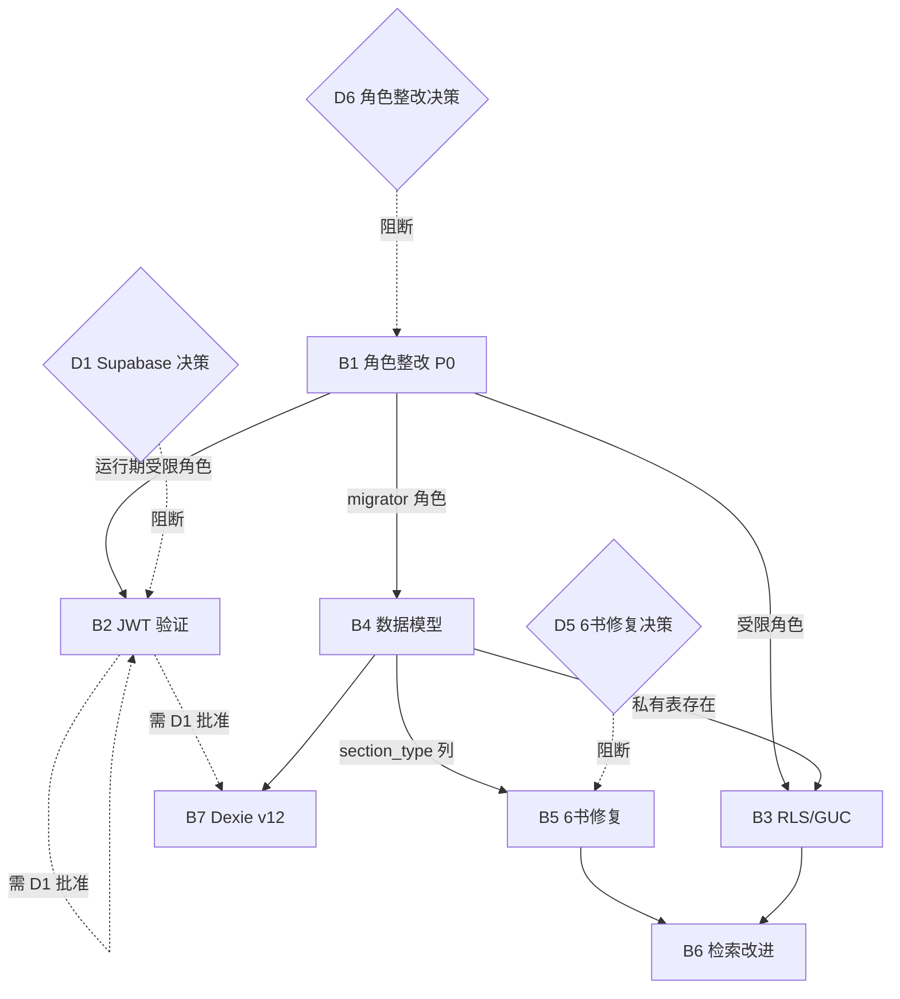

# 述树统一书籍资产与知识问答架构设计 · V1.2.4 — 阶段 1B 执行计划

> 本文件是 V1 / V1.1 / V1.2 / V1.2.1 / V1.2.2 / V1.2.3 的**阶段 1B 实施计划编制**（只读 + 文档编写），不覆盖前序文档。
> 本轮为**阶段 1A 收尾后的「实施计划编制」**，目标是把已确认的架构决策（V1.2 系列）转化为**有依赖关系、可验收、可回滚**的工作包，供项目负责人审阅与批准。
>
> **本轮只允许只读检查与文档编写。未经明确批准，不得开始任何实施。**
>
> 标注约定：**【已核实事实】**= 本轮（2026-11-01）只读 SQL / git / 代码审计实测；**【历史事实】**= 前序报告已确认、本轮未重新取证；**【推断】**= 尚未验证；**【建议】**= 架构建议；**【待决策】**= 需用户拍板。
>
> ⚠️ **V1.1 §10 / V1.2 §20 / V1.2.2 §9 的七项决策用户仍未批准**；本文件的 B1–B7 均为「推荐方案 + 步骤 + 验收」，列入 §11 待拍板，**不得视为已授权实施**。

---

## 1. 执行摘要

阶段 1B 承接 1A 系列（1A / 1A.1 / 1A.2 / 1A.3）已完成的安全架构复核，将「统一书籍资产 + 账号体系 + 私有隔离 + 检索改进 + Dexie 兼容」落为 7 个可编排工作包（B1–B7）。核心结论：

1. **当前数据库运行角色是 `postgres` 超级用户，且是唯一的登录角色**，全部 9 张表均未启用 RLS、均归 `postgres` 所有——**RLS 当前整体失效，是 P0 级真实缺口**（非假设，本轮探针实测）。
2. **私有表、账号体系、JWT 验证、GUC 上下文、统一资产模型均不存在**（探针确认 `user_*`/`knowledge_*`/`book_*`/`app_users` 表 absent；`api/` 与 `server/src` 均无 user-JWT 中间件）。
3. **6 本书 11,328 分块仍全 NULL**（本轮重新实测得 `id∈{10,44,47,49,51,52}` 全部 0 非 NULL 章节），19.4% 语料永久不可召回，且从未被任何指标覆盖。
4. 实施顺序：**B1（角色整改，P0，无前置）→ B4（数据模型）+ B2（JWT，待批）→ B3（RLS/GUC）+ B5（6 书修复）→ B6（检索改进）→ B7（Dexie，待批）**。B1 是其余所有包的前置硬门槛。
5. **GUC 不是认证边界**（1A.3 已证）：B3 必须同时满足「可信 JWT 验证 + 全参数化查询 + 最小权限角色 + RLS + 连接池重置 + 注入静态审计」六重防御。

---

## 2. 当前状态只读核查结果（2026-11-01 重新取证）

### 2.1 Git 工作区（重新核查）
| 项 | 值 |
|---|---|
| 分支 | `master` |
| HEAD | `5cc47ba82291b58d191a3c6e1df83d06e15d4cf0` |
| 工作树 | 暂存 6 / 修改 45 / 未跟踪 153（合计 204） |
| 其他 Agent 在途改动 | **存在且大量**：B12 系列报告、Stage B/C 采集脚本、单词学习页（wordLearning.ts / useSwipeSwitch / v11→v12 升级夹具）、多端兼容（useIsDesktop）、convert/asr 链路等。**均非本任务范围，本轮零接触** |
| 本任务改动 | **仅新增本 V1.2.4 文档**（未跟踪），其余文件完全未动 |

### 2.2 数据库（只读探针 `st_1b_ro_probe.py`，连接 `readonly=True`，不打印凭据）
| 检查 | 结论（重新取证） |
|---|---|
| 当前连接角色 | **`postgres`**（`rolsuper=true`、`rolbypassrls=true`、`rolcreaterole=true`、`rolcreatedb=true`） |
| 可登录角色 | **仅 `postgres` 一个**（`shutree_app` / `shutree_migrator` 均不存在） |
| RLS 状态 | 全部 9 张表 `relrowsecurity=false` → **RLS 全未启用** |
| 表所有权 | 全部 9 张表 `relowner = postgres` |
| 私有表 | **不存在**（`user_*`/`knowledge_*`/`book_*`/`app_users` 全部 absent） |
| 6 本书章节 | `id∈{10,44,47,49,51,52}` 共 **11,328** 分块，**chapter_title 全部 NULL（0 非空）** |
| 全局章节 | 58,332 分块 / NULL 11,769 / 非 NULL 46,563（11,769 = 11,328 问题书 + 441 paratext） |

### 2.3 认证与数据库访问路径（代码审计）
| 层 | 现状（重新取证） | 证据 |
|---|---|---|
| FastAPI `api/` | **无任何 JWT / Authorization / 验签 / `current_user_id`**；`retrieve.py` 公开 | Grep `api/` 零命中 |
| Express `server/src` | 仅 `adminAuth.ts`（管理员 API Key，`/dict-ingest` 用）；**无 user-JWT 中间件**；`/api/auth/*` 路由不存在 | Grep 命中仅 `adminAuth.ts`/`llm.ts`(LLM 服务 token)/`paddle/client.ts`(OCR token) |
| 连接池角色 | 通过 `server/.env` 的 `DATABASE_URL` 连接 = **`postgres` 超管**（探针实测 current_user=postgres） | 探针 + `api/config.py:115` `load_dotenv(SERVER_ROOT/".env")` |
| 配置读取 | FastAPI 与 Express **同读 `server/.env`**（无独立 `api/.env`） | `api/config.py:10,115` |
| 迁移入口 | `npm run db:migrate` → `server/src/scripts/migrate.ts` 按文件名升序执行 `sql/*.sql`（001→005）；`apply-sql.ts` 支持单文件针对性应用 | `migrate.ts:2`、`apply-sql.ts` |

> 结论：B1/B2/B3/B4 均为**净新增能力**，不存在「改造已有安全机制」的兼容负担；但 B1 的 `postgres` 超管连接是**当前生产真实缺口**，优先级高于一切用户数据写入。

---

## 3. 已确认事实与待确认事项

### 3.1 已确认事实（可直接用于实施，无需再议）
- F-A：运行期连接为 `postgres` 超管 → RLS 失效（**P0 真实缺口**，非假设）。
- F-B：`shutree_app` / `shutree_migrator` 角色不存在，需新建。
- F-C：私有表 / 账号 / RLS / GUC 上下文 / 统一资产模型均不存在。
- F-D：6 本书 11,328 分块全 NULL；全局 NULL 11,769 = 11,328 + 441（paratext 非缺陷）。
- F-E：FastAPI / Express 均无 user-JWT；两者同读 `server/.env`。
- F-F：迁移执行入口 = `npm run db:migrate`（全量升序）；新迁移加 `sql/006_*.sql` 等。
- F-G：前提卡红线 #7（令牌仅 `server/.env`）、#4（平台 API 仅 `src/services/`）、#2（不顺手改无关代码/升依赖）、技术栈版本锁死（React18.3.1/TS5.5/Vite5.4/Tailwind3.4/zustand4.5.5/Dexie4.4.6）仍有效。

### 3.2 待确认事项（需用户拍板，见 §11）
- D1：是否正式采用 Supabase Auth（B1 角色整改与 Supabase 决策**相互独立**，可先批 B1）。
- D2：是否购买/启用 Supabase Storage（B3 文件存储）。
- D3：用户主动上传是否默认关闭。
- D4：公共书与私有书的最终产品边界。
- D5：是否正式启动 6 本书修复（B5）。
- D6：是否正式启动数据库角色整改（B1）。
- D7：是否正式执行任何数据库迁移 / 进入阶段 1B。
- 另含 V1.1 §10：Supabase B1+B3、上传默认关、本地数据不自动关联、BM25 用 tsvector、知识库支持整库范围。

---

## 4. 阶段 1B 工作包（B1–B7）

> 统一表格格式：目标 / 当前依据 / 变更范围 / 前置依赖 / 执行步骤 / 数据风险 / 安全风险 / 验收标准 / 回滚方案 / 停止条件。
> 验收标准一律可量化、可执行，禁用「测试通过」「功能正常」等空泛描述。

### B1 ｜ 数据库运行角色与权限整改

| 项目 | 内容 |
|---|---|
| **目标** | 消除「运行期以 `postgres` 超管连接致 RLS 失效」的 P0 真实缺口；建立最小权限运行角色。 |
| **当前依据** | 【已核实】探针实测 current_user=postgres（rolsuper/rolbypassrls/rolcreaterole/rolcreatedb 全 true），唯一登录角色；全部表归 postgres。 |
| **变更范围** | PG 角色：`shutree_app`（新建，运行期）、`shutree_migrator`（新建，迁移专用）；`server/.env` 的 `DATABASE_URL` 改为 `shutree_app` 凭据；`api/db.py` 与 `server/src/db/pool.ts` 连接池 DSN 不变（读同一 `.env`，仅凭据变）；不改动任何业务表结构。 |
| **前置依赖** | 无（可立即启动）。⚠️ **与 D1 Supabase 决策相互独立**：无论用 Supabase 还是自建 JWT，运行期都不能是超管。 |
| **执行步骤** | ① 用受控的 `postgres`（或新建 `shutree_migrator`）执行 `CREATE ROLE shutree_app NOSUPERUSER NOBYPASSRLS NOCREATEDB NOCREATEROLE NOINHERIT LOGIN PASSWORD '...'`；② 同样建 `shutree_migrator`（可 `CREATEDB` 受控、拥有表）；③ 对既有 `discovered_*` 表 `GRANT SELECT` 给 `shutree_app`；④ 新建私有表时 `ALTER TABLE ... OWNER TO shutree_migrator`，`GRANT SELECT/INSERT/UPDATE/DELETE` 给 `shutree_app`；⑤ 在 `server/.env` 新增 `DATABASE_URL_APP`（仅运行期用），原 `DATABASE_URL` 保留给迁移/管理；⑥ 改 `api/db.py`、`pool.ts` 运行期连接走 `DATABASE_URL_APP`；⑦ 重启两后端（先 FastAPI 后 Express，或反之，需零宕期方案见下）；⑧ 探针复验 `current_user=shutree_app` 且 `rolsuper=false/rolbypassrls=false`。 |
| **数据风险** | 无结构/内容变化；仅角色与授权变化。 |
| **安全风险** | 切换瞬间若 `shutree_app` 权限不足，运行期查询会失败 → 需先在影子配置验证权限矩阵；`shutree_app` 口令须强随机、只存 `server/.env`、`shutree_migrator` 凭据绝不进运行期/前端。 |
| **验收标准** | ① `SELECT rolsuper,rolbypassrls FROM pg_roles WHERE rolname='shutree_app'` 两列均 `false`；② `SELECT count(*) FROM pg_roles WHERE rolcanlogin` ≥ 2（含 shutree_app）；③ 运行期两后端日志显示 `current_user=shutree_app`；④ 用 `shutree_app` 执行 `CREATE ROLE x CREATEDB SUPERUSER` 返回权限拒绝（SQL 错误码 42501）；⑤ 公共检索 `/api/discover` 仍可返回 Top10（回归 M4 47/63/69 不变）；⑥ `pg_dump` 备份已存在（见 §9）。 |
| **回滚方案** | `server/.env` 还原 `DATABASE_URL_APP` 指向原 `postgres` 凭据（或回退运行期连接用原 `DATABASE_URL`），重启两后端；角色与 GRANT 保留不影响回滚（GRANT 对原 postgres 无副作用）。 |
| **停止条件** | 出现以下任一即暂停：① `shutree_app` 误获 SUPERUSER/BYPASSRLS（验收 ① 失败）；② 切换后公共检索回归失败（验收 ⑤ 失败）；③ 无法在零宕期完成切换（需重新设计发布顺序）。 |

### B2 ｜ JWT 身份验证

| 项目 | 内容 |
|---|---|
| **目标** | 引入非对称 JWT 验签，建立可信用户身份（`sub`），为 GUC/RLS 提供权威身份源。 |
| **当前依据** | 【已核实】`api/` 与 `server/src` 均无 user-JWT；`/api/auth/*` 不存在；`auth/web.ts` 为本地 uuid 桩；`sync/remote.ts` 为内存 Map 桩。 |
| **变更范围** | `server/.env` 增 `SUPABASE_URL`/`SUPABASE_PROJECT_REF`/`SUPABASE_PUBLISHABLE_KEY`（仅服务端）；**不部署 service_role/secret**。`server/src` 新增 `routes/auth.ts`（`/api/auth/*` 注册/登录/刷新/me，经后端代理 Supabase）、`middleware/requireUserJwt.ts`（Express 验签）；`api/` 新增 JWT 验签依赖（`PyJWT`+`PyJWKClient`）与中间件；前端 `src/services/auth/web.ts`、`src/services/sync/remote.ts` 改造；`vite.config.ts` 代理新增 `/api/auth`→8787（在 `/api` 之前）。 |
| **前置依赖** | **D1 Supabase Auth 决策（须先批）**；B1 角色整改建议先完成（运行期已是受限角色）；Express 持有 `/api/auth/*`（V1.2.1 §3.5）。 |
| **执行步骤** | ① 用户批准 Supabase Auth 并建项目，**创建时启用非对称 Signing Keys（ES256/P-256）**；② `server/.env` 加三项（publishable 仅服务端，JWT 验证走 JWKS 公钥，不存 JWT secret 于运行期）；③ Express 用 `jose` 实现 `createRemoteJWKSet`+`jwtVerify`，`allowed_algs=['ES256']`，校验 `iss`/`aud='authenticated'`/`exp`/`sub`/`kid`；④ FastAPI 用 `PyJWT`/`PyJWKClient` 同参验签；⑤ JWKS 缓存 TTL≤10min + 手动 purge；不可用 fail-closed（TTL 内用缓存，超 TTL+失败→401）；⑥ 中间件取 `sub` 注入请求上下文；⑦ 前端 `authService` 改调 `/api/auth/*`，JWT 存 Dexie `session`（非 localStorage，沿用桩）；⑧ 替换 `LocalSyncStub` 为真实 `RemoteSyncClient`（仅当用户主动选择上传）。 |
| **数据风险** | 无结构变化；仅新增 `app_users` 镜像（可选，B4）；用户本地 Dexie 数据不强制关联。 |
| **安全风险** | **绝不**将 service_role/secret 或 publishable key 放入前端（`import.meta.env`/`dist`）；JWKS 不可用**不**降级为「不验证」；拒绝 `alg=none`/`HS256`/未知 alg；非对称密钥缺失时本地验证无公钥可用 → 须在 Supabase 创建时确认 JWKS 端点返回公钥。 |
| **验收标准** | ① 用有效 ES256 JWT 带 `aud=authenticated` 请求受保护端点 → 200，且中间件 `sub` 与 JWT 一致；② 过期/错 `iss`/错 `aud`/篡改签名/`alg=none`/`HS256` 共 6 类均返回 401（构造 6 条负例）；③ JWKS 轮换期旧+新签名令牌均 200；④ 阻断 JWKS 拉取且超缓存 TTL 后请求 401（fail-closed）；⑤ 前端 `grep -rE "SUPABASE_PUBLISHABLE|sb_publishable" src` 零命中（密钥不进前端）；⑥ 令牌仅存 Dexie `session`，`grep -rE "localStorage" src/services/auth` 零命中。 |
| **回滚方案** | 关闭新增 `routes/auth.ts` 与 JWT 中间件（feature flag / 路由摘除），前端回退至本地 uuid 桩（保留 `LocalSyncStub`）；`server/.env` 新增三项不删除但不再被引用。 |
| **停止条件** | ① D1 未批准；② Supabase 项目未启用非对称密钥致 JWKS 无公钥；③ 任何验收 ①–④ 失败且无法在当日修复。 |

### B3 ｜ RLS 与 GUC 安全边界

| 项目 | 内容 |
|---|---|
| **目标** | 在私有表上建立行级隔离；明确 GUC 仅作「受信任后端写入的上下文」，非认证边界。 |
| **当前依据** | 【已核实】RLS 全未启用；无私有表；运行期为超管（B1 修复后变 `shutree_app`）；`api/db.py:89` 已用 `set_config(...,true)`（事务级）模式可作范本。 |
| **变更范围** | 新建 `current_user_id()` 函数（读 GUC）；私有表 `ENABLE ROW LEVEL SECURITY` + 策略 `USING/WITH CHECK(owner_id=current_user_id())`；连接池 checkout 重置逻辑（FastAPI `api/db.py`、Express `pool.ts`）；`server.sql/006_rls.sql` 等迁移。公共 `discovered_*` **不启 RLS、不增 owner_id**（V1.2.1 §6.1 撤回）。 |
| **前置依赖** | **B1（角色就绪）** + **B4（私有表已建）**。GUC 设置依赖 B2 提供的 `sub`。 |
| **执行步骤** | ① `CREATE FUNCTION current_user_id() RETURNS uuid ... SELECT nullif(current_setting('app.current_user_id',true),'')::uuid`（`SECURITY INVOKER`，仅读 GUC，安全）；② 私有表 `ENABLE ROW LEVEL SECURITY`（**非 FORCE**，避免阻断迁移角色批量写跨用户行；替代强化见 V1.2.2 §5.2：迁移用 SECURITY DEFINER 或 CI 断言 `shutree_app` 非所有者）；③ 每私有表建 `own` 策略 `USING/WITH CHECK(owner_id=current_user_id())`；④ 请求事务入口 `set_config('app.current_user_id', sub, true)`（参数化，值来自 B2 已验证 `sub`，**绝不拼接客户端输入**）；⑤ 连接归还前 `commit/rollback`，`SET LOCAL` 随事务清空；⑥ 连接池 checkout 时显式 `RESET app.current_user_id`（或依赖事务级自动清空 + 测试证明无残留）；⑦ 审计所有 `SECURITY DEFINER` 函数：不得读 GUC 作身份、须 `REVOKE EXECUTE` 于 `shutree_app` 或内部以调用者 `current_user_id()` 限定。 |
| **数据风险** | 仅新增策略与函数；不改变表数据。 |
| **安全风险** | **GUC 可伪造（1A.3 已证）**：任何角色可 `set_config('app.current_user_id',任意值,true)` 且 value 无身份约束 → 必须靠「无注入面 + 最小权限 + RLS + 持续审计」兜底，**不得把 GUC 当认证**。连接池跨请求残留会越权 → 必须有 T-06 类测试。 |
| **验收标准** | ① `shutree_app` 不设 GUC 直查 `user_book_chunks` → 0 行（默认拒绝）；② 用户 A 带 A JWT 查自身私有书 → 返回；③ A 带 A JWT 按 B 的 id 查 → 0 行；④ A 带 A JWT `UPDATE` B 的私有书 → 0 行影响（WITH CHECK 拒绝）；⑤ 同一池连接 A 提交后 B 复用，B 的事务内 `current_user_id()`=B 且查 A 行=0（泄漏测试）；⑥ A 事务 `rollback` 后新请求不设 GUC 查私有表=0 行（无残留）；⑦ T-01/T-02 正向证明普通角色可 `set_config` 任意值（含他人 UUID）——用于暴露「GUC 非认证」这一架构事实，不视为失败。 |
| **回滚方案** | `ALTER TABLE ... DISABLE ROW LEVEL SECURITY` 移除策略；`current_user_id()` 函数保留无害；代码侧移除 GUC 设置（应用层仍按 `sub` 写入 `owner_id`，仅失 RLS 兜底）。 |
| **停止条件** | ① 验收 ②–⑥ 任一失败（跨用户泄漏）；② 发现运行期角色仍为超管（B1 未完成）；③ 静态审计发现拼接 SQL（T-08 失败）。 |

### B4 ｜ 统一书籍资产数据模型

| 项目 | 内容 |
|---|---|
| **目标** | 建立 Work→Edition→Content Version 三层身份 + 公共/私有分离 + 书架/知识库关系，兼容既有 30 本/58,332 块/向量/HNSW。 |
| **当前依据** | 【已核实】仅 `discovered_books`(30)/`discovered_book_chunks`(58,332) 存在；零 user_id 列；无 `book_*`/`user_*`/`knowledge_*` 表。 |
| **变更范围** | 新增 `sql/006_asset_model.sql`：公共表加兼容列（`work_id`/`edition_id`/`content_version_id`/`section_type`，**不加 owner_id**）；新建 `book_works`/`book_editions`/`book_content_versions`/`user_books`/`user_book_chunks`(独立 HNSW)/`user_bookshelf`/`knowledge_bases`/`kb_books`/`app_users`(可选)；回填脚本（30 本→Work+Edition，`legacy_book_id` 保留 BIGSERIAL）。 |
| **前置依赖** | **B1（migrator 角色就绪，安全迁移）**；D4 公共/私有边界拍板；迁移前 `pg_dump`（§9）。 |
| **执行步骤** | ① 先 `pg_dump` 全库备份；② 幂等 `ALTER TABLE` 加兼容列（不改历史列/类型）；③ 新建逻辑表与私有表（含私有 HNSW 索引，公共 HNSW **不动**）；④ 回填：30 本→`book_works`/`book_editions`，58,332 块→`content_version_id`，`legacy_book_id` 回写 Edition；⑤ `section_type` 列先默认 `'body'`，B5 再标记 441 paratext；⑥ 历史数据全保留，不删旧表/旧实验数据（`discovered_book_chunks_exp` 仍不删）。 |
| **数据风险** | **中**。ALTER 加列可回滚；回填写错映射会污染新表 → 须先小批量 dry-run 校验 `legacy_book_id` 双向回溯；禁止删 `discovered_book_chunks_emb_v1`（v1 向量唯一备份）。 |
| **安全风险** | 新表 owner 归属；`shutree_app` 须为非所有者以受 RLS 约束（B1/B3 协同）；回填脚本用 migrator 角色，不进运行期。 |
| **验收标准** | ① `count(*)` `discovered_books`=30、`discovered_book_chunks`=58,332、向量覆盖 100%、HNSW 大小不变；② 新表 `book_editions.legacy_book_id` 与 `discovered_books.id` 1:1 双向可回溯（抽样 30/30）；③ 公共检索 M4 47/63/69 逐条不变（回归）；④ 无重复 Work（强标识 `(source_site,source_id)` 唯一键幂等）；⑤ `discovered_book_chunks_exp` 仍存在（未误删）。 |
| **回滚方案** | `DROP` 新建表 + `DROP COLUMN` 新增列（ALTER 加列可回滚）；原表/向量/HNSW 未动 → 天然安全；Dexie 不受影响。 |
| **停止条件** | ① 备份缺失（§9 未过）；② 回填导致 `discovered_*` 任何行数/向量变化（验收 ①③ 失败）；③ 误删旧表/实验数据。 |

### B5 ｜ 六本书章节识别修复

| 项目 | 内容 |
|---|---|
| **目标** | 修复 6 本书 11,328 分块的章节归属，拿回 19.4% 语料召回（零算法改动）。 |
| **当前依据** | 【已核实，本轮重测】`id∈{10,44,47,49,51,52}` 共 11,328 分块 `chapter_title` 全 NULL（0 非空）。根因历史确认：`ingest-books.py:313-348 build_chapter_anchors` 对空 `chapters[]` 返回空 → 全 NULL；切块 `chunk_size=500/overlap=80`。 |
| **变更范围** | 新增 `scripts/repair-chapters.py`（只读原 chunks，`UPDATE chapter_title/chapter_number/section_type`）；`section_type` 列由 B4 提供；441 paratext 标记脚本。**不重建向量、不改 content/embedding**。 |
| **前置依赖** | **B4（section_type 列已加）**；D5 修复启动决策；迁移前备份。 |
| **执行步骤** | ① 对 6 个 `book_id` 按 `chunk_index` 取全部分块 content；② 用更宽正则（`CHAPTER`/`BOOK`/`ACT`/`SCENE` + 罗马/阿拉伯/单词数字 + 可选标题）在**逐块检测 + carry-forward** 模式下识别章节起点（**不用全局字符偏移**，免疫 overlap=80 错位）；③ 按块 `UPDATE chapter_title/chapter_number`，置 `section_type='body'`；④ 441 paratext 块按内容启发式（`[Illustration]`/目录行/`Transcriber's Note`/版权页）标 `section_type`，**保持 `chapter_title IS NULL`、保持检索过滤行为不变**；⑤ 修复前后数据对比（每本书修复数/失败数/异常样本）。 |
| **数据风险** | **低**。仅 UPDATE 三列，幂等可重算、可逆（回填 NULL 即还原）；向量列独立不受影响。 |
| **安全风险** | 无新增权限面；脚本用 migrator/只读连接，不进运行期。 |
| **验收标准** | ① 6 本书修复后 `chapter_title` 非 NULL 块数：0 → 11,328；全局非 NULL 46,563 → 57,891；② 修复后公共检索 M4 47/63/69 不退化且力争提升（修的是之前被排除的 6 本，应提升可召回书覆盖率 20/30→30/30）；③ 逐块 carry-forward 使章节边界抽样人工核对误判率 < 2%（正文内 "Chapter" 误判计数）；④ 441 paratext 块 `section_type` 标记后 `chapter_title` 仍全 NULL（过滤行为不变）；⑤ 向量列 100% 覆盖无变化（验收脚本比对 `count(*)` where embedding is not null）。 |
| **回滚方案** | `UPDATE ... SET chapter_title=NULL, chapter_number=NULL`（还原）；`section_type` 还原默认 `'body'`；向量/索引零影响。 |
| **停止条件** | ① D5 未批准；② 修复导致非 6 本书的章节数据变化（误伤）；③ 章节边界误判率超阈值且无法快速修正。 |

### B6 ｜ 检索改进

| 项目 | 内容 |
|---|---|
| **目标** | 在修数据基础上提升召回：扩候选池 → 词法信号 → RRF 融合 → 评估 Reranker 必要性。 |
| **当前依据** | 【历史事实】V1.1 §7 离线评测：31 条未命中中 81% 证据在 Top50 外（召回缺失，Reranker 无解），仅 16% 在 11–50（重排可作用）；`tsvector` ≠ BM25（PG 原生 `ts_rank` 是启发式）。 |
| **变更范围** | `discovered_book_chunks` 增 `tsvector` 生成列 + GIN 索引（仅英文 `english` 配置，中文需 `zhparser`/`pg_jieba` 未来）；检索 SQL 改「HNSW 取 Top-50 候选 → 应用层 RRF 融合 vector+tsvector → 截断 Top-10」；`/api/discover` 增 `scope`（public/kb/user）；私有检索走 `id=ANY(ARRAY[...])` 限定可见集。 |
| **前置依赖** | **B5（6 书修复完成，召回池扩大）** + B3（私有检索权限）。 |
| **执行步骤** | ① `LIMIT` 候选 10→50（向量）；② 加 `tsvector` STORED 生成列 + GIN；③ 向量 Top-K ∪ tsvector Top-K → RRF（`Σ 1/(k+rank)`, k≈60）→ 融合 Top-N；④ `EXPLAIN ANALYZE` 验证仍走 HNSW（**加任何过滤必须先验证执行计划**，`main.py:366-373` 教训）；⑤ 复测 Recall@10/@50；⑥ 残余未命中分布决定**是否**引入 Reranker（bge-reranker-v2-m3，同生态）。 |
| **数据风险** | **中**。GIN 写入一次性成本；`book_filter`/`chapter_filter` 历史显式 400，新过滤必须单独立项验证执行计划，禁止直接上线。 |
| **安全风险** | 私有检索必须服务端推导可见 book 集合，绝不接受客户端 book_id 列表；RRF 融合不影响权限边界（B3 已约束）。 |
| **验收标准** | ① Recall@10 相对纯向量不退化（≥69）且力争提升；② Recall@50 提升（目标 ≥75，对照 V1.1 §7.2 基线 75%）；③ `EXPLAIN ANALYZE` 显示 `plan_type=HNSW`（非 `book_idx` 全扫+Sort）；④ 大书（如 Middlemarch 4920 块）不淹没小书（每书配额生效）；⑤ A/B 两用户私有检索结果互不可见（4 项越权用例全过）；⑥ 若引入 Reranker，须先证明 B 档（11–50）占比可观（≥15 条）。 |
| **回滚方案** | 检索 SQL 走参数开关退回纯向量 Top-10；`tsvector` 生成列/`section_type` 保留无害（不进检索路径则无影响）；GIN 索引可 `DROP`。 |
| **停止条件** | ① 加过滤后执行计划退化（验收 ③ 失败）；② Recall@10 退化超 2 个百分点；③ 在未证明 Reranker 有用前擅自引入（违反 V1.1 实证结论）。 |

### B7 ｜ Dexie 本地数据兼容

| 项目 | 内容 |
|---|---|
| **目标** | v11→v12 升级路径，保护现有 readings/annotations/transcripts/studyNotes，不自动上传/关联/清空。 |
| **当前依据** | 【历史事实】Dexie `shushu-learn` 已到 **v11**（`wordLearningSessions` 其他会话新增未提交）；前提卡仍写 v10；Dexie 把 schema version ×10 写进原生 IDB（v11→IDB 110）。 |
| **变更范围** | `src/services/storage/web.ts` 增 `version(12).stores({ readings:'id,created_at,type,on_shelf,owner', annotations:'id,doc_id,created_at,owner' })`；升级夹具（先建 version 110 补齐全部 v11 表/索引再 120）；`owner` = Supabase `sub`（NULL=仅本地）；上传仅在用户主动勾选后写入 `owner`。 |
| **前置依赖** | **D1（账号体系，决定 owner 语义）**；可与 B4/B3 并行（schema 变更独立）；不依赖 B2 实施完成即可先定 v12 schema。 |
| **执行步骤** | ① 后端 v12 仅新增 `owner` 索引，不改历史版本定义；② 存量库升级夹具：先 `version(110)` 补齐 v11 全表 → `version(120)`；③ 断言 v11 全部表行数不变、无表重建；④ `owner` 默认 NULL（本地数据不清空、不自动上传、不自动关联）；⑤ 用户主动选择上传时仅写 `owner` 并触发 `RemoteSyncClient`（B2）。 |
| **数据风险** | **中**。Dexie 版本错配会用 ×10 写 IDB，错误夹具会从 v1 重放致表重建丢数据（历史踩坑）→ 必须 v110 基线夹具。 |
| **安全风险** | 本地数据不外泄；`owner` 仅本地标记，不上传除非用户授权；令牌不进前端。 |
| **验收标准** | ① 升级后 v10→v11 存量库（生词本 3 + 默写 1 等）逐表行数 0 丢失；② `grep -rE "version\(1[12]\)" src/services/storage/web.ts` 存在且历史 version 定义未被修改；③ 升级失败可回退（version 回退 + 从 IndexedDB 备份恢复）；④ `owner` 默认 NULL 时本地数据行为与原 v11 完全一致（端到端 4 件套：`tsc`/`npm test`/`build`/`check_pwa` 全绿，预览端口 4174）。 |
| **回滚方案** | 前端 feature flag 退回 v11 schema（不读 `owner`）；IndexedDB 数据未动 → 回退即原状；上传路径关闭。 |
| **停止条件** | ① D1 未批导致 owner 语义不确定；② 升级夹具导致任何 v11 表行数丢失（验收 ① 失败）；③ 违反红线 #2 顺手改了无关 Dexie 历史版本。 |

---

## 5. 总体依赖图

**串行主干**：B1 → B4 → B5 → B6（数据链路，必须串行）。
**可并行支线**：B2（JWT，待 D1）可与 B4 并行；B3（RLS）须在 B4 之后、可与 B5 并行；B7（Dexie）可在 D1 后尽早启动，与 B4/B3 并行。
**硬依赖关系核查**：
- 数据库角色整改(B1) ⟶ RLS(B3)：B3 的策略 `owner_id=current_user_id()` 依赖运行期角色受限，否则 RLS 被超管绕过（F-A）。
- JWT(B2) ⟶ GUC 身份上下文(B3)：B3 的 `set_config(sub)` 的 `sub` 来自 B2 验签结果；无 B2 则无可信 `sub`。
- 统一模型(B4) ⟶ 旧数据迁移：B4 的回填与 `legacy_book_id` 是旧 BIGSERIAL→UUID 的唯一桥梁，须在删/改任何旧列之前完成。
- 章节修复(B5) ⟶ 检索改进(B6)：B6 的候选池扩大与评测必须基于 B5 修复后的可召回书覆盖率（20/30→30/30）。
- Dexie(B7) ⟶ 账号体系(B2)：`owner` 列语义绑定 Supabase `sub`；schema 变更可先行，但关联/上传逻辑须等 B2。

**开始/结束条件**（每包）：
- B1：开始=用户批 D6；结束=`current_user=shutree_app` 且验收 ①–⑤ 全过。
- B2：开始=用户批 D1；结束=验收 ①–⑥ 全过。
- B3：开始=B1+B4 完成；结束=验收 ①–⑦ 全过。
- B4：开始=B1 完成+备份就绪；结束=验收 ①–⑤ 全过。
- B5：开始=用户批 D5+B4 完成；结束=验收 ①–⑤ 全过。
- B6：开始=B5 完成；结束=验收 ①–⑥ 全过。
- B7：开始=用户批 D1；结束=验收 ①–④ 全过。

---

## 6. 数据迁移顺序

1. **P0-备份**：`pg_dump shutree > backup_before_stage1b_YYYYMMDD.sql`（§9）。**未备份不得执行任何 DDL/DML**。
2. **P0-B1**：建 `shutree_app`/`shutree_migrator` 角色 + GRANT（无结构变化）。
3. **P0-B4-结构**：`sql/006_asset_model.sql` 加兼容列 + 建新表 + 私有 HNSW（幂等）。
4. **P0-B4-回填**：30 本→Work/Edition（写 `legacy_book_id`）；58,332 块→`content_version_id`。
5. **P0-B3**：`current_user_id()` 函数 + 私有表 `ENABLE RLS` + 策略（依赖 B1 受限角色）。
6. **P1-B5**：6 本书章节修复（仅 UPDATE 元数据）+ 441 paratext 标记 `section_type`。
7. **P1-B2**：Supabase Auth 接入 + JWT 验签（依赖 D1）。
8. **P1-B4-可选**：`app_users` 镜像表。
9. **P1-B6**：`tsvector` 生成列 + GIN + RRF 融合 + Recall 复测。
10. **P2-B7**：Dexie v12（前端，独立发版）。
11. **P2-知识库/问答**：`knowledge_bases`/`kb_books` 已建空表（B4），接口与前端页（先 `未接入` 门控）。

> 全程不改变 `discovered_books.id` / `readings.id` / 向量 / 公共 HNSW 索引。回滚 = 删新表 + 弃用新增列 + 关闭新中间件。

---

## 7. 实施前安全门禁

| # | 门禁项 | 等级 | 不通过停止条件 |
|---|---|---|---|
| G1 | 数据库完整备份及恢复验证（`pg_dump` + 测试 `pg_restore` 到临时库确认可恢复） | **P0** | 无备份或恢复演练失败 → 禁止任何迁移 |
| G2 | 当前 Git 工作区与其他 Agent 修改保护（列出暂存/修改/未跟踪清单，实施只按路径 `git add` 指定文件，禁 `git add .`） | **P0** | 无法确认工作区边界 → 暂停，避免裹挟他人在途成果 |
| G3 | 数据库角色权限审计（`shutree_app` 非超管/非 BYPASSRLS/非所有者；`shutree_migrator` 不进运行期） | **P0** | 运行期角色仍具 SUPERUSER/BYPASSRLS → 禁止进入 B3/B4 写入 |
| G4 | JWT 验签测试（有效/过期/错 iss/错 aud/篡改/alg=none/HS256 共 7 类全拒，仅 ES256 接受） | **P0** | 任一负例被放行 → 禁止上线 |
| G5 | RLS 跨用户隔离测试（A 不可见 B 私有书/块/书架/知识库，4 类越权用例全过） | **P0** | 任一越权成功 → 禁止上线 |
| G6 | GUC 伪造风险暴露测试（T-01/T-02 证明普通角色可 `set_config` 任意值；T-03 注入被参数化拦截） | **P1** | 若发现拼接 SQL（T-03 失败）→ 禁止带注入面的代码合入 |
| G7 | 连接池上下文残留测试（A→B 复用连接隔离；rollback 后无残留） | **P1** | 跨请求身份泄漏 → 禁止上线 |
| G8 | SQL 注入静态检查（全数据层仅参数化，零 `${}`/`+` 拼接 SQL） | **P1** | 发现动态拼接 → 禁止合入 |
| G9 | 历史数据数量及完整性基线（books=30/chunks=58,332/向量100%/内容25,625,443字符/HNSW456MB，迁移前后一致） | **P1** | 迁移后任一基线漂移 → 回滚 |
| G10 | 迁移失败和回滚演练（`DROP` 新表 + `DROP COLUMN` 验证可还原；Dexie v110→v120 夹具回退演练） | **P1** | 回滚路径未验证 → 禁止生产迁移 |

> P0 = 阻塞级，不过则整个 1B 不得进入实施；P1 = 实施中各包准入门槛，不过则对应包暂停；P2（如中文分词组件选型）属后续优化，不阻塞 1B。

---

## 8. 验收标准（汇总，全量化）

- **角色**：`shutree_app` `rolsuper=false`/`rolbypassrls=false`；可登录角色≥2；无法自建高权角色（42501）。
- **JWT**：7 类负例全 401；JWKS 不可用 fail-closed 401；前端零密钥命中。
- **RLS**：缺失 GUC→0 行；跨用户读/写 0 行；连接复用隔离；rollback 无残留；正向 T-01/T-02 暴露 GUC 可伪造（架构事实）。
- **数据模型**：books=30/chunks=58,332/向量100%/HNSW 不变；`legacy_book_id` 1:1 回溯；M4 47/63/69 不退化。
- **6 书修复**：11,328 块 → 全有章节；全局非 NULL 46,563→57,891；误判率<2%；441 paratext 仍 NULL。
- **检索**：Recall@10≥69 不退化、Recall@50≥75；执行计划 HNSW；大书不淹没；越权 0。
- **Dexie**：v10→v11 存量 0 丢失；4 件套全绿；预览端口 4174。
- **前端四件套（任何前端改动后）**：`npx tsc --noEmit` / `npm test` / `npm run build` / `python scripts/check_pwa.py` 全绿。

---

## 9. 备份与回滚方案

- **DB 备份**：实施前 `pg_dump shutree > backup_before_stage1b_YYYYMMDD.sql`；可选云快照。G1 要求**恢复演练**（restore 到临时库验证可恢复）。
- **6 书修复可逆**：`UPDATE ... SET chapter_title=NULL` 即还原，向量零影响。
- **新增表/列可删**：历史列/向量/HNSW 不动 → 回滚 = 弃用新表 + `DROP COLUMN` + 关闭新中间件。
- **Dexie 回退**：版本回退 + 从 IndexedDB 导出备份恢复；v110→v120 夹具可降级。
- **Git 回退**：实施按路径提交；若裹挟他人成果，按 `git diff --cached --name-status` 复核后精准 `git reset`（不 `--hard` 清他人未提交）。
- **配置回退**：`server/.env` 新增项可逆（不删原 `DATABASE_URL`，仅切 `DATABASE_URL_APP`）。

---

## 10. 风险清单

| # | 风险 | 等级 | 缓解 |
|---|---|---|---|
| R1 | 运行期为 `postgres` 超管 → RLS 失效 | **P0** | B1 建 `shutree_app` 并切换（F-A 已证） |
| R2 | 6 本书 11,328 块永久不可召回 | **P0** | B5 修复（零算法，+19.4%） |
| R3 | GUC 可伪造（1A.3） | **高** | B3 六重防御（JWT+参数化+最小权限+RLS+池重置+注入审计） |
| R4 | 公共表误加 `owner_id` 混淆所有权 | 中 | B4 撤回（V1.2.1 §6.1），公共表不加 owner |
| R5 | 章节修复 overlap=80 字符偏移错位 | 中 | 逐块检测 + carry-forward（B5） |
| R6 | 检索加过滤致执行计划退化 | 中 | 先 `EXPLAIN ANALYZE` 验证 HNSW（B6，main.py:366 教训） |
| R7 | BIGSERIAL→UUID 映射错 | 中 | `legacy_book_id` 双向回溯（B4） |
| R8 | Dexie 版本错配致表重建丢数据 | 中 | v110 基线夹具（B7，历史踩坑） |
| R9 | 密钥误放前端 / service_role 进运行期 | **P0** | 统一 `server/.env`；B2 不部署 secret |
| R10 | 多会话仓库冲突（204 条漂移） | 中 | 按路径 `git add`，禁 `git add .`（G2） |
| R11 | Reranker 在召回缺失时无效 | 中 | B6 先证 B 档占比再决定是否引入（V1.1 实证） |
| R12 | 中文分词缺组件（tsvector 中文） | 低(P2) | `zhparser`/`pg_jieba` 未来；阶段 1 语料为英文 |

---

## 11. 需要项目负责人拍板的决策（不可替代）

> 以下均**不可由 Agent 自行决定**（§九 决策边界）。列出利弊与推荐，等待明确批准。

| # | 决策 | 选项与推荐 | 影响范围 |
|---|---|---|---|
| D1 | 是否正式采用 Supabase Auth | 推荐 B1（Supabase Auth + 自托管 PG）。自建有成本且易错；B2 也支持自建 JWT，但账号体系从零搭。 | B2、B7 |
| D2 | 是否购买/启用 Supabase Storage | 推荐默认不引入（B3 文件存储）；用户主动上传原始文件可先落自建对象存储或延后。 | B3、上传 Worker |
| D3 | 用户主动上传是否默认关闭 | 推荐默认关闭、主动勾选（本地数据保护红线）。 | B4、B5 范围、Worker |
| D4 | 公共书与私有书最终产品边界 | 推荐公共书纯公共（无 owner）、私有书独立表+RLS；知识库仅关系不删原书。 | B3、B4 |
| D5 | 是否正式启动 6 本书修复 | 推荐是（零算法风险，+19.4%）。 | B5、B6 |
| D6 | 是否正式启动数据库角色整改 | 推荐是（P0 真实缺口，独立于 Supabase 决策）。 | B1、B3、全局 |
| D7 | 是否正式执行数据库迁移 / 进入阶段 1B | 须用户明确授权后启动。 | 全部 |
| 附 | BM25 用 PG `tsvector`（非真 BM25） | 推荐先 `tsvector+ts_rank` 作词法信号 + RRF；真 BM25/Reranker 待评估。 | B6 |
| 附 | 知识库支持「整个知识库」范围（公共+私有混合） | 推荐支持，检索时合并公共候选+用户私有候选再融合。 | B4、B6 |

---

## 12. 本轮只读执行记录

- **Git 基线（重新核查）**：`master` / `5cc47ba`；暂存 6 / 修改 45 / 未跟踪 153；其他 Agent 在途改动大量存在但零接触。
- **只读核查手段**：`git status`；`st_1b_ro_probe.py`（`readonly=True`，复用 `api/config.load()` 读 `server/.env`，不打印凭据）实测角色/RLS/表所有权/6 书状态；Grep `api/`、`server/src` 确认无 user-JWT；读 `api/config.py`、`server/src/scripts/migrate.ts`、`apply-sql.ts`、`产品前提卡-给协作方.md` 红线/架构节。
- **未做**：未改代码/Schema/数据/索引；未启停服务；未建/连 Supabase；未改 `.env`；未 `git add/commit/reset/clean`；未跑迁移/评测。
- **新增文件**：仅本 `V1.2.4`（未跟踪）。探针脚本在 `%TEMP%`，未进仓库。
- **本轮核心增量**：把 V1.2 系列决策落成 B1–B7 七工作包（统一表格 + 依赖图 + 迁移顺序 + 10 项安全门禁 P0/P1/P2 + 量化验收 + 回滚 + 风险 + 11 项待拍板决策）。

> **最终停止条件**：V1.2.4 完成、当前状态重新取证齐全、工作包与依赖明确、决策事项列出。**不进入阶段 1B 实施，未获明确授权不动手。** 等待用户审阅并拍板 §11 后，再展开正式实施。
