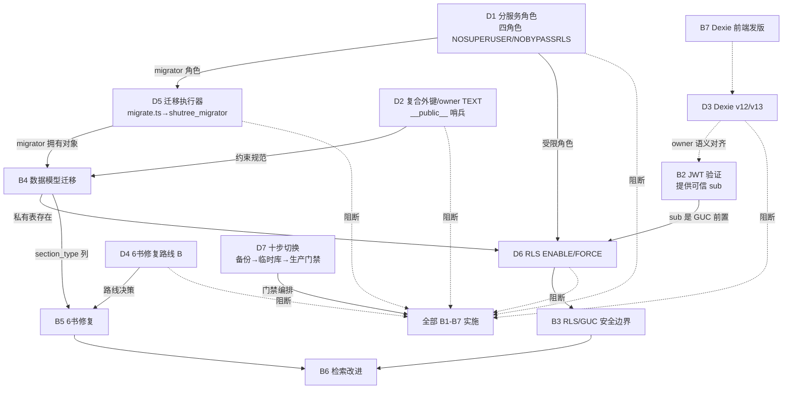

# 述树统一书籍资产与知识问答架构设计 · V1.2.8 — D1–D7 项目负责人决策稿

> **文档性质**：**项目负责人决策文件（Decision Brief）**，**不构成实施授权**。
> 本文件在 V1 / V1.1 / V1.2 / V1.2.1 / V1.2.2 / V1.2.3 / V1.2.4 / V1.2.5 / V1.2.6 / V1.2.7 全部十份历史文档基础上，**逐项整理尚未批准的架构决策**，供项目负责人裁定。
> 本轮**仅读取历史文档 + 仅读取当前代码/Dexie 文件（只读）**；**未**执行任何 DDL/DML/GRANT/REVOKE、未创建/修改角色、未改 `.env`/DATABASE_URL、未改 Dexie Schema/业务代码、未启停服务、未跑迁移、未 `git add/commit/reset/clean`、未改其他 Agent 文件。
>
> ⚠️ **红线声明**：所有「推荐选择」均为**推荐 + 理由**，不等同于已批准决定。凡涉及「负责人裁定」一栏，均写「待批准」。本文不进入阶段 1B 实施。
>
> 标注约定：**【历史冲突】**= 各版本间已改变的决策；**【技术事实】**= 官方文档/只读探针/代码实测；**【推荐】**= 本文基于全部历史证据给出的统一建议；**【待裁定】**= 须项目负责人拍板。

---

## 〇、本轮只读核查基线

| 项 | 值 |
|---|---|
| 已读历史文档 | V1、V1.1、V1.2、V1.2.1、V1.2.2、V1.2.3、V1.2.4、V1.2.5、V1.2.6、V1.2.7（共 10 份，未只依据 V1.2.7 摘要） |
| 当前 Dexie 代码（`src/services/storage/web.ts`，只读） | 确为 **v11**（末版本块 `wordLearningSessions`）；**无** `db.on('blocked')`/`versionchange` 监听；`readings/recitations/transcripts/studyNotes/annotations` 五表**无 owner 索引**；文件头声明「只新增 version(n).stores，不改历史版本」 |
| 数据库状态 | 沿用 V1.2.7（2026-11-03）只读探针权威值：`current_user=postgres`（`rolsuper`/`rolbypassrls` 均 true，唯一登录角色）；9 张业务表 RLS=false、owner=postgres；6 本书 11,328 分块 `chapter_title` 全 NULL 但 `embedding` 全非 NULL |
| 工作区保护 | 未触碰、未提交、未重置任何并行 Agent 的在途文件 |

---

## 一、历史决策演化总览（核对结论）

> 目的：先把每个决策在版本间的迁移画清，避免把 V1.2.7 的**最新表述**误当作「一贯如此」。

### 1.1 数据库角色模型演化

| 版本 | 角色方案 | 关键变化 |
|---|---|---|
| V1.2.2 §4 | 三类：`shutree_app` / `shutree_migrator` / `postgres` | 首次提出最小权限角色，撤回 V1.2 的 `api/.env` 构想 |
| V1.2.4 B1 | 两类新增（`shutree_app` + `shutree_migrator`），引入 `DATABASE_URL_APP` 切运行期 | 仍两角色；Worker 未单列 |
| V1.2.6 B1 | 仍 `shutree_app` / `shutree_migrator`（Worker 也用 `shutree_app`） | 补全逐对象 GRANT（序列/函数/触发器/schema/search_path） |
| **V1.2.7 B3** | **四类**：`shutree_app` / `shutree_api` / `shutree_worker` / `shutree_migrator` | **新增拆分出 `shutree_api`（FastAPI 仅 SELECT）、`shutree_worker`（转换表 DML）**；postgres 退出运行时 |

→ **结论**：角色模型从 2 个新增角色演进到 4 个独立角色。**四角色方案是 V1.2.7 新增、尚未批准**，是 D1 的核心待裁点。

### 1.2 数据归属（owner_id）与表结构演化 — ⚠️ 含真实冲突

| 版本 | owner_id 类型 | 表命名 | 主键 | 跨用户约束 | 公开书方案 |
|---|---|---|---|---|---|
| V1.2.5 修订点5 | **`uuid NOT NULL`**（=Supabase sub） | `book_works`/`book_editions`/`book_content_versions` | `uuid`（`gen_random_uuid()`） | **非法 CHECK(子查询)**（已被判无效） | 公共表**不加 owner_id**（V1.2.1 §6.1 撤回） |
| V1.2.6 A | `uuid NOT NULL` | 同上 | uuid | **复合唯一 + 复合外键**（`UNIQUE(id,owner_id)` + `FK(id,owner_id)→父(id,owner_id)`） | 公众表不加 owner；`kb_books` 拆 `public_book_id`/`user_book_id` 两列 |
| **V1.2.7 A** | **`TEXT NOT NULL`** | **`works`/`editions`/`content_versions`**（改名） | **`BIGSERIAL`**（改名） | 复合唯一 + 复合外键 | **`owner_id='__public__'` 哨兵，公私书统一入复合键** |

→ **结论（D2 核心冲突）**：**V1.2.5/1.2.6 用 `uuid`；V1.2.7 改用 `TEXT` 并引入 `__public__` 哨兵**，同时发生**表改名 + 主键类型改变**。二者直接冲突，必须以本文件 D2 的「统一方案」裁定。详见 §二·D2。

### 1.3 6 本书修复路线演化

| 版本 | 路线 | 关键变化 |
|---|---|---|
| V1.2.4 B5 | 逐块 carry-forward 识别章节 | 视为「永久不可召回」 |
| V1.2.5 修订点7 | **根因二分**：向量有效 ≠ 被过滤排除 | 召回可得 vs 章节边界正确，须分别验收 |
| V1.2.6 D | 路线 A（放宽过滤）/ B（补元数据）二选一 | B 优先，但不可归章块分类未细化 |
| **V1.2.7 D** | **A/B/C/D/E 五类分类，B 路线优先** | 实测 11,328 块 100% 可分类（A=923/B=190/C=10,215/D=0/E=0） |

→ 结论：根因与路线已收敛到「B 路线（补元数据、不臆造）」，但**仍待负责人裁定**。

### 1.2 其余决策（D3/D5/D6/D7）演化无冲突，仅逐步细化

- **D3（Dexie）**：V1.2.5 修订点4（前进式降级）→ V1.2.6 C（×10 官方确认）→ V1.2.7 C（缺 blocked/versionchange 处理）。方向一致，仅补实现细节。
- **D5（迁移执行器）**：V1.2.4 §2.3（migrate.ts 直连 postgres）→ V1.2.6 B6（改用 migrator）→ V1.2.7 D5。方向一致。
- **D6（RLS）**：V1.2.2 §5.2 即定「ENABLE 非 FORCE」→ 各版本沿用，未变。
- **D7（切换顺序）**：V1.2.4 §5/§6（依赖图）→ V1.2.5 修订点3（B2→B3 显式边）→ V1.2.7 B4（十步切换法）。

---

## 二、七项决策矩阵（D1–D7）

> 统一格式：当前状态 / 历史设计 / 技术事实 / 推荐选择 / 不选择的代价 / 实施影响 / 验收条件 / 回滚方案 / 负责人裁定。

### D1 ｜ 数据库分服务角色

| 项目 | 内容 |
|---|---|
| **当前状态** | **存在冲突（版本间角色数量变化）** —— V1.2.4/1.2.6 为新增两角色；**V1.2.7 升为四角色**，尚未批准 |
| **历史设计** | V1.2.2：三类 `shutree_app`/`shutree_migrator`/`postgres`。V1.2.7 B3：四类 `shutree_app`(Express 运行时)/`shutree_api`(FastAPI 仅 SELECT)/`shutree_worker`(转换表 DML)/`shutree_migrator`(迁移拥有对象) |
| **技术事实** | 【技术事实】当前唯一可登录角色 = `postgres`（`rolsuper`/`rolbypassrls`/`rolcreaterole`/`rolcreatedb` 全 true）→ RLS 被超管**完全绕过**，是 P0 真实缺口（V1.2.1 §4.1 起多份探针实测一致）。所有数据访问走 `DATABASE_URL` 环境变量，无硬编码凭据（Express `pool.ts`/FastAPI `config.py` 已确认）。现有 8 函数/5 触发器全部 `prosecdef=false`（无 SECURITY DEFINER 提权路径）。 |
| **推荐选择** | **采用 V1.2.7 四角色模型**：`shutree_app`/`shutree_api`/`shutree_worker`/`shutrate_migrator` 全部 `NOSUPERUSER`/`NOBYPASSRLS`/`NOCREATEDB`/`NOCREATEROLE`/`NOINHERIT`；`postgres` 仅保留为管理/迁移管理角色，**绝不进任何运行时连接池或前端**；`migrate.ts` 用 `shutree_migrator`（见 D5）。FastAPI 独立拆出 `shutree_api`（仅 `discovered_*` SELECT），避免 Express 角色拿到检索之外的权限。 |
| **不选择的代价** | 维持 `postgres` 超管运行时 → RLS 永久失效（当前缺口即此）；若只用两角色（不拆 api/worker）则权限粒度粗、攻击面大；若误让 `shutree_app` 成为表所有者 → RLS 对其失效（见 D6）。 |
| **实施影响** | `server/.env`（新增分角色凭据，原 `DATABASE_URL` 保留给管理/备份）；`api/db.py`、`server/src/db/pool.ts`（连接池 DSN）；`server/src/scripts/migrate.ts`（改用 migrator）；`server/convert_worker/db.py`（worker 角色）；各服务权限矩阵 GRANT/REVOKE。 |
| **验收条件** | ① 四角色 `rolsuper=false`/`rolbypassrls=false`（逐项 `pg_roles` 断言）；② 可登录角色 ≥ 4，`postgres` 不出现在任何运行时连接；③ `shutree_api` 对 `user_*`/`knowledge_*` 写被拒（42501），仅 `discovered_*` SELECT 成功；④ `shutree_app` 无法 `CREATE TABLE`/`ALTER POLICY`（无 CREATE/RLS 写）；⑤ 临时库业务冒烟（Express 写、FastAPI 只读检索、worker 转换）全绿后，生产按同序列切换无回归。 |
| **回滚方案** | 保留原 `postgres` 连接配置；任一步失败即 `REVOKE` 新授权、`DROP ROLE`（若未绑定对象）、`DATABASE_URL` 还原、`DISABLE` RLS。临时库演练失败则**不触碰生产**（零风险）。回滚严守 V1.2.5 修订点2 红线：**禁止以 postgres 超管还原为长期运行态、禁止 DROP 用户数据表**。 |
| **负责人裁定** | **待批准**：是否采用「四角色 + 无超级用户运行时」模型（含 `shutree_api`/`shutree_worker` 拆分）。 |

### D2 ｜ 数据归属与复合外键  ⚠️ 含 UUID↔TEXT 真实冲突

| 项目 | 内容 |
|---|---|
| **当前状态** | **存在冲突** —— V1.2.5/1.2.6 用 `owner_id uuid NOT NULL`；**V1.2.7 改用 `owner_id TEXT NOT NULL` + `__public__` 哨兵**，并同步发生**表改名（book_*→works/editions/content_versions）+ 主键 uuid→BIGSERIAL**。三者必须统一裁定。 |
| **历史设计** | V1.2.5 修订点5：`owner_id uuid NOT NULL`，并企图用 `CHECK(...=(SELECT...))` 跨表校验（**非法 DDL**）。V1.2.6 A：改复合唯一+复合外键，仍 `uuid`。V1.2.7 A：改 `TEXT` + `'__public__'` 哨兵，表改名，PK 改 BIGSERIAL。 |
| **技术事实** | 【技术事实 1】PostgreSQL **CHECK 约束不能包含跨表子查询**（`cannot use subquery in check constraint`）——V1.2.5 方案为非法 DDL，V1.2.6 已纠正。**【技术事实 2】** 复合外键 `MATCH SIMPLE`（默认）下，任一 FK 列为 NULL 时**不校验**→ 存在 NULL 绕过；**双列均 `NOT NULL`** 才能关闭绕过（V1.2.7 A3 边界矩阵）。**【技术事实 3】** 复合 FK 不自动在子表建索引，高频按 `owner_id` 过滤需显式补索引。**【技术事实 4】** 现有 `discovered_books` **无 owner 列**；`book_id→discovered_books.id` 为单列 FK。 |
| **推荐选择** | **统一方案（推荐）**：① **全部 `owner_id TEXT NOT NULL`**（兼容 uuid 格式 Supabase `sub` 与 `__public__` 哨兵，二者 TEXT 均可存）；② 父表 `UNIQUE(id, owner_id)`，子表 `FOREIGN KEY(id, owner_id) REFERENCES 父(id, owner_id)` 且**两列 NOT NULL**（关闭 MATCH SIMPLE 绕过）；③ 公开书补 `owner_id` 列并回填 `'__public__'`；④ **用户态 `owner_id` 一致性**用「复合外键 + 触发器/部分 CHECK」在 DB 层保证，**不单靠应用层**：`user_books.owner_id` 经复合 FK 锁到 `content_versions(id, owner_id)`，且另加触发器或 `CHECK` 约束 `user_books.owner_id = user_books.user_id`（即 owner 必须等于本行 user_id）；公共表因哨兵不引用 `app_users`。⑤ 采用 V1.2.7 的表改名与 BIGSERIAL 主键（与现有 `discovered_books.id BIGSERIAL` 同源，迁移平滑）。 |
| **不选择的代价** | 若坚持 `uuid`：无法表达 `__public__` 哨兵 → 公私书无法统一进复合键，或被迫为公共表保留无 owner 的分裂模型（与 V1.2.7 统一目标冲突）。若保留非法 CHECK(子查询)：迁移脚本执行即失败。若仅 `owner_id` 单列 + 应用层保证 user_id==owner_id：**无 DB 级强制**，违反本任务「不得仅依赖应用层」要求。若 `MATCH SIMPLE` 但允许 owner_id NULL：**跨用户引用绕过**。 |
| **实施影响** | `server/sql/006_*.sql`：新建 `works`/`editions`/`content_versions`/`user_books`/`user_book_chunks`/`user_bookshelf`/`knowledge_bases`/`kb_books`/`app_users`；`discovered_books` 补 `owner_id` 列回填 `'__public__'`；`discovered_book_chunks.book_id` 单列 FK 改造须与复合键对齐。迁移脚本回填（30 本→work/edition，写 `legacy_book_id` 回溯；58,332 块→content_version_id）。 |
| **验收条件** | ① 父表 `UNIQUE(id, owner_id)` 存在；② 子表复合 FK 存在且 `(id, owner_id)` 两列均 `NOT NULL`（`pg_attribute.attnotnull` 断言）；③ **负向用例**：插入 owner 不匹配父表的子行报 FK 违反（23503）；插入 owner=NULL 的子行报 NOT NULL 违反（非静默绕过）；④ `kb_books` 引用他人 `user_books` 被复合 FK 拒绝；⑤ `discovered_books` 迁移后 `owner_id` 全为 `'__public__'`、检索不受影响；⑥ 构造 `user_books.owner_id ≠ user_id` 的插入被触发器/CHECK 拒绝。 |
| **回滚方案** | `DROP CONSTRAINT` 复合外键（新增约束，可回滚）；公开表 `owner_id` 列若回滚需 `DROP COLUMN`（先确认无下游依赖）。严守红线：不得 DROP 含用户数据的表。 |
| **负责人裁定** | **待批准**：须拍板 —— (a) `owner_id` 定为 **TEXT**（采纳 V1.2.7）还是 **uuid**（沿用 V1.2.5/1.2.6）；(b) 公开书是否采用 `'__public__'` 哨兵统一复合键，还是维持「公共表无 owner」分裂模型；(c) 表改名 `book_*`→`works/editions/content_versions` 是否采纳；(d) `user_id==owner_id` 的 DB 级强制采用触发器还是部分 CHECK。 |

> **冲突定位说明（D2 特写）**：V1.2.5 的 `owner_id uuid`（=Supabase sub，并 `FK→app_users(sub)`）与 V1.2.7 的 `owner_id TEXT` + `__public__` 哨兵**直接互斥**——`uuid` 无法装 `'__public__'`，且引入哨兵后 `FK→app_users(sub)` 对公共行失效。推荐以 **TEXT** 统一（uuid 格式的 sub 存进 TEXT 无损），使复合键不变量在公私书混库下仍成立，同时用触发器/部分 CHECK 在 DB 层锁死用户态 `owner_id==user_id`，满足本任务「不得仅依赖应用层」要求。

### D3 ｜ Dexie 本地数据库升级

| 项目 | 内容 |
|---|---|
| **当前状态** | **已确认现状**（v11，无 blocked/versionchange），方案**未批准** |
| **历史设计** | V1.2.5 修订点4（前进式降级，禁止降 version）；V1.2.6 C（×10 官方确认、v12 补 owner 索引、v13 前进式兼容）；V1.2.7 C（缺 blocked/versionchange 处理）。 |
| **技术事实** | 【技术事实 1】Dexie `version(n)` 底层原生 IDB 版本 = **`n×10`**（官方 Issue #59）：v11→110、v12→120、v13→130。**【技术事实 2】** IndexedDB **拒绝以降低版本号打开**（VersionError）→ 只能前进式升级，不可就地降级。**【技术事实 3】** 当前 `web.ts` 确为 v11（只读确认），且无 `db.on('blocked')`/`versionchange` 监听（缺口）；`readings/recitations/transcripts/studyNotes/annotations` 五表无 owner 索引；v8 起 `owner` 默认 `'guest'`。**【技术事实 4】** 跨版本 upgrade 只跑 >旧版本号的版本回调，v13 只需处理 v11→v13 增量，不得重放 v1–v11。 |
| **推荐选择** | **v12**：为 `readings/recitations/transcripts/studyNotes/annotations` 补 `owner` 索引（纯新增索引，安全；原生 120）。**v13**：`owner` 可空、默认 `'guest'`（前进式兼容，原生 130）；业务代码用 feature flag 决定是否写/读 owner；补齐 `db.on('blocked')` + `db.on('versionchange')`（`versionchange` 内 `db.close()`）。**不降 version 号**；升级夹具满足备份/幂等/断点恢复/多标签页/并发新数据。 |
| **不选择的代价** | 无 `blocked` 处理 → 多标签页同时打开时升级静默阻塞（数据可用性风险，P0 关联）；无 owner 索引 → 统一身份模型落地后按 owner 过滤全表扫；若误发更低版本号 → IndexedDB 拒绝、需改回更高版本修复。 |
| **实施影响** | 仅 `src/services/storage/web.ts`（新增 v12/v13 版本块 + 两事件监听）；不改动任何历史版本定义；不影响服务端 schema。 |
| **验收条件** | ① `web.ts` 含 `db.on('blocked')` 与 `db.on('versionchange')`（后者调 `db.close()`）；② **真实浏览器（Chromium + Firefox）**双标签页升级：一标签触发升级、另一标签收 `versionchange` 并 `db.close()`、升级完成后两标签均可用；③ 升级中途杀进程 → 重启库可用且为升级前版本 → 重新升级成功；④ v11→v12→v13 各表行数 0 丢失；⑤ 四件套全绿 + 预览端口 4174。 |
| **回滚方案** | Dexie 不可就地降级；若 v13 有问题，发新构建将版本号提到 v14 并修复，旧库由 IDB 自动按更高版本升级路径恢复；极端情况清 IndexedDB 重导（最后手段，UI 提示）。IndexedDB 数据原状保留。 |
| **负责人裁定** | **待批准**：是否批准 v12/v13 前进式升级路径（v12 补 owner 索引、v13 owner 可空默认 `'guest'`），并授权在 `web.ts` 增加 `blocked`/`versionchange` 处理。 |

### D4 ｜ 六本书章节元数据修复

| 项目 | 内容 |
|---|---|
| **当前状态** | 根因与分类**已确认**（100% 可分类），**路线待裁定** |
| **历史设计** | V1.2.4 B5（逐块 carry-forward）；V1.2.5 修订点7（根因二分：向量有效 ≠ 被过滤排除）；V1.2.6 D（A 放宽过滤 / B 补元数据，二选一）；V1.2.7 D（A/B/C/D/E 五类，B 优先）。 |
| **技术事实** | 【技术事实】6 本书（id=10/44/47/49/51/52）共 **11,328** 分块 `chapter_title` 全 NULL，但 **`embedding` 全部非 NULL**（向量完好，召回能力本应存在）；生产检索 `WHERE c.embedding IS NOT NULL AND (%s OR c.chapter_title IS NOT NULL)` 且 `include_front_matter=False` → `(false OR chapter_title IS NOT NULL)` **排除**这些块（V1.2.7 §0 权威实测）。分类（正则启发式，未物化）：A 标题锚点=923 / B 前言版权=190 / C 无标题正文=10,215 / D 极短歧义=0 / E 其他=0 → **全部 100% 可分类**，无残留。 |
| **推荐选择** | **B 路线优先（补元数据，不臆造）**：A 类提取锚点词（chapter/book/act/scene/volume/part/section）作 `chapter_title`；C 类前向继承最近 A 类章节；B 类标 `section_type='front_matter'` 且 `chapter_title` 保持 NULL（检索仍排除）；D/E 为 0 无需处理。**严格不走 A 路线**（放宽过滤会使前言/目录/版权噪声进正文检索，违反「不臆造/不污染」红线，治标不治本）。 |
| **不选择的代价** | A 路线（放宽 `include_front_matter`）→ 190+ 块 front_matter 混入正文结果，精确率下降、用户见「未命名章节」、无章节上下文；B 路线若误判率 >2% 须对误判块回退到 front-matter/unchaptered 独立分类 + RRF 纳入，不强行归章。 |
| **实施影响** | 新增 `scripts/repair-chapters.py`（只读原 chunks，`UPDATE chapter_title/chapter_number/section_type`）；依赖 B4 的 `section_type` 列；**仅改三列，不重建 embedding、不改 content**；441 paratext 另标记（保持 NULL）。 |
| **验收条件** | ① 11,328 块写入 `chapter_title`/`section_type`（B 类保持 NULL + 类型标签）；② `chunk_id`/`embedding` 字节级不变（`count(*)` where embedding is not null = 58,332）；③ 真实查询召回对比：6 书命中数 0→显著提升，全局 Recall@10≥69/@50≥75 不退化；④ 章节标注正确率抽样 ≥95%；⑤ 441 paratext 仍 NULL、未误标章节；⑥ `EXPLAIN ANALYZE` 仍 `plan_type=HNSW`。 |
| **回滚方案** | `UPDATE ... SET chapter_title=NULL, section_type=NULL WHERE book_id IN (...)`（仅改列值，不改结构）；向量/索引零影响。 |
| **负责人裁定** | **待批准**：是否批准 **B 路线**（补元数据、不臆造），而非 A 路线（放宽检索过滤）；并确定不可归章块的 `unchaptered` 分类兜底口径。 |

### D5 ｜ 迁移执行器身份

| 项目 | 内容 |
|---|---|
| **当前状态** | 需改，**未执行** |
| **历史设计** | V1.2.4 §2.3（`migrate.ts` 用 `DATABASE_URL` 直连，当前 = `postgres` 超管，按文件名升序执行 `sql/*.sql`）；V1.2.6 B6（migrate.ts 改用 `shutree_migrator`）；V1.2.7 D5。 |
| **技术事实** | 【技术事实】`migrate.ts` 直连 `DATABASE_URL`，对象归属 = 连接角色 → 若切到 `shutree_migrator`，新表即归其所有；原 `postgres` 凭据保留给管理/备份。当前因 DATABASE_URL=postgres，所有对象已归超管。 |
| **推荐选择** | **migrate.ts 改用 `shutree_migrator` 凭据**（如 `DATABASE_URL_MIGRATOR`）；新对象归 migrator、`shutree_app` 非所有者 → 受 RLS 约束（呼应 D1/D6）；建角色后统一 `ALTER DEFAULT PRIVILEGES` 避免新对象继承 postgres 权限；迁移脚本用 migrator 角色，绝不进运行期。 |
| **不选择的代价** | 若迁移仍用 `postgres` → 新表归超管，且运行期若切 `shutree_app` 而 `shutree_app` 成了表所有者 → RLS 对其**失效**（FORCE 才约束所有者，见 D6）；若默认权限未设 → 新对象继承超管权限，权限泄漏。 |
| **实施影响** | `server/src/scripts/migrate.ts`（DSN 切换）；`server/.env`；`sql/006_*.sql` 对象所有权；`ALTER DEFAULT PRIVILEGES` 脚本。 |
| **验收条件** | ① 迁移后新表 `relowner = shutree_migrator`（非 shutree_app、非 postgres）；② `shutree_app` 非任何私有表所有者；③ `npm run db:migrate` 可用 migrator 凭据完成建表/函数/序列；④ 新增对象经 `ALTER DEFAULT PRIVILEGES` 不继承超管权限。 |
| **回滚方案** | migrate.ts `DATABASE_URL` 切回 postgres（临时，仅回滚期）；角色与 GRANT 保留无害；严守红线：回滚不得恢复超管为长期运行态、不得 DROP 用户数据表。 |
| **负责人裁定** | **待批准**：是否批准迁移执行器改用 `shutree_migrator` 拥有对象（且配套 `ALTER DEFAULT PRIVILEGES`）。 |

### D6 ｜ RLS 策略（ENABLE vs FORCE）

| 项目 | 内容 |
|---|---|
| **当前状态** | **待裁定** |
| **历史设计** | V1.2.2 §5.2（**ENABLE 非 FORCE**，避免阻断 migrator 批量写）；V1.2.3（FORCE 会约束表所有者）；V1.2.4 B3（ENABLE 非 FORCE）；V1.2.7 D6。 |
| **技术事实** | 【技术事实 1】**超级用户与 `BYPASSRLS` 角色无视所有 RLS 策略，无开关可改** → 运行时角色必须 `NOBYPASSRLS`（D1 前提）。**【技术事实 2】** `ENABLE ROW LEVEL SECURITY` 下，**表所有者豁免** RLS；`FORCE ROW LEVEL SECURITY` 下，**所有者也被约束**。**【技术事实 3】** RLS **不防 SQL 注入**：任意角色可 `set_config('app.current_user_id',任意值,true)`（V1.2.3 F1/F2），隔离只在「查询参数化、无注入面」时成立。**【技术事实 4】** GUC `set_config(...,true)` 仅事务级（V1.2.3 F7），连接归还即清空。 |
| **推荐选择** | **私有表 `ENABLE ROW LEVEL SECURITY`（非 FORCE）**：运行时 `shutree_app` 非所有者 → 自动受策略约束；`current_user_id()` 读 GUC；每私有表建 `own` 策略 `USING/WITH CHECK(owner_id=current_user_id())`；迁移角色 `shutree_migrator` 为所有者可批量回填跨用户行（ENABLE 下豁免，合法）。**配套**：CI 断言 `shutree_app` 非表所有者；新增高敏感写路径可用 V1.2.3 方案 B（SECURITY DEFINER + 显式 `search_path`，内部以参数接收 user_id，不读 GUC）。 |
| **不选择的代价** | 若误用 `FORCE` → 迁移角色（所有者）也被约束，无法批量回填 `owner_id≠自身` 的行，须改用 SECURITY DEFINER/临时 DISABLE 切换，复杂且易错；若连 `ENABLE` 都不做 → 无行级兜底；若运行时角色仍为超管 → RLS 完全失效（当前缺口）。 |
| **实施影响** | `sql/006_rls.sql`：`current_user_id()` 函数（`SECURITY INVOKER`，仅读 GUC）+ 私有表 `ENABLE RLS` + `own` 策略；`api/db.py`/`pool.ts` 连接池事务级 `set_config`；CI 断言脚本。 |
| **验收条件** | ① `shutree_app` 不设 GUC 查 `user_book_chunks` → 0 行（默认拒绝）；② A 带 A JWT 查自身私有书 → 返回；③ A 按 B 的 id 查 → 0 行；④ A `UPDATE` B 的私有书 → 0 行影响（WITH CHECK 拒绝）；⑤ 同池连接 A 提交后 B 复用 → B 事务内 `current_user_id()`=B 且查 A 行=0（泄漏测试）；⑥ A 事务 rollback 后新请求不设 GUC 查私有表=0 行（无残留）；⑦ **正向 T-01/T-02**：普通角色可 `set_config` 任意值（暴露「GUC 非认证」架构事实，不视为失败）；⑧ CI 断言 `shutree_app` 非所有者通过。 |
| **回滚方案** | `DROP POLICY`（保留 `ENABLE` 状态，不 `DISABLE`——RLS 永不关闭，应用层继续按 `owner_id` 写入）。**严禁 `DISABLE ROW LEVEL SECURITY`**（V1.2.5 修订点2 红线）。 |
| **负责人裁定** | **待批准**：私有表采用 **ENABLE** 还是 **FORCE**；以及是否采纳「CI 断言 shutree_app 非所有者」作为 ENABLE 方案的补强。 |

### D7 ｜ 实施与切换顺序

| 项目 | 内容 |
|---|---|
| **当前状态** | **待裁定（十步切换法）** |
| **历史设计** | V1.2.4 §5/§6（依赖图：B1→B4→B5→B6 串行；B2/B3/B7 并行）；V1.2.5 修订点3（**显式 B2→B3 边**：JWT 提供可信 sub 是 GUC 前置）；V1.2.7 B4（十步切换法）。 |
| **技术事实** | 【技术事实】当前 `postgres` 超管运行时；GUC 由可信后端在事务内 `SET LOCAL`（参数化，值来自已验证 JWT `sub`）；**JWT 提供可信 `sub` 是 GUC/RLS 身份上下文的硬前置**——无 B2 则 `set_config(sub)` 无权威源，GUC 悬空、RLS 隔离失效（V1.2.5 修订点3 硬停止条件）。 |
| **推荐选择** | **十步切换顺序**（建议在临时还原库预演后再上生产）：① 全量备份 → ② 还原到临时库预演 → ③ 临时库建四角色（`NOSUPERUSER`）→ ④ 逐对象 GRANT/REVOKE → ⑤ 业务冒烟（Express 写/FastAPI 只读/worker 转换）→ ⑥ 启用 RLS+策略、验证跨用户隔离 → ⑦ 连接池显式 `SET search_path` 并绑角色 → ⑧ 迁移执行器切 `shutree_migrator` → ⑨ 准备回滚预案 → ⑩ 生产门禁（临时库全过且无回归后方对生产执行同序列）。**编排**：串行主干 B1→B4→B5→B6；并行支线 B2（JWT，待 D1 中 Supabase 决策）/B3（RLS，须 B2 后）/B7（Dexie，可尽早启动）。 |
| **不选择的代价** | 直接对生产改权限/建角色 → 风险失控、无回退演练；顺序错（先 B3 后 B2）→ GUC 悬空、RLS 失效；未先备份即迁移 → 不可恢复（G1 门禁）。 |
| **实施影响** | 全部 B1–B7 工作包；`server/.env`、连接池、迁移器、RLS 脚本、业务冒烟用例。 |
| **验收条件** | ① 临时库十步全部通过且无回归；② B1 验收（四角色 NOSUPERUSER/NOBYPASSRLS）；③ B4 验收（表/约束/legacy_book_id 1:1/检索不退化）；④ B5 验收（11,328 块修复）；⑤ B2 验收（7 类 JWT 负例全拒）；⑥ B3 验收（跨用户隔离 7 项）；⑦ B6 验收（Recall 不退化 + HNSW 计划）；⑧ B7 验收（真实浏览器双标签页）。 |
| **回滚方案** | 临时库演练失败则**不触碰生产**（零风险）；生产十步任一步失败 → REVOKE 新授权、`DROP ROLE`（未绑对象时）、`DATABASE_URL` 还原、保留 `ENABLE RLS`（不 DISABLE）；备份可恢复（G1 已演练）。 |
| **负责人裁定** | **待批准**：是否批准「备份→临时库预演→十步切换→生产门禁」顺序；以及 D1–D7 全部决策的下达。 |

---

## 三、决策依赖表（D1–D7 与实施工作包）

> 重点核实：哪些决策是其他决策/工作包的前置；哪些可并行准备但被误写成串行。

| 决策/包 | 直接前置（必须先生效） | 并行可准备项 | 被谁依赖 |
|---|---|---|---|
| **D1**（分服务角色） | 无（独立，且独立于 Supabase 决策） | 可与 D5/D6 的权限草案一并起草 | D2/D5/D6/D7、B1/B3/B4/B6 |
| **D5**（迁移执行器→migrator） | D1（角色模型须先定，migrator 才存在） | 与 D1 同轮起草 SQL | B4（迁移执行）、D6（migrator 为所有者批量写） |
| **D2**（复合外键/owner 类型） | 无硬前置；但影响 B4 数据模型 | 可与 B4 迁移 SQL 并行起草；**须早于 B4 迁移执行** | B3（RLS 挂 owner_id）、B4、B5（section_type）、B6（私有检索 id=ANY）、B7（owner 语义） |
| **D6**（RLS ENABLE/FORCE） | **B2**（JWT 提供可信 sub 是 GUC 前置）、D1（受限角色）、B4（私有表已建） | 策略 SQL 可先写 | B3、B6、B7 |
| **D3**（Dexie v12/v13） | D1（账号体系决定 owner 语义） | schema 变更独立，**可与 B4/B3 并行**；v12 索引可先行 | B7（前端发版）、B2（关联/上传逻辑） |
| **D4**（6 书修复路线） | D5/D2 决策下达后即可启动；B4 提供 `section_type` 列 | 分类脚本与 B6 协同设计 | B5、B6（候选池扩大 + 评测） |
| **D7**（十步切换） | 依赖 **全部** D1–D7 与 B1–B7 完成/就绪 | 十步本身是顺序执行，但「临时库预演」可与各包实施并行推进 | 全局（门禁） |

**关键依赖纠偏**：
- **D1 与 D5**：D5 的 `migrate.ts→shutree_migrator` 必须先有 D1 的 migrator 角色定义；二者同属「角色整改」，应同轮裁定、同轮落地。
- **D2 与 B4 数据模型**：D2 的 `owner_id` 类型/TEXT 冲突必须先于 B4 迁移 SQL 落地，否则迁移脚本写完即冲突——这是 P0-1（V1.2.7）的根。
- **D3 与 Dexie v11 兼容**：D3 的 v12/v13 是 v11 的「前进式」扩展（×10 已官方确认），天然兼容，无冲突；但 `owner` 默认值须与 B2 服务端 `sub` 对齐（否则本地 `'guest'` 与远端 `sub` 混存）。
- **D4 与检索过滤/B6**：D4 选 B 路线 → 召回提升来自「补元数据」，B6 候选池扩大；若误选 A 路线 → B6 需额外处理 front-matter 噪声。二者必须在 D4 拍板时协同。
- **D6 与 B2 JWT、B3 RLS**：**D6（RLS 生效）强依赖 B2（可信 sub）**，无 B2 则 GUC 悬空——V1.2.5 修订点3 已硬停止。D6 的策略形式（ENABLE/FORCE）决定 migrator（D5）能否批量写。
- **D7 与全部工作包**：D7 是门禁编排，须 D1–D7 + B1–B7 全部就绪后执行；但其「临时库预演」阶段可并行于各包实施。

---

## 四、实施依赖关系图（Mermaid）

**串行主干**：D1/D5（角色+迁移器）→ D2/B4（数据模型）→ D4/B5（6 书修复）→ B6（检索改进）。
**并行支线**：B2（JWT，待 Supabase 决策）+ D6/D3 可与主干并行；D7 的临时库预演贯穿全程。

---

## 五、历史版本冲突清单（须负责人在裁定时一并消除）

| # | 冲突项 | 冲突版本 | 矛盾点 | 影响 | 处置建议 |
|---|---|---|---|---|---|
| C1 | **owner_id 数据类型** | V1.2.5/1.2.6 = `uuid`；V1.2.7 = `TEXT` | uuid 无法装 `'__public__'` 哨兵；TEXT 与既有 `app_users(sub uuid)` FK 不兼容 | D2 迁移 SQL 无法定稿 | **统一为 TEXT**（推荐，见 D2）；或保留 uuid 并放弃哨兵统一模型 |
| C2 | **表命名** | V1.2.5/1.2.6 = `book_works`/`book_editions`/`book_content_versions`；V1.2.7 = `works`/`editions`/`content_versions` | 同名迁移脚本若混用会失败 | D2/B4 | 以 V1.2.7 命名为准（与现有 `discovered_*` 同源 BIGSERIAL） |
| C3 | **主键类型** | V1.2.5/1.2.6 = `uuid`（gen_random_uuid）；V1.2.7 = `BIGSERIAL` | 影响 `legacy_book_id` 回溯逻辑与复合 FK 列类型 | D2/B4 | 以 V1.2.7 BIGSERIAL 为准 |
| C4 | **owner→app_users FK** | V1.2.5：`FK owner_id→app_users(sub)`；V1.2.7：引入 `'__public__'` 哨兵后公共行无对应 app_users 行 | FK 对公共行失效 | D2 | 放松严格 FK，改用触发器/部分 CHECK 锁用户态一致性（见 D2 推荐） |
| C5 | **角色数量** | V1.2.4/1.2.6 = 新增两角色；V1.2.7 = 四角色 | 权限矩阵与 GRANT 清单不一致 | D1 | 以 V1.2.7 四角色为准 |
| C6 | **公开书是否加 owner_id** | V1.2.1 §6.1 撤回（公共表不加 owner_id）；V1.2.7 A 改为补 `'__public__'` 哨兵统一复合键 | 复合键不变量能否覆盖公共资产 | D2/B4 | 与 C1 一并裁定（推荐哨兵统一） |
| C7 | **跨用户校验机制** | V1.2.5 = 非法 CHECK(子查询)；V1.2.6/1.2.7 = 复合外键 | 前者为非法 DDL | D2/P0-1 | 以复合外键为准（已纠正，仍待落地迁移） |

---

## 六、仍然缺失的证据清单（实施前须补齐）

| # | 缺失证据 | 为何重要 | 获取方式（实施前，受权限/环境边界约束） |
|---|---|---|---|
| E1 | 真实浏览器（Chromium + Firefox）多标签页升级 / `blocked` / `versionchange` 实测 | D3 验收无法用静态替代；只读阶段不允许起服务 | 实施期起服务 + 双浏览器手测（验收 C6） |
| E2 | 生产库权限切换十步法在临时库/任何环境的预演记录 | D7/D1 的安全切换未经演练即上生产风险高 | 临时还原库跑十步（V1.2.7 B4） |
| E3 | 11,328 块 A/B/C/D/E 分类物化到数据库 + 人工抽样核对 | 当前仅正则启发式估算，未验证分类质量 | 临时副本跑分类脚本 + 人工抽检 A/C 归类 |
| E4 | `__public__` 哨兵方案与现有 `discovered_books` 迁移的具体回填脚本与回归 | C1/C6 的 TEXT+哨兵能否平滑落地未知 | 起草迁移 SQL + 临时库回归检索 M4 47/63/69 |
| E5 | Supabase 项目是否创建、是否启用非对称 Signing Keys（ES256） | D1（若采 Supabase Auth）与 B2 JWKS 验证的前置 | 用户决策后建项目并确认 JWKS 返回公钥 |
| E6 | 中文分词组件（zhparser/pg_jieba）可行性（B6 阶段，非 1B 阻塞） | 阶段 1 语料为英文，不影响 1B | 后续评估（P2） |
| E7 | 新抓取书籍链路是否仍会产生全 NULL 章节（`ingest-books.py` 历史根因） | 避免修复只覆盖存量、新增书再现缺陷 | 核查抓取链路 + 抽样新抓书 |

---

## 七、每项决策需要项目负责人回答的问题

### D1 ｜ 分服务角色
1. 是否批准「四角色 + 无超级用户运行时」模型（含把 FastAPI 拆出 `shutree_api`、转换拆出 `shutree_worker`）？还是维持 V1.2.4/1.2.6 的两角色（app+migrator）？
2. `postgres` 凭据是否确认**永不**进入任何运行时连接池与前端？

### D2 ｜ 数据归属与复合外键
3. `owner_id` 统一为 **TEXT**（采纳 V1.2.7，兼容 uuid 格式 sub 与 `__public__`）还是坚持 **uuid**（沿用 V1.2.5/1.2.6）？
4. 公开书是否采用 `'__public__'` 哨兵统一进复合键（采纳 V1.2.7），还是维持「公共表无 owner_id」的分裂模型（V1.2.1 §6.1）？
5. 表改名 `book_*`→`works/editions/content_versions` 与主键 `uuid`→`BIGSERIAL` 是否采纳？
6. 用户态 `owner_id == user_id` 的 DB 级强制，采用**触发器**还是**部分 CHECK**？

### D3 ｜ Dexie 升级
7. 是否批准 v12/v13 前进式升级路径（v12 补 owner 索引、v13 owner 可空默认 `'guest'`），并授权在 `web.ts` 增加 `blocked`/`versionchange` 处理？

### D4 ｜ 六本书修复
8. 是否批准 **B 路线**（补元数据、不臆造），而非 A 路线（放宽检索过滤）？
9. 不可归章块（C 类无前驱）的 `unchaptered` 归类兜底口径是否认可？

### D5 ｜ 迁移执行器
10. 是否批准 `migrate.ts` 改用 `shutree_migrator` 拥有对象，并配套 `ALTER DEFAULT PRIVILEGES`？

### D6 ｜ RLS
11. 私有表采用 **ENABLE** 还是 **FORCE**？
12. 是否采纳「CI 断言 `shutree_app` 非表所有者」作为 ENABLE 方案的补强？

### D7 ｜ 切换顺序
13. 是否批准「备份→临时库预演→十步切换→生产门禁」顺序？
14. 是否整体批准进入阶段 1B（需 D1–D7 全部回答后）？

---

## 八、当前是否具备进入阶段 1B 的条件

**结论：暂不具备。**

依据 V1.2.7 门禁裁决与本文件复核：

- **P0 硬阻塞未关闭（4 项）**：
  1. **P0-1 [D2/B4]**：跨用户 CHECK 为非法 DDL，须改复合外键；复合外键 DDL 仍设计态，未落地（且存在 C1–C7 版本冲突未消）。
  2. **P0-2 [D1/B1]**：运行时仍为 `postgres` 超级用户，RLS 整体失效。
  3. **P0-3 [D3/D4]**：6 本书元数据未修复；Dexie 缺 `blocked`/`versionchange` 处理。
  4. **P0-4 [决策]**：**D1–D7 全部未经项目负责人裁定**（本文件即为此而生）。
- **决策冲突未消**：§五 C1–C7 的版本间矛盾（尤其 owner_id uuid↔TEXT、表改名、公开书哨兵）必须先由负责人在 D2 裁定中消除，否则 D2/B4 迁移 SQL 无法定稿。
- **缺失证据未补**：§六 E1–E4 为实施前必须补齐的实测/预演证据（尤其临时库权限预演、6 书分类物化核对）。

**进入阶段 1B 的充要条件（全部满足后）**：
1. 本文件 D1–D7 全部由项目负责人裁定；
2. C1–C7 冲突已消除、D2/B4 迁移 SQL 定稿；
3. D1 完成（运行期切 `shutree_app`/四角色、RLS 可生效）；
4. 备份/恢复演练通过（G1）；
5. D3 多标签页处理 + 真实浏览器验收方案就绪；
6. D7 临时库十步预演通过。

---

## 九、最终声明

> **V1.2.8 仅为项目负责人决策文件，不构成实施授权。**
>
> 本文所有「推荐选择」均为基于 V1–V1.2.7 全部十份历史文档与本轮只读核查的**建议**，凡标注「待批准」之处均须项目负责人逐项裁定后方可进入阶段 1B 实施。本轮未执行任何 DDL/DML/GRANT/REVOKE、未创建/修改角色、未改 `.env`/DATABASE_URL、未改 Dexie Schema/业务代码、未启停服务、未跑迁移、未 `git add/commit/reset/clean`、未改其他 Agent 文件。
>
> 待项目负责人审阅并回答 §七 的 14 个问题、裁定 D1–D7 后，再行阶段 1B 实施。**本文完成后立即停止，等待审阅。**

---

*本文件为 D1–D7 决策稿（V1.2.8），新增独立版本，不覆盖 V1–V1.2.7 任何文档。*
