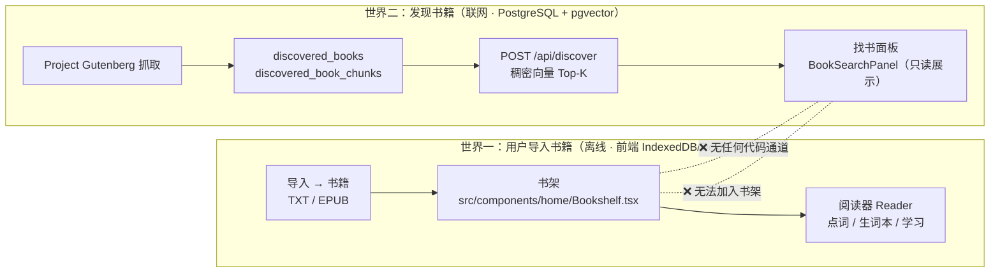
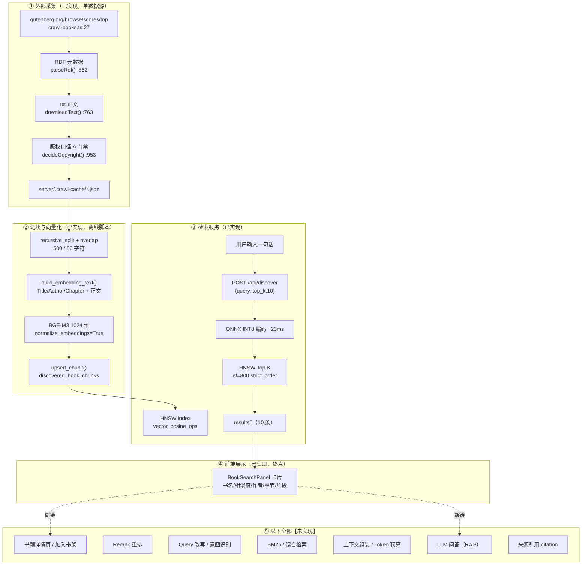
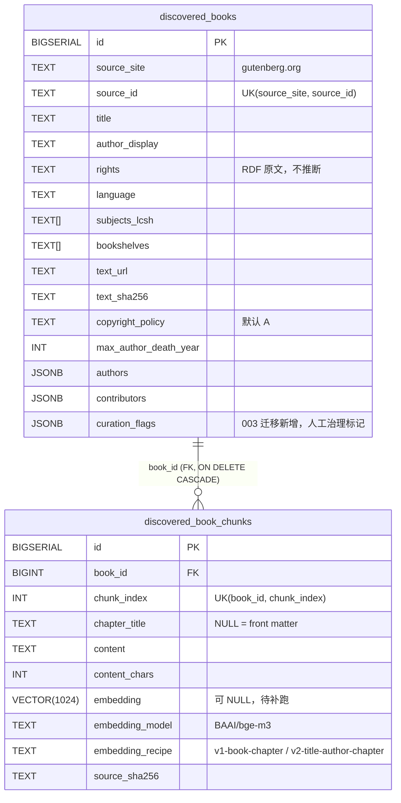

# 述树找书与知识库问答 —— 现状架构审计报告

> 性质：**只读调查**。本报告全程未修改任何代码、未写入数据库、未安装依赖、未启停服务。
> 调查目的：在动手设计 Reranker / 混合检索 / query 改写 / 上下文优化 / 来源引用之前，先把「现在到底有什么」查清楚。
> 产出方式：静态代码确认 + 已存在的历史实验产物 + 一次只读的运行时核验（`api/b12-phase-b-verify.py`）。

## 0. 执行声明与环境快照

### 0.1 本次调查实际做了什么

| 动作 | 是否执行 | 说明 |
|---|---|---|
| 修改 / 新建代码文件 | ❌ | 唯一新建的是本报告 md 文件本身 |
| 数据库写入 / 迁移 | ❌ | 仅执行了已在仓库内的只读脚本 `api/b12-phase-b-verify.py`（纯 SELECT + SHOW） |
| 启停 / 重启服务 | ❌ | PG 处于既有运行状态，未做任何干预 |
| 安装依赖 / 下载模型 | ❌ | — |
| 抓取外部站点 | ❌ | — |
| 性能压测 | ❌ | 未跑任何 benchmark；延迟数据全部引用历史产物 |
| Git 操作（checkout/reset/clean/stash/commit） | ❌ | 仅 `rev-parse` / `status` 只读 |

### 0.2 环境快照（只读）

| 项 | 值 | 标签 |
|---|---|---|
| 工作目录 | `C:\Users\lagom\WorkBuddy\2026-10-02-10-40-40\shutree\述树交付包` | 【运行实测】 |
| Git 分支 / HEAD | `master` / `dbabf84`（`feat(spelling): 接入 /spelling 与 /spelling-result 两条路由`） | 【运行实测】 |
| 工作树状态 | 已暂存 6、未暂存 40、未跟踪 120（**大量改动尚未提交**，本报告所有行号以工作树磁盘内容为准） | 【运行实测】 |
| PostgreSQL | 18.6，postmaster 启动于 2026-10-21 13:14:05，已运行 9 天 11:03:37 | 【运行实测】 |
| pgvector | 0.8.6 | 【运行实测】 |

> ⚠️ **行号口径声明**：因工作树存在大量未提交改动，本报告的「文件路径 + 行号」均指**当前磁盘上的文件内容**，与 `dbabf84` 提交树可能不一致。

### 0.3 证据标签

| 标签 | 含义 |
|---|---|
| 【代码确认】 | 本次直接读源码确认，给出 文件:行号 + 函数/接口名 |
| 【运行实测】 | 本次或此前在本机实际运行得到的输出 |
| 【历史记录】 | 引用项目内已有的实验/验收报告产物 |
| 【推断】 | 由上述证据合理推导，但**未直接验证** |
| 【未知】 | 现有材料无法判断，不做猜测 |

---

## 1. 产品功能全景

### 1.1 主 App 的两个互相隔离的「书世界」

这是本次审计最重要的一条结构性结论：**述树里存在两套完全不相通的书**。



| 证据 | 标签 |
|---|---|
| 书架来自用户导入、与发现书籍无关：`src/components/home/Bookshelf.tsx:226`「去「导入 → 书籍」上传 TXT/EPUB 并加入书架」 | 【代码确认】 |
| 全库检索 `user_books` / `bookshelf` / `user_id` / `library_books`：`server/sql/` 与 `server/src/` 内仅有 `crawl-books.ts:909`（那是 Gutenberg RDF 的 `pgterms:bookshelf` 元数据元素，不是用户书架） | 【代码确认】 |
| `server/src/**` 中除 `scripts/` 与 `sql/` 外，**零处**引用 `discover` / `discovered_book`；`server/src/scripts/b7-iterative-scan-fix.sql:16-17` 自述「发现书籍没有 HTTP API，也没有任何业务代码查询 discovered_book_chunks」 | 【代码确认】 |
| 找书结果卡片无 onClick、无跳转（组件注释 `src/components/discover/BookSearchPanel.tsx:30`「无书籍详情页：卡片纯展示不可跳转（不造路由）」） | 【代码确认】 |

### 1.2 主 App 功能地图（与找书相关的部分）

| 入口 | 路径 | 组件 | 现状 |
|---|---|---|---|
| 底部 Tab「发现」 | `/discover` | `src/components/layout/BottomTabBar.tsx:21` → `src/App.tsx:93` | Tab 组：课程 / 词库 / **找书** / 笔记（`src/pages/Discover.tsx:42-52`） |
| 找书面板 | — | `src/components/discover/BookSearchPanel.tsx`（`Discover.tsx:165` 挂载） | 语义检索，**只读展示 10 条片段** |
| 全局搜索 | — | `src/components/layout/SearchDock.tsx`（`AppShell.tsx:36`） | **本地**词库搜索，不碰检索 API |
| 搜索页 AI 模式 | `/search?mode=ai` | `src/pages/Search.tsx:198-203` | **静态占位**：`EmptyState title="AI 问答即将上线"`，不发任何请求 |

### 1.3 完整业务链路图（含「已实现 / 未实现」分界）



---

## 2. 外部书籍采集链路（范围 B）

### 2.1 数据源：只有一个

| 项 | 值 | 标签 |
|---|---|---|
| 唯一已实现数据源 | **Project Gutenberg** | 【代码确认】 |
| 榜单 URL | `https://www.gutenberg.org/browse/scores/top`（`crawl-books.ts:27`） | 【代码确认】 |
| 来源标识 | `SOURCE_SITE = 'gutenberg.org'`（`crawl-books.ts:26`） | 【代码确认】 |
| 抓取默认规模 | `--limit` 默认 **10**（`crawl-books.ts:1407`） | 【代码确认】 |
| 榜单解析 | `parseTopList()`（`crawl-books.ts:1377`） | 【代码确认】 |
| 元数据解析 | `parseRdf()`（`crawl-books.ts:862-947`） | 【代码确认】 |
| 正文下载 | `downloadText()`（`crawl-books.ts:763`），支持 HTTP Range 续传（`770-812`，`MAX_RESUME_ROUNDS=16`） | 【代码确认】 |
| 重试 / 限流 | `MAX_RETRIES=3`（`:64`）、速率限制（`:57-59`）、连续减速上限（`CONSECUTIVE_SLOWDOWN_LIMIT=3`，`:67`） | 【代码确认】 |
| 本地缓存 | `server/.crawl-cache`（`:1409`） | 【代码确认】 |
| Standard Ebooks / archive.org / wikisource | **零代码**，仅在 `发现书籍链路-Stage0-检查报告.md` 中被评估 | 【代码确认】+【历史记录】 |

### 2.2 版权门禁（口径 A）

`decideCopyright()`（`crawl-books.ts:953`）逐条硬性跳过：

| 条件 | 行为 | 行号 |
|---|---|---|
| `language ≠ 'en'` | 跳过 | `:966` |
| rights 不含 "Public domain in the USA" | 跳过 | `:974` |
| 无 creator | 跳过 | `:982` |
| 缺卒年 | 跳过 | `:990` / `:1001` |
| `max_author_death_year > POLICY_MAX_DEATH_YEAR (1975)` | 跳过（`reason_code='death_year_after_limit'`，`:1016`） | `:76-78` |

> 【推断】这套门禁决定了「语料 100% 英文公版」，是后面「中文 query 检索英文书」这一跨语言设定的根源，也是 Top-10 召回只有 69% 的重要背景之一（未经对照实验证明因果关系）。

### 2.3 采集链路的运维形态

| 项 | 现状 | 标签 |
|---|---|---|
| 是否有调度（cron / setInterval / 队列） | **没有**。`server/src/` 内唯一的 `setInterval` 是格式转换结果清理（`server/src/index.ts:57`），与采集无关 | 【代码确认】 |
| 触发方式 | 人工命令行：`crawl-books.ts` → 产出 json → `ingest-books.py` | 【代码确认】 |
| 增量能力 | 有：`readExisting()`（`:1464-1473`）读已有记录；ingest 侧按 `(source_sha256, embedding_recipe)` 跳过未变更块（`ingest-books.py:806-817`） | 【代码确认】 |

---

## 3. 知识库构建与存储（范围 C）

### 3.1 数据模型



来源：`server/sql/002_discover.sql:33-96`；`curation_flags` 来自 `server/sql/003_curation_flags.sql:12`。【代码确认】

### 3.2 切块策略

| 参数 | 值 | 位置 |
|---|---|---|
| `chunk_size` | **500 字符** | `ingest-books.py:71` |
| `chunk_overlap` | **80 字符** | `ingest-books.py:72` |
| `MIN_CHUNK_CHARS` | 40（过短残块并入前一块） | `ingest-books.py:73` |
| 切分算法 | 分隔符递归切分 `recursive_split()`（`:118`）+ 重叠拼接 `split_with_overlap()`（`:153`） | 【代码确认】 |

> ⚠️ 注意：500/80 是**字符数**口径。对英文正文，500 字符 ≈ 80~100 token。【推断】

### 3.3 Embedding 输入格式（Stage 1.5 起的 v2 recipe）

`build_embedding_text()`（`ingest-books.py:698-722`）：

```
Title: <真实书名>
Author: <真实作者>
Chapter: <真实章节名>
<正文>
```

红线（代码注释原文，`ingest-books.py:712-713`）：任何一项在原数据中不存在就**整行省略**，不补默认值、不用 "Unknown" 占位、不伪造章节名。【代码确认】

### 3.4 向量与索引

| 项 | 值 | 标签 |
|---|---|---|
| 模型 | `BAAI/bge-m3`（`ingest-books.py:50`；`api/config.py:79`） | 【代码确认】 |
| 维度 | **1024** | 【代码确认】 |
| 归一化 | `normalize_embeddings=True`（`api/embed.py:68`） | 【代码确认】 |
| 离线约束 | `HF_HUB_OFFLINE=1` + `local_files_only=True`（`api/embed.py:51/57`） | 【代码确认】 |
| 距离算子 | `<=>`（余弦距离），相似度 = `1 - (embedding <=> q)` | 【代码确认】`api/retrieve.py:43` |
| 索引类型 | **HNSW**，opclass `vector_cosine_ops` | 【运行实测】 |
| 索引参数 | **未指定** `m` / `ef_construction` → 用 pgvector 默认值 | 【代码确认】`002_discover.sql:112-113` |

> 【推断】未指定即 pgvector 默认 `m=16`、`ef_construction=64`。这两个参数对召回上限有直接影响，但**从未做过 A/B**（未检索到相关实验产物）→ 属【未知】。

### 3.5 检索侧 GUC

`server/src/scripts/db-conn-init.sql:24-27`：

```sql
SELECT NULL::vector;              -- 先让 pgvector 扩展加载，否则 GUC 不可见
SET hnsw.ef_search = 800;
SET hnsw.iterative_scan = strict_order;
```

由 `api/config.py:44-69` 解析、`api/db.py:48-59` 每连接执行。【代码确认】实测生效：`hnsw.ef_search = 800`、`hnsw.iterative_scan = strict_order`。【运行实测】

### 3.6 数据量（只读核验）

| 指标 | 值 | 标签 |
|---|---|---|
| `discovered_books` 行数 | **30** | 【运行实测】`api/b12-phase-b-verify.py` |
| `discovered_book_chunks` 行数 | **58,332** | 【运行实测】同上 |
| `embedding IS NULL` 的块数 | **未知**（本次未能查询） | 【未知】 |
| `embedding_recipe` 分布 | **未知**（v1 / v2 混用比例未查） | 【未知】 |

> ⚠️ **口径差异待验证**：`M4-检索验收报告.md:31` 与 `BookSearchPanel.tsx:23` 都写「46,563 个章节块」，与实测总量 58,332 不一致。【推断】46,563 很可能是「`chapter_title IS NOT NULL`（排除 front matter）的块数」，且为 M4 时点的旧值。**未实测确认** → 该推断标为待验证。

---

## 4. 检索链路（范围 D）：query → 结果

### 4.1 调用链

```
用户输入（≤500 字符）
  └─ BookSearchPanel.submit()            src/components/discover/BookSearchPanel.tsx:101
      └─ searchBooks(query, {top_k:10})   src/domain/discover/search.ts:120
          └─ requestJson('/discover')     src/data/discoverClient.ts:150
              │   body = { query, top_k: 10 }        ← 只有这两个字段
              └─ vite 代理 /api/discover → 127.0.0.1:8000   vite.config.ts:172
                  └─ POST /api/discover   api/main.py:348
                      ├─ 参数校验（query 长度 / top_k / ef 白名单 / filter 未实现）
                      ├─ embedder.embed_timed()   api/main.py:377
                      ├─ search()                 api/main.py:384 → api/retrieve.py:36 SEARCH_SQL
                      ├─ 1% EXPLAIN 抽样          api/main.py:392-403
                      └─ results[]                 api/main.py:405-432
```

### 4.2 检索 SQL 原文（`api/retrieve.py:36-51`）

```sql
SELECT c.id AS chunk_id, b.id AS book_id, b.title, b.author_display AS author,
       c.chunk_index, c.chapter_title, c.content,
       1 - (c.embedding <=> %s::vector) AS similarity
FROM discovered_book_chunks c
JOIN discovered_books b ON b.id = c.book_id
WHERE c.embedding IS NOT NULL
  AND (%s OR c.chapter_title IS NOT NULL)      -- 默认排除 front matter
ORDER BY c.embedding <=> %s::vector
LIMIT %s
```

【代码确认】这是**唯一**一条检索 SQL。文件头注释（`retrieve.py:5-22`）声明：SQL 从 `eval-discover.py` 的 `--source main` 分支**逐字复制**，只多两列投影，`FROM/JOIN/WHERE/ORDER BY/LIMIT` 一字未动。

### 4.3 服务端参数与诚实边界

| 约束 | 值 / 行为 | 位置 |
|---|---|---|
| query 长度上限 | **500 字符**（env `MAX_QUERY_CHARS` 可覆盖） | `api/config.py:84,176`；`api/main.py:354` |
| `top_k` 上限 | 50（默认 10） | `api/config.py:81-82`；`api/main.py:358` |
| `ef_search` 白名单 | `(40, 80, 120, 200, 400, 800)`，其他一律 400 | `api/config.py:28`；`api/main.py:360` |
| `book_filter` / `chapter_filter` | 非空 → **400 `not_implemented`** | `api/main.py:366-373` |
| 分页 | **无**（只有 `top_k` 截断） | 【代码确认】 |
| 分数阈值 | **无**（不设 min_score，永远返回 min(top_k, 命中数) 条） | 【代码确认】 |
| 去重 / 同书合并 | **无**（同一本书的多个 chunk 会重复出现） | 【代码确认】 |

> `api/main.py:366-373` 的注释原文：「诚实边界：检索 SQL 必须与已验证脚本逐字一致，加过滤条件会改变执行计划，需要先单独做一轮路径验证。宁可明确报错，也不给一个没验过的行为。」【代码确认】

### 4.4 前端契约与错误处理

| 项 | 实现 | 位置 |
|---|---|---|
| 请求体 | `{query, top_k}`（**不含** filters / 分页 / 会话 ID） | `src/data/discoverClient.ts:153` |
| 重试 | 3 次尝试，退避 400ms×n；**4xx 与 503 不重试**，5xx/网络错误重试 | `src/domain/discover/search.ts:65-71,130-155` |
| 契约校验 | `results` 必须数组、每项有 title/content/score、`meta.returned === results.length` | `search.ts:85-100` |
| 失败分类文案 | `unavailable` / `timeout` / `bad_request` / `server_error` / `bad_response` / `empty_query` | `search.ts:46-52`；`BookSearchPanel.tsx:43-61` |
| 结果展示 | 书名 + 相似度 Badge + 作者 + 章节 + 片段（`line-clamp-3`） | `BookSearchPanel.tsx:168-187` |
| 无结果 | `EmptyState`「没有找到相关的书」+ 换说法建议 | `BookSearchPanel.tsx:150-155` |
| 离线 | `OfflineNotice`（仅文案，不拦截请求） | `BookSearchPanel.tsx:110-112` |

### 4.5 检索质量现状（引用历史产物，本次未重跑）

**M4 验收（100 条 counted query，top_k=10，排除 front matter，HNSW ef=800）** —— `M4-检索验收报告.md:36-41`：

| 口径 | top1 | top3 | top10 |
|---|---|---|---|
| B.8 直连（torch） | 49 | 62 | 70 |
| B.11 int8 逐通道（**生产口径**） | 47 | — | 69 |
| **M4 本次（HTTP + ONNX 逐通道）** | **47** | 63 | **69** |

【历史记录】

**Stage B.5 实验（47 / 53 条 query，HNSW ef=800）** —— `发现书籍链路-StageB.5最终报告.md`：

| 集合 | Top1 | Top3 | P50 延迟 |
|---|---|---|---|
| 47 条 | 24/47 = **51.1%** | 36/47 = 76.6% | 7.0 ms |
| 53 条 | 28/53 = **52.8%** | 38/53 = 71.7% | 6.9 ms |

【历史记录】

**ef 非单调的历史观察** —— `发现书籍链路-Stage1.5-检索质量修正报告.md`：

> 「强制走索引：ef=40/60/100 → 1.8~2.4 ms 但 5/6；ef=200 → 79 ms 6/6；**ef=800 → 14 ms 却 5/6**。」
> 「ef 与质量**不单调**（ef=800 比 ef=200 差），原因未完全确定……据此停止调参。」

【历史记录】

> ⚠️ **本报告不重新解释这些数字**。需要强调的是：这些是**不同 query 集合、不同实验阶段**的结果，**不可互相比较**。唯一能确定的是：**当前生产口径下，Top-10 有约 31% 的 query 找不到目标书**（100 − 69）。【历史记录】

### 4.6 延迟现状

| 口径 | 数值 | 标签 |
|---|---|---|
| SQL 检索 HNSW P50（热态重复） | **7.39 ms**（B.12 Phase D 回归） | 【历史记录】 |
| HTTP e2e P50（热态） | **27.69 ms**（retrieve 9.27 ms + encode ~18 ms） | 【历史记录】 |
| HTTP 首次触碰（12h 冷启动后单次观测） | **73.02 ms**（单次，**不构成基线**） | 【历史记录】 |
| 编码 P50（ONNX INT8 逐通道） | **23.1 ms**（torch 119.9ms / FP32 ONNX 58.4ms） | 【历史记录】`api/embed.py:130` |
| 本次是否重测 | **否**（明确不做性能压测） | — |

---

## 5. 用户提问 → 知识检索链路（范围 D/E 的问答部分）

### 5.1 结论：这条链路**不存在**

| 检查项 | 结果 | 证据 | 标签 |
|---|---|---|---|
| 前端是否有 AI 问答界面 | 只有一个**静态占位** | `src/pages/Search.tsx:198-203`：`<EmptyState icon={Sparkles} title="AI 问答即将上线" description="AI 模式需联网调用大模型（解释单词、生成例句、对话陪练）。Phase 0 用静态模板兜底，真实能力在 Phase 2 接入。" />` | 【代码确认】 |
| 占位是否发请求 | **不发**（`EmptyState` 是纯展示组件，无 handler、无 fetch） | 【代码确认】 |
| `src/` 内是否有「提问/问答/chat」实现 | **零命中**（`grep 问答\|提问\|askQuestion\|chat` 仅命中注释与占位文案） | 【代码确认】 |
| `server/src/**` 是否有 RAG 相关路由 | **零命中** | 【代码确认】 |
| `api/main.py` 是否调用 LLM | **否**。端点列表仅 `POST /api/discover`、`GET /api/discover/health`、`GET /api/discover/regression`（`api/main.py:333`） | 【代码确认】 |

### 5.2 因此，以下能力全部【未实现】

- 用户自然语言提问 → 检索 → LLM 回答（RAG）
- 多轮对话 / 会话上下文
- 检索结果的上下文组装与 token 预算控制
- 来源引用（citation）/ 引用回溯到 chunk
- 「只依据给定材料回答」之类的 prompt 约束
- 回答的幻觉防护与「未收录」兜底

---

## 6. LLM 调用链路（范围 E）

### 6.1 全项目唯一的 LLM 调用点

| 项 | 值 | 位置 | 标签 |
|---|---|---|---|
| 唯一调用函数 | `streamLLM()` | `server/src/llm.ts:88` | 【代码确认】 |
| HTTP 实现 | `doFetch`（`server/src/llm.ts:129`），body `{model, messages, stream:true}`（`:135`） | 【代码确认】 |
| 端点 | `https://api.deepseek.com/chat/completions` | `server/.env:41` | 【代码确认】 |
| 模型 | `deepseek-flash` | `server/.env:43`（`server/src/config.ts:208` 读 env `AI_MODEL`） | 【代码确认】 |
| 超时 | 双超时：首 token 30s / 整体流 120s | `server/src/llm.ts:118-125` | 【代码确认】 |
| 自动重试 | **无** | 【代码确认】 |
| 调用方 | `server/src/llmStudyNote.ts:247` | 【代码确认】 |
| 路由 | `server/src/routes/ai.ts:51` `POST /api/ai/study-notes` | 【代码确认】 |

### 6.2 LLM 的唯一用途：字幕 → 学习稿

| 项 | 值 | 位置 |
|---|---|---|
| 输入 | 转写字幕文本 | `llmStudyNote.ts` |
| 输出 | `summary` / `bilingual_notes` / `key_points` / `vocabulary` | 【代码确认】 |
| Prompt | **内联模板字符串**：`SYSTEM_PROMPT_EN`（`:41-59`）、`SYSTEM_PROMPT_ZH`（`:66-82`）、`buildTranscriptUserPrompt()`（`:101-109`） | 【代码确认】 |
| 消息结构 | 仅 `[system, user]` 两轮（`:230-234`），**无多轮** | 【代码确认】 |
| 是否用检索结果作上下文 | **否** | 【代码确认】 |
| 是否有 citation 字段 | **否** | 【代码确认】 |
| 是否含「不要使用先验知识」约束 | **否** | 【代码确认】 |

> 【推断】当前 LLM 链路与「找书 / 知识库」**完全正交**：它服务的是用户自己的转写稿，与 `discovered_book_chunks` 没有任何数据交集。

### 6.3 🔴 安全发现（只读审计发现，未做任何修改）

| 项 | 事实 | 标签 |
|---|---|---|
| `server/.env:42` | 明文存放 DeepSeek API Key（`sk-acd8...` 开头的真实密钥） | 【代码确认】 |
| 是否在 .gitignore | **需进一步确认** | 【未知】 |

> 建议后续处理（**本次未执行任何修改**）：确认 `server/.env` 已被 gitignore；若已入库，需走密钥轮换而非仅删除文件。

---

## 7. 系统运行与运维（范围 F）

### 7.1 三个进程

| 组件 | 形态 | 端口 | 启动方式 | 标签 |
|---|---|---|---|---|
| PostgreSQL 18.6 | Windows 服务 `postgresql-x64-18` | 5432 | 服务方式（当前已运行 9 天 11 小时） | 【运行实测】 |
| 检索 API | FastAPI + uvicorn | 8000 | `cd api && uvicorn main:app --port 8000`（需 3 个环境变量） | 【代码确认】 |
| 前端 | Vite preview | **4174**（固定，换端口会作废 SW/Cache/IndexedDB） | `npm run preview -- --port 4174 --strictPort` | 【历史记录】 |
| 旁路后端 | Express（OCR/词典/格式转换/ASR/学习稿） | 8787 | — | 【代码确认】`vite.config.ts:134` |

### 7.2 代理与故障可见性

| 项 | 事实 | 位置 |
|---|---|---|
| `/api/discover` → 8000（检索 API） | **必须先于** `/api` → 8787 注册，否则被 Node 后端接走返回 HTML | `vite.config.ts:130-131,172` |
| 后端不可达 | 代理 `onError` → 503 JSON（`code=backend_unreachable`） | `vite.config.ts:146-165` |
| 前端区分 | `ApiRequestError.code` 透传，UI 按 code 区分「后端没启动」vs「AI 未接入」 | 【历史记录】 |

### 7.3 健康检查与退化观测

| 端点 | 作用 | 位置 |
|---|---|---|
| `GET /api/discover/health` | GUC 实测 + 执行计划实测 + 编码器状态 | `api/main.py:499` |
| `GET /api/discover/status` | health + 行数 + 缓存斜率算 N* | `api/main.py:509` |
| `GET /api/discover/regression` | 回归检查 | `api/main.py:577` |
| 1% EXPLAIN 抽样 | 请求级退化告警；`plan_type` 回显在 meta | `api/main.py:392-403` |
| 计划判定方式 | **按索引名**判定 HNSW（`HNSW_INDEX` 常量），不是「有 Index Scan 就算过」 | `api/retrieve.py:34`；`parse_plan_json()` `:63-105` |

> 这个「按索引名判定」的设计是**已有资产**：将来加 Reranker 或改 SQL 时，退化检测不需要重写，但**需要把新路径的期望索引名/计划形态加进去**。【推断】

### 7.4 无托管/无自动化的部分

| 项 | 现状 | 标签 |
|---|---|---|
| 采集调度 | 无（见 §2.3） | 【代码确认】 |
| 向量补跑调度 | 无（`embedding IS NULL` 的块只能人工重跑 ingest） | 【推断】 |
| 数据新鲜度监控 | 无 | 【推断】 |
| 检索质量线上监控 | 只有 1% EXPLAIN 计划抽样，**没有**召回率/点击率的线上观测 | 【代码确认】 |

---

## 8. 已实现 / 未实现清单（范围 A–G 汇总）

### 8.1 ✅ 已实现

| # | 能力 | 关键证据 |
|---|---|---|
| 1 | Gutenberg 榜单抓取 + RDF 元数据 + txt 正文 + Range 续传 + 重试限流 | `crawl-books.ts:26,27,763,862,1377` |
| 2 | 版权口径 A 门禁（语言/权利/作者/卒年） | `crawl-books.ts:953` |
| 3 | 两表数据模型 + 幂等 upsert（ON CONFLICT）+ 陈旧块清理 | `002_discover.sql:33-96`；`ingest-books.py:456,580,684` |
| 4 | 500/80 字符重叠切块 + 章节归属 | `ingest-books.py:71-73,118,153` |
| 5 | v2 embedding 输入格式（Title/Author/Chapter + 正文，缺失整行省略） | `ingest-books.py:698-722` |
| 6 | BGE-M3 1024 维离线向量化（torch / ONNX FP32 / ONNX INT8 三后端） | `api/embed.py` |
| 7 | pgvector HNSW 索引 + `ef_search=800` + `strict_order` 每连接初始化 | `002_discover.sql:112`；`db-conn-init.sql:24-27` |
| 8 | FastAPI 检索服务（参数校验、ef 白名单、filter 诚实报错、1% EXPLAIN 抽样、health/status/regression） | `api/main.py:348-432,499-577` |
| 9 | 前端找书面板（输入校验、加载态、空态、错误分类文案、重试、离线提示、AbortController 顶掉旧请求） | `BookSearchPanel.tsx`；`search.ts` |
| 10 | 领域层契约校验（坏数据不进 UI） | `search.ts:85-100` |
| 11 | 延迟调优（shared_buffers 2GB / effective_cache_size 8GB / ONNX INT8） | 【运行实测】+【历史记录】 |
| 12 | 字幕 → 学习稿的 LLM 链路（双 prompt 中英分支） | `llm.ts:88`；`llmStudyNote.ts` |

### 8.2 ❌ 未实现（逐项给证据）

| # | 缺失能力 | 证据（「查不到」的位置） |
|---|---|---|
| 1 | **Rerank / 重排** | `api/main.py:405` 起直接 `for r in rows` 输出，中间无任何排序/打分环节；全库无 `rerank` 字样 |
| 2 | **Query 改写 / 扩展 / 意图识别** | `discoverClient.ts:153` body 只有 `{query, top_k}`；服务端 `main.py:377` 拿到 query 直接编码 |
| 3 | **BM25 / 关键词 / 混合检索** | `retrieve.py:36-51` 只有一条向量 SQL；无 tsvector、无全文索引；`002_discover.sql` 无任何 GIN/tsvector 索引 |
| 4 | **多路召回 / 邻居合并 / 同书去重** | 同上；结果里同一本书的多个 chunk 会重复出现 |
| 5 | **分数阈值 / 置信度门槛** | 无 `min_score` 参数（请求模型里没有该字段） |
| 6 | **上下文组装 / Token 预算** | `api/main.py` 无 LLM 调用，无处组装上下文 |
| 7 | **LLM 问答（RAG）** | `src/pages/Search.tsx:198-203` 静态占位 |
| 8 | **来源引用 / citation** | `llmStudyNote.ts` 输出结构无 citation 字段；检索响应也无「可引用片段」结构 |
| 9 | **书籍详情页** | `BookSearchPanel.tsx:30` 注释明确「不造路由」 |
| 10 | **加入书架 / 收藏找书结果** | 无用户书架表；两套书世界无通道（§1.1） |
| 11 | **分页** | 只有 `top_k` 截断 |
| 12 | **按书/按章节过滤** | `main.py:366-373` 显式 400 `not_implemented` |
| 13 | **多数据源** | 仅 Gutenberg（§2.1） |
| 14 | **采集调度 / 自动化** | 无（§2.3） |
| 15 | **线上检索质量监控** | 只有 1% 计划抽样，无召回率观测（§7.4） |
| 16 | **HNSW 建参调优（m / ef_construction）** | 索引建时未指定（§3.4），无实验产物 → 效果【未知】 |

---

## 9. 接口与契约清单

| 端点 | 方法 | 位置 | 请求 | 响应要点 |
|---|---|---|---|---|
| `/api/discover` | POST | `api/main.py:348` | `{query, top_k?, ef_search?, include_front_matter?, book_filter?, chapter_filter?}` | `{results:[{chunk_id,book_id,title,author,chapter_title,chunk_index,content,score}], latency:{encode_ms,retrieve_ms,e2e_ms}, meta:{top_k,returned,ef_search,iterative_scan,include_front_matter,explain_sampled,sampled_plan_type}}` |
| `/api/discover/health` | GET | `api/main.py:499` | — | service/version/endpoints/retrieval/embedding/uptime/requests_served |
| `/api/discover/status` | GET | `api/main.py:509` | — | health + 行数 + N* |
| `/api/discover/regression` | GET | `api/main.py:577` | — | 回归结果 |
| `/` | GET | `api/main.py:327` | — | 服务自述 |
| `/api/ai/study-notes` | POST | `server/src/routes/ai.ts:51` | 字幕 | 学习稿（summary/bilingual_notes/key_points/vocabulary） |

> 前端实际只用了 `/api/discover`，且只传 `{query, top_k:10}`。【代码确认】

---

## 10. 已知缺陷与风险（按可观察性排序）

| # | 风险 | 证据 | 影响 |
|---|---|---|---|
| R1 | **两套书世界完全断链**：找到的书不能读、不能入架 | §1.1 | 找书功能的价值无法闭环，用户「找到 → 读」这一步缺失 |
| R2 | **Top-10 召回 69/100，31% 未命中** | `M4-检索验收报告.md:41` | 用户每 3 次搜索有约 1 次看不到目标书 |
| R3 | **ef=800 处于历史观察到的非单调区** | `发现书籍链路-Stage1.5-检索质量修正报告.md` | 参数并非「已调优到最优」，只是「停在了这里」；数据量继续增长时存在退化风险 |
| R4 | **索引未指定 m / ef_construction** | `002_discover.sql:112-113` | 建参对召回上限的影响**从未验证**（【未知】） |
| R5 | **`book_filter` / `chapter_filter` 400 not_implemented** | `api/main.py:366-373` | 产品上无法「限定在某本书里找」，也无法做二次过滤 |
| R6 | **无去重 / 同书合并** | §4.3 | 10 条结果可能全部来自 2 本书，用户看到的信息量远小于 10 |
| R7 | **数据口径不一致**：46,563（UI/报告） vs 58,332（实测） | §3.6 | UI 提示文案已过期；比例关系待验证 |
| R8 | **明文 API Key 在 `server/.env`** | §6.3 | 安全风险，需确认 gitignore 状态 |
| R9 | **无采集调度与向量补跑调度** | §2.3 / §7.4 | 知识库只能人工更新；`embedding IS NULL` 的块可能长期沉默 |
| R10 | **大量改动未提交**（已暂存 6 / 未暂存 40 / 未跟踪 120） | §0.2 | 本报告的行号与 `dbabf84` 提交树不一致；后续任何基于提交树的构建都可能断链 |
| R11 | **线上无检索质量监控** | §7.4 | 召回退化不会被主动发现，只能靠人工重跑评测 |

---

## 11. 测试与验收现状（范围 G）

| 资产 | 位置 | 覆盖 |
|---|---|---|
| 检索 API 端到端测试 | `api/test_m4_discover.py` | 【代码确认】存在，本次未运行 |
| 延迟回归 | `api/regression.py` | 【代码确认】 |
| query 集合 | `discover-query-set-v3.json`（`api/config.py:23`） | 100 条 counted query（【历史记录】`M4-检索验收报告.md`） |
| 只读 PG 核验 | `api/b12-phase-b-verify.py` | 本次运行通过（§3.6） |
| 前端四件套 | `npx tsc --noEmit` / `npm test` / `npm run build` / `python scripts/check_pwa.py` | 【历史记录】项目约定，**本次未执行**（只读调查，不构建） |

> 【推断】检索质量的评测**只能在人工跑完 query set 后离线比对产物**（`.crawl-cache/_*.json`），没有进入 CI，也没有 npm test 链。

---

## 12. Reranker 四问：基于证据的回答

> 以下只回答「从证据能看到什么」，**不做任何 Reranker 方案设计**（按任务书要求）。

### Q1：当前检索的目标，是「发现书籍」还是「知识库问答召回证据」？

**答：是「发现书籍」，而且只到「展示片段」为止。** 【代码确认】

证据链：
1. UI 层文案与交互全部围绕「找一本书」：`BookSearchPanel.tsx:117` placeholder「用一句话描述想找的情节，如：为爱复仇的贵族青年」；`:136`「中文或英文描述均可，在 30 本公版英文原著里做语义检索」；`:143`「描述情节，找一本想读的书」。
2. 评价指标是**书名命中**（Top1/Top3/Top10 命中目标书名），不是「证据是否足以回答问题」（`M4-检索验收报告.md:36-41`）。
3. 检索结果里**没有任何为 LLM 准备的字段**（无段落 ID 供引用、无上下文窗口、无 token 预算）。
4. LLM 链路的输入是用户自己的转写字幕，与 `discovered_book_chunks` 零交集（§6.2）。

### Q2：两条链路（发现书籍 / 知识库问答）是否分离？

**答：不是「分离」，是「第二条根本不存在」。** 【代码确认】

| 检查 | 结果 |
|---|---|
| 是否有问答链路代码 | 无（`src/pages/Search.tsx:198-203` 静态占位） |
| 是否有检索 → LLM 的管道 | 无（`api/main.py` 无 LLM 调用） |
| 是否共享检索层 | 不适用（只有一个消费者：找书面板） |

因此不存在「两条链路共用一套检索、要不要拆」的问题。现状是：**单链路、单消费者、单评价口径（书名命中）**。

### Q3：Reranker 该放在哪条链路？

**基于证据的观察（不含方案设计）：**

1. 现有唯一的插入点在 `api/main.py:384`（`search()` 返回 rows）与 `:405`（组装 `results`）之间 —— 这是当前**唯一**一处「拿到候选集、尚未输出」的位置。
2. 但该位置**目前没有任何 rerank 所需的基础设施**：
   - 没有「候选集 > 输出集」的余量设计（请求 `top_k=10`，SQL `LIMIT 10`，**召回即输出，没有可重排的余量**）【代码确认】
   - 没有 rerank 模型 / cross-encoder 依赖【代码确认】
   - 没有 rerank 的评价口径（现有评价是书名命中，rerank 若改序，需新的评价方式）【推断】
3. 更重要：**「发现书籍」这个目标，是否适用 rerank，取决于产品定义** —— 当前的目标是「命中书名」，而检索返回的是 **chunk**。从 chunk 排序到「这本书是不是用户要找的书」，中间还缺一层「chunk → book」的聚合（目前无去重、无同书合并，见 R6）。【推断】

> ⚠️ **关键判断（【推断】）**：现有证据显示，在「发现书籍」链路上，**「chunk → 书的聚合与去重」这个缺失，比「更精细的排序」更靠近瓶颈** —— 10 条结果可能来自 2 本书，此时无论怎么重排，用户看到的可选书数量都很少。这一点需要产品侧先定义「找书结果到底按 chunk 排还是按书排」，才能判断 rerank 的输入是什么。

### Q4：是否存在比 Reranker 更优先的缺陷？

**答：是。按 §10 的风险表，至少 5 项排在 Reranker 前面。** 【推断，基于 §8.2 / §10 的证据】

| 优先级 | 缺陷 | 为什么排在 Reranker 前面 |
|---|---|---|
| P0 | R1 两套书世界断链 | 找到的书无法读、无法入架，功能不闭环 —— 排序再准也无法交付价值 |
| P0 | R7/R10 数据口径不一致 + 大量未提交 | 连「库里到底有多少块、UI 说的是不是真的」都没对齐，任何优化都建立在不确定基线上 |
| P1 | R6 无去重 / 同书合并 | 决定 rerank 的输入是什么（chunk 列表还是书列表），是 rerank 的**前置定义**，不是并列项 |
| P1 | R2/R3/R4 召回本身（69/100）+ ef 非单调 + 索引建参未验 | rerank 只能在**已召回的集合内**改序；召回不到时 rerank 无米下锅。先要确认召回瓶颈在哪 |
| P2 | R5 过滤未实现 / 无分页 | 影响产品可用性，与排序正交 |

> 【推断】一句话：**现在的瓶颈看起来在「召回 + 聚合 + 闭环」，不在「排序精度」。** 但这个判断需要一条硬证据来坐实：**把 31% 未命中的 query 拿出来，看目标 chunk 到底排在第几位**（第 11~50 位 = rerank/扩召回有机会；根本不在库里 = rerank 完全无解）。**本次未做该分析**（只读调查，未跑评测）。

---

## 13. 需要产品决策的问题

| # | 决策点 | 为什么必须先定 | 现状 |
|---|---|---|---|
| D1 | 「找书」的目标单位到底是 **chunk 片段** 还是 **整本书**？ | 决定 rerank 的输入、去重策略、UI 卡片形态、评价指标 | 现状是 chunk 列表，但 UI 文案和评价指标都指向「书」 |
| D2 | 找到的书是否要能 **加入书架并开始阅读**？ | 决定是否要打通两套书世界（涉及数据模型与合规：Gutenberg 正文如何进入本地阅读器） | 完全不通 |
| D3 | 是否要做 **知识库问答（RAG）**？如果要，问的是「书的内容」还是「用户自己的学习素材」？ | 决定是新建链路还是复用；当前 LLM 只服务用户自己的转写稿 | 无 |
| D4 | 数据源是否要 **扩展到 Gutenberg 之外**？ | 决定版权门禁、语言策略是否要改（现门禁硬编码 language=en） | 仅 Gutenberg，30 本 |
| D5 | **知识库规模目标**是多少？ | HNSW 的 ef / m / ef_construction 都依赖规模；现在的 800 是在 58k 块、30 本书上定的 | 30 本 / 58,332 块 |
| D6 | 检索质量的 **验收口径**是什么？ | 现在是「书名命中率」，若改 rerank 需新口径 | 100 条 query 的 Top1/Top3/Top10 |
| D7 | 是否需要 **线上质量监控**？ | 现在只有 1% 执行计划抽样，召回退化无告警 | 无 |

---

## 14. 需要进一步验证的问题

| # | 问题 | 现状标签 | 建议验证方式（**本次未执行**） |
|---|---|---|---|
| V1 | `embedding IS NULL` 的块有多少？ | 【未知】 | 只读 `SELECT count(*) ... WHERE embedding IS NULL` |
| V2 | `embedding_recipe` 的 v1/v2 分布？是否存在新旧向量混用？ | 【未知】 | 只读 `GROUP BY embedding_recipe` |
| V3 | 46,563 与 58,332 的口径差是什么？ | 【推断】前者 = 排除 front matter 的旧值 | 只读 `count(*) WHERE chapter_title IS NOT NULL` |
| V4 | 31% 未命中 query 中，目标 chunk 排在 Top-50 的哪一段？ | 【未知】 | 离线跑评测脚本，输出未命中 query 的目标 rank 分布（**这是判断 rerank 是否有用的关键证据**） |
| V5 | HNSW 的 `m` / `ef_construction` 实际值是多少？ | 【推断】默认 16 / 64 | `SELECT indexrelid::pg_class.relname, pg_get_indexdef(...)` |
| V6 | `server/.env` 是否已被 gitignore？API Key 是否已入库？ | 【未知】 | `git check-ignore server/.env` + `git log --all -- server/.env` |
| V7 | 中文 query → 英文书的跨语言召回，与英文 query 的差距有多大？ | 【未知】 | query set 需要按语言分组统计（未做） |
| V8 | 同一本书多 chunk 重复出现在 Top-10 的比例有多高？ | 【未知】 | 对现有评测产物按 book_id 去重后重算 Top-K |
| V9 | `api/test_m4_discover.py` 当前是否全绿？ | 【未知】 | 需运行（本次不跑测试） |
| V10 | 前端四件套在当前工作树是否通过？ | 【未知】 | 需构建（本次只读，不构建） |
| V11 | 500 字符切块在英文语料下约合多少 token？是否适配将来的上下文窗口？ | 【推断】约 80~100 token | 用 tokenizer 实测抽样统计 |

---

## 附录 A：本报告引用的关键文件索引

| 主题 | 文件 | 关键行 |
|---|---|---|
| 检索 SQL | `api/retrieve.py` | 34（索引名常量）、36-51（SEARCH_SQL）、63-105（计划解析） |
| 检索端点 | `api/main.py` | 348-432（discover）、499/509/577（health/status/regression） |
| 配置 | `api/config.py` | 28（ef 白名单）、81-84（top_k / query 上限）、44-69（init SQL 解析） |
| 编码器 | `api/embed.py` | 51/57（离线）、68（归一化）、115-172（ONNX） |
| 连接初始化 | `server/src/scripts/db-conn-init.sql` | 24-27 |
| 建表 | `server/sql/002_discover.sql` | 33-96（两表）、112-113（HNSW） |
| 治理列 | `server/sql/003_curation_flags.sql` | 12 |
| 抓取 | `server/src/scripts/crawl-books.ts` | 26/27（源）、763（正文）、862（RDF）、953（版权）、1377（榜单）、1407（limit） |
| 入库 | `server/src/scripts/ingest-books.py` | 71-73（切块）、698-722（embedding 文本）、456/580/684（upsert） |
| 前端面板 | `src/components/discover/BookSearchPanel.tsx` | 30（无详情页）、101-104（提交）、168-187（结果） |
| 前端域层 | `src/domain/discover/search.ts` | 65-71（重试口径）、85-100（契约校验）、120-157（searchBooks） |
| 前端数据层 | `src/data/discoverClient.ts` | 145-155（只发 query/top_k） |
| 代理 | `vite.config.ts` | 130-131（键序）、172（/api/discover） |
| AI 占位 | `src/pages/Search.tsx` | 198-203 |
| LLM | `server/src/llm.ts` | 88（streamLLM）、118-125（超时）、129-135（fetch） |
| LLM 用途 | `server/src/llmStudyNote.ts` | 41-59 / 66-82 / 101-109（prompt）、230-234（两轮）、247（调用） |
| 历史验收 | `M4-检索验收报告.md` | 36-41（召回对比） |
| 历史实验 | `发现书籍链路-Stage1.5-检索质量修正报告.md` | ef 非单调观察 |
| 历史实验 | `发现书籍链路-StageB.5最终报告.md` | ef=800 的 Top1/Top3 |
| 运行核验 | `api/b12-phase-b-verify.py` | 本次运行，输出见 §3.6 |

---

**报告结束。本次未修改任何代码，等待下一步指令。**
